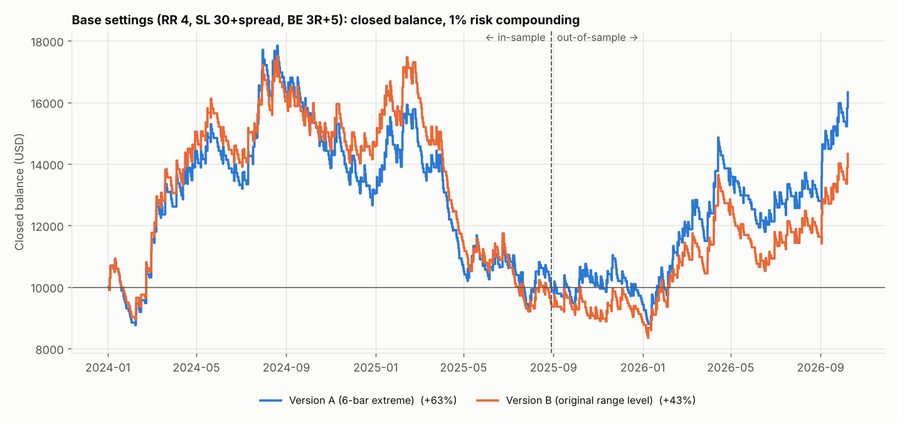
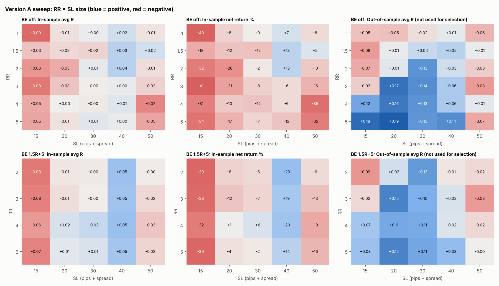
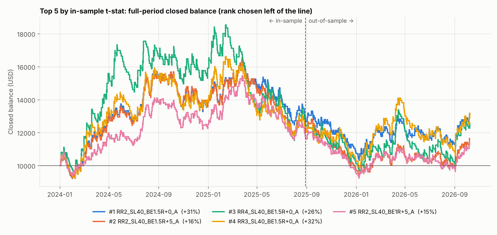

# GBPJPY 05:00–06:00 IST range breakout — backtest report

*Data:* Dukascopy GBPJPY 1-minute BID + ASK candles; USDJPY 1-minute BID for pip value.  
*Period:* 2024-01-02 → 2026-10-07 (IST trading days), 707 tradable days.  
*In-sample:* 2024-01-02 → 2025-08-28 (424 days).  *Out-of-sample:* 2025-08-29 → 2026-10-07 (283 days).  
*Costs:* real bid/ask from the data (median entry spread 2.1 pips, 90th pct 2.7), commission $0/lot, no swap, lots rounded down to 0.01. Start $10,000, 1% risk of closed balance per trade.

## Data quality

| | Count |
|---|---|
| Mon–Fri IST dates in period | 723 |
| Skipped — no data (market closed/holiday) | 3 |
| Skipped — incomplete range window (minutes without ticks) | 13 |
| Days traded | 707 |

Skipped dates: 2024-01-01 (no data), 2024-05-08 (1 empty minutes in range), 2024-05-23 (1 empty minutes in range), 2024-05-28 (3 empty minutes in range), 2024-06-11 (1 empty minutes in range), 2024-06-12 (1 empty minutes in range), 2024-10-10 (41 empty minutes in range), 2024-12-12 (7 empty minutes in range), 2024-12-25 (9 empty minutes in range), 2025-01-01 (no data), 2025-09-12 (1 empty minutes in range), 2025-12-25 (4 empty minutes in range), 2026-01-01 (no data), 2026-04-23 (1 empty minutes in range), 2026-05-20 (1 empty minutes in range), 2026-06-24 (1 empty minutes in range)

## 1. Base settings: Version A vs Version B

RR 4, SL 30 pips + spread, BE at 3R → entry + 5 pips. Full period:

| Metric | Version A (6-bar extreme) | Version B (range level) |
|---|---|---|
| Trades | 847 | 770 |
| Win rate % | 26.2 | 25.8 |
| Avg R | +0.079 | +0.068 |
| Profit factor | 1.11 | 1.09 |
| Expectancy (R/trade) | +0.079 | +0.068 |
| Expectancy (% equity/trade) | +0.077 | +0.066 |
| t-stat of mean R (SQN) | +1.16 | +0.95 |
| Max drawdown % | 51.2 | 52.4 |
| Longest losing streak | 22 | 20 |
| Net return % | +63.3 | +43.3 |
| CAGR % | +19.4 | +13.9 |

In-sample / out-of-sample split of the same runs:

| Metric | A in-sample | A out-of-sample | B in-sample | B out-of-sample |
|---|---|---|---|---|
| Trades | 514 | 333 | 468 | 302 |
| Win rate % | 25.1 | 27.9 | 24.6 | 27.8 |
| Avg R | +0.018 | +0.175 | +0.009 | +0.160 |
| Profit factor | 1.02 | 1.24 | 1.01 | 1.22 |
| Expectancy (R/trade) | +0.018 | +0.175 | +0.009 | +0.160 |
| Expectancy (% equity/trade) | +0.016 | +0.172 | +0.006 | +0.157 |
| t-stat of mean R (SQN) | +0.21 | +1.55 | +0.10 | +1.36 |
| Max drawdown % | 47.6 | 21.1 | 47.4 | 23.0 |
| Longest losing streak | 22 | 12 | 20 | 10 |
| Net return % | -1.1 | +65.4 | -5.5 | +51.1 |
| CAGR % | -0.7 | +57.6 | -3.3 | +45.3 |

### Order and re-entry counts

| | Version A | Version B |
|---|---|---|
| Days with a valid range | 707 | 707 |
| 06:00 orders expired unfilled at 11:00 | 2 | 2 |
| 06:00 level already crossed → filled at market | 58 | 58 |
| SL/BE exits before 11:00 (re-entry candidates) | 228 | 228 |
| Re-entry skipped: 6-bar wait reaches 11:00 | 3 | 3 |
| Re-entry skipped: price already beyond level (invalid stop) | 18 | 120 |
| Re-entry orders expired unfilled | 65 | 40 |
| Re-entry orders filled | 142 | 65 |
| SL/BE exits at/after 11:00 (no re-entry) | 334 | 334 |

Version A: 180 of 847 trades were held overnight (swap not modelled); 1 still open at data end (marked to market); 60 entries filled at a gapped open.

Version B: 162 of 770 trades were held overnight (swap not modelled); 1 still open at data end (marked to market); 60 entries filled at a gapped open.

### Breakdowns — base Version A

**By range size (pips)**

| Range size (pips) | trades | win_rate_% | avg_R | total_R | profit_factor |
|---|---|---|---|---|---|
| <20 | 263.000 | 29.278 | 0.230 | 60.492 | 1.325 |
| 20-40 | 395.000 | 26.582 | 0.087 | 34.236 | 1.117 |
| 40-60 | 138.000 | 22.464 | -0.072 | -9.911 | 0.907 |
| 60+ | 51.000 | 17.647 | -0.344 | -17.541 | 0.582 |

**By side**

| Side | trades | win_rate_% | avg_R | total_R | profit_factor |
|---|---|---|---|---|---|
| BUY | 448.000 | 27.455 | 0.162 | 72.401 | 1.221 |
| SELL | 399.000 | 24.812 | -0.013 | -5.125 | 0.983 |

**By trade number**

| Trade number | trades | win_rate_% | avg_R | total_R | profit_factor |
|---|---|---|---|---|---|
| 1 | 705.000 | 26.099 | 0.077 | 54.200 | 1.104 |
| 2 | 142.000 | 26.761 | 0.092 | 13.076 | 1.125 |

**By day of week**

| Day of week | trades | win_rate_% | avg_R | total_R | profit_factor |
|---|---|---|---|---|---|
| Monday | 171.000 | 31.579 | 0.332 | 56.718 | 1.485 |
| Tuesday | 169.000 | 25.444 | 0.090 | 15.143 | 1.120 |
| Wednesday | 171.000 | 26.316 | 0.019 | 3.252 | 1.026 |
| Thursday | 165.000 | 25.455 | 0.016 | 2.675 | 1.022 |
| Friday | 171.000 | 22.222 | -0.061 | -10.512 | 0.922 |

**By month**

| Month | trades | win_rate_% | avg_R | total_R | profit_factor |
|---|---|---|---|---|---|
| 2024-01 | 26.000 | 15.385 | -0.383 | -9.953 | 0.550 |
| 2024-02 | 21.000 | 52.381 | 1.253 | 26.312 | 3.631 |
| 2024-03 | 25.000 | 40.000 | 0.385 | 9.626 | 1.642 |
| 2024-04 | 24.000 | 41.667 | 0.603 | 14.467 | 2.033 |
| 2024-05 | 21.000 | 23.810 | 0.007 | 0.154 | 1.010 |
| 2024-06 | 19.000 | 15.789 | -0.413 | -7.842 | 0.510 |
| 2024-07 | 26.000 | 50.000 | 1.056 | 27.465 | 3.113 |
| 2024-08 | 28.000 | 21.429 | -0.203 | -5.690 | 0.741 |
| 2024-09 | 25.000 | 20.000 | -0.154 | -3.846 | 0.808 |
| 2024-10 | 33.000 | 15.152 | -0.359 | -11.845 | 0.577 |
| 2024-11 | 24.000 | 29.167 | 0.138 | 3.308 | 1.195 |
| 2024-12 | 26.000 | 19.231 | -0.334 | -8.688 | 0.586 |
| 2025-01 | 29.000 | 27.586 | 0.379 | 11.000 | 1.524 |
| 2025-02 | 25.000 | 24.000 | 0.046 | 1.152 | 1.061 |
| 2025-03 | 27.000 | 25.926 | -0.131 | -3.529 | 0.824 |
| 2025-04 | 29.000 | 3.448 | -0.963 | -27.941 | 0.005 |
| 2025-05 | 30.000 | 20.000 | 0.000 | 0.000 | 1.000 |
| 2025-06 | 25.000 | 28.000 | 0.246 | 6.158 | 1.342 |
| 2025-07 | 28.000 | 14.286 | -0.512 | -14.340 | 0.459 |
| 2025-08 | 24.000 | 25.000 | 0.090 | 2.159 | 1.120 |
| 2025-09 | 24.000 | 29.167 | 0.126 | 3.013 | 1.174 |
| 2025-10 | 33.000 | 27.273 | 0.015 | 0.479 | 1.020 |
| 2025-11 | 23.000 | 21.739 | 0.087 | 2.000 | 1.111 |
| 2025-12 | 26.000 | 23.077 | -0.291 | -7.572 | 0.622 |
| 2026-01 | 29.000 | 24.138 | 0.207 | 6.000 | 1.273 |
| 2026-02 | 26.000 | 38.462 | 0.775 | 20.156 | 2.260 |
| 2026-03 | 28.000 | 25.000 | 0.113 | 3.155 | 1.150 |
| 2026-04 | 23.000 | 30.435 | 0.522 | 12.000 | 1.750 |
| 2026-05 | 24.000 | 25.000 | -0.375 | -8.997 | 0.490 |
| 2026-06 | 22.000 | 27.273 | 0.185 | 4.064 | 1.252 |
| 2026-07 | 24.000 | 20.833 | -0.118 | -2.841 | 0.850 |
| 2026-08 | 21.000 | 33.333 | 0.484 | 10.158 | 1.726 |
| 2026-09 | 24.000 | 37.500 | 0.555 | 13.315 | 1.888 |
| 2026-10 | 5.000 | 40.000 | 0.844 | 4.219 | 2.406 |

**By exit reason**

| Exit reason | trades | win_rate_% | avg_R | total_R | profit_factor |
|---|---|---|---|---|---|
| BE | 52.000 | 96.154 | 0.113 | 5.892 | 4.066 |
| OPEN_AT_END | 1.000 | 100.000 | 3.219 | 3.219 | inf |
| SL | 623.000 | 0.000 | -1.005 | -625.835 | 0.000 |
| TP | 171.000 | 100.000 | 4.000 | 684.000 | inf |

### Breakdowns — base Version B

**By range size (pips)**

| Range size (pips) | trades | win_rate_% | avg_R | total_R | profit_factor |
|---|---|---|---|---|---|
| <20 | 234.000 | 29.487 | 0.213 | 49.788 | 1.302 |
| 20-40 | 347.000 | 25.937 | 0.087 | 30.334 | 1.117 |
| 40-60 | 138.000 | 22.464 | -0.072 | -9.911 | 0.907 |
| 60+ | 51.000 | 17.647 | -0.344 | -17.541 | 0.582 |

**By side**

| Side | trades | win_rate_% | avg_R | total_R | profit_factor |
|---|---|---|---|---|---|
| BUY | 423.000 | 27.423 | 0.166 | 70.127 | 1.227 |
| SELL | 347.000 | 23.919 | -0.050 | -17.456 | 0.934 |

**By trade number**

| Trade number | trades | win_rate_% | avg_R | total_R | profit_factor |
|---|---|---|---|---|---|
| 1 | 705.000 | 26.099 | 0.077 | 54.200 | 1.104 |
| 2 | 65.000 | 23.077 | -0.024 | -1.529 | 0.969 |

**By day of week**

| Day of week | trades | win_rate_% | avg_R | total_R | profit_factor |
|---|---|---|---|---|---|
| Monday | 156.000 | 29.487 | 0.253 | 39.402 | 1.358 |
| Tuesday | 154.000 | 24.675 | 0.058 | 8.989 | 1.077 |
| Wednesday | 157.000 | 25.478 | -0.025 | -3.908 | 0.967 |
| Thursday | 151.000 | 26.490 | 0.044 | 6.714 | 1.060 |
| Friday | 152.000 | 23.026 | 0.010 | 1.474 | 1.012 |

**By month**

| Month | trades | win_rate_% | avg_R | total_R | profit_factor |
|---|---|---|---|---|---|
| 2024-01 | 24.000 | 16.667 | -0.331 | -7.953 | 0.605 |
| 2024-02 | 21.000 | 52.381 | 1.253 | 26.312 | 3.631 |
| 2024-03 | 21.000 | 38.095 | 0.539 | 11.311 | 1.870 |
| 2024-04 | 22.000 | 40.909 | 0.696 | 15.312 | 2.178 |
| 2024-05 | 20.000 | 25.000 | 0.058 | 1.154 | 1.077 |
| 2024-06 | 19.000 | 15.789 | -0.413 | -7.842 | 0.510 |
| 2024-07 | 23.000 | 43.478 | 0.840 | 19.310 | 2.485 |
| 2024-08 | 27.000 | 22.222 | -0.174 | -4.690 | 0.777 |
| 2024-09 | 24.000 | 20.833 | -0.119 | -2.846 | 0.850 |
| 2024-10 | 28.000 | 17.857 | -0.245 | -6.848 | 0.702 |
| 2024-11 | 23.000 | 30.435 | 0.187 | 4.308 | 1.269 |
| 2024-12 | 20.000 | 25.000 | -0.134 | -2.688 | 0.821 |
| 2025-01 | 27.000 | 25.926 | 0.296 | 8.000 | 1.400 |
| 2025-02 | 23.000 | 26.087 | 0.137 | 3.152 | 1.185 |
| 2025-03 | 26.000 | 19.231 | -0.334 | -8.683 | 0.587 |
| 2025-04 | 27.000 | 3.704 | -0.961 | -25.941 | 0.006 |
| 2025-05 | 25.000 | 16.000 | -0.200 | -5.000 | 0.762 |
| 2025-06 | 24.000 | 25.000 | 0.090 | 2.158 | 1.120 |
| 2025-07 | 23.000 | 13.043 | -0.623 | -14.340 | 0.363 |
| 2025-08 | 22.000 | 22.727 | -0.038 | -0.841 | 0.951 |
| 2025-09 | 21.000 | 28.571 | 0.062 | 1.309 | 1.087 |
| 2025-10 | 27.000 | 22.222 | -0.173 | -4.681 | 0.777 |
| 2025-11 | 22.000 | 27.273 | 0.364 | 8.000 | 1.500 |
| 2025-12 | 22.000 | 22.727 | -0.388 | -8.530 | 0.498 |
| 2026-01 | 27.000 | 25.926 | 0.296 | 8.000 | 1.400 |
| 2026-02 | 23.000 | 39.130 | 0.789 | 18.156 | 2.297 |
| 2026-03 | 22.000 | 22.727 | -0.038 | -0.845 | 0.950 |
| 2026-04 | 21.000 | 33.333 | 0.667 | 14.000 | 2.000 |
| 2026-05 | 22.000 | 22.727 | -0.545 | -11.997 | 0.278 |
| 2026-06 | 22.000 | 27.273 | 0.185 | 4.064 | 1.252 |
| 2026-07 | 23.000 | 21.739 | -0.080 | -1.841 | 0.898 |
| 2026-08 | 21.000 | 33.333 | 0.484 | 10.158 | 1.726 |
| 2026-09 | 23.000 | 34.783 | 0.405 | 9.316 | 1.621 |
| 2026-10 | 5.000 | 40.000 | 0.844 | 4.219 | 2.406 |

**By exit reason**

| Exit reason | trades | win_rate_% | avg_R | total_R | profit_factor |
|---|---|---|---|---|---|
| BE | 45.000 | 97.778 | 0.139 | 6.245 | 10.979 |
| OPEN_AT_END | 1.000 | 100.000 | 3.219 | 3.219 | inf |
| SL | 570.000 | 0.000 | -1.005 | -572.793 | 0.000 |
| TP | 154.000 | 100.000 | 4.000 | 616.000 | inf |

## 2. Parameter sweep (Version A)

**170 combinations tested** (6 RR × 5 SL × 9 BE settings, minus combos with BE trigger ≥ RR). Ranked by **in-sample t-stat of mean R** (SQN) only. With 170 tries, pure luck alone would be expected to produce a best t-stat of roughly **3.2** if every combo had zero edge (fewer effective tries because combos are correlated, so call it 2.5–3.2). A top combo below that is indistinguishable from the luckiest of many coin-flippers.

Full table: `results/sweep_version_A.csv` (every combo × IS / OOS / full-period metrics).

| Top 25 by in-sample t-stat | is_trades | is_win_rate | is_avg_R | is_profit_factor | is_max_dd_pct | is_net_return_pct | is_sqn | oos_trades | oos_avg_R | oos_profit_factor | oos_net_return_pct |
|---|---|---|---|---|---|---|---|---|---|---|---|
| RR2_SL40_BE1.5R+0_A | 488.00 | 32.58 | 0.06 | 1.11 | 24.63 | 27.98 | 0.99 | 314.00 | 0.02 | 1.03 | 2.71 |
| RR2_SL40_BE1.5R+5_A | 488.00 | 41.19 | 0.05 | 1.09 | 28.15 | 22.61 | 0.85 | 315.00 | -0.01 | 0.99 | -5.26 |
| RR4_SL40_BE1.5R+0_A | 488.00 | 16.39 | 0.06 | 1.11 | 37.84 | 25.33 | 0.79 | 314.00 | 0.02 | 1.03 | 0.21 |
| RR3_SL40_BE1.5R+0_A | 488.00 | 21.52 | 0.06 | 1.09 | 29.40 | 21.45 | 0.77 | 314.00 | 0.04 | 1.07 | 7.86 |
| RR2_SL40_BE1R+5_A | 489.00 | 50.92 | 0.04 | 1.08 | 25.15 | 17.33 | 0.74 | 316.00 | 0.00 | 1.00 | -2.26 |
| RR3_SL40_BE1.5R+5_A | 488.00 | 41.19 | 0.05 | 1.08 | 29.48 | 18.80 | 0.70 | 315.00 | 0.02 | 1.04 | 3.22 |
| RR4_SL40_BE1.5R+5_A | 488.00 | 40.98 | 0.05 | 1.09 | 39.32 | 19.89 | 0.68 | 315.00 | 0.02 | 1.03 | 1.26 |
| RR2_SL40_BE1R+0_A | 489.00 | 26.58 | 0.04 | 1.08 | 24.53 | 15.76 | 0.67 | 315.00 | 0.02 | 1.05 | 4.94 |
| RR4_SL30_BE1R+5_A | 516.00 | 49.61 | 0.05 | 1.09 | 34.15 | 19.04 | 0.67 | 334.00 | 0.13 | 1.26 | 48.07 |
| RR3_SL40_BE1R+5_A | 489.00 | 50.92 | 0.04 | 1.08 | 26.43 | 14.86 | 0.62 | 316.00 | 0.03 | 1.06 | 6.24 |
| RR5_SL40_BE1.5R+0_A | 488.00 | 12.91 | 0.05 | 1.09 | 32.87 | 16.47 | 0.61 | 314.00 | 0.07 | 1.12 | 15.75 |
| RR1.5_SL40_BEoff_A | 487.00 | 41.48 | 0.03 | 1.06 | 27.03 | 12.84 | 0.60 | 314.00 | 0.05 | 1.09 | 14.10 |
| RR5_SL40_BE1.5R+5_A | 488.00 | 40.98 | 0.05 | 1.08 | 31.27 | 13.53 | 0.55 | 315.00 | 0.08 | 1.14 | 21.76 |
| RR2_SL40_BEoff_A | 488.00 | 34.63 | 0.04 | 1.05 | 30.12 | 12.60 | 0.55 | 314.00 | 0.03 | 1.04 | 5.93 |
| RR5_SL30_BE2R+0_A | 514.00 | 14.40 | 0.05 | 1.07 | 43.68 | 14.80 | 0.54 | 333.00 | 0.14 | 1.23 | 48.98 |
| RR1.5_SL40_BE1R+5_A | 488.00 | 51.02 | 0.03 | 1.05 | 24.31 | 9.54 | 0.51 | 315.00 | 0.05 | 1.10 | 14.88 |
| RR4_SL40_BE1R+5_A | 489.00 | 50.72 | 0.03 | 1.07 | 32.78 | 11.48 | 0.49 | 316.00 | 0.02 | 1.04 | 3.08 |
| RR4_SL30_BE2R+0_A | 514.00 | 17.70 | 0.04 | 1.06 | 39.05 | 10.69 | 0.47 | 333.00 | 0.16 | 1.25 | 57.80 |
| RR5_SL30_BE1R+5_A | 516.00 | 49.42 | 0.03 | 1.07 | 38.27 | 11.07 | 0.46 | 334.00 | 0.14 | 1.26 | 48.03 |
| RR5_SL40_BE1R+5_A | 489.00 | 50.72 | 0.04 | 1.07 | 27.51 | 9.90 | 0.46 | 316.00 | 0.06 | 1.12 | 14.37 |
| RR3_SL40_BE1R+0_A | 489.00 | 17.38 | 0.03 | 1.06 | 26.12 | 8.43 | 0.42 | 315.00 | 0.05 | 1.10 | 13.79 |
| RR4_SL30_BE2R+5_A | 514.00 | 33.46 | 0.03 | 1.05 | 41.63 | 8.10 | 0.42 | 334.00 | 0.14 | 1.22 | 46.22 |
| RR1_SL40_BEoff_A | 485.00 | 51.13 | 0.02 | 1.04 | 20.49 | 7.02 | 0.42 | 313.00 | 0.01 | 1.02 | 1.29 |
| RR1.5_SL50_BE1R+5_A | 472.00 | 49.15 | 0.02 | 1.04 | 26.87 | 7.28 | 0.41 | 300.00 | -0.05 | 0.91 | -15.45 |
| RR1.5_SL50_BE1R+0_A | 472.00 | 35.17 | 0.02 | 1.04 | 25.77 | 6.26 | 0.37 | 299.00 | -0.04 | 0.93 | -12.93 |

### Summary

Median across all combos sharing each value (in-sample for decisions; OOS shown only for context):

| RR | is_avg_R | is_net_return_pct | oos_avg_R |
|---|---|---|---|
| 1.0 | -0.007 | -5.623 | -0.045 |
| 1.5 | 0.001 | -2.633 | 0.006 |
| 2.0 | -0.004 | -6.171 | -0.008 |
| 3.0 | -0.011 | -11.540 | 0.044 |
| 4.0 | -0.015 | -14.274 | 0.064 |
| 5.0 | -0.011 | -15.649 | 0.087 |

| SL pips | is_avg_R | is_net_return_pct | oos_avg_R |
|---|---|---|---|
| 15 | -0.075 | -37.868 | 0.008 |
| 20 | -0.019 | -15.846 | 0.115 |
| 30 | 0.011 | -1.233 | 0.130 |
| 40 | 0.027 | 7.723 | 0.039 |
| 50 | -0.016 | -14.467 | -0.041 |

**BE vs no BE** — each BE setting compared with BE off on the identical RR × SL cells:

| BE setting | cells | is_avg_R_diff | is_return_diff | is_better_share | oos_avg_R_diff |
|---|---|---|---|---|---|
| 1.5R+5 | 20.000 | 0.015 | 9.422 | 75.000 | -0.024 |
| 1.5R+0 | 20.000 | 0.015 | 9.194 | 75.000 | -0.018 |
| 2R+0 | 15.000 | 0.007 | 4.878 | 60.000 | -0.031 |
| 1R+5 | 25.000 | 0.004 | 5.868 | 64.000 | -0.047 |
| 2R+5 | 15.000 | 0.004 | 3.413 | 66.667 | -0.042 |
| 3R+0 | 10.000 | -0.008 | -1.828 | 50.000 | -0.026 |
| 1R+0 | 25.000 | -0.008 | 0.296 | 56.000 | -0.039 |
| 3R+5 | 10.000 | -0.013 | -3.646 | 40.000 | -0.039 |

Heatmap rows: BE off, and the best BE setting by paired in-sample improvement (**1.5R+5**).

## 3. Top 5 (picked in-sample) tested out-of-sample

| # | Combo | Flags |
|---|---|---|
| 1 | `RR2_SL40_BE1.5R+0_A` | NOISE? (weak neighbours); DEGRADED OOS (<50% of IS avg R) |
| 2 | `RR2_SL40_BE1.5R+5_A` | NOISE? (weak neighbours); OVERFIT (fails OOS) |
| 3 | `RR4_SL40_BE1.5R+0_A` | DEGRADED OOS (<50% of IS avg R) |
| 4 | `RR3_SL40_BE1.5R+0_A` | — |
| 5 | `RR2_SL40_BE1R+5_A` | DEGRADED OOS (<50% of IS avg R) |

| Metric | #1 IS | #1 OOS | #2 IS | #2 OOS | #3 IS | #3 OOS | #4 IS | #4 OOS | #5 IS | #5 OOS |
|---|---|---|---|---|---|---|---|---|---|---|
| Trades | 488 | 314 | 488 | 315 | 488 | 314 | 488 | 314 | 489 | 316 |
| Win rate % | 32.6 | 30.3 | 41.2 | 40.6 | 16.4 | 15.3 | 21.5 | 21.0 | 50.9 | 49.1 |
| Avg R | +0.062 | +0.018 | +0.053 | -0.008 | +0.064 | +0.017 | +0.056 | +0.039 | +0.041 | +0.001 |
| Profit factor | 1.11 | 1.03 | 1.09 | 0.99 | 1.11 | 1.03 | 1.09 | 1.07 | 1.08 | 1.00 |
| Expectancy (R/trade) | +0.062 | +0.018 | +0.053 | -0.008 | +0.064 | +0.017 | +0.056 | +0.039 | +0.041 | +0.001 |
| Expectancy (% equity/trade) | +0.060 | +0.017 | +0.051 | -0.009 | +0.062 | +0.015 | +0.052 | +0.036 | +0.040 | -0.000 |
| t-stat of mean R (SQN) | +0.99 | +0.24 | +0.85 | -0.11 | +0.79 | +0.17 | +0.77 | +0.44 | +0.74 | +0.01 |
| Max drawdown % | 24.6 | 22.4 | 28.1 | 27.3 | 37.8 | 25.5 | 29.4 | 24.9 | 25.2 | 23.6 |
| Longest losing streak | 11 | 10 | 11 | 10 | 9 | 9 | 10 | 9 | 8 | 6 |
| Net return % | +28.0 | +2.7 | +22.6 | -5.3 | +25.3 | +0.2 | +21.4 | +7.9 | +17.3 | -2.3 |
| CAGR % | +16.1 | +2.4 | +13.1 | -4.8 | +14.6 | +0.2 | +12.5 | +7.1 | +10.1 | -2.0 |

Full-period stats of the top 5:

| Metric | #1 | #2 | #3 | #4 | #5 |
|---|---|---|---|---|---|
| Trades | 802 | 803 | 802 | 802 | 805 |
| Win rate % | 31.7 | 41.0 | 16.0 | 21.3 | 50.2 |
| Avg R | +0.045 | +0.029 | +0.046 | +0.049 | +0.025 |
| Profit factor | 1.08 | 1.05 | 1.08 | 1.08 | 1.05 |
| Expectancy (R/trade) | +0.045 | +0.029 | +0.046 | +0.049 | +0.025 |
| Expectancy (% equity/trade) | +0.043 | +0.028 | +0.044 | +0.046 | +0.024 |
| t-stat of mean R (SQN) | +0.93 | +0.61 | +0.73 | +0.88 | +0.59 |
| Max drawdown % | 37.7 | 43.6 | 48.1 | 40.6 | 40.2 |
| Longest losing streak | 11 | 11 | 9 | 10 | 8 |
| Net return % | +31.5 | +16.4 | +25.7 | +31.8 | +14.7 |
| CAGR % | +10.4 | +5.7 | +8.6 | +10.5 | +5.1 |

### Plateau check (in-sample, same BE setting, adjacent RR and SL)

| Top combo | neighbour | is_avg_R | is_sqn | is_trades |
|---|---|---|---|---|
| RR2_SL40_BE1.5R+0_A | RR3_SL40_BE1.5R+0_A | 0.056 | 0.770 | 488.000 |
| RR2_SL40_BE1.5R+0_A | RR2_SL50_BE1.5R+0_A | -0.002 | -0.030 | 471.000 |
| RR2_SL40_BE1.5R+0_A | RR2_SL30_BE1.5R+0_A | -0.008 | -0.133 | 513.000 |
| RR2_SL40_BE1.5R+0_A | → share of neighbours with IS avg R > 0 | 0.333 | -0.030 |  |
| RR2_SL40_BE1.5R+5_A | RR3_SL40_BE1.5R+5_A | 0.050 | 0.699 | 488.000 |
| RR2_SL40_BE1.5R+5_A | RR2_SL50_BE1.5R+5_A | -0.003 | -0.048 | 471.000 |
| RR2_SL40_BE1.5R+5_A | RR2_SL30_BE1.5R+5_A | -0.004 | -0.062 | 513.000 |
| RR2_SL40_BE1.5R+5_A | → share of neighbours with IS avg R > 0 | 0.333 | -0.048 |  |
| RR4_SL40_BE1.5R+0_A | RR3_SL40_BE1.5R+0_A | 0.056 | 0.770 | 488.000 |
| RR4_SL40_BE1.5R+0_A | RR5_SL40_BE1.5R+0_A | 0.054 | 0.610 | 488.000 |
| RR4_SL40_BE1.5R+0_A | RR4_SL30_BE1.5R+0_A | 0.027 | 0.339 | 514.000 |
| RR4_SL40_BE1.5R+0_A | RR4_SL50_BE1.5R+0_A | -0.029 | -0.364 | 471.000 |
| RR4_SL40_BE1.5R+0_A | → share of neighbours with IS avg R > 0 | 0.750 | 0.474 |  |
| RR3_SL40_BE1.5R+0_A | RR2_SL40_BE1.5R+0_A | 0.062 | 0.993 | 488.000 |
| RR3_SL40_BE1.5R+0_A | RR4_SL40_BE1.5R+0_A | 0.064 | 0.791 | 488.000 |
| RR3_SL40_BE1.5R+0_A | RR3_SL30_BE1.5R+0_A | 0.002 | 0.025 | 514.000 |
| RR3_SL40_BE1.5R+0_A | RR3_SL50_BE1.5R+0_A | -0.005 | -0.073 | 471.000 |
| RR3_SL40_BE1.5R+0_A | → share of neighbours with IS avg R > 0 | 0.750 | 0.408 |  |
| RR2_SL40_BE1R+5_A | RR3_SL40_BE1R+5_A | 0.039 | 0.617 | 489.000 |
| RR2_SL40_BE1R+5_A | RR1.5_SL40_BE1R+5_A | 0.026 | 0.507 | 488.000 |
| RR2_SL40_BE1R+5_A | RR2_SL30_BE1R+5_A | 0.017 | 0.309 | 515.000 |
| RR2_SL40_BE1R+5_A | RR2_SL50_BE1R+5_A | 0.007 | 0.132 | 472.000 |
| RR2_SL40_BE1R+5_A | → share of neighbours with IS avg R > 0 | 1.000 | 0.408 |  |

### Breakdowns — #1 `RR2_SL40_BE1.5R+0_A` (full period)

**By range size (pips)**

| Range size (pips) | trades | win_rate_% | avg_R | total_R | profit_factor |
|---|---|---|---|---|---|
| <20 | 253.000 | 35.178 | 0.106 | 26.885 | 1.178 |
| 20-40 | 363.000 | 29.752 | 0.020 | 7.097 | 1.034 |
| 40-60 | 136.000 | 30.147 | -0.008 | -1.029 | 0.988 |
| 60+ | 50.000 | 32.000 | 0.060 | 3.000 | 1.103 |

**By side**

| Side | trades | win_rate_% | avg_R | total_R | profit_factor |
|---|---|---|---|---|---|
| BUY | 430.000 | 33.256 | 0.091 | 39.117 | 1.158 |
| SELL | 372.000 | 29.839 | -0.009 | -3.164 | 0.986 |

**By trade number**

| Trade number | trades | win_rate_% | avg_R | total_R | profit_factor |
|---|---|---|---|---|---|
| 1 | 705.000 | 30.638 | 0.018 | 12.734 | 1.030 |
| 2 | 97.000 | 39.175 | 0.239 | 23.218 | 1.440 |

**By day of week**

| Day of week | trades | win_rate_% | avg_R | total_R | profit_factor |
|---|---|---|---|---|---|
| Monday | 160.000 | 39.375 | 0.249 | 39.896 | 1.463 |
| Tuesday | 162.000 | 26.543 | -0.056 | -9.012 | 0.905 |
| Wednesday | 161.000 | 34.161 | 0.104 | 16.678 | 1.179 |
| Thursday | 159.000 | 29.560 | 0.006 | 0.930 | 1.010 |
| Friday | 160.000 | 28.750 | -0.078 | -12.540 | 0.880 |

**By month**

| Month | trades | win_rate_% | avg_R | total_R | profit_factor |
|---|---|---|---|---|---|
| 2024-01 | 26.000 | 19.231 | -0.308 | -8.000 | 0.556 |
| 2024-02 | 21.000 | 57.143 | 0.762 | 16.000 | 3.000 |
| 2024-03 | 23.000 | 43.478 | 0.348 | 8.000 | 1.667 |
| 2024-04 | 23.000 | 52.174 | 0.609 | 14.000 | 2.400 |
| 2024-05 | 21.000 | 38.095 | 0.143 | 3.000 | 1.231 |
| 2024-06 | 17.000 | 17.647 | -0.412 | -7.000 | 0.462 |
| 2024-07 | 26.000 | 53.846 | 0.692 | 18.000 | 2.800 |
| 2024-08 | 27.000 | 33.333 | 0.074 | 2.000 | 1.125 |
| 2024-09 | 24.000 | 29.167 | 0.083 | 2.000 | 1.167 |
| 2024-10 | 31.000 | 16.129 | -0.388 | -12.017 | 0.454 |
| 2024-11 | 24.000 | 37.500 | 0.208 | 5.000 | 1.385 |
| 2024-12 | 24.000 | 25.000 | -0.167 | -4.000 | 0.750 |
| 2025-01 | 27.000 | 33.333 | 0.074 | 2.000 | 1.125 |
| 2025-02 | 25.000 | 40.000 | 0.320 | 8.000 | 1.667 |
| 2025-03 | 25.000 | 36.000 | 0.120 | 3.000 | 1.200 |
| 2025-04 | 26.000 | 23.077 | -0.231 | -6.000 | 0.667 |
| 2025-05 | 28.000 | 32.143 | -0.036 | -1.000 | 0.947 |
| 2025-06 | 22.000 | 27.273 | -0.136 | -3.000 | 0.800 |
| 2025-07 | 24.000 | 12.500 | -0.487 | -11.685 | 0.339 |
| 2025-08 | 25.000 | 28.000 | 0.038 | 0.962 | 1.074 |
| 2025-09 | 23.000 | 26.087 | 0.010 | 0.240 | 1.020 |
| 2025-10 | 29.000 | 24.138 | -0.174 | -5.044 | 0.735 |
| 2025-11 | 20.000 | 25.000 | -0.155 | -3.104 | 0.763 |
| 2025-12 | 24.000 | 16.667 | -0.340 | -8.149 | 0.495 |
| 2026-01 | 26.000 | 38.462 | 0.192 | 5.000 | 1.333 |
| 2026-02 | 25.000 | 36.000 | 0.280 | 7.000 | 1.636 |
| 2026-03 | 25.000 | 28.000 | -0.040 | -1.000 | 0.933 |
| 2026-04 | 22.000 | 36.364 | 0.136 | 3.000 | 1.231 |
| 2026-05 | 23.000 | 30.435 | 0.000 | 0.000 | 1.000 |
| 2026-06 | 22.000 | 27.273 | -0.099 | -2.169 | 0.847 |
| 2026-07 | 24.000 | 25.000 | -0.170 | -4.083 | 0.746 |
| 2026-08 | 21.000 | 33.333 | 0.048 | 1.000 | 1.077 |
| 2026-09 | 24.000 | 45.833 | 0.500 | 12.000 | 2.200 |
| 2026-10 | 5.000 | 40.000 | 0.400 | 2.000 | 2.000 |

**By exit reason**

| Exit reason | trades | win_rate_% | avg_R | total_R | profit_factor |
|---|---|---|---|---|---|
| BE | 80.000 | 0.000 | -0.028 | -2.216 | 0.000 |
| SL | 468.000 | 0.000 | -1.004 | -469.832 | 0.000 |
| TP | 254.000 | 100.000 | 2.000 | 508.000 | inf |

## 4. Verdict

**Short answer: no edge has been shown yet.** It isn't clearly losing either. Measured honestly, the result can't be told apart from zero.

**Is there an edge?**
- Base Version A made +0.079R per trade over 847 trades (+63%). The t-stat is 1.16, which would happen about 1 time in 4 with no edge at all. Almost all of that profit came after the in-sample period. In-sample the same rules made **+0.018R** (−1% net, with a 48% drawdown).
- The sweep tested **170 combos**. Luck alone would be expected to produce a best in-sample t-stat of about 2.5–3.2. The actual best was **0.99**. No parameter set stands out from noise.
- The in-sample top 5 are all SL 40 with BE at 1R–1.5R. Out-of-sample they fell to between −0.01R and +0.04R per trade. Three are flagged degraded, one overfit, and two sit on weak neighbours. The "best SL" also reversed between the halves: 40 pips won in-sample, 20–30 pips won out-of-sample. Noise behaves like that.
- **Version A vs B:** A is slightly better (+0.079R vs +0.068R; +63% vs +43%). The whole difference is in re-entries. A filled 142 second trades and B filled only 65, because B's stop was already crossed 120 times. A's second trades averaged +0.09R and B's −0.02R. That direction makes sense, but at n=142 it isn't statistically meaningful.
- **Break-even:** BE at 1.5R helped in-sample on 75% of RR×SL cells, by about +0.015R. Out-of-sample it hurt on average. BE mostly changes the shape of returns (win rate up, average win down), not the edge.
- **RR / SL:** no RR is reliably better. **SL 15 is consistently bad**: the 2.1-pip spread is about 12% of a 17-pip risk, and noise stops you out. SL 30–40 is the least bad range.

**Weakest point:** the edge is tiny compared with the risks around it.
1. The base case had a **51% max drawdown and a 22-loss streak at 1% risk**. One month, April 2025 (the tariff shock), lost **−28R**, with 1 win out of 29.
2. At about 0.05–0.08R per trade, **one extra pip of slippage per side (~0.06R) wipes it out**. Commission at a typical $7 per lot round turn costs about 0.03R more.
3. **Buys carry the result** (+0.16R vs −0.01R for sells). GBPJPY rose about 16% over the test (179.5 → 208.9). Long swap on GBPJPY is positive and short swap negative, and about 21% of trades are held overnight with **swap not modelled**. Part of the "edge" may just be being long a rising pair.
4. This is under three years of data, in one regime.

**What to test next, in order:**
1. **Older data as a true out-of-sample test.** Dukascopy has GBPJPY back to 2003. Run these exact rules, untouched, on 2010–2023 (`--end`; extend `START`). That is the cleanest check available, because nothing was fitted on that period.
2. **Costs:** rerun with `--commission 7` and 0.5–1 pip of extra slippage on stop fills, and add the swap. If the base case goes negative, stop here.
3. **A range-size filter** (skip days with a range above 30 or 40 pips). It is the only pattern positive in **both** halves (ranges under 20 pips: +0.35R in-sample, +0.15R out-of-sample). Fix the threshold first and test it on the older data, not on this sample. Ignore Monday, Friday and large-range patterns: they reverse between halves.
4. **Direction:** compare buy-only with a simple trend filter (for example, trade only with the daily 50-day MA) to separate a breakout edge from GBPJPY drift.
5. **Walk-forward** (fit on 12 months, trade the next 3, roll) instead of a single 60/40 split, if steps 1–3 leave anything worth fitting.

Data notes: 16 of 723 weekdays were skipped. Three were holidays with no data. Thirteen had tick-less minutes in the range window, mostly a single minute, under your strict "any missing minute" rule; `--max-missing 2` would keep most of them. Every fill is conservative where 1-minute bars are ambiguous (SL first, no TP on the entry bar, no positive slippage), so on these mechanics results are more likely understated than overstated.
