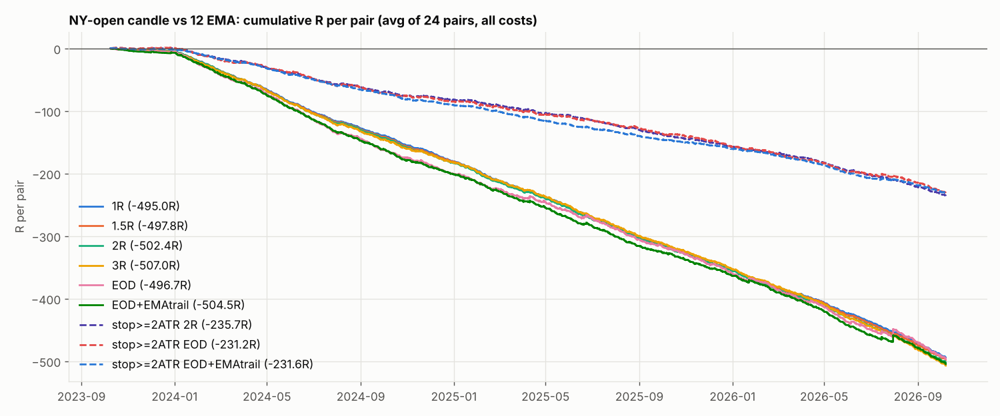

# NY-open candle vs 12 EMA — all stored FX pairs, last 3 years

Rule (from the reel): 5-minute chart, the 09:30–09:34 New York candle. Close above the 12 EMA → buy at the 09:35 open, close below → sell. Stop = far end of that candle (+ spread on shorts). The reel hides its trade management, so several exits are compared, plus the same with the stop floored at 2 × ATR(14) of 5-minute candles. Every open trade is closed at 16:00 New York.

Window: 2023-10-08 → 2026-10-07 for EURUSD, GBPUSD, USDJPY, EURJPY, GBPJPY; 2024-01-01 → 2026-10-07 for the rest (stored data starts there). XAUUSD is left out (stored only to 2015). Costs: $7/lot round turn + 0.2 pip slippage on the entry and on every non-limit exit. 1% risk compounding from $10,000, each pair its own account.

**Verdict: no edge.** 0 of 216 pair × exit runs are positive after costs and 2 before costs (USDJPY EOD, USDJPY stop>=2ATR EOD). The direction alone is right on 48.2% of days before any cost, so better management cannot rescue it, and the raw candle stop (median 2.4–11.1 pips by pair, often < 1 pip from the fill) makes spread and commission a large share of 1R.

## Is the direction right? (no stop, no target, no costs)

Mid price from the 09:35 open to the 16:00 NY open, signed by the signal. Right on 48.2% of days on average; mean move > 0 on 5 of 24 pairs.

| Pair | days | right_pct | mean_pips | t_stat |
|---|---|---|---|---|
| EURUSD | 777.00 | 47.36 | -1.19 | -1.20 |
| GBPUSD | 777.00 | 48.91 | -1.26 | -1.02 |
| USDJPY | 777.00 | 49.55 | -0.07 | -0.04 |
| USDCHF | 718.00 | 46.52 | -0.91 | -1.00 |
| AUDUSD | 718.00 | 50.00 | -0.00 | -0.00 |
| USDCAD | 718.00 | 49.72 | -0.33 | -0.30 |
| NZDUSD | 718.00 | 50.00 | 0.30 | 0.43 |
| EURGBP | 718.00 | 44.99 | -0.55 | -1.15 |
| EURJPY | 777.00 | 49.03 | -1.49 | -1.00 |
| GBPJPY | 777.00 | 50.32 | 0.00 | 0.00 |
| EURCHF | 718.00 | 46.94 | -1.20 | -1.89 |
| EURAUD | 718.00 | 47.21 | -0.43 | -0.26 |
| EURCAD | 718.00 | 50.00 | 0.18 | 0.15 |
| EURNZD | 718.00 | 46.38 | -1.06 | -0.69 |
| GBPCHF | 718.00 | 49.16 | -0.34 | -0.35 |
| GBPAUD | 718.00 | 48.19 | -0.57 | -0.33 |
| GBPCAD | 718.00 | 47.91 | -0.46 | -0.32 |
| GBPNZD | 718.00 | 47.77 | -1.16 | -0.70 |
| AUDNZD | 718.00 | 51.25 | 0.41 | 0.83 |
| AUDCAD | 718.00 | 45.54 | -1.50 | -1.87 |
| AUDCHF | 717.00 | 49.51 | 0.08 | 0.12 |
| NZDCAD | 717.00 | 46.44 | -0.87 | -1.26 |
| NZDCHF | 717.00 | 48.40 | -0.47 | -0.92 |
| CADCHF | 718.00 | 45.54 | -0.93 | -1.56 |

## All pairs pooled (net of costs)

| Exit | trades | win_rate | avg_R | profit_factor | t_stat | pairs_positive | avg_R_2023 | avg_R_2024 | avg_R_2025 | avg_R_2026 |
|---|---|---|---|---|---|---|---|---|---|---|
| 1R | 17522.000 | 31.315 | -0.678 | 0.266 | -86.259 | 0.000 | -0.510 | -0.671 | -0.672 | -0.706 |
| 1.5R | 17522.000 | 25.140 | -0.682 | 0.319 | -76.558 | 0.000 | -0.399 | -0.678 | -0.670 | -0.719 |
| 2R | 17522.000 | 21.025 | -0.688 | 0.346 | -70.231 | 0.000 | -0.358 | -0.687 | -0.667 | -0.738 |
| 3R | 17522.000 | 16.528 | -0.694 | 0.373 | -61.818 | 0.000 | -0.403 | -0.683 | -0.660 | -0.773 |
| EOD | 17522.000 | 11.911 | -0.680 | 0.418 | -33.402 | 0.000 | -0.404 | -0.754 | -0.616 | -0.684 |
| EOD+EMAtrail | 17522.000 | 14.485 | -0.691 | 0.321 | -42.832 | 0.000 | -0.565 | -0.748 | -0.627 | -0.708 |
| stop>=2ATR 2R | 17524.000 | 29.149 | -0.323 | 0.583 | -34.067 | 0.000 | 0.021 | -0.317 | -0.291 | -0.393 |
| stop>=2ATR EOD | 17524.000 | 25.719 | -0.317 | 0.607 | -26.402 | 0.000 | 0.062 | -0.330 | -0.279 | -0.371 |
| stop>=2ATR EOD+EMAtrail | 17524.000 | 20.013 | -0.317 | 0.412 | -43.392 | 0.000 | -0.124 | -0.343 | -0.271 | -0.356 |

## Average R per trade, net (pair × exit)

| Pair | 1R | 1.5R | 2R | 3R | EOD | EOD+EMAtrail | stop>=2ATR 2R | stop>=2ATR EOD | stop>=2ATR EOD+EMAtrail |
|---|---|---|---|---|---|---|---|---|---|
| EURUSD | -0.744 | -0.682 | -0.729 | -0.757 | -0.724 | -0.740 | -0.146 | -0.144 | -0.177 |
| GBPUSD | -0.558 | -0.556 | -0.588 | -0.631 | -0.570 | -0.639 | -0.207 | -0.125 | -0.193 |
| USDJPY | -0.667 | -0.625 | -0.610 | -0.689 | -0.345 | -0.508 | -0.107 | -0.055 | -0.139 |
| USDCHF | -0.667 | -0.661 | -0.662 | -0.659 | -0.721 | -0.702 | -0.249 | -0.247 | -0.278 |
| AUDUSD | -0.618 | -0.614 | -0.643 | -0.618 | -0.586 | -0.645 | -0.330 | -0.249 | -0.300 |
| USDCAD | -0.564 | -0.541 | -0.527 | -0.566 | -0.562 | -0.512 | -0.286 | -0.249 | -0.220 |
| NZDUSD | -0.773 | -0.803 | -0.832 | -0.855 | -0.763 | -0.803 | -0.338 | -0.325 | -0.354 |
| EURGBP | -0.851 | -0.858 | -0.870 | -0.917 | -0.973 | -0.860 | -0.414 | -0.445 | -0.348 |
| EURJPY | -0.560 | -0.559 | -0.629 | -0.609 | -0.630 | -0.636 | -0.203 | -0.180 | -0.154 |
| GBPJPY | -0.467 | -0.490 | -0.465 | -0.454 | -0.368 | -0.421 | -0.139 | -0.076 | -0.121 |
| EURCHF | -0.731 | -0.739 | -0.762 | -0.769 | -0.870 | -0.839 | -0.389 | -0.418 | -0.371 |
| EURAUD | -0.526 | -0.522 | -0.504 | -0.465 | -0.458 | -0.476 | -0.214 | -0.195 | -0.213 |
| EURCAD | -0.621 | -0.617 | -0.611 | -0.596 | -0.683 | -0.656 | -0.218 | -0.229 | -0.272 |
| EURNZD | -0.599 | -0.603 | -0.575 | -0.623 | -0.628 | -0.618 | -0.318 | -0.360 | -0.339 |
| GBPCHF | -0.684 | -0.706 | -0.667 | -0.672 | -0.632 | -0.701 | -0.374 | -0.340 | -0.355 |
| GBPAUD | -0.613 | -0.635 | -0.612 | -0.577 | -0.568 | -0.589 | -0.248 | -0.249 | -0.282 |
| GBPCAD | -0.561 | -0.604 | -0.607 | -0.636 | -0.687 | -0.650 | -0.269 | -0.290 | -0.236 |
| GBPNZD | -0.617 | -0.617 | -0.620 | -0.569 | -0.633 | -0.663 | -0.331 | -0.388 | -0.381 |
| AUDNZD | -0.992 | -1.003 | -1.019 | -0.996 | -0.995 | -0.995 | -0.613 | -0.614 | -0.621 |
| AUDCAD | -0.696 | -0.714 | -0.710 | -0.754 | -0.783 | -0.745 | -0.428 | -0.462 | -0.392 |
| AUDCHF | -0.754 | -0.750 | -0.766 | -0.752 | -0.687 | -0.692 | -0.368 | -0.364 | -0.382 |
| NZDCAD | -0.767 | -0.795 | -0.801 | -0.795 | -0.770 | -0.819 | -0.515 | -0.541 | -0.516 |
| NZDCHF | -0.860 | -0.871 | -0.872 | -0.894 | -0.940 | -0.910 | -0.582 | -0.637 | -0.591 |
| CADCHF | -0.813 | -0.840 | -0.869 | -0.842 | -0.815 | -0.810 | -0.527 | -0.501 | -0.443 |

## Average R per trade, gross (no commission, no slippage)

| Pair | 1R | 1.5R | 2R | 3R | EOD | EOD+EMAtrail | stop>=2ATR 2R | stop>=2ATR EOD | stop>=2ATR EOD+EMAtrail |
|---|---|---|---|---|---|---|---|---|---|
| EURUSD | -0.234 | -0.169 | -0.212 | -0.234 | -0.187 | -0.203 | -0.042 | -0.034 | -0.068 |
| GBPUSD | -0.256 | -0.250 | -0.280 | -0.319 | -0.250 | -0.319 | -0.123 | -0.037 | -0.105 |
| USDJPY | -0.213 | -0.168 | -0.151 | -0.226 | +0.127 | -0.036 | -0.003 | +0.053 | -0.031 |
| USDCHF | -0.334 | -0.324 | -0.323 | -0.317 | -0.369 | -0.350 | -0.141 | -0.133 | -0.165 |
| AUDUSD | -0.272 | -0.264 | -0.290 | -0.262 | -0.220 | -0.279 | -0.187 | -0.100 | -0.151 |
| USDCAD | -0.245 | -0.219 | -0.203 | -0.238 | -0.227 | -0.177 | -0.156 | -0.115 | -0.085 |
| NZDUSD | -0.385 | -0.410 | -0.437 | -0.456 | -0.356 | -0.396 | -0.182 | -0.162 | -0.191 |
| EURGBP | -0.403 | -0.405 | -0.414 | -0.456 | -0.501 | -0.388 | -0.243 | -0.266 | -0.169 |
| EURJPY | -0.205 | -0.202 | -0.269 | -0.247 | -0.262 | -0.268 | -0.109 | -0.083 | -0.057 |
| GBPJPY | -0.260 | -0.280 | -0.255 | -0.241 | -0.151 | -0.204 | -0.067 | -0.001 | -0.046 |
| EURCHF | -0.367 | -0.370 | -0.390 | -0.394 | -0.485 | -0.455 | -0.238 | -0.261 | -0.214 |
| EURAUD | -0.317 | -0.311 | -0.293 | -0.252 | -0.241 | -0.259 | -0.114 | -0.091 | -0.109 |
| EURCAD | -0.369 | -0.363 | -0.356 | -0.340 | -0.422 | -0.395 | -0.116 | -0.124 | -0.166 |
| EURNZD | -0.412 | -0.415 | -0.386 | -0.432 | -0.434 | -0.424 | -0.220 | -0.260 | -0.239 |
| GBPCHF | -0.465 | -0.484 | -0.444 | -0.447 | -0.402 | -0.470 | -0.275 | -0.237 | -0.251 |
| GBPAUD | -0.438 | -0.458 | -0.435 | -0.399 | -0.387 | -0.408 | -0.162 | -0.160 | -0.193 |
| GBPCAD | -0.371 | -0.412 | -0.414 | -0.441 | -0.489 | -0.453 | -0.186 | -0.204 | -0.150 |
| GBPNZD | -0.465 | -0.465 | -0.467 | -0.415 | -0.477 | -0.507 | -0.248 | -0.303 | -0.296 |
| AUDNZD | -0.559 | -0.567 | -0.582 | -0.557 | -0.551 | -0.551 | -0.348 | -0.344 | -0.351 |
| AUDCAD | -0.386 | -0.401 | -0.395 | -0.437 | -0.460 | -0.423 | -0.267 | -0.296 | -0.227 |
| AUDCHF | -0.466 | -0.459 | -0.472 | -0.455 | -0.385 | -0.390 | -0.204 | -0.192 | -0.210 |
| NZDCAD | -0.465 | -0.491 | -0.495 | -0.487 | -0.458 | -0.507 | -0.343 | -0.365 | -0.340 |
| NZDCHF | -0.564 | -0.572 | -0.570 | -0.590 | -0.631 | -0.601 | -0.391 | -0.440 | -0.393 |
| CADCHF | -0.515 | -0.539 | -0.565 | -0.537 | -0.505 | -0.499 | -0.376 | -0.346 | -0.287 |

## Net return % at 1% risk (pair × exit)

| Pair | 1R | 1.5R | 2R | 3R | EOD | EOD+EMAtrail | stop>=2ATR 2R | stop>=2ATR EOD | stop>=2ATR EOD+EMAtrail |
|---|---|---|---|---|---|---|---|---|---|
| EURUSD | -99.7 | -99.4 | -99.6 | -99.7 | -99.8 | -99.7 | -69.7 | -70.3 | -75.4 |
| GBPUSD | -98.6 | -98.6 | -98.9 | -99.1 | -99.0 | -99.3 | -80.9 | -66.4 | -77.9 |
| USDJPY | -99.4 | -99.2 | -99.2 | -99.5 | -97.7 | -99.1 | -59.0 | -42.9 | -67.1 |
| USDCHF | -99.1 | -99.0 | -99.0 | -99.1 | -99.4 | -99.2 | -83.7 | -84.2 | -86.3 |
| AUDUSD | -98.7 | -98.7 | -98.9 | -98.8 | -98.6 | -99.0 | -90.8 | -84.7 | -88.5 |
| USDCAD | -98.2 | -97.9 | -97.8 | -98.3 | -98.4 | -97.7 | -87.6 | -84.7 | -80.1 |
| NZDUSD | -99.5 | -99.6 | -99.7 | -99.7 | -99.5 | -99.6 | -91.5 | -90.9 | -92.1 |
| EURGBP | -99.7 | -99.7 | -99.7 | -99.8 | -99.9 | -99.7 | -94.9 | -95.9 | -91.8 |
| EURJPY | -98.7 | -98.7 | -99.2 | -99.2 | -99.4 | -99.4 | -80.2 | -77.4 | -70.6 |
| GBPJPY | -97.3 | -97.7 | -97.3 | -97.1 | -95.7 | -96.7 | -67.9 | -50.6 | -62.5 |
| EURCHF | -99.4 | -99.4 | -99.5 | -99.5 | -99.8 | -99.7 | -93.9 | -95.1 | -92.9 |
| EURAUD | -97.6 | -97.6 | -97.3 | -96.5 | -96.6 | -96.8 | -79.3 | -77.1 | -78.8 |
| EURCAD | -98.7 | -98.7 | -98.7 | -98.5 | -99.1 | -98.9 | -79.8 | -81.8 | -85.8 |
| EURNZD | -98.5 | -98.5 | -98.2 | -98.7 | -98.8 | -98.6 | -89.9 | -92.6 | -91.1 |
| GBPCHF | -99.0 | -99.2 | -99.0 | -99.0 | -98.8 | -99.2 | -93.2 | -91.5 | -91.9 |
| GBPAUD | -98.6 | -98.8 | -98.6 | -98.3 | -98.3 | -98.4 | -83.8 | -84.1 | -86.9 |
| GBPCAD | -98.1 | -98.6 | -98.6 | -98.8 | -99.1 | -98.9 | -85.9 | -88.0 | -82.0 |
| GBPNZD | -98.6 | -98.6 | -98.6 | -98.2 | -98.7 | -98.9 | -90.8 | -93.7 | -93.2 |
| AUDNZD | -99.9 | -99.9 | -100.0 | -99.9 | -99.9 | -99.9 | -98.7 | -98.7 | -98.7 |
| AUDCAD | -99.2 | -99.3 | -99.3 | -99.4 | -99.5 | -99.4 | -95.4 | -96.3 | -93.9 |
| AUDCHF | -99.4 | -99.4 | -99.4 | -99.4 | -99.2 | -99.1 | -92.9 | -93.0 | -93.5 |
| NZDCAD | -99.5 | -99.5 | -99.6 | -99.6 | -99.5 | -99.6 | -97.4 | -97.8 | -97.3 |
| NZDCHF | -99.7 | -99.7 | -99.7 | -99.8 | -99.9 | -99.8 | -98.3 | -98.7 | -98.4 |
| CADCHF | -99.6 | -99.6 | -99.7 | -99.7 | -99.6 | -99.6 | -97.5 | -97.1 | -95.7 |

## Max drawdown % (pair × exit)

| Pair | 1R | 1.5R | 2R | 3R | EOD | EOD+EMAtrail | stop>=2ATR 2R | stop>=2ATR EOD | stop>=2ATR EOD+EMAtrail |
|---|---|---|---|---|---|---|---|---|---|
| EURUSD | 99.7 | 99.4 | 99.6 | 99.7 | 99.8 | 99.7 | 71.9 | 71.6 | 75.4 |
| GBPUSD | 98.6 | 98.6 | 98.9 | 99.2 | 99.0 | 99.3 | 82.9 | 69.9 | 77.9 |
| USDJPY | 99.4 | 99.2 | 99.2 | 99.5 | 98.5 | 99.4 | 62.9 | 56.1 | 68.6 |
| USDCHF | 99.1 | 99.1 | 99.1 | 99.1 | 99.4 | 99.2 | 84.0 | 84.5 | 86.6 |
| AUDUSD | 98.7 | 98.7 | 98.9 | 98.8 | 98.7 | 99.0 | 91.0 | 85.0 | 88.6 |
| USDCAD | 98.2 | 98.0 | 97.8 | 98.3 | 98.7 | 97.7 | 87.7 | 85.2 | 80.1 |
| NZDUSD | 99.5 | 99.6 | 99.7 | 99.7 | 99.5 | 99.6 | 91.5 | 91.0 | 92.1 |
| EURGBP | 99.7 | 99.7 | 99.7 | 99.8 | 99.9 | 99.7 | 95.1 | 96.3 | 92.0 |
| EURJPY | 98.7 | 98.7 | 99.2 | 99.2 | 99.4 | 99.4 | 81.4 | 80.7 | 73.1 |
| GBPJPY | 97.3 | 97.7 | 97.3 | 97.2 | 96.2 | 96.9 | 71.5 | 58.5 | 63.8 |
| EURCHF | 99.4 | 99.4 | 99.5 | 99.5 | 99.8 | 99.7 | 93.9 | 95.2 | 92.9 |
| EURAUD | 97.6 | 97.6 | 97.3 | 96.6 | 96.7 | 96.8 | 79.8 | 78.2 | 78.8 |
| EURCAD | 98.7 | 98.7 | 98.7 | 98.5 | 99.2 | 99.0 | 80.5 | 83.3 | 85.8 |
| EURNZD | 98.5 | 98.5 | 98.2 | 98.7 | 98.8 | 98.6 | 89.9 | 92.6 | 91.1 |
| GBPCHF | 99.0 | 99.2 | 99.0 | 99.0 | 98.8 | 99.2 | 93.2 | 92.1 | 91.9 |
| GBPAUD | 98.7 | 98.8 | 98.6 | 98.3 | 98.3 | 98.4 | 83.9 | 84.2 | 86.9 |
| GBPCAD | 98.1 | 98.6 | 98.6 | 98.8 | 99.1 | 98.9 | 86.4 | 88.2 | 82.0 |
| GBPNZD | 98.6 | 98.6 | 98.6 | 98.2 | 98.7 | 98.9 | 90.9 | 93.7 | 93.2 |
| AUDNZD | 99.9 | 99.9 | 100.0 | 99.9 | 99.9 | 99.9 | 98.7 | 98.7 | 98.7 |
| AUDCAD | 99.2 | 99.3 | 99.3 | 99.4 | 99.5 | 99.4 | 95.4 | 96.3 | 93.9 |
| AUDCHF | 99.4 | 99.4 | 99.4 | 99.4 | 99.2 | 99.2 | 93.2 | 93.1 | 93.5 |
| NZDCAD | 99.5 | 99.5 | 99.6 | 99.6 | 99.5 | 99.6 | 97.4 | 97.8 | 97.3 |
| NZDCHF | 99.7 | 99.7 | 99.7 | 99.8 | 99.9 | 99.8 | 98.3 | 98.7 | 98.4 |
| CADCHF | 99.6 | 99.6 | 99.7 | 99.7 | 99.6 | 99.6 | 97.6 | 97.2 | 95.7 |

## Best exit per pair (picked in hindsight — optimistic)

| Pair | variant | trades | win_rate | avg_R | profit_factor | t_stat | net_return_pct | max_dd_pct |
|---|---|---|---|---|---|---|---|---|
| EURUSD | stop>=2ATR EOD | 777 | 29.60 | -0.14 | 0.81 | -2.26 | -70.29 | 71.59 |
| GBPUSD | stop>=2ATR EOD | 777 | 29.60 | -0.12 | 0.83 | -1.80 | -66.44 | 69.92 |
| USDJPY | stop>=2ATR EOD | 777 | 31.40 | -0.05 | 0.92 | -0.78 | -42.94 | 56.10 |
| USDCHF | stop>=2ATR EOD | 718 | 26.04 | -0.25 | 0.68 | -3.88 | -84.15 | 84.48 |
| AUDUSD | stop>=2ATR EOD | 718 | 25.21 | -0.25 | 0.70 | -3.72 | -84.70 | 85.04 |
| USDCAD | stop>=2ATR EOD+EMAtrail | 718 | 23.82 | -0.22 | 0.58 | -5.20 | -80.06 | 80.06 |
| NZDUSD | stop>=2ATR EOD | 718 | 25.07 | -0.33 | 0.61 | -5.28 | -90.94 | 91.00 |
| EURGBP | stop>=2ATR EOD+EMAtrail | 718 | 17.41 | -0.35 | 0.38 | -9.24 | -91.79 | 92.05 |
| EURJPY | stop>=2ATR EOD+EMAtrail | 777 | 22.91 | -0.15 | 0.64 | -4.18 | -70.59 | 73.08 |
| GBPJPY | stop>=2ATR EOD | 777 | 30.37 | -0.08 | 0.89 | -1.14 | -50.65 | 58.51 |
| EURCHF | stop>=2ATR EOD+EMAtrail | 718 | 18.11 | -0.37 | 0.33 | -11.68 | -92.89 | 92.91 |
| EURAUD | stop>=2ATR EOD | 718 | 27.86 | -0.19 | 0.75 | -3.22 | -77.10 | 78.16 |
| EURCAD | stop>=2ATR 2R | 718 | 32.03 | -0.22 | 0.70 | -4.54 | -79.85 | 80.50 |
| EURNZD | stop>=2ATR 2R | 718 | 28.55 | -0.32 | 0.58 | -6.88 | -89.95 | 89.95 |
| GBPCHF | stop>=2ATR EOD | 718 | 24.79 | -0.34 | 0.58 | -6.14 | -91.48 | 92.06 |
| GBPAUD | stop>=2ATR 2R | 718 | 30.64 | -0.25 | 0.66 | -5.26 | -83.81 | 83.89 |
| GBPCAD | stop>=2ATR EOD+EMAtrail | 718 | 22.14 | -0.24 | 0.52 | -5.99 | -81.96 | 81.96 |
| GBPNZD | stop>=2ATR 2R | 718 | 27.30 | -0.33 | 0.56 | -7.31 | -90.82 | 90.90 |
| AUDNZD | stop>=2ATR 2R | 718 | 23.82 | -0.61 | 0.35 | -14.13 | -98.66 | 98.66 |
| AUDCAD | stop>=2ATR EOD+EMAtrail | 718 | 18.94 | -0.39 | 0.34 | -11.49 | -93.95 | 93.95 |
| AUDCHF | stop>=2ATR EOD | 717 | 23.99 | -0.36 | 0.57 | -5.75 | -92.95 | 93.08 |
| NZDCAD | stop>=2ATR 2R | 717 | 23.99 | -0.51 | 0.41 | -11.79 | -97.41 | 97.41 |
| NZDCHF | stop>=2ATR 2R | 717 | 22.18 | -0.58 | 0.36 | -13.73 | -98.27 | 98.27 |
| CADCHF | stop>=2ATR EOD+EMAtrail | 718 | 17.83 | -0.44 | 0.27 | -13.64 | -95.67 | 95.68 |

## Signal candle size and cost

| Pair | first_day | trades | median_risk_pips | median_spread_pips |
|---|---|---|---|---|
| EURUSD | 2023-10-09 | 776 | 3.3 | 0.3 |
| GBPUSD | 2023-10-09 | 776 | 4.8 | 0.7 |
| USDJPY | 2023-10-09 | 777 | 5.5 | 0.5 |
| USDCHF | 2024-01-01 | 718 | 3.7 | 0.8 |
| AUDUSD | 2024-01-01 | 718 | 3.8 | 0.9 |
| USDCAD | 2024-01-01 | 718 | 5.5 | 1.1 |
| NZDUSD | 2024-01-01 | 718 | 3.2 | 1.0 |
| EURGBP | 2024-01-01 | 718 | 2.4 | 0.7 |
| EURJPY | 2023-10-09 | 777 | 6.0 | 0.9 |
| GBPJPY | 2023-10-09 | 777 | 8.5 | 1.8 |
| EURCHF | 2024-01-01 | 718 | 3.1 | 0.9 |
| EURAUD | 2024-01-01 | 718 | 7.9 | 2.2 |
| EURCAD | 2024-01-01 | 718 | 6.3 | 1.7 |
| EURNZD | 2024-01-01 | 718 | 9.0 | 3.5 |
| GBPCHF | 2024-01-01 | 718 | 5.1 | 1.7 |
| GBPAUD | 2024-01-01 | 718 | 9.3 | 3.4 |
| GBPCAD | 2024-01-01 | 718 | 8.0 | 2.7 |
| GBPNZD | 2024-01-01 | 718 | 11.1 | 4.6 |
| AUDNZD | 2024-01-01 | 718 | 3.9 | 1.9 |
| AUDCAD | 2024-01-01 | 718 | 4.7 | 1.8 |
| AUDCHF | 2024-01-01 | 717 | 3.6 | 1.4 |
| NZDCAD | 2024-01-01 | 717 | 4.8 | 2.1 |
| NZDCHF | 2024-01-01 | 717 | 3.4 | 1.6 |
| CADCHF | 2024-01-01 | 718 | 3.6 | 1.4 |
