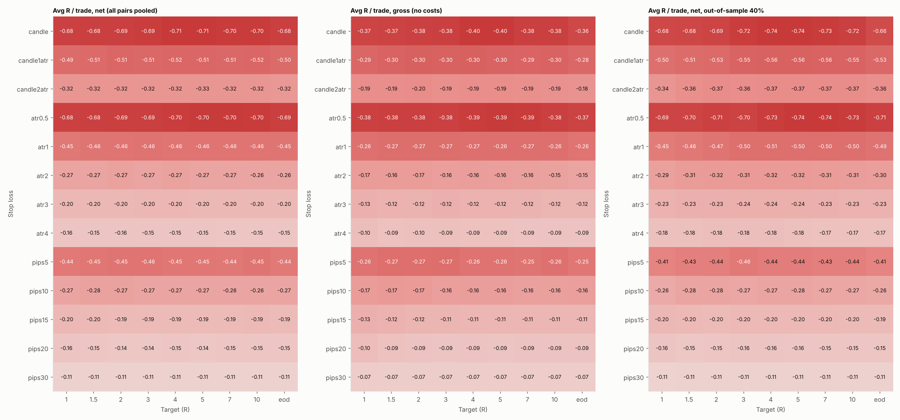

# NY-open candle vs 12 EMA — stop × target grid

Rule as in `results/candle_ema/`. Stops: candle, candle1atr, candle2atr, atr0.5, atr1, atr2, atr3, atr4, pips5, pips10, pips15, pips20, pips30. Targets: 1, 1.5, 2, 3, 4, 5, 7, 10, eod (eod = no target, flat at 16:00 NY). `candleNatr` = candle stop but at least N × ATR(14) of 5-minute candles; `atrN` / `pipsN` ignore the candle (+ spread). 24 pairs, 117 combos each = 2808 runs. Costs $7/lot + 0.2 pip slippage, 1% risk compounding per pair. In-sample = first 60% of each pair's days, out-of-sample = the rest.

**Positive after costs: 0 of 2808 pair × combo runs; 0 of 117 combos pooled over all pairs.** Best pooled combo picked in-sample: pips30 / 3 → in-sample -0.102R (t -12.55), out-of-sample -0.114R (t -12.69).

## Top 10 combos, all pairs pooled (net)

| Stop / target | trades | win_rate | avg_R | gross_avg_R | profit_factor | t_stat | is_avg_R | is_t | oos_avg_R | oos_t | pairs_positive | pairs_oos_positive |
|---|---|---|---|---|---|---|---|---|---|---|---|---|
| pips30 / 2 | 17524.000 | 40.670 | -0.106 | -0.067 | 0.708 | -18.064 | -0.102 | -12.967 | -0.113 | -12.848 | 0.000 | 0.000 |
| pips30 / 1.5 | 17524.000 | 41.087 | -0.107 | -0.068 | 0.705 | -18.762 | -0.104 | -13.694 | -0.111 | -13.018 | 0.000 | 0.000 |
| pips30 / 3 | 17524.000 | 40.442 | -0.107 | -0.068 | 0.707 | -17.622 | -0.102 | -12.548 | -0.114 | -12.688 | 0.000 | 0.000 |
| pips30 / 4 | 17524.000 | 40.385 | -0.108 | -0.068 | 0.706 | -17.512 | -0.104 | -12.612 | -0.113 | -12.411 | 0.000 | 0.000 |
| pips30 / 7 | 17524.000 | 40.356 | -0.108 | -0.069 | 0.705 | -17.430 | -0.105 | -12.597 | -0.113 | -12.299 | 0.000 | 0.000 |
| pips30 / 10 | 17524.000 | 40.356 | -0.108 | -0.069 | 0.705 | -17.359 | -0.106 | -12.670 | -0.112 | -12.056 | 0.000 | 0.000 |
| pips30 / 5 | 17524.000 | 40.367 | -0.108 | -0.069 | 0.704 | -17.571 | -0.105 | -12.676 | -0.113 | -12.427 | 0.000 | 0.000 |
| pips30 / eod | 17524.000 | 40.356 | -0.109 | -0.069 | 0.704 | -17.450 | -0.106 | -12.804 | -0.112 | -12.016 | 0.000 | 0.000 |
| pips30 / 1 | 17524.000 | 42.661 | -0.109 | -0.070 | 0.692 | -20.565 | -0.110 | -15.714 | -0.106 | -13.315 | 0.000 | 0.000 |
| pips20 / 3 | 17524.000 | 37.337 | -0.144 | -0.086 | 0.707 | -18.467 | -0.134 | -12.948 | -0.157 | -13.531 | 0.000 | 0.000 |

## Best combo per pair, picked on in-sample t-stat

| Pair | sl | rr | trades | is_avg_R | is_t | oos_avg_R | oos_t | avg_R | net_return_pct | max_dd_pct |
|---|---|---|---|---|---|---|---|---|---|---|
| EURUSD | pips15 | 10 | 777 | -0.087 | -1.301 | -0.108 | -1.502 | -0.095 | -55.365 | 57.085 |
| GBPUSD | atr4 | 5 | 777 | -0.081 | -1.642 | -0.036 | -0.543 | -0.063 | -40.685 | 45.120 |
| USDJPY | candle2atr | 10 | 777 | 0.036 | 0.403 | -0.204 | -2.053 | -0.060 | -44.471 | 61.849 |
| USDCHF | atr4 | 5 | 718 | -0.101 | -2.216 | -0.182 | -2.777 | -0.133 | -62.326 | 62.972 |
| AUDUSD | pips10 | 10 | 718 | -0.082 | -1.119 | -0.219 | -2.676 | -0.136 | -64.854 | 65.164 |
| USDCAD | pips20 | 2 | 718 | -0.027 | -0.499 | -0.174 | -3.079 | -0.086 | -47.532 | 55.347 |
| NZDUSD | atr4 | 7 | 718 | -0.102 | -1.900 | -0.198 | -3.416 | -0.140 | -64.439 | 64.720 |
| EURGBP | pips30 | 4 | 718 | -0.071 | -3.324 | -0.082 | -3.648 | -0.076 | -41.518 | 42.656 |
| EURJPY | pips20 | 5 | 777 | -0.047 | -0.660 | -0.158 | -2.215 | -0.091 | -54.026 | 58.674 |
| GBPJPY | pips20 | 5 | 777 | -0.029 | -0.366 | -0.075 | -0.843 | -0.048 | -37.644 | 45.878 |
| EURCHF | atr4 | 2 | 718 | -0.111 | -2.550 | -0.326 | -6.251 | -0.197 | -75.876 | 75.927 |
| EURAUD | pips10 | 7 | 718 | -0.195 | -2.237 | -0.165 | -1.471 | -0.183 | -75.935 | 77.010 |
| EURCAD | pips30 | 7 | 718 | -0.088 | -1.882 | -0.145 | -3.137 | -0.110 | -55.143 | 56.745 |
| EURNZD | pips30 | 2 | 718 | -0.177 | -3.943 | -0.224 | -4.135 | -0.196 | -75.613 | 75.769 |
| GBPCHF | atr4 | 5 | 718 | -0.154 | -3.446 | -0.112 | -1.976 | -0.137 | -63.187 | 65.702 |
| GBPAUD | pips30 | 2 | 718 | -0.088 | -1.865 | -0.157 | -2.660 | -0.116 | -57.471 | 57.920 |
| GBPCAD | pips30 | 5 | 718 | -0.098 | -1.889 | -0.141 | -2.472 | -0.115 | -57.129 | 59.574 |
| GBPNZD | pips20 | eod | 718 | -0.227 | -3.478 | -0.305 | -4.096 | -0.258 | -84.789 | 84.789 |
| AUDNZD | pips30 | 3 | 718 | -0.112 | -5.775 | -0.088 | -3.508 | -0.102 | -51.858 | 51.885 |
| AUDCAD | pips15 | 2 | 718 | -0.234 | -5.001 | -0.243 | -4.168 | -0.237 | -81.953 | 81.954 |
| AUDCHF | atr4 | 5 | 717 | -0.135 | -2.935 | -0.120 | -2.054 | -0.129 | -61.196 | 62.671 |
| NZDCAD | pips15 | 5 | 717 | -0.217 | -4.837 | -0.317 | -6.037 | -0.257 | -84.141 | 84.190 |
| NZDCHF | pips30 | 5 | 717 | -0.107 | -4.616 | -0.094 | -5.282 | -0.102 | -51.301 | 51.433 |
| CADCHF | pips30 | 5 | 718 | -0.114 | -4.224 | -0.098 | -4.270 | -0.107 | -53.177 | 53.650 |

## Every pair × combo that is positive after costs

None.
