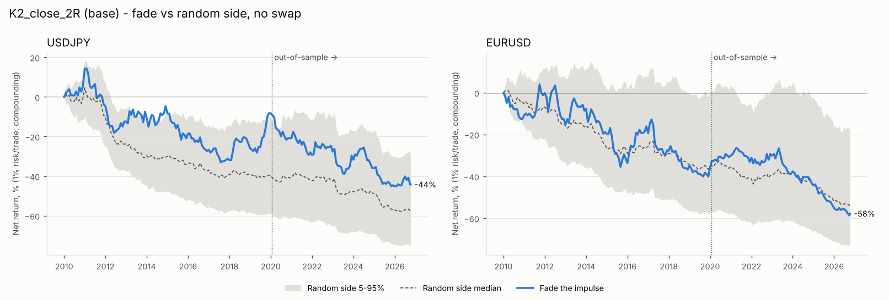
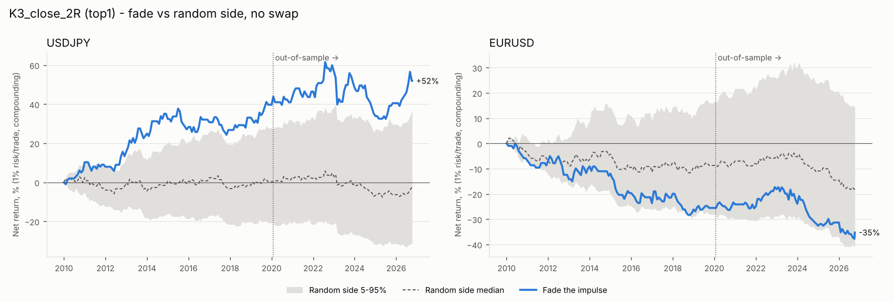
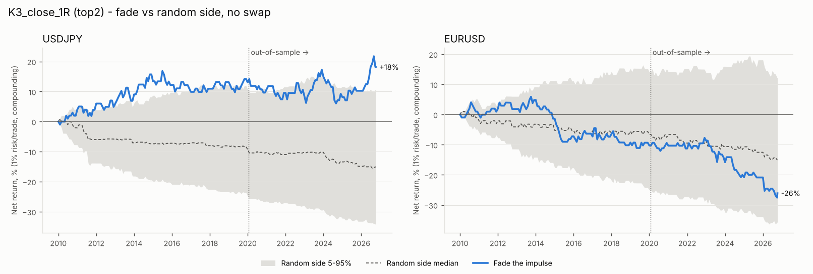
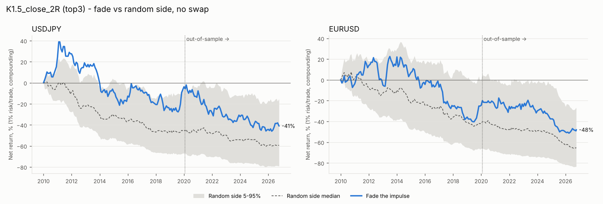
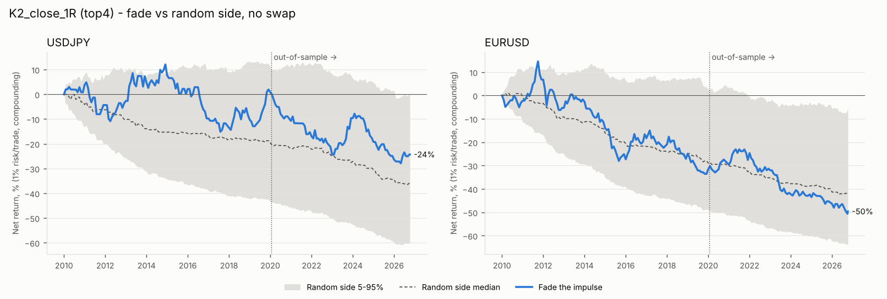

# Fade the 4H impulse: USDJPY and EURUSD

Period 2010-01-01 to 2026-10-07 23:45 UTC, in-sample to 2020-01-23 (60%), out-of-sample after. **Combos tested: 18 per pair** (K 1.5/2/3 x entry at impulse close / after a confirmation candle x target 1R / 2R / back to the base). No day filter. Same costs, swap and one-position rule as the zone studies.

Benchmark: random side at the same moment with the same stop and target distances, 1000 seeds (no swap). It tests whether the fade direction carries information beyond volatility and costs.

## Verdict

**Short answer: fading the 4H impulse, with these rules, has no tradeable edge on the two pairs together.** There is one lead, USDJPY at K=3, but it fails on EURUSD with the same rules, and it is too small and too data-mined to trust yet.

**Sweep (18 combos per pair, all eligible; ranked on 2010–2020 only).**
- Average expectancy with swap is −0.10R in-sample and −0.07R out-of-sample.
- Only 22% of combo-pair runs are positive over the full period.

**Top 5 in-sample** (average of both pairs):
1. K3_close_2R: +0.046R
2. K3_close_1R: +0.015R
3. K1.5_close_2R: −0.009R
4. K2_close_1R: −0.031R
5. K2_close_2R (the base): −0.041R

**All 5 lose out-of-sample** (−0.03R to −0.14R) and are flagged as overfit. The plateau check calls the two positive ones likely noise: their neighbours have medians of −0.09R and −0.08R.

**Fade direction vs a coin-flip direction** (same moment, same stop and target):

| Combo | Pair | In-sample percentile | Out-of-sample percentile | Expectancy, IS → OOS |
|---|---|---|---|---|
| Base (K2_close_2R) | USDJPY | 97th | 23rd | |
| Base (K2_close_2R) | EURUSD | 57th | 28th | |
| K3_close_2R | USDJPY | 99th | 75th | +0.27R → +0.05R |
| K3_close_2R | EURUSD | 10th | 36th | −0.17R → −0.10R |

On EURUSD, fading big impulses is worse than a coin flip: those impulses tend to continue.

**Why the earlier hint didn't turn into a strategy.** The +0.12R in the zone study's controls came from fading at a random time later in the zone's life, with a stop sized from the zone, about 36 pips. Fading right at the impulse close with the stop just beyond the impulse extreme gives a median stop of about 17 pips (a quarter are under 10). At that size, spread and noise dominate: the cost floor alone is −0.06R per trade. Waiting for a confirmation candle didn't help either; it was worse in-sample in every pairing.

**USDJPY K=3, the only lead.**
- 2R target: +0.17R over the full period (257 trades, 98th–99th percentile in-sample, 75th out-of-sample).
- 1R target: +0.07R.
- The equity curve grows mostly in 2010–2014 and 2020–2022, then goes flat to down.
- Out-of-sample it has only about 110 trades and +0.02R to +0.05R, which is not distinguishable from zero.
- Trading it means dropping your "identical rules on both pairs" principle and picking USDJPY after seeing the result. That is exactly the kind of choice the protocol exists to prevent.

**Multiple testing.** This is the third strategy family tested on the same 2010–2026 data, and the 2020–2026 "out-of-sample" has now been looked at three times. Each new idea derived from these results is less protected by that split. Anything that looks good from here needs fresh data before real money: other pairs, or forward/paper trading.

**Other:**
- Swap and the intervention exclusion change results by ≤ 0.03R.
- No result was flagged as unrealistically good.

**What I would do next**
1. Stop iterating on these two pairs' history. Across three families, the only consistent pattern is that big 4H impulses partially retrace. These rules haven't turned that into money after costs.
2. If you want one more test, take the USDJPY K=3 fade exactly as it is now (no re-tuning) and check it on fresh data: other JPY pairs (EURJPY, GBPJPY, AUDJPY are already in `datastore/`) and from now on as paper trades. If it doesn't hold there, drop it.

## In-sample ranking (with swap)

| combo | IS_avg_exp | IS_exp_USDJPY | IS_n_USDJPY | IS_exp_EURUSD | IS_n_EURUSD | eligible_100_each | OOS_avg_exp | OOS_exp_USDJPY | OOS_n_USDJPY | OOS_exp_EURUSD | OOS_n_EURUSD |
|---|---|---|---|---|---|---|---|---|---|---|---|
| K3_close_2R | 0.046 | 0.264 | 144 | -0.173 | 166 | True | -0.025 | 0.053 | 113 | -0.103 | 129 |
| K3_close_1R | 0.015 | 0.096 | 149 | -0.066 | 166 | True | -0.063 | 0.022 | 115 | -0.148 | 129 |
| K1.5_close_2R | -0.009 | 0.001 | 807 | -0.019 | 844 | True | -0.079 | -0.081 | 557 | -0.077 | 549 |
| K2_close_1R | -0.031 | 0.004 | 472 | -0.066 | 521 | True | -0.094 | -0.085 | 335 | -0.103 | 328 |
| K2_close_2R | -0.041 | -0.014 | 460 | -0.069 | 513 | True | -0.144 | -0.142 | 328 | -0.146 | 324 |
| K1.5_close_1R | -0.048 | -0.050 | 829 | -0.046 | 888 | True | -0.080 | -0.117 | 572 | -0.043 | 577 |
| K1.5_confirm_2R | -0.070 | -0.019 | 620 | -0.121 | 659 | True | -0.006 | 0.068 | 412 | -0.080 | 438 |
| K1.5_confirm_1R | -0.090 | -0.082 | 744 | -0.098 | 771 | True | -0.039 | -0.025 | 486 | -0.052 | 514 |
| K2_confirm_1R | -0.105 | -0.074 | 436 | -0.137 | 477 | True | -0.023 | -0.014 | 298 | -0.031 | 314 |
| K3_confirm_1R | -0.126 | 0.031 | 140 | -0.283 | 157 | True | 0.029 | -0.002 | 110 | 0.060 | 126 |
| K2_confirm_2R | -0.131 | -0.064 | 390 | -0.199 | 433 | True | -0.041 | 0.113 | 267 | -0.194 | 282 |
| K3_close_base | -0.143 | 0.012 | 138 | -0.298 | 153 | True | -0.113 | 0.110 | 110 | -0.336 | 117 |
| K3_confirm_base | -0.157 | 0.022 | 111 | -0.335 | 135 | True | -0.007 | 0.139 | 93 | -0.153 | 101 |
| K2_close_base | -0.167 | -0.110 | 424 | -0.223 | 471 | True | -0.261 | -0.136 | 303 | -0.386 | 292 |
| K3_confirm_2R | -0.168 | 0.053 | 129 | -0.389 | 150 | True | 0.079 | 0.238 | 106 | -0.080 | 124 |
| K1.5_close_base | -0.180 | -0.173 | 731 | -0.188 | 751 | True | -0.186 | -0.134 | 501 | -0.238 | 484 |
| K1.5_confirm_base | -0.200 | -0.195 | 483 | -0.204 | 555 | True | -0.107 | -0.033 | 333 | -0.181 | 340 |
| K2_confirm_base | -0.225 | -0.215 | 317 | -0.236 | 400 | True | -0.079 | 0.045 | 223 | -0.203 | 231 |

18 of 18 eligible. Top 5 (in-sample only): K3_close_2R, K3_close_1R, K1.5_close_2R, K2_close_1R, K2_close_2R.

### Top 5: in-sample vs out-of-sample

| combo | IS_avg_exp | OOS_avg_exp | OOS_USDJPY | OOS_EURUSD | flag |
|---|---|---|---|---|---|
| K3_close_2R | 0.046 | -0.025 | 0.053 | -0.103 | OVERFIT: loses out-of-sample |
| K3_close_1R | 0.015 | -0.063 | 0.022 | -0.148 | OVERFIT: loses out-of-sample |
| K1.5_close_2R | -0.009 | -0.079 | -0.081 | -0.077 | OVERFIT: loses out-of-sample |
| K2_close_1R | -0.031 | -0.094 | -0.085 | -0.103 | OVERFIT: loses out-of-sample |
| K2_close_2R | -0.041 | -0.144 | -0.142 | -0.146 | OVERFIT: loses out-of-sample |

## Plateau check

**K3_close_2R** (IS 0.046R): neighbour median -0.092R, 1/4 positive -> LIKELY NOISE

| neighbor | changed | neighbor_IS_avg_exp | neighbor_IS_n_USDJPY | neighbor_IS_n_EURUSD |
|---|---|---|---|---|
| K2_close_2R | K | -0.041 | 460 | 513 |
| K3_confirm_2R | entry | -0.168 | 129 | 150 |
| K3_close_1R | target | 0.015 | 149 | 166 |
| K3_close_base | target | -0.143 | 138 | 153 |

**K3_close_1R** (IS 0.015R): neighbour median -0.079R, 1/4 positive -> LIKELY NOISE

| neighbor | changed | neighbor_IS_avg_exp | neighbor_IS_n_USDJPY | neighbor_IS_n_EURUSD |
|---|---|---|---|---|
| K2_close_1R | K | -0.031 | 472 | 521 |
| K3_confirm_1R | entry | -0.126 | 140 | 157 |
| K3_close_2R | target | 0.046 | 144 | 166 |
| K3_close_base | target | -0.143 | 138 | 153 |

**K1.5_close_2R** (IS -0.009R): neighbour median -0.059R, 0/4 positive -> no in-sample edge to check (IS <= 0)

| neighbor | changed | neighbor_IS_avg_exp | neighbor_IS_n_USDJPY | neighbor_IS_n_EURUSD |
|---|---|---|---|---|
| K2_close_2R | K | -0.041 | 460 | 513 |
| K1.5_confirm_2R | entry | -0.070 | 620 | 659 |
| K1.5_close_1R | target | -0.048 | 829 | 888 |
| K1.5_close_base | target | -0.180 | 731 | 751 |

**K2_close_1R** (IS -0.031R): neighbour median -0.048R, 1/5 positive -> no in-sample edge to check (IS <= 0)

| neighbor | changed | neighbor_IS_avg_exp | neighbor_IS_n_USDJPY | neighbor_IS_n_EURUSD |
|---|---|---|---|---|
| K1.5_close_1R | K | -0.048 | 829 | 888 |
| K3_close_1R | K | 0.015 | 149 | 166 |
| K2_confirm_1R | entry | -0.105 | 436 | 477 |
| K2_close_2R | target | -0.041 | 460 | 513 |
| K2_close_base | target | -0.167 | 424 | 471 |

**K2_close_2R** (IS -0.041R): neighbour median -0.031R, 1/5 positive -> no in-sample edge to check (IS <= 0)

| neighbor | changed | neighbor_IS_avg_exp | neighbor_IS_n_USDJPY | neighbor_IS_n_EURUSD |
|---|---|---|---|---|
| K1.5_close_2R | K | -0.009 | 807 | 844 |
| K3_close_2R | K | 0.046 | 144 | 166 |
| K2_confirm_2R | entry | -0.131 | 390 | 433 |
| K2_close_1R | target | -0.031 | 472 | 521 |
| K2_close_base | target | -0.167 | 424 | 471 |

## Base and top 5 vs random side

pctl = share of random-side seeds the real fade beats on expectancy (no swap).

| combo | pair | period | trades | win% | avg win R | avg loss R | PF | exp R | exp R +swap | maxDD% +swap | lose streak | net % +swap | rand p5 | rand p50 | rand p95 | pctl | flags |
|---|---|---|---|---|---|---|---|---|---|---|---|---|---|---|---|---|---|
| K2_close_2R | USDJPY | IS | 460 | 33.261 | 2.000 | -1.010 | 0.987 | -0.009 | -0.014 | 44.747 | 16 | -10.347 | -0.188 | -0.103 | -0.017 | 96.600 |  |
| K2_close_2R | USDJPY | OOS | 328 | 29.573 | 2.000 | -1.041 | 0.807 | -0.141 | -0.142 | 41.957 | 9 | -39.396 | -0.206 | -0.096 | 0.017 | 23.400 |  |
| K2_close_2R | USDJPY | full | 788 | 31.726 | 2.000 | -1.023 | 0.908 | -0.064 | -0.067 | 55.313 | 16 | -45.666 | -0.166 | -0.099 | -0.032 | 81.000 |  |
| K2_close_2R | EURUSD | IS | 513 | 31.774 | 2.000 | -1.026 | 0.908 | -0.065 | -0.069 | 44.323 | 17 | -33.437 | -0.153 | -0.072 | 0.014 | 56.500 |  |
| K2_close_2R | EURUSD | OOS | 324 | 28.704 | 2.000 | -1.000 | 0.805 | -0.139 | -0.146 | 46.198 | 12 | -39.470 | -0.204 | -0.100 | 0.009 | 27.600 |  |
| K2_close_2R | EURUSD | full | 837 | 30.585 | 2.000 | -1.016 | 0.868 | -0.093 | -0.099 | 62.804 | 17 | -59.709 | -0.145 | -0.081 | -0.013 | 38.600 |  |
| K3_close_2R | USDJPY | IS | 144 | 42.361 | 2.000 | -1.000 | 1.470 | 0.271 | 0.264 | 10.868 | 9 | 43.877 | -0.146 | 0.019 | 0.188 | 99.200 |  |
| K3_close_2R | USDJPY | OOS | 113 | 37.168 | 2.000 | -1.099 | 1.076 | 0.053 | 0.053 | 19.153 | 14 | 4.541 | -0.233 | -0.031 | 0.164 | 75.400 |  |
| K3_close_2R | USDJPY | full | 257 | 40.078 | 2.000 | -1.046 | 1.279 | 0.175 | 0.171 | 19.153 | 14 | 50.411 | -0.136 | 0.000 | 0.131 | 98.800 |  |
| K3_close_2R | EURUSD | IS | 166 | 27.711 | 2.000 | -1.000 | 0.767 | -0.169 | -0.173 | 29.062 | 13 | -26.036 | -0.190 | -0.045 | 0.102 | 9.700 |  |
| K3_close_2R | EURUSD | OOS | 129 | 31.008 | 2.000 | -1.041 | 0.863 | -0.098 | -0.103 | 25.657 | 16 | -13.615 | -0.233 | -0.062 | 0.101 | 36.100 |  |
| K3_close_2R | EURUSD | full | 295 | 29.153 | 2.000 | -1.018 | 0.809 | -0.138 | -0.142 | 38.567 | 16 | -36.107 | -0.167 | -0.056 | 0.059 | 11.600 |  |
| K3_close_1R | USDJPY | IS | 149 | 55.034 | 1.000 | -1.000 | 1.224 | 0.101 | 0.096 | 6.506 | 4 | 14.565 | -0.187 | -0.062 | 0.074 | 96.900 |  |
| K3_close_1R | USDJPY | OOS | 115 | 51.304 | 1.000 | -1.000 | 1.054 | 0.026 | 0.022 | 9.451 | 6 | 1.956 | -0.199 | -0.046 | 0.093 | 80.200 |  |
| K3_close_1R | USDJPY | full | 264 | 53.409 | 1.000 | -1.000 | 1.146 | 0.068 | 0.064 | 9.579 | 6 | 16.806 | -0.153 | -0.057 | 0.044 | 98.500 |  |
| K3_close_1R | EURUSD | IS | 166 | 46.988 | 1.000 | -1.000 | 0.886 | -0.060 | -0.066 | 17.530 | 6 | -11.124 | -0.169 | -0.036 | 0.084 | 35.900 |  |
| K3_close_1R | EURUSD | OOS | 129 | 44.186 | 1.000 | -1.051 | 0.753 | -0.145 | -0.148 | 21.884 | 6 | -18.000 | -0.207 | -0.067 | 0.085 | 18.600 |  |
| K3_close_1R | EURUSD | full | 295 | 45.763 | 1.000 | -1.023 | 0.825 | -0.097 | -0.102 | 32.413 | 6 | -27.121 | -0.145 | -0.050 | 0.044 | 21.400 |  |
| K1.5_close_2R | USDJPY | IS | 807 | 33.581 | 2.000 | -1.003 | 1.008 | 0.005 | 0.001 | 52.195 | 16 | -7.171 | -0.127 | -0.065 | 0.002 | 95.500 |  |
| K1.5_close_2R | USDJPY | OOS | 557 | 31.418 | 1.990 | -1.024 | 0.890 | -0.077 | -0.081 | 46.650 | 15 | -39.902 | -0.122 | -0.043 | 0.034 | 25.800 |  |
| K1.5_close_2R | USDJPY | full | 1364 | 32.698 | 1.996 | -1.012 | 0.958 | -0.029 | -0.033 | 64.700 | 16 | -44.211 | -0.105 | -0.056 | -0.002 | 79.600 |  |
| K1.5_close_2R | EURUSD | IS | 844 | 33.294 | 2.000 | -1.021 | 0.978 | -0.015 | -0.019 | 53.665 | 18 | -21.553 | -0.117 | -0.050 | 0.017 | 80.500 |  |
| K1.5_close_2R | EURUSD | OOS | 549 | 30.965 | 2.000 | -1.000 | 0.897 | -0.071 | -0.077 | 43.918 | 12 | -37.750 | -0.168 | -0.091 | -0.004 | 64.600 |  |
| K1.5_close_2R | EURUSD | full | 1393 | 32.376 | 2.000 | -1.012 | 0.946 | -0.037 | -0.041 | 63.107 | 18 | -51.167 | -0.120 | -0.066 | -0.013 | 82.300 |  |
| K2_close_1R | USDJPY | IS | 472 | 50.636 | 1.000 | -1.012 | 1.014 | 0.007 | 0.004 | 24.583 | 8 | -0.588 | -0.114 | -0.041 | 0.027 | 86.400 |  |
| K2_close_1R | USDJPY | OOS | 335 | 45.970 | 1.000 | -1.000 | 0.851 | -0.081 | -0.085 | 29.814 | 7 | -25.944 | -0.153 | -0.063 | 0.021 | 38.300 |  |
| K2_close_1R | USDJPY | full | 807 | 48.699 | 1.000 | -1.007 | 0.943 | -0.029 | -0.033 | 37.275 | 8 | -26.379 | -0.109 | -0.050 | 0.005 | 75.000 |  |
| K2_close_1R | EURUSD | IS | 521 | 47.217 | 1.000 | -1.012 | 0.884 | -0.062 | -0.066 | 43.637 | 13 | -31.080 | -0.125 | -0.060 | 0.010 | 48.500 |  |
| K2_close_1R | EURUSD | OOS | 328 | 45.122 | 1.000 | -1.000 | 0.822 | -0.098 | -0.103 | 37.789 | 12 | -29.772 | -0.152 | -0.061 | 0.029 | 24.000 |  |
| K2_close_1R | EURUSD | full | 849 | 46.408 | 1.000 | -1.007 | 0.860 | -0.076 | -0.080 | 58.932 | 13 | -51.599 | -0.115 | -0.060 | -0.002 | 32.900 |  |

## Cost floor control (base combo)

| combo | pair | control | mean_exp_R | p5 | p95 |
|---|---|---|---|---|---|
| K2_close_2R | USDJPY | random side, uniform random time (cost floor) | -0.061 | -0.143 | 0.015 |
| K2_close_2R | EURUSD | random side, uniform random time (cost floor) | -0.056 | -0.141 | 0.029 |

## USDJPY with and without trades open within +/-3 trading days of MoF interventions (with swap)

| combo | period | exp all | exp ex-intervention | n all | n ex-intervention |
|---|---|---|---|---|---|
| K1.5_close_2R | IS | 0.001 | -0.000 | 807.000 | 799.000 |
| K1.5_close_2R | OOS | -0.081 | -0.084 | 557.000 | 542.000 |
| K1.5_close_2R | full | -0.033 | -0.034 | 1364.000 | 1341.000 |
| K2_close_1R | IS | 0.004 | 0.002 | 472.000 | 467.000 |
| K2_close_1R | OOS | -0.085 | -0.085 | 335.000 | 324.000 |
| K2_close_1R | full | -0.033 | -0.034 | 807.000 | 791.000 |
| K2_close_2R | IS | -0.014 | -0.016 | 460.000 | 455.000 |
| K2_close_2R | OOS | -0.142 | -0.158 | 328.000 | 316.000 |
| K2_close_2R | full | -0.067 | -0.074 | 788.000 | 771.000 |
| K3_close_1R | IS | 0.096 | 0.090 | 149.000 | 148.000 |
| K3_close_1R | OOS | 0.022 | 0.040 | 115.000 | 107.000 |
| K3_close_1R | full | 0.064 | 0.069 | 264.000 | 255.000 |
| K3_close_2R | IS | 0.264 | 0.273 | 144.000 | 143.000 |
| K3_close_2R | OOS | 0.053 | 0.074 | 113.000 | 105.000 |
| K3_close_2R | full | 0.171 | 0.188 | 257.000 | 248.000 |

## Breakdowns (with swap)

### by pair

| combo | key | trades | win_rate | expectancy_R | profit_factor | total_R |
|---|---|---|---|---|---|---|
| K2_close_2R | EURUSD | 837 | 30.585 | -0.099 | 0.860 | -82.716 |
| K2_close_2R | USDJPY | 788 | 31.726 | -0.067 | 0.904 | -52.928 |
| K3_close_2R | EURUSD | 295 | 29.153 | -0.142 | 0.804 | -41.930 |
| K3_close_2R | USDJPY | 257 | 40.078 | 0.171 | 1.271 | 43.988 |
| K3_close_1R | EURUSD | 295 | 45.763 | -0.102 | 0.817 | -30.054 |
| K3_close_1R | USDJPY | 264 | 53.409 | 0.064 | 1.137 | 16.849 |
| K1.5_close_2R | EURUSD | 1393 | 32.376 | -0.041 | 0.940 | -57.761 |
| K1.5_close_2R | USDJPY | 1364 | 32.698 | -0.033 | 0.952 | -44.542 |
| K2_close_1R | EURUSD | 849 | 46.408 | -0.080 | 0.852 | -68.256 |
| K2_close_1R | USDJPY | 807 | 48.575 | -0.033 | 0.936 | -26.556 |

### by side

| combo | key | trades | win_rate | expectancy_R | profit_factor | total_R |
|---|---|---|---|---|---|---|
| K2_close_2R | long | 869 | 32.106 | -0.051 | 0.926 | -44.483 |
| K2_close_2R | short | 756 | 30.026 | -0.121 | 0.832 | -91.161 |
| K3_close_2R | long | 300 | 36.667 | 0.094 | 1.147 | 28.167 |
| K3_close_2R | short | 252 | 31.349 | -0.104 | 0.858 | -26.109 |
| K3_close_1R | long | 304 | 50.658 | 0.008 | 1.017 | 2.551 |
| K3_close_1R | short | 255 | 47.843 | -0.062 | 0.885 | -15.756 |
| K1.5_close_2R | long | 1417 | 32.604 | -0.032 | 0.953 | -45.720 |
| K1.5_close_2R | short | 1340 | 32.463 | -0.042 | 0.939 | -56.583 |
| K2_close_1R | long | 884 | 47.511 | -0.059 | 0.890 | -51.970 |
| K2_close_1R | short | 772 | 47.409 | -0.055 | 0.895 | -42.842 |

### by sample

| combo | key | trades | win_rate | expectancy_R | profit_factor | total_R |
|---|---|---|---|---|---|---|
| K2_close_2R | IS | 973 | 32.477 | -0.043 | 0.938 | -41.824 |
| K2_close_2R | OOS | 652 | 29.141 | -0.144 | 0.801 | -93.820 |
| K3_close_2R | IS | 310 | 34.516 | 0.030 | 1.046 | 9.358 |
| K3_close_2R | OOS | 242 | 33.884 | -0.030 | 0.957 | -7.300 |
| K3_close_1R | IS | 315 | 50.794 | 0.011 | 1.022 | 3.380 |
| K3_close_1R | OOS | 244 | 47.541 | -0.068 | 0.874 | -16.585 |
| K1.5_close_2R | IS | 1651 | 33.434 | -0.009 | 0.987 | -14.994 |
| K1.5_close_2R | OOS | 1106 | 31.193 | -0.079 | 0.887 | -87.309 |
| K2_close_1R | IS | 993 | 48.842 | -0.033 | 0.936 | -32.751 |
| K2_close_1R | OOS | 663 | 45.400 | -0.094 | 0.829 | -62.061 |

### by year (expectancy R, trades)

| year | K1.5_close_2R | K2_close_1R | K2_close_2R | K3_close_1R | K3_close_2R |
|---|---|---|---|---|---|
| 2010 | 0.133 (161) | 0.019 (94) | 0.028 (93) | 0.153 (26) | 0.12 (24) |
| 2011 | 0.126 (143) | 0.01 (81) | -0.086 (78) | 0.165 (24) | -0.092 (23) |
| 2012 | -0.126 (193) | -0.086 (116) | -0.196 (113) | -0.003 (32) | -0.037 (31) |
| 2013 | 0.05 (165) | 0.094 (109) | 0.085 (107) | 0.146 (40) | 0.344 (40) |
| 2014 | -0.136 (157) | -0.088 (109) | -0.104 (108) | -0.055 (42) | 0.061 (42) |
| 2015 | -0.092 (161) | -0.217 (101) | -0.307 (99) | -0.217 (33) | -0.369 (33) |
| 2016 | 0.045 (146) | 0.007 (89) | 0.136 (84) | -0.034 (29) | -0.036 (28) |
| 2017 | -0.219 (178) | -0.092 (90) | -0.219 (90) | 0.03 (27) | -0.007 (27) |
| 2018 | -0.116 (179) | -0.019 (101) | -0.02 (100) | -0.051 (27) | -0.135 (27) |
| 2019 | 0.291 (151) | 0.027 (94) | 0.233 (92) | -0.038 (33) | 0.195 (33) |
| 2020 | -0.039 (159) | -0.102 (93) | -0.065 (93) | -0.093 (22) | 0.224 (22) |
| 2021 | -0.162 (149) | -0.007 (88) | -0.125 (88) | -0.081 (26) | 0.03 (26) |
| 2022 | -0.01 (175) | -0.183 (105) | 0.021 (105) | 0.046 (42) | 0.387 (41) |
| 2023 | -0.029 (171) | 0.005 (106) | -0.153 (97) | -0.044 (50) | -0.243 (50) |
| 2024 | -0.144 (164) | -0.12 (102) | -0.197 (101) | -0.307 (40) | -0.555 (40) |
| 2025 | -0.175 (174) | -0.15 (101) | -0.346 (101) | 0.057 (32) | 0.213 (32) |
| 2026 | 0.081 (131) | -0.037 (77) | -0.046 (76) | 0.007 (34) | 0.08 (33) |

### Entry at impulse close vs after confirmation (paired by K / target, with swap)

| K | target | pair | period | close | confirm | close_minus_confirm |
|---|---|---|---|---|---|---|
| 1.500 | 1R | EURUSD | IS | -0.046 | -0.098 | 0.052 |
| 1.500 | 1R | EURUSD | OOS | -0.043 | -0.052 | 0.009 |
| 1.500 | 1R | USDJPY | IS | -0.050 | -0.082 | 0.032 |
| 1.500 | 1R | USDJPY | OOS | -0.117 | -0.025 | -0.092 |
| 1.500 | 2R | EURUSD | IS | -0.019 | -0.121 | 0.102 |
| 1.500 | 2R | EURUSD | OOS | -0.077 | -0.080 | 0.003 |
| 1.500 | 2R | USDJPY | IS | 0.001 | -0.019 | 0.019 |
| 1.500 | 2R | USDJPY | OOS | -0.081 | 0.068 | -0.149 |
| 1.500 | base | EURUSD | IS | -0.188 | -0.204 | 0.016 |
| 1.500 | base | EURUSD | OOS | -0.238 | -0.181 | -0.058 |
| 1.500 | base | USDJPY | IS | -0.173 | -0.195 | 0.023 |
| 1.500 | base | USDJPY | OOS | -0.134 | -0.033 | -0.101 |
| 2.000 | 1R | EURUSD | IS | -0.066 | -0.137 | 0.071 |
| 2.000 | 1R | EURUSD | OOS | -0.103 | -0.031 | -0.071 |
| 2.000 | 1R | USDJPY | IS | 0.004 | -0.074 | 0.078 |
| 2.000 | 1R | USDJPY | OOS | -0.085 | -0.014 | -0.070 |
| 2.000 | 2R | EURUSD | IS | -0.069 | -0.199 | 0.130 |
| 2.000 | 2R | EURUSD | OOS | -0.146 | -0.194 | 0.049 |
| 2.000 | 2R | USDJPY | IS | -0.014 | -0.064 | 0.050 |
| 2.000 | 2R | USDJPY | OOS | -0.142 | 0.113 | -0.255 |
| 2.000 | base | EURUSD | IS | -0.223 | -0.236 | 0.013 |
| 2.000 | base | EURUSD | OOS | -0.386 | -0.203 | -0.183 |
| 2.000 | base | USDJPY | IS | -0.110 | -0.215 | 0.105 |
| 2.000 | base | USDJPY | OOS | -0.136 | 0.045 | -0.181 |
| 3.000 | 1R | EURUSD | IS | -0.066 | -0.283 | 0.217 |
| 3.000 | 1R | EURUSD | OOS | -0.148 | 0.060 | -0.208 |
| 3.000 | 1R | USDJPY | IS | 0.096 | 0.031 | 0.065 |
| 3.000 | 1R | USDJPY | OOS | 0.022 | -0.002 | 0.023 |
| 3.000 | 2R | EURUSD | IS | -0.173 | -0.389 | 0.217 |
| 3.000 | 2R | EURUSD | OOS | -0.103 | -0.080 | -0.023 |
| 3.000 | 2R | USDJPY | IS | 0.264 | 0.053 | 0.210 |
| 3.000 | 2R | USDJPY | OOS | 0.053 | 0.238 | -0.185 |
| 3.000 | base | EURUSD | IS | -0.298 | -0.335 | 0.037 |
| 3.000 | base | EURUSD | OOS | -0.336 | -0.153 | -0.183 |
| 3.000 | base | USDJPY | IS | 0.012 | 0.022 | -0.010 |
| 3.000 | base | USDJPY | OOS | 0.110 | 0.139 | -0.029 |

### All combos x 2 pairs, expectancy with swap

| combo | pair | exp IS | exp OOS | exp full | n IS | n OOS | n full |
|---|---|---|---|---|---|---|---|
| K1.5_close_1R | EURUSD | -0.046 | -0.043 | -0.045 | 888.000 | 577.000 | 1465.000 |
| K1.5_close_1R | USDJPY | -0.050 | -0.117 | -0.077 | 829.000 | 572.000 | 1401.000 |
| K1.5_close_2R | EURUSD | -0.019 | -0.077 | -0.041 | 844.000 | 549.000 | 1393.000 |
| K1.5_close_2R | USDJPY | 0.001 | -0.081 | -0.033 | 807.000 | 557.000 | 1364.000 |
| K1.5_close_base | EURUSD | -0.188 | -0.238 | -0.208 | 751.000 | 484.000 | 1235.000 |
| K1.5_close_base | USDJPY | -0.173 | -0.134 | -0.157 | 731.000 | 501.000 | 1232.000 |
| K1.5_confirm_1R | EURUSD | -0.098 | -0.052 | -0.079 | 771.000 | 514.000 | 1285.000 |
| K1.5_confirm_1R | USDJPY | -0.082 | -0.025 | -0.059 | 744.000 | 486.000 | 1230.000 |
| K1.5_confirm_2R | EURUSD | -0.121 | -0.080 | -0.104 | 659.000 | 438.000 | 1097.000 |
| K1.5_confirm_2R | USDJPY | -0.019 | 0.068 | 0.016 | 620.000 | 412.000 | 1032.000 |
| K1.5_confirm_base | EURUSD | -0.204 | -0.181 | -0.195 | 555.000 | 340.000 | 895.000 |
| K1.5_confirm_base | USDJPY | -0.195 | -0.033 | -0.129 | 483.000 | 333.000 | 816.000 |
| K2_close_1R | EURUSD | -0.066 | -0.103 | -0.080 | 521.000 | 328.000 | 849.000 |
| K2_close_1R | USDJPY | 0.004 | -0.085 | -0.033 | 472.000 | 335.000 | 807.000 |
| K2_close_2R | EURUSD | -0.069 | -0.146 | -0.099 | 513.000 | 324.000 | 837.000 |
| K2_close_2R | USDJPY | -0.014 | -0.142 | -0.067 | 460.000 | 328.000 | 788.000 |
| K2_close_base | EURUSD | -0.223 | -0.386 | -0.285 | 471.000 | 292.000 | 763.000 |
| K2_close_base | USDJPY | -0.110 | -0.136 | -0.121 | 424.000 | 303.000 | 727.000 |
| K2_confirm_1R | EURUSD | -0.137 | -0.031 | -0.095 | 477.000 | 314.000 | 791.000 |
| K2_confirm_1R | USDJPY | -0.074 | -0.014 | -0.050 | 436.000 | 298.000 | 734.000 |
| K2_confirm_2R | EURUSD | -0.199 | -0.194 | -0.197 | 433.000 | 282.000 | 715.000 |
| K2_confirm_2R | USDJPY | -0.064 | 0.113 | 0.008 | 390.000 | 267.000 | 657.000 |
| K2_confirm_base | EURUSD | -0.236 | -0.203 | -0.224 | 400.000 | 231.000 | 631.000 |
| K2_confirm_base | USDJPY | -0.215 | 0.045 | -0.107 | 317.000 | 223.000 | 540.000 |
| K3_close_1R | EURUSD | -0.066 | -0.148 | -0.102 | 166.000 | 129.000 | 295.000 |
| K3_close_1R | USDJPY | 0.096 | 0.022 | 0.064 | 149.000 | 115.000 | 264.000 |
| K3_close_2R | EURUSD | -0.173 | -0.103 | -0.142 | 166.000 | 129.000 | 295.000 |
| K3_close_2R | USDJPY | 0.264 | 0.053 | 0.171 | 144.000 | 113.000 | 257.000 |
| K3_close_base | EURUSD | -0.298 | -0.336 | -0.315 | 153.000 | 117.000 | 270.000 |
| K3_close_base | USDJPY | 0.012 | 0.110 | 0.055 | 138.000 | 110.000 | 248.000 |
| K3_confirm_1R | EURUSD | -0.283 | 0.060 | -0.131 | 157.000 | 126.000 | 283.000 |
| K3_confirm_1R | USDJPY | 0.031 | -0.002 | 0.017 | 140.000 | 110.000 | 250.000 |
| K3_confirm_2R | EURUSD | -0.389 | -0.080 | -0.249 | 150.000 | 124.000 | 274.000 |
| K3_confirm_2R | USDJPY | 0.053 | 0.238 | 0.137 | 129.000 | 106.000 | 235.000 |
| K3_confirm_base | EURUSD | -0.335 | -0.153 | -0.257 | 135.000 | 101.000 | 236.000 |
| K3_confirm_base | USDJPY | 0.022 | 0.139 | 0.075 | 111.000 | 93.000 | 204.000 |

## Counts

| combo | pair | impulses | no_confirmation | skipped_position_open | stop_lt_2x_spread | base_target_lt_1R |
|---|---|---|---|---|---|---|
| K1.5_close_1R | USDJPY | 1483 | 0 | 81 | 1 | 0 |
| K1.5_close_1R | EURUSD | 1569 | 0 | 104 | 0 | 0 |
| K1.5_close_2R | USDJPY | 1483 | 0 | 118 | 1 | 0 |
| K1.5_close_2R | EURUSD | 1569 | 0 | 176 | 0 | 0 |
| K1.5_close_base | USDJPY | 1483 | 0 | 60 | 1 | 190 |
| K1.5_close_base | EURUSD | 1569 | 0 | 103 | 0 | 231 |
| K1.5_confirm_1R | USDJPY | 1483 | 19 | 234 | 0 | 0 |
| K1.5_confirm_1R | EURUSD | 1569 | 15 | 269 | 0 | 0 |
| K1.5_confirm_2R | USDJPY | 1483 | 19 | 432 | 0 | 0 |
| K1.5_confirm_2R | EURUSD | 1569 | 15 | 457 | 0 | 0 |
| K1.5_confirm_base | USDJPY | 1483 | 19 | 168 | 0 | 480 |
| K1.5_confirm_base | EURUSD | 1569 | 15 | 160 | 0 | 499 |
| K2_close_1R | USDJPY | 845 | 0 | 37 | 1 | 0 |
| K2_close_1R | EURUSD | 903 | 0 | 54 | 0 | 0 |
| K2_close_2R | USDJPY | 845 | 0 | 56 | 1 | 0 |
| K2_close_2R | EURUSD | 903 | 0 | 66 | 0 | 0 |
| K2_close_base | USDJPY | 845 | 0 | 33 | 1 | 84 |
| K2_close_base | EURUSD | 903 | 0 | 56 | 0 | 84 |
| K2_confirm_1R | USDJPY | 845 | 15 | 96 | 0 | 0 |
| K2_confirm_1R | EURUSD | 903 | 10 | 102 | 0 | 0 |
| K2_confirm_2R | USDJPY | 845 | 15 | 173 | 0 | 0 |
| K2_confirm_2R | EURUSD | 903 | 10 | 178 | 0 | 0 |
| K2_confirm_base | USDJPY | 845 | 15 | 76 | 0 | 214 |
| K2_confirm_base | EURUSD | 903 | 10 | 61 | 0 | 201 |
| K3_close_1R | USDJPY | 277 | 0 | 13 | 0 | 0 |
| K3_close_1R | EURUSD | 312 | 0 | 17 | 0 | 0 |
| K3_close_2R | USDJPY | 277 | 0 | 20 | 0 | 0 |
| K3_close_2R | EURUSD | 312 | 0 | 17 | 0 | 0 |
| K3_close_base | USDJPY | 277 | 0 | 13 | 0 | 16 |
| K3_close_base | EURUSD | 312 | 0 | 18 | 0 | 24 |
| K3_confirm_1R | USDJPY | 277 | 3 | 24 | 0 | 0 |
| K3_confirm_1R | EURUSD | 312 | 6 | 23 | 0 | 0 |
| K3_confirm_2R | USDJPY | 277 | 3 | 39 | 0 | 0 |
| K3_confirm_2R | EURUSD | 312 | 6 | 32 | 0 | 0 |
| K3_confirm_base | USDJPY | 277 | 3 | 16 | 0 | 54 |
| K3_confirm_base | EURUSD | 312 | 6 | 18 | 0 | 52 |