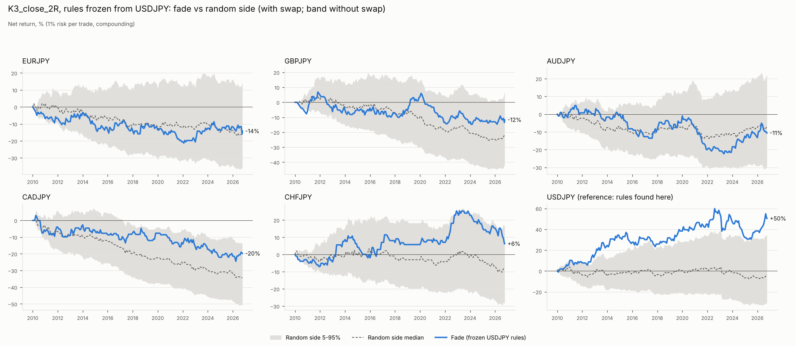
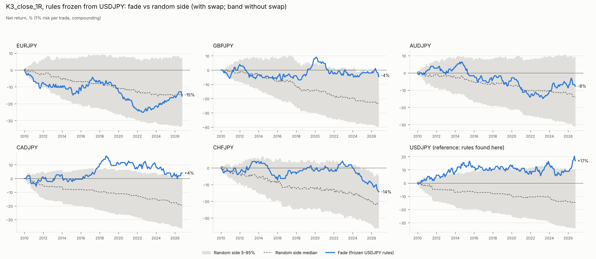

# Frozen USDJPY impulse fade, tested on the other JPY pairs

Period 2010-01-01 to 2026-10-07 23:45 UTC. Rules taken unchanged from the USDJPY fade study (no re-tuning). Fresh pairs: EURJPY, GBPJPY, AUDJPY, CADJPY, CHFJPY. USDJPY shown for reference only. Random-side benchmark: 1000 seeds, same moment, same stop and target, coin-flip direction, no swap.

**Pass criteria (fixed before running, primary rule K3_close_2R, with swap, fresh pairs, full period):** (1) pooled expectancy > 0; (2) pooled fade beats >= 95% of random-side seeds; (3) positive on >= 3 of 5 pairs.

## Verdict

**Short answer: it fails. The USDJPY K=3 fade does not carry over to the other yen pairs, so treat the USDJPY result as a one-pair fluke.**

**Primary rule, K3_close_2R, unchanged from USDJPY, 2010–2026, with swap.** It fails all three criteria fixed before the run:

| Pair | Trades | Expectancy | vs random direction (percentile) |
|---|---|---|---|
| EURJPY | 231 | −0.057R | 52nd |
| GBPJPY | 253 | −0.039R | 76th |
| AUDJPY | 190 | −0.049R | 39th |
| CADJPY | 214 | −0.093R | 87th |
| CHFJPY | 165 | +0.047R | 88th |
| **Pooled, 5 fresh pairs** | 1053 | **−0.042R** | 89th |
| USDJPY (reference, where the rules were found) | 257 | +0.171R | 99th |

1. Pooled expectancy −0.042R → **FAIL**
2. Pooled percentile 89, below the 95 needed → **FAIL**
3. Positive on 1 of 5 pairs → **FAIL**

CHFJPY, the only positive pair, is negative in 2020–2026 (−0.005R) and gives back most of its 2022–2023 gain by 2026.

**Secondary rule, K3_close_1R** (for information only):
- Pooled −0.032R, positive on 1 of 5 pairs.
- It does beat the random direction at the 98th percentile pooled.

**What the "beats random" numbers mean.** Fading is somewhat better than picking a random direction at the same moment. On the 1R rule it's clearly better: the pooled random-direction median is −0.09R against −0.03R for the fade. But the random-direction median is essentially the cost of trading: spread, plus the stop and target being slightly asymmetric after spread on these short stops. So there is a small real snap-back after 3×ATR yen impulses, worth roughly 0.05R per trade. The cost of trading it with stops this tight is about 0.09R per trade, which is bigger, so it doesn't pay.

**Caveats:**
- These crosses aren't fully independent of USDJPY: many big impulses are the same yen move showing up on every pair. That makes the failure more telling, not less. The same yen events that paid on USDJPY didn't pay on its crosses.
- MoF intervention windows change results by ≤ 0.03R.
- NZDJPY was not tested: the datastore has data only to 2012.

**Bottom line across all four studies:** no tested version of 4H supply/demand trading has a robust edge on these pairs after costs. That covers zones with the macro filter, zones alone, the fade on USDJPY and EURUSD, and the frozen USDJPY fade on 5 yen crosses. The one real effect, a partial snap-back after big impulses, is smaller than the cost of trading it with these stops.

## K3_close_2R

| pair | trades | win% | PF | exp R +swap | exp R no swap | maxDD% | lose streak | net % | rand p50 | rand p95 | pctl vs random |
|---|---|---|---|---|---|---|---|---|---|---|---|
| EURJPY | 231 | 31.602 | 0.918 | -0.057 | -0.056 | 21.327 | 9 | -14.196 | -0.057 | 0.073 | 51.900 |
| GBPJPY | 253 | 32.411 | 0.943 | -0.039 | -0.035 | 20.198 | 13 | -11.679 | -0.087 | 0.036 | 75.500 |
| AUDJPY | 190 | 32.105 | 0.929 | -0.049 | -0.053 | 25.933 | 13 | -10.574 | -0.029 | 0.115 | 39.000 |
| CADJPY | 214 | 30.374 | 0.867 | -0.093 | -0.095 | 27.383 | 11 | -19.774 | -0.187 | -0.061 | 87.400 |
| CHFJPY | 165 | 35.152 | 1.072 | 0.047 | 0.054 | 16.057 | 11 | 6.287 | -0.047 | 0.104 | 87.600 |
| USDJPY (reference) | 257 | 40.078 | 1.271 | 0.171 | 0.175 | 19.153 | 14 | 50.411 | -0.004 | 0.128 | 98.600 |
| POOLED fresh pairs | 1053 | - | - | -0.042 | -0.041 | - | 0 | - | -0.085 | -0.030 | 89.400 |

Criteria: (1) pooled expectancy -0.042R -> FAIL; (2) pooled percentile 89.4 -> FAIL; (3) positive on 1/5 pairs -> FAIL. **FAILS**

### By period (with swap)

| pair | 2010-2020 (IS for USDJPY) | 2020-2026 | full |
|---|---|---|---|
| AUDJPY | -0.019 | -0.084 | -0.049 |
| CADJPY | -0.052 | -0.154 | -0.093 |
| CHFJPY | 0.084 | -0.005 | 0.047 |
| EURJPY | -0.085 | -0.010 | -0.057 |
| GBPJPY | 0.047 | -0.182 | -0.039 |
| USDJPY | 0.264 | 0.053 | 0.171 |

Trades per period:

| pair | 2010-2020 (IS for USDJPY) | 2020-2026 | full |
|---|---|---|---|
| AUDJPY | 103 | 87 | 190 |
| CADJPY | 128 | 86 | 214 |
| CHFJPY | 96 | 69 | 165 |
| EURJPY | 143 | 88 | 231 |
| GBPJPY | 158 | 95 | 253 |
| USDJPY | 144 | 113 | 257 |

### With and without trades open within +/-3 trading days of MoF yen interventions (full, with swap)

| pair | exp all | exp ex-intervention | n all | n ex-intervention |
|---|---|---|---|---|
| AUDJPY | -0.049 | -0.067 | 190.000 | 184.000 |
| CADJPY | -0.093 | -0.124 | 214.000 | 201.000 |
| CHFJPY | 0.047 | 0.024 | 165.000 | 157.000 |
| EURJPY | -0.057 | -0.063 | 231.000 | 223.000 |
| GBPJPY | -0.039 | -0.070 | 253.000 | 245.000 |
| USDJPY | 0.171 | 0.188 | 257.000 | 248.000 |

## K3_close_1R

| pair | trades | win% | PF | exp R +swap | exp R no swap | maxDD% | lose streak | net % | rand p50 | rand p95 | pctl vs random |
|---|---|---|---|---|---|---|---|---|---|---|---|
| EURJPY | 232 | 46.983 | 0.881 | -0.064 | -0.063 | 25.099 | 9 | -14.737 | -0.063 | 0.040 | 51.400 |
| GBPJPY | 255 | 49.804 | 0.980 | -0.010 | -0.004 | 13.412 | 8 | -3.771 | -0.098 | -0.004 | 94.100 |
| AUDJPY | 192 | 48.958 | 0.931 | -0.036 | -0.036 | 19.957 | 9 | -7.663 | -0.074 | 0.049 | 69.200 |
| CADJPY | 216 | 51.389 | 1.047 | 0.023 | 0.022 | 14.937 | 7 | 3.996 | -0.095 | 0.007 | 97.400 |
| CHFJPY | 178 | 46.067 | 0.848 | -0.082 | -0.079 | 18.474 | 9 | -14.354 | -0.135 | -0.022 | 78.500 |
| USDJPY (reference) | 264 | 53.409 | 1.137 | 0.064 | 0.068 | 9.579 | 6 | 16.806 | -0.055 | 0.044 | 98.400 |
| POOLED fresh pairs | 1073 | - | - | -0.032 | -0.030 | - | 0 | - | -0.090 | -0.042 | 98.300 |

Criteria: (1) pooled expectancy -0.032R -> FAIL; (2) pooled percentile 98.3 -> PASS; (3) positive on 1/5 pairs -> FAIL. **FAILS** (secondary rule, for information)

### By period (with swap)

| pair | 2010-2020 (IS for USDJPY) | 2020-2026 | full |
|---|---|---|---|
| AUDJPY | -0.023 | -0.053 | -0.036 |
| CADJPY | 0.082 | -0.066 | 0.023 |
| CHFJPY | -0.004 | -0.203 | -0.082 |
| EURJPY | -0.090 | -0.021 | -0.064 |
| GBPJPY | 0.058 | -0.125 | -0.010 |
| USDJPY | 0.096 | 0.022 | 0.064 |

Trades per period:

| pair | 2010-2020 (IS for USDJPY) | 2020-2026 | full |
|---|---|---|---|
| AUDJPY | 105 | 87 | 192 |
| CADJPY | 130 | 86 | 216 |
| CHFJPY | 108 | 70 | 178 |
| EURJPY | 144 | 88 | 232 |
| GBPJPY | 160 | 95 | 255 |
| USDJPY | 149 | 115 | 264 |

### With and without trades open within +/-3 trading days of MoF yen interventions (full, with swap)

| pair | exp all | exp ex-intervention | n all | n ex-intervention |
|---|---|---|---|---|
| AUDJPY | -0.036 | -0.038 | 192.000 | 186.000 |
| CADJPY | 0.023 | 0.030 | 216.000 | 203.000 |
| CHFJPY | -0.082 | -0.074 | 178.000 | 170.000 |
| EURJPY | -0.064 | -0.075 | 232.000 | 224.000 |
| GBPJPY | -0.010 | -0.023 | 255.000 | 246.000 |
| USDJPY | 0.064 | 0.069 | 264.000 | 255.000 |

## Counts

| rule | pair | skipped_position_open | stop_lt_2x_spread |
|---|---|---|---|
| K3_close_2R | EURJPY | 8 | 0 |
| K3_close_2R | GBPJPY | 12 | 0 |
| K3_close_2R | AUDJPY | 5 | 1 |
| K3_close_2R | CADJPY | 15 | 0 |
| K3_close_2R | CHFJPY | 19 | 0 |
| K3_close_2R | USDJPY | 20 | 0 |
| K3_close_1R | EURJPY | 7 | 0 |
| K3_close_1R | GBPJPY | 10 | 0 |
| K3_close_1R | AUDJPY | 3 | 1 |
| K3_close_1R | CADJPY | 13 | 0 |
| K3_close_1R | CHFJPY | 6 | 0 |
| K3_close_1R | USDJPY | 13 | 0 |

## Data

| pair | median spread pips | expected_15m_bars | missing_15m_bars | gaps_ge_1h |
|---|---|---|---|---|
| EURJPY | 0.90 | 414304 | 116 | 12 |
| GBPJPY | 1.90 | 414304 | 129 | 12 |
| AUDJPY | 1.00 | 414304 | 119 | 13 |
| CADJPY | 1.30 | 414304 | 110 | 12 |
| CHFJPY | 1.80 | 414304 | 237 | 16 |
| USDJPY | 0.50 | 414304 | 109 | 13 |