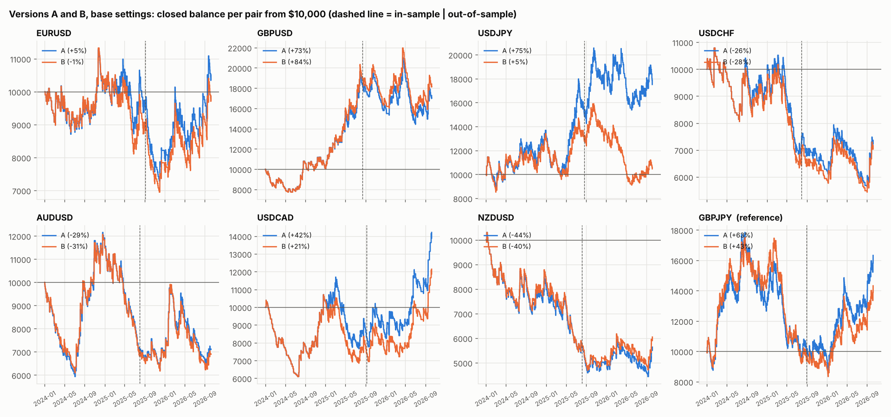

# Versions A and B on every major pair

Base settings: IST 05:00–05:59 box, SL 30 pips + spread, RR 4, BE 3R → +5 pips, 1% risk compounding from $10,000, each pair its own account. Dukascopy bid/ask, 2024-01-01 → 2026-10-07. 60/40 in-sample / out-of-sample split by tradable days. GBPJPY is the original pair, shown for reference only and not included in the pooled row.

## Version A — breakout, re-entry at the 6-minute extreme

| Version A | trades | win_rate | avg_R | profit_factor | t_stat | max_dd_pct | losing_streak | net_return_pct | is_avg_R | oos_avg_R | both halves + |
|---|---|---|---|---|---|---|---|---|---|---|---|
| EURUSD | 559 | 26.83 | 0.03 | 1.04 | 0.32 | 35.37 | 19 | 5.09 | -0.00 | 0.07 | no |
| GBPUSD | 534 | 26.78 | 0.13 | 1.17 | 1.45 | 31.27 | 16 | 72.58 | 0.21 | -0.00 | no |
| USDJPY | 804 | 28.11 | 0.09 | 1.13 | 1.31 | 27.85 | 19 | 75.13 | 0.11 | 0.07 | yes |
| USDCHF | 525 | 25.71 | -0.03 | 0.96 | -0.36 | 47.82 | 20 | -26.42 | -0.06 | 0.02 | no |
| AUDUSD | 596 | 24.66 | -0.03 | 0.96 | -0.41 | 48.81 | 20 | -28.96 | -0.07 | 0.03 | no |
| USDCAD | 563 | 26.11 | 0.10 | 1.13 | 1.14 | 41.38 | 22 | 42.09 | -0.03 | 0.29 | no |
| NZDUSD | 561 | 22.28 | -0.08 | 0.90 | -1.02 | 56.93 | 24 | -43.62 | -0.16 | 0.03 | no |
| GBPJPY | 847 | 26.21 | 0.08 | 1.11 | 1.16 | 51.18 | 22 | 63.29 | 0.02 | 0.17 | yes |

## Version B — breakout, re-entry at the original box level

| Version B | trades | win_rate | avg_R | profit_factor | t_stat | max_dd_pct | losing_streak | net_return_pct | is_avg_R | oos_avg_R | both halves + |
|---|---|---|---|---|---|---|---|---|---|---|---|
| EURUSD | 541 | 26.25 | 0.02 | 1.02 | 0.18 | 38.66 | 18 | -1.35 | -0.02 | 0.07 | no |
| GBPUSD | 512 | 26.56 | 0.14 | 1.20 | 1.60 | 30.66 | 16 | 84.07 | 0.23 | 0.01 | yes |
| USDJPY | 733 | 26.47 | 0.03 | 1.04 | 0.37 | 42.71 | 20 | 4.66 | 0.08 | -0.06 | no |
| USDCHF | 519 | 25.43 | -0.04 | 0.95 | -0.48 | 49.62 | 20 | -28.36 | -0.09 | 0.03 | no |
| AUDUSD | 576 | 24.31 | -0.04 | 0.95 | -0.50 | 48.86 | 22 | -31.05 | -0.08 | 0.02 | no |
| USDCAD | 554 | 25.63 | 0.07 | 1.09 | 0.82 | 41.38 | 22 | 21.42 | -0.07 | 0.27 | no |
| NZDUSD | 544 | 22.43 | -0.07 | 0.91 | -0.89 | 54.38 | 23 | -39.53 | -0.16 | 0.06 | no |
| GBPJPY | 770 | 25.84 | 0.07 | 1.09 | 0.95 | 52.37 | 20 | 43.25 | 0.01 | 0.16 | yes |

## All majors pooled (every trade, equal weight)

| All 7 majors pooled | trades | avg_R | t_stat | is_avg_R | oos_avg_R |
|---|---|---|---|---|---|
| A | 4142.000 | 0.032 | 1.043 | 0.005 | 0.071 |
| B | 3979.000 | 0.014 | 0.468 | -0.012 | 0.055 |

## A vs B per pair

| Pair | avg_R A | avg_R B | reentries_filled A | reentries_filled B | reentries_invalid A | reentries_invalid B | A better? |
|---|---|---|---|---|---|---|---|
| AUDUSD | -0.032 | -0.039 | 23.000 | 3.000 | 4.000 | 31.000 | yes |
| EURUSD | 0.027 | 0.015 | 18.000 | 0.000 | 1.000 | 20.000 | yes |
| GBPJPY | 0.079 | 0.068 | 142.000 | 65.000 | 18.000 | 120.000 | yes |
| GBPUSD | 0.127 | 0.145 | 23.000 | 1.000 | 1.000 | 31.000 | no |
| NZDUSD | -0.081 | -0.072 | 17.000 | 0.000 | 4.000 | 24.000 | no |
| USDCAD | 0.097 | 0.069 | 10.000 | 1.000 | 0.000 | 12.000 | yes |
| USDCHF | -0.030 | -0.040 | 6.000 | 0.000 | 1.000 | 8.000 | yes |
| USDJPY | 0.092 | 0.026 | 122.000 | 51.000 | 4.000 | 94.000 | yes |

## Context: box size, spread, skipped days

The SL is 30 pips on every pair. On a pair whose 05:00–06:00 IST box is small, 30 pips is a wide stop relative to that morning's movement; on GBPJPY it is close to one box.

| Pair | median_box_pips | median_spread_pips | skipped_days | SL as x box |
|---|---|---|---|---|
| EURUSD | 8.20 | 0.30 | 177.00 | 3.66 |
| GBPUSD | 10.10 | 0.80 | 209.00 | 2.97 |
| USDJPY | 24.30 | 0.50 | 36.00 | 1.23 |
| USDCHF | 7.60 | 0.90 | 201.00 | 3.95 |
| AUDUSD | 8.70 | 0.90 | 149.00 | 3.45 |
| USDCAD | 8.30 | 1.30 | 168.00 | 3.61 |
| NZDUSD | 8.20 | 1.00 | 179.00 | 3.66 |
| GBPJPY | 26.40 | 2.10 | 16.00 | 1.14 |

Trade logs: `trade_logs/<PAIR>_<A|B>.csv`. Raw numbers: `summary.csv`.
