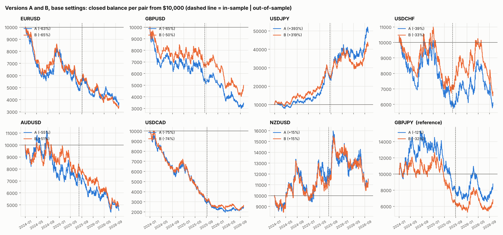

# Versions A and B on every major pair — SL = 1 × box

Base settings: IST 05:00–05:59 box, SL = 1 × that day's 05:00–05:59 box + spread (BE offset scaled the same: 5/30 of the SL distance), RR 4, BE 3R → +5 pips, 1% risk compounding from $10,000, each pair its own account. Dukascopy bid/ask, 2024-01-01 → 2026-10-07. 60/40 in-sample / out-of-sample split by tradable days. GBPJPY is the original pair, shown for reference only and not included in the pooled row.

## Version A — breakout, re-entry at the 6-minute extreme

| Version A | trades | win_rate | avg_R | profit_factor | t_stat | max_dd_pct | losing_streak | net_return_pct | is_avg_R | oos_avg_R | both halves + |
|---|---|---|---|---|---|---|---|---|---|---|---|
| EURUSD | 728 | 21.43 | -0.12 | 0.85 | -1.73 | 64.72 | 22 | -62.65 | -0.13 | -0.11 | no |
| GBPUSD | 685 | 20.58 | -0.14 | 0.82 | -1.99 | 70.09 | 19 | -65.45 | -0.14 | -0.14 | no |
| USDJPY | 858 | 29.37 | 0.21 | 1.30 | 2.98 | 34.47 | 26 | 392.61 | 0.20 | 0.24 | yes |
| USDCHF | 668 | 22.75 | -0.06 | 0.92 | -0.80 | 44.84 | 23 | -39.44 | -0.11 | 0.01 | no |
| AUDUSD | 766 | 23.11 | -0.09 | 0.89 | -1.30 | 60.79 | 28 | -54.79 | -0.05 | -0.15 | no |
| USDCAD | 722 | 19.39 | -0.18 | 0.78 | -2.60 | 80.46 | 18 | -75.00 | -0.25 | -0.06 | no |
| NZDUSD | 721 | 26.07 | 0.04 | 1.05 | 0.53 | 33.12 | 14 | 15.29 | 0.06 | 0.01 | yes |
| GBPJPY | 893 | 24.75 | 0.00 | 1.00 | 0.05 | 57.18 | 32 | -12.42 | -0.03 | 0.06 | no |

## Version B — breakout, re-entry at the original box level

| Version B | trades | win_rate | avg_R | profit_factor | t_stat | max_dd_pct | losing_streak | net_return_pct | is_avg_R | oos_avg_R | both halves + |
|---|---|---|---|---|---|---|---|---|---|---|---|
| EURUSD | 634 | 20.50 | -0.15 | 0.81 | -2.08 | 67.33 | 19 | -65.07 | -0.13 | -0.18 | no |
| GBPUSD | 591 | 21.49 | -0.10 | 0.87 | -1.32 | 59.70 | 35 | -50.18 | -0.10 | -0.11 | no |
| USDJPY | 766 | 29.50 | 0.21 | 1.30 | 2.82 | 27.61 | 23 | 319.24 | 0.22 | 0.19 | yes |
| USDCHF | 570 | 23.16 | -0.05 | 0.93 | -0.65 | 40.44 | 19 | -32.58 | -0.08 | -0.01 | no |
| AUDUSD | 650 | 23.23 | -0.10 | 0.88 | -1.31 | 56.10 | 26 | -51.33 | -0.03 | -0.19 | no |
| USDCAD | 617 | 19.12 | -0.20 | 0.75 | -2.79 | 78.81 | 29 | -73.60 | -0.29 | -0.06 | no |
| NZDUSD | 613 | 25.61 | 0.04 | 1.06 | 0.53 | 32.51 | 15 | 15.16 | 0.05 | 0.03 | yes |
| GBPJPY | 792 | 23.99 | -0.03 | 0.96 | -0.45 | 58.45 | 27 | -31.84 | -0.08 | 0.05 | no |

## All majors pooled (every trade, equal weight)

| All 7 majors pooled | trades | avg_R | t_stat | is_avg_R | oos_avg_R |
|---|---|---|---|---|---|
| A | 5148.000 | -0.040 | -1.502 | -0.052 | -0.022 |
| B | 4441.000 | -0.041 | -1.434 | -0.042 | -0.039 |

## A vs B per pair

| Pair | avg_R A | avg_R B | reentries_filled A | reentries_filled B | reentries_invalid A | reentries_invalid B | A better? |
|---|---|---|---|---|---|---|---|
| AUDUSD | -0.088 | -0.095 | 193.000 | 77.000 | 42.000 | 186.000 | yes |
| EURUSD | -0.119 | -0.150 | 187.000 | 93.000 | 25.000 | 147.000 | yes |
| GBPJPY | 0.003 | -0.031 | 188.000 | 87.000 | 30.000 | 162.000 | yes |
| GBPUSD | -0.139 | -0.101 | 174.000 | 80.000 | 27.000 | 141.000 | no |
| NZDUSD | 0.039 | 0.042 | 177.000 | 69.000 | 52.000 | 176.000 | no |
| USDCAD | -0.175 | -0.201 | 169.000 | 64.000 | 53.000 | 182.000 | yes |
| USDCHF | -0.059 | -0.052 | 149.000 | 51.000 | 49.000 | 167.000 | no |
| USDJPY | 0.211 | 0.212 | 176.000 | 84.000 | 14.000 | 125.000 | no |

## Context: box size, spread, skipped days

The SL follows each day's box, so it is the same size relative to the morning's movement on every pair. Small boxes make the spread a bigger share of the risk (column spread_pct_of_risk).

| Pair | median_box_pips | median_spread_pips | median_risk_pips | spread_pct_of_risk | skipped_days | SL as x box |
|---|---|---|---|---|---|---|
| EURUSD | 8.20 | 0.30 | 8.40 | 3.67 | 177.00 | 1.02 |
| GBPUSD | 10.10 | 0.80 | 10.60 | 7.63 | 209.00 | 1.05 |
| USDJPY | 24.30 | 0.50 | 24.00 | 2.20 | 36.00 | 0.99 |
| USDCHF | 7.60 | 0.90 | 8.30 | 11.52 | 201.00 | 1.09 |
| AUDUSD | 8.70 | 0.90 | 9.45 | 9.88 | 149.00 | 1.09 |
| USDCAD | 8.30 | 1.30 | 9.30 | 13.79 | 168.00 | 1.12 |
| NZDUSD | 8.20 | 1.00 | 9.10 | 11.11 | 179.00 | 1.11 |
| GBPJPY | 26.40 | 2.10 | 27.30 | 7.30 | 16.00 | 1.03 |

Trade logs: `trade_logs/<PAIR>_<A|B>.csv`. Raw numbers: `summary.csv`.
