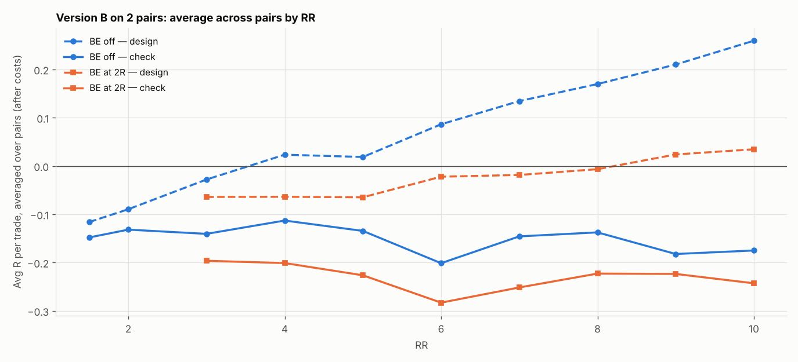

# Version B (SL 1 × box, 05:00 IST) on 2 pairs: RR 1.5–10 × BE

138 setups per pair, 276 in total. $7/lot, swap (+1% markup), 0.2 pip slippage. 2024–2026 split 60/40 into design / check. With this many tries, judge by the check columns and by how many pairs agree.

## Each pair's best design setup, checked

| pair | design pick | design avg R | design t | check avg R | check t | check trades | held up? |
|---|---|---|---|---|---|---|---|
| EURUSD | SL2x RR10 BE 4R+5 | 0.205 | 1.099 | -0.158 | -0.806 | 218 | no |
| GBPUSD | SL2x RR10 BE off | 0.368 | 1.734 | -0.162 | -0.767 | 204 | no |

Pairs whose design pick held up in check: **0 of 2**.

## Every setup averaged over all pairs (top 15 by design)

| setup | design | check | pairs positive in check |
|---|---|---|---|
| SL2x RR10 BE 8R+5 | 0.261 | -0.170 | 0.000 |
| SL2x RR10 BE 4R+5 | 0.260 | -0.135 | 0.000 |
| SL2x RR10 BE off | 0.260 | -0.175 | 0.000 |
| SL2x RR10 BE 9R+5 | 0.249 | -0.166 | 0.000 |
| SL2x RR10 BE 5R+5 | 0.247 | -0.133 | 0.000 |
| SL2x RR10 BE 6R+5 | 0.246 | -0.148 | 0.000 |
| SL2x RR10 BE 7R+5 | 0.244 | -0.156 | 0.000 |
| SL2x RR9 BE 8R+5 | 0.222 | -0.184 | 0.000 |
| SL2x RR9 BE 4R+5 | 0.216 | -0.141 | 0.000 |
| SL2x RR9 BE off | 0.210 | -0.182 | 0.000 |
| SL2x RR9 BE 7R+5 | 0.208 | -0.170 | 0.000 |
| SL3x RR8 BE 5R+5 | 0.203 | -0.045 | 0.000 |
| SL2x RR9 BE 5R+5 | 0.200 | -0.144 | 0.000 |
| SL2x RR9 BE 6R+5 | 0.198 | -0.161 | 0.000 |
| SL3x RR9 BE 5R+5 | 0.197 | -0.063 | 0.000 |

## Data

| Pair | days | skipped | design_end | median_box_pips | median_spread_pips |
|---|---|---|---|---|---|
| EURUSD | 723 | 177 | 2025-09-03 | 8.20 | 0.30 |
| GBPUSD | 723 | 209 | 2025-08-14 | 10.10 | 0.70 |

Full grid: `grid.csv`.
