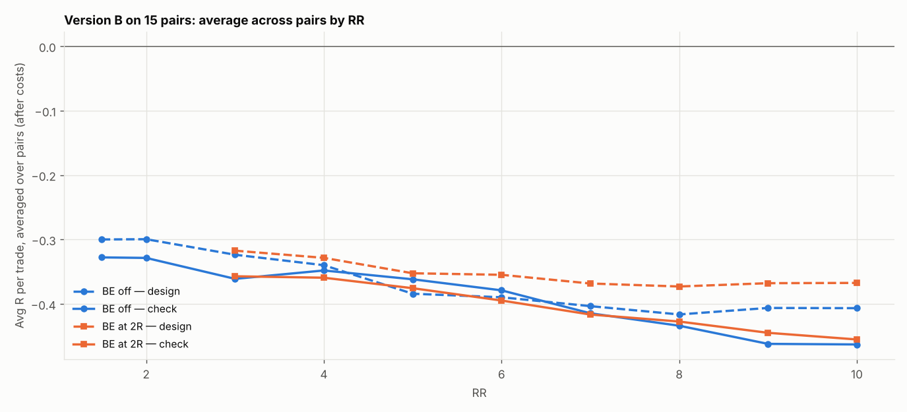

# Version B (SL 1 × box, 05:00 IST) on 15 pairs: RR 1.5–10 × BE

184 setups per pair, 2760 in total. $7/lot, swap (+1% markup), 0.2 pip slippage. 2024–2026 split 60/40 into design / check. With this many tries, judge by the check columns and by how many pairs agree.

## Each pair's best design setup, checked

| pair | design pick | design avg R | design t | check avg R | check t | check trades | held up? |
|---|---|---|---|---|---|---|---|
| EURGBP | SL3x RR4 BE 3R+5 | -0.074 | -0.606 | -0.267 | -1.978 | 178 | no |
| EURCHF | SL3x RR3 BE off | -0.101 | -1.065 | -0.056 | -0.471 | 226 | no |
| EURAUD | SL3x RR1.5 BE off | -0.087 | -1.460 | -0.188 | -2.612 | 286 | no |
| EURCAD | SL4x RR2 BE off | 0.031 | 0.435 | -0.158 | -1.860 | 269 | no |
| EURNZD | SL4x RR10 BE 6R+5 | 0.164 | 1.022 | -0.721 | -7.763 | 284 | no |
| GBPCHF | SL3x RR9 BE 6R+5 | -0.141 | -0.981 | -0.305 | -1.866 | 261 | no |
| GBPAUD | SL3x RR4 BE 2R+5 | 0.022 | 0.246 | -0.339 | -3.897 | 286 | no |
| GBPCAD | SL4x RR4 BE off | 0.112 | 1.049 | -0.141 | -1.175 | 260 | no |
| GBPNZD | SL4x RR10 BE off | 0.250 | 1.478 | -0.614 | -5.101 | 281 | no |
| AUDNZD | SL4x RR10 BE 3R+5 | -0.057 | -0.373 | 0.463 | 2.096 | 268 | yes |
| AUDCAD | SL4x RR6 BE off | -0.089 | -0.735 | -0.230 | -1.632 | 266 | no |
| AUDCHF | SL4x RR1.5 BE off | -0.219 | -3.464 | -0.299 | -3.795 | 243 | no |
| NZDCAD | SL4x RR1.5 BE off | -0.216 | -3.255 | -0.361 | -4.566 | 213 | no |
| NZDCHF | SL1x RR1.5 BE off | -0.247 | -3.955 | -0.421 | -5.389 | 246 | no |
| CADCHF | SL4x RR2 BE off | -0.158 | -1.956 | -0.502 | -5.781 | 195 | no |

Pairs whose design pick held up in check: **1 of 15**.

## Every setup averaged over all pairs (top 15 by design)

| setup | design | check | pairs positive in check |
|---|---|---|---|
| SL4x RR1.5 BE off | -0.163 | -0.206 | 1.000 |
| SL4x RR2 BE off | -0.164 | -0.229 | 0.000 |
| SL4x RR3 BE off | -0.181 | -0.286 | 1.000 |
| SL4x RR3 BE 2R+5 | -0.191 | -0.280 | 0.000 |
| SL3x RR1.5 BE off | -0.191 | -0.206 | 0.000 |
| SL3x RR2 BE off | -0.198 | -0.231 | 1.000 |
| SL3x RR3 BE off | -0.208 | -0.301 | 0.000 |
| SL4x RR4 BE 2R+5 | -0.208 | -0.311 | 0.000 |
| SL4x RR4 BE 3R+5 | -0.214 | -0.320 | 1.000 |
| SL4x RR4 BE off | -0.215 | -0.306 | 0.000 |
| SL3x RR4 BE off | -0.218 | -0.352 | 0.000 |
| SL2x RR1.5 BE off | -0.220 | -0.215 | 1.000 |
| SL3x RR4 BE 3R+5 | -0.225 | -0.347 | 0.000 |
| SL3x RR3 BE 2R+5 | -0.226 | -0.295 | 0.000 |
| SL4x RR5 BE 2R+5 | -0.233 | -0.330 | 1.000 |

## Data

| Pair | days | skipped | design_end | median_box_pips | median_spread_pips |
|---|---|---|---|---|---|
| EURGBP | 723 | 279 | 2025-08-06 | 3.70 | 0.70 |
| EURCHF | 723 | 151 | 2025-08-19 | 4.90 | 1.00 |
| EURAUD | 723 | 9 | 2025-08-29 | 16.40 | 2.30 |
| EURCAD | 723 | 48 | 2025-09-02 | 8.30 | 1.90 |
| EURNZD | 723 | 13 | 2025-08-26 | 19.90 | 3.70 |
| GBPCHF | 723 | 63 | 2025-08-21 | 6.80 | 1.80 |
| GBPAUD | 723 | 9 | 2025-08-29 | 18.10 | 3.60 |
| GBPCAD | 723 | 72 | 2025-08-27 | 9.70 | 2.80 |
| GBPNZD | 723 | 18 | 2025-08-26 | 22.05 | 4.90 |
| AUDNZD | 723 | 53 | 2025-08-27 | 9.30 | 2.00 |
| AUDCAD | 723 | 61 | 2025-08-28 | 9.00 | 1.90 |
| AUDCHF | 723 | 114 | 2025-07-07 | 6.60 | 1.40 |
| NZDCAD | 723 | 190 | 2025-07-07 | 9.20 | 2.20 |
| NZDCHF | 723 | 142 | 2025-06-25 | 6.10 | 1.60 |
| CADCHF | 723 | 228 | 2025-05-26 | 4.90 | 1.50 |

Full grid: `grid.csv`.
