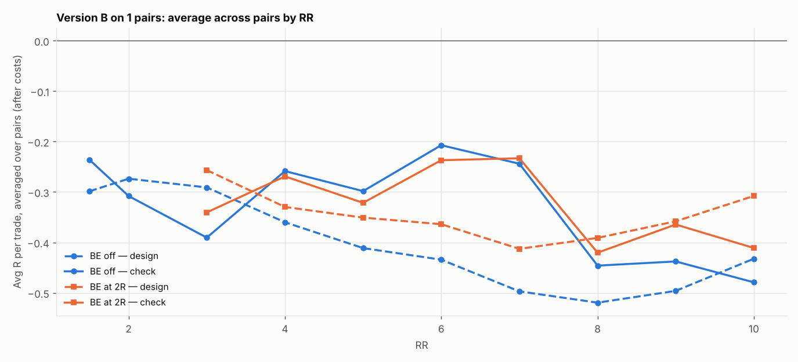

# Version B (SL 1 × box, 05:00 IST) on 1 pairs: RR 1.5–10 × BE

184 setups per pair, 184 in total. $7/lot, swap (+1% markup), 0.2 pip slippage. 2024–2026 split 60/40 into design / check. With this many tries, judge by the check columns and by how many pairs agree.

## Each pair's best design setup, checked

| pair | design pick | design avg R | design t | check avg R | check t | check trades | held up? |
|---|---|---|---|---|---|---|---|
| AUDCAD | SL4x RR6 BE off | -0.089 | -0.735 | -0.230 | -1.632 | 266 | no |

Pairs whose design pick held up in check: **0 of 1**.

## Every setup averaged over all pairs (top 15 by design)

| setup | design | check | pairs positive in check |
|---|---|---|---|
| SL4x RR6 BE off | -0.089 | -0.230 | 0.000 |
| SL4x RR6 BE 5R+5 | -0.126 | -0.244 | 0.000 |
| SL4x RR5 BE off | -0.129 | -0.277 | 0.000 |
| SL4x RR7 BE 6R+5 | -0.142 | -0.176 | 0.000 |
| SL4x RR3 BE off | -0.145 | -0.315 | 0.000 |
| SL4x RR7 BE off | -0.157 | -0.184 | 0.000 |
| SL4x RR9 BE 6R+5 | -0.165 | -0.045 | 0.000 |
| SL4x RR9 BE 7R+5 | -0.176 | -0.053 | 0.000 |
| SL4x RR1.5 BE off | -0.179 | -0.125 | 0.000 |
| SL4x RR10 BE 6R+5 | -0.184 | 0.041 | 1.000 |
| SL4x RR7 BE 5R+5 | -0.189 | -0.193 | 0.000 |
| SL4x RR10 BE 7R+5 | -0.193 | 0.032 | 1.000 |
| SL4x RR5 BE 4R+5 | -0.198 | -0.277 | 0.000 |
| SL4x RR9 BE 8R+5 | -0.202 | -0.019 | 0.000 |
| SL4x RR9 BE 3R+5 | -0.204 | -0.201 | 0.000 |

## Data

| Pair | days | skipped | design_end | median_box_pips | median_spread_pips |
|---|---|---|---|---|---|
| AUDCAD | 723 | 61 | 2025-08-28 | 9.00 | 1.90 |

Full grid: `grid.csv`.
