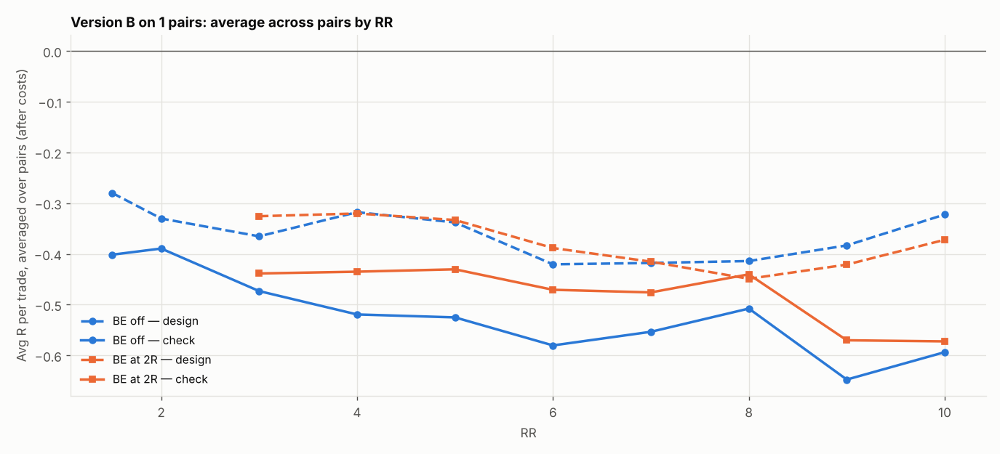

# Version B (SL 1 × box, 05:00 IST) on 1 pairs: RR 1.5–10 × BE

184 setups per pair, 184 in total. $7/lot, swap (+1% markup), 0.2 pip slippage. 2024–2026 split 60/40 into design / check. With this many tries, judge by the check columns and by how many pairs agree.

## Each pair's best design setup, checked

| pair | design pick | design avg R | design t | check avg R | check t | check trades | held up? |
|---|---|---|---|---|---|---|---|
| AUDCHF | SL4x RR1.5 BE off | -0.219 | -3.464 | -0.299 | -3.795 | 243 | no |

Pairs whose design pick held up in check: **0 of 1**.

## Every setup averaged over all pairs (top 15 by design)

| setup | design | check | pairs positive in check |
|---|---|---|---|
| SL4x RR1.5 BE off | -0.219 | -0.299 | 0.000 |
| SL2x RR1.5 BE off | -0.253 | -0.308 | 0.000 |
| SL3x RR1.5 BE off | -0.257 | -0.338 | 0.000 |
| SL4x RR2 BE off | -0.260 | -0.330 | 0.000 |
| SL1x RR1.5 BE off | -0.280 | -0.401 | 0.000 |
| SL4x RR3 BE off | -0.285 | -0.274 | 0.000 |
| SL4x RR3 BE 2R+5 | -0.294 | -0.418 | 0.000 |
| SL3x RR2 BE off | -0.310 | -0.367 | 0.000 |
| SL2x RR2 BE off | -0.313 | -0.411 | 0.000 |
| SL4x RR8 BE 2R+5 | -0.314 | -0.385 | 0.000 |
| SL1x RR4 BE off | -0.318 | -0.519 | 0.000 |
| SL1x RR4 BE 2R+5 | -0.320 | -0.435 | 0.000 |
| SL1x RR10 BE off | -0.322 | -0.593 | 0.000 |
| SL1x RR10 BE 8R+5 | -0.322 | -0.646 | 0.000 |
| SL1x RR10 BE 9R+5 | -0.323 | -0.671 | 0.000 |

## Data

| Pair | days | skipped | design_end | median_box_pips | median_spread_pips |
|---|---|---|---|---|---|
| AUDCHF | 723 | 114 | 2025-07-07 | 6.60 | 1.40 |

Full grid: `grid.csv`.
