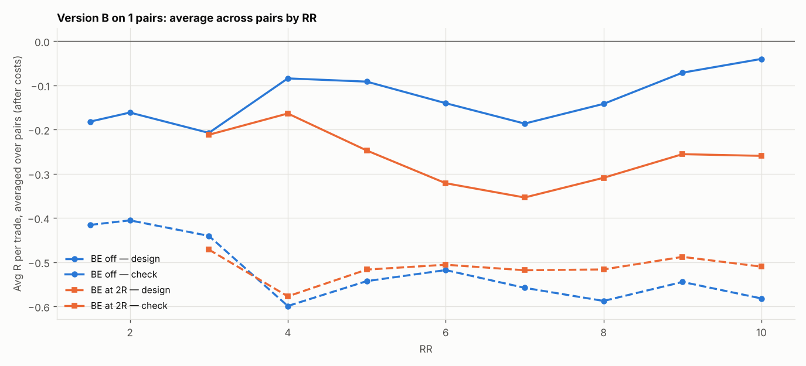

# Version B (SL 1 × box, 05:00 IST) on 1 pairs: RR 1.5–10 × BE

184 setups per pair, 184 in total. $7/lot, swap (+1% markup), 0.2 pip slippage. 2024–2026 split 60/40 into design / check. With this many tries, judge by the check columns and by how many pairs agree.

## Each pair's best design setup, checked

| pair | design pick | design avg R | design t | check avg R | check t | check trades | held up? |
|---|---|---|---|---|---|---|---|
| AUDNZD | SL4x RR10 BE 3R+5 | -0.057 | -0.373 | 0.463 | 2.096 | 268 | yes |

Pairs whose design pick held up in check: **1 of 1**.

## Every setup averaged over all pairs (top 15 by design)

| setup | design | check | pairs positive in check |
|---|---|---|---|
| SL4x RR10 BE 3R+5 | -0.057 | 0.463 | 1.000 |
| SL4x RR8 BE 3R+5 | -0.071 | 0.279 | 1.000 |
| SL4x RR9 BE 3R+5 | -0.083 | 0.351 | 1.000 |
| SL4x RR10 BE 4R+5 | -0.088 | 0.432 | 1.000 |
| SL4x RR8 BE 4R+5 | -0.107 | 0.241 | 1.000 |
| SL4x RR9 BE 4R+5 | -0.117 | 0.316 | 1.000 |
| SL4x RR10 BE 2R+5 | -0.117 | 0.336 | 1.000 |
| SL4x RR10 BE 5R+5 | -0.124 | 0.397 | 1.000 |
| SL4x RR8 BE 2R+5 | -0.125 | 0.190 | 1.000 |
| SL4x RR7 BE 3R+5 | -0.133 | 0.171 | 1.000 |
| SL4x RR8 BE 5R+5 | -0.143 | 0.206 | 1.000 |
| SL4x RR10 BE off | -0.146 | 0.475 | 1.000 |
| SL4x RR10 BE 6R+5 | -0.149 | 0.413 | 1.000 |
| SL4x RR9 BE 5R+5 | -0.152 | 0.281 | 1.000 |
| SL4x RR9 BE 2R+5 | -0.154 | 0.243 | 1.000 |

## Data

| Pair | days | skipped | design_end | median_box_pips | median_spread_pips |
|---|---|---|---|---|---|
| AUDNZD | 723 | 53 | 2025-08-27 | 9.30 | 2.00 |

Full grid: `grid.csv`.
