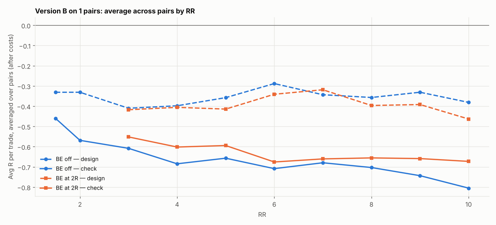

# Version B (SL 1 × box, 05:00 IST) on 1 pairs: RR 1.5–10 × BE

184 setups per pair, 184 in total. $7/lot, swap (+1% markup), 0.2 pip slippage. 2024–2026 split 60/40 into design / check. With this many tries, judge by the check columns and by how many pairs agree.

## Each pair's best design setup, checked

| pair | design pick | design avg R | design t | check avg R | check t | check trades | held up? |
|---|---|---|---|---|---|---|---|
| CADCHF | SL4x RR2 BE off | -0.158 | -1.956 | -0.502 | -5.781 | 195 | no |

Pairs whose design pick held up in check: **0 of 1**.

## Every setup averaged over all pairs (top 15 by design)

| setup | design | check | pairs positive in check |
|---|---|---|---|
| SL4x RR2 BE off | -0.158 | -0.502 | 0.000 |
| SL4x RR1.5 BE off | -0.183 | -0.457 | 0.000 |
| SL3x RR2 BE off | -0.216 | -0.484 | 0.000 |
| SL3x RR1.5 BE off | -0.247 | -0.400 | 0.000 |
| SL3x RR3 BE 2R+5 | -0.249 | -0.626 | 0.000 |
| SL2x RR3 BE off | -0.272 | -0.579 | 0.000 |
| SL2x RR4 BE off | -0.278 | -0.686 | 0.000 |
| SL1x RR6 BE off | -0.288 | -0.708 | 0.000 |
| SL2x RR4 BE 3R+5 | -0.289 | -0.700 | 0.000 |
| SL3x RR3 BE off | -0.295 | -0.657 | 0.000 |
| SL4x RR4 BE 2R+5 | -0.299 | -0.643 | 0.000 |
| SL4x RR3 BE off | -0.300 | -0.606 | 0.000 |
| SL2x RR4 BE 2R+5 | -0.309 | -0.656 | 0.000 |
| SL4x RR3 BE 2R+5 | -0.311 | -0.607 | 0.000 |
| SL1x RR6 BE 5R+5 | -0.316 | -0.751 | 0.000 |

## Data

| Pair | days | skipped | design_end | median_box_pips | median_spread_pips |
|---|---|---|---|---|---|
| CADCHF | 723 | 228 | 2025-05-26 | 4.90 | 1.50 |

Full grid: `grid.csv`.
