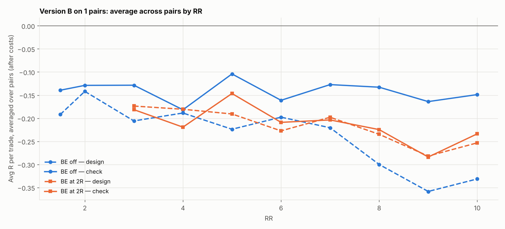

# Version B (SL 1 × box, 05:00 IST) on 1 pairs: RR 1.5–10 × BE

184 setups per pair, 184 in total. $7/lot, swap (+1% markup), 0.2 pip slippage. 2024–2026 split 60/40 into design / check. With this many tries, judge by the check columns and by how many pairs agree.

## Each pair's best design setup, checked

| pair | design pick | design avg R | design t | check avg R | check t | check trades | held up? |
|---|---|---|---|---|---|---|---|
| EURAUD | SL3x RR1.5 BE off | -0.087 | -1.460 | -0.188 | -2.612 | 286 | no |

Pairs whose design pick held up in check: **0 of 1**.

## Every setup averaged over all pairs (top 15 by design)

| setup | design | check | pairs positive in check |
|---|---|---|---|
| SL3x RR1.5 BE off | -0.087 | -0.188 | 0.000 |
| SL3x RR2 BE off | -0.100 | -0.284 | 0.000 |
| SL4x RR1.5 BE off | -0.115 | -0.309 | 0.000 |
| SL3x RR4 BE 2R+5 | -0.121 | -0.361 | 0.000 |
| SL3x RR3 BE 2R+5 | -0.124 | -0.326 | 0.000 |
| SL2x RR3 BE off | -0.141 | -0.247 | 0.000 |
| SL1x RR2 BE off | -0.142 | -0.129 | 0.000 |
| SL2x RR4 BE 2R+5 | -0.156 | -0.215 | 0.000 |
| SL2x RR4 BE 3R+5 | -0.159 | -0.246 | 0.000 |
| SL2x RR3 BE 2R+5 | -0.160 | -0.195 | 0.000 |
| SL2x RR1.5 BE off | -0.164 | -0.149 | 0.000 |
| SL2x RR2 BE off | -0.166 | -0.171 | 0.000 |
| SL4x RR2 BE off | -0.168 | -0.321 | 0.000 |
| SL3x RR5 BE 2R+5 | -0.171 | -0.391 | 0.000 |
| SL1x RR3 BE 2R+5 | -0.174 | -0.181 | 0.000 |

## Data

| Pair | days | skipped | design_end | median_box_pips | median_spread_pips |
|---|---|---|---|---|---|
| EURAUD | 723 | 9 | 2025-08-29 | 16.40 | 2.30 |

Full grid: `grid.csv`.
