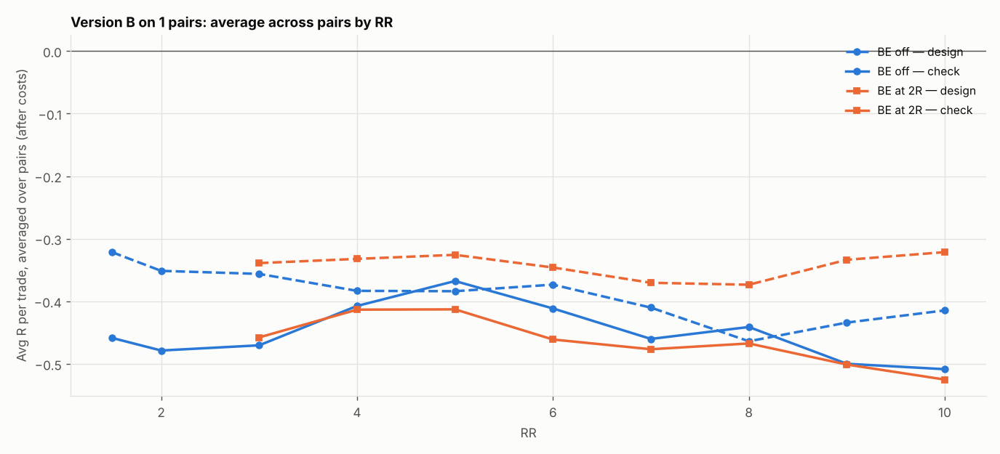

# Version B (SL 1 × box, 05:00 IST) on 1 pairs: RR 1.5–10 × BE

184 setups per pair, 184 in total. $7/lot, swap (+1% markup), 0.2 pip slippage. 2024–2026 split 60/40 into design / check. With this many tries, judge by the check columns and by how many pairs agree.

## Each pair's best design setup, checked

| pair | design pick | design avg R | design t | check avg R | check t | check trades | held up? |
|---|---|---|---|---|---|---|---|
| EURCAD | SL4x RR2 BE off | 0.031 | 0.435 | -0.158 | -1.860 | 269 | no |

Pairs whose design pick held up in check: **0 of 1**.

## Every setup averaged over all pairs (top 15 by design)

| setup | design | check | pairs positive in check |
|---|---|---|---|
| SL4x RR2 BE off | 0.031 | -0.158 | 0.000 |
| SL4x RR3 BE 2R+5 | 0.029 | -0.259 | 0.000 |
| SL4x RR4 BE 2R+5 | 0.021 | -0.341 | 0.000 |
| SL4x RR3 BE off | -0.003 | -0.310 | 0.000 |
| SL4x RR5 BE 2R+5 | -0.023 | -0.370 | 0.000 |
| SL4x RR4 BE 3R+5 | -0.032 | -0.396 | 0.000 |
| SL4x RR4 BE off | -0.044 | -0.417 | 0.000 |
| SL4x RR1.5 BE off | -0.051 | -0.112 | 0.000 |
| SL4x RR6 BE 2R+5 | -0.061 | -0.356 | 0.000 |
| SL4x RR5 BE 3R+5 | -0.083 | -0.407 | 0.000 |
| SL3x RR7 BE 2R+5 | -0.089 | -0.323 | 0.000 |
| SL3x RR3 BE off | -0.093 | -0.257 | 0.000 |
| SL3x RR3 BE 2R+5 | -0.101 | -0.215 | 0.000 |
| SL4x RR5 BE 4R+5 | -0.106 | -0.434 | 0.000 |
| SL3x RR6 BE 2R+5 | -0.106 | -0.278 | 0.000 |

## Data

| Pair | days | skipped | design_end | median_box_pips | median_spread_pips |
|---|---|---|---|---|---|
| EURCAD | 723 | 48 | 2025-09-02 | 8.30 | 1.90 |

Full grid: `grid.csv`.
