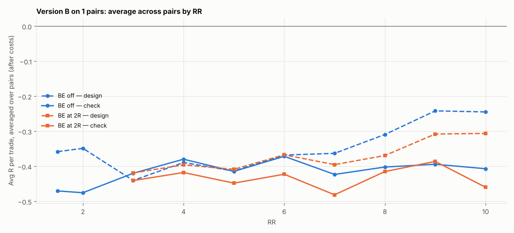

# Version B (SL 1 × box, 05:00 IST) on 1 pairs: RR 1.5–10 × BE

184 setups per pair, 184 in total. $7/lot, swap (+1% markup), 0.2 pip slippage. 2024–2026 split 60/40 into design / check. With this many tries, judge by the check columns and by how many pairs agree.

## Each pair's best design setup, checked

| pair | design pick | design avg R | design t | check avg R | check t | check trades | held up? |
|---|---|---|---|---|---|---|---|
| EURCHF | SL3x RR3 BE off | -0.101 | -1.065 | -0.056 | -0.471 | 226 | no |

Pairs whose design pick held up in check: **0 of 1**.

## Every setup averaged over all pairs (top 15 by design)

| setup | design | check | pairs positive in check |
|---|---|---|---|
| SL3x RR3 BE off | -0.101 | -0.056 | 0.000 |
| SL3x RR2 BE off | -0.103 | 0.008 | 1.000 |
| SL4x RR1.5 BE off | -0.114 | 0.007 | 1.000 |
| SL3x RR1.5 BE off | -0.124 | -0.038 | 0.000 |
| SL3x RR3 BE 2R+5 | -0.126 | -0.047 | 0.000 |
| SL4x RR2 BE off | -0.135 | -0.001 | 0.000 |
| SL3x RR4 BE 3R+5 | -0.154 | -0.131 | 0.000 |
| SL2x RR5 BE 4R+5 | -0.161 | -0.128 | 0.000 |
| SL2x RR5 BE 2R+5 | -0.174 | -0.273 | 0.000 |
| SL2x RR5 BE off | -0.174 | -0.168 | 0.000 |
| SL4x RR3 BE 2R+5 | -0.181 | -0.043 | 0.000 |
| SL2x RR5 BE 3R+5 | -0.182 | -0.140 | 0.000 |
| SL3x RR4 BE off | -0.186 | -0.095 | 0.000 |
| SL3x RR4 BE 2R+5 | -0.197 | -0.084 | 0.000 |
| SL4x RR3 BE off | -0.203 | -0.008 | 0.000 |

## Data

| Pair | days | skipped | design_end | median_box_pips | median_spread_pips |
|---|---|---|---|---|---|
| EURCHF | 723 | 151 | 2025-08-19 | 4.90 | 1.00 |

Full grid: `grid.csv`.
