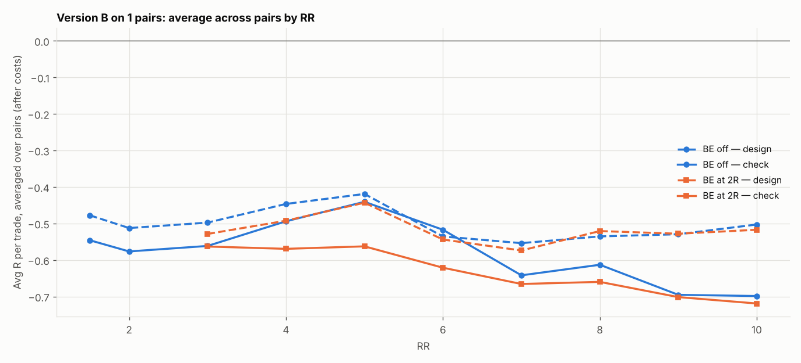

# Version B (SL 1 × box, 05:00 IST) on 1 pairs: RR 1.5–10 × BE

184 setups per pair, 184 in total. $7/lot, swap (+1% markup), 0.2 pip slippage. 2024–2026 split 60/40 into design / check. With this many tries, judge by the check columns and by how many pairs agree.

## Each pair's best design setup, checked

| pair | design pick | design avg R | design t | check avg R | check t | check trades | held up? |
|---|---|---|---|---|---|---|---|
| EURGBP | SL3x RR4 BE 3R+5 | -0.074 | -0.606 | -0.267 | -1.978 | 178 | no |

Pairs whose design pick held up in check: **0 of 1**.

## Every setup averaged over all pairs (top 15 by design)

| setup | design | check | pairs positive in check |
|---|---|---|---|
| SL3x RR4 BE 3R+5 | -0.074 | -0.267 | 0.000 |
| SL3x RR3 BE off | -0.110 | -0.254 | 0.000 |
| SL2x RR5 BE off | -0.117 | -0.338 | 0.000 |
| SL2x RR5 BE 4R+5 | -0.117 | -0.397 | 0.000 |
| SL3x RR4 BE off | -0.140 | -0.282 | 0.000 |
| SL3x RR6 BE 3R+5 | -0.151 | -0.446 | 0.000 |
| SL4x RR3 BE off | -0.159 | -0.174 | 0.000 |
| SL2x RR6 BE 4R+5 | -0.163 | -0.411 | 0.000 |
| SL4x RR3 BE 2R+5 | -0.176 | -0.197 | 0.000 |
| SL2x RR3 BE 2R+5 | -0.178 | -0.419 | 0.000 |
| SL2x RR6 BE 5R+5 | -0.181 | -0.370 | 0.000 |
| SL2x RR3 BE off | -0.186 | -0.403 | 0.000 |
| SL3x RR4 BE 2R+5 | -0.186 | -0.313 | 0.000 |
| SL3x RR5 BE 3R+5 | -0.187 | -0.272 | 0.000 |
| SL3x RR2 BE off | -0.189 | -0.268 | 0.000 |

## Data

| Pair | days | skipped | design_end | median_box_pips | median_spread_pips |
|---|---|---|---|---|---|
| EURGBP | 723 | 279 | 2025-08-06 | 3.70 | 0.70 |

Full grid: `grid.csv`.
