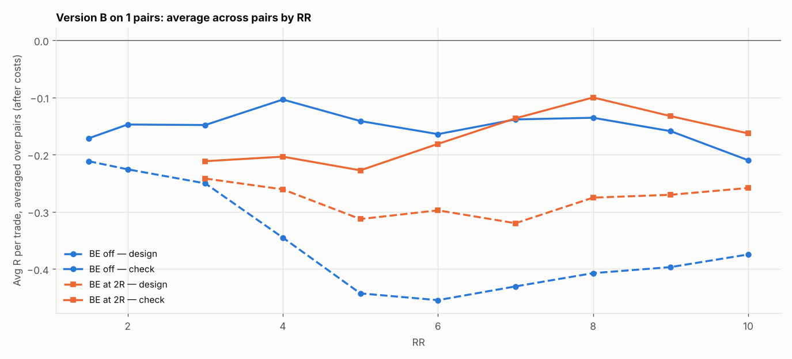

# Version B (SL 1 × box, 05:00 IST) on 1 pairs: RR 1.5–10 × BE

184 setups per pair, 184 in total. $7/lot, swap (+1% markup), 0.2 pip slippage. 2024–2026 split 60/40 into design / check. With this many tries, judge by the check columns and by how many pairs agree.

## Each pair's best design setup, checked

| pair | design pick | design avg R | design t | check avg R | check t | check trades | held up? |
|---|---|---|---|---|---|---|---|
| EURNZD | SL4x RR10 BE 6R+5 | 0.164 | 1.022 | -0.721 | -7.763 | 284 | no |

Pairs whose design pick held up in check: **0 of 1**.

## Every setup averaged over all pairs (top 15 by design)

| setup | design | check | pairs positive in check |
|---|---|---|---|
| SL4x RR10 BE 6R+5 | 0.164 | -0.721 | 0.000 |
| SL4x RR10 BE 4R+5 | 0.164 | -0.652 | 0.000 |
| SL4x RR10 BE 5R+5 | 0.159 | -0.695 | 0.000 |
| SL4x RR10 BE 7R+5 | 0.147 | -0.738 | 0.000 |
| SL4x RR10 BE 8R+5 | 0.135 | -0.746 | 0.000 |
| SL4x RR10 BE 9R+5 | 0.123 | -0.734 | 0.000 |
| SL4x RR10 BE off | 0.121 | -0.743 | 0.000 |
| SL4x RR9 BE 4R+5 | 0.089 | -0.602 | 0.000 |
| SL4x RR9 BE 6R+5 | 0.084 | -0.670 | 0.000 |
| SL4x RR8 BE 4R+5 | 0.083 | -0.555 | 0.000 |
| SL4x RR9 BE 5R+5 | 0.082 | -0.645 | 0.000 |
| SL4x RR8 BE 5R+5 | 0.074 | -0.598 | 0.000 |
| SL4x RR8 BE 6R+5 | 0.073 | -0.624 | 0.000 |
| SL4x RR9 BE 7R+5 | 0.067 | -0.687 | 0.000 |
| SL4x RR8 BE 7R+5 | 0.056 | -0.641 | 0.000 |

## Data

| Pair | days | skipped | design_end | median_box_pips | median_spread_pips |
|---|---|---|---|---|---|
| EURNZD | 723 | 13 | 2025-08-26 | 19.90 | 3.70 |

Full grid: `grid.csv`.
