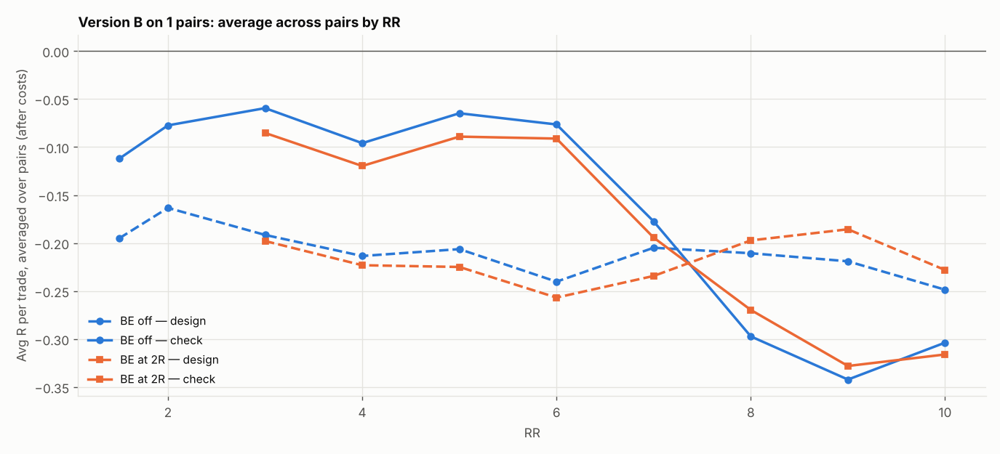

# Version B (SL 1 × box, 05:00 IST) on 1 pairs: RR 1.5–10 × BE

184 setups per pair, 184 in total. $7/lot, swap (+1% markup), 0.2 pip slippage. 2024–2026 split 60/40 into design / check. With this many tries, judge by the check columns and by how many pairs agree.

## Each pair's best design setup, checked

| pair | design pick | design avg R | design t | check avg R | check t | check trades | held up? |
|---|---|---|---|---|---|---|---|
| GBPAUD | SL3x RR4 BE 2R+5 | 0.022 | 0.246 | -0.339 | -3.897 | 286 | no |

Pairs whose design pick held up in check: **0 of 1**.

## Every setup averaged over all pairs (top 15 by design)

| setup | design | check | pairs positive in check |
|---|---|---|---|
| SL3x RR4 BE 2R+5 | 0.022 | -0.339 | 0.000 |
| SL3x RR5 BE 2R+5 | 0.020 | -0.416 | 0.000 |
| SL2x RR7 BE 2R+5 | 0.020 | -0.338 | 0.000 |
| SL3x RR6 BE 2R+5 | 0.019 | -0.386 | 0.000 |
| SL2x RR9 BE 2R+5 | 0.019 | -0.309 | 0.000 |
| SL4x RR3 BE 2R+5 | 0.017 | -0.267 | 0.000 |
| SL2x RR8 BE 2R+5 | 0.012 | -0.326 | 0.000 |
| SL2x RR10 BE off | 0.008 | -0.393 | 0.000 |
| SL4x RR4 BE 2R+5 | 0.008 | -0.339 | 0.000 |
| SL2x RR10 BE 2R+5 | 0.008 | -0.353 | 0.000 |
| SL3x RR7 BE 2R+5 | 0.007 | -0.418 | 0.000 |
| SL3x RR7 BE off | 0.002 | -0.366 | 0.000 |
| SL4x RR6 BE 5R+5 | 0.001 | -0.349 | 0.000 |
| SL4x RR4 BE 3R+5 | -0.000 | -0.377 | 0.000 |
| SL4x RR5 BE off | -0.003 | -0.363 | 0.000 |

## Data

| Pair | days | skipped | design_end | median_box_pips | median_spread_pips |
|---|---|---|---|---|---|
| GBPAUD | 723 | 9 | 2025-08-29 | 18.10 | 3.60 |

Full grid: `grid.csv`.
