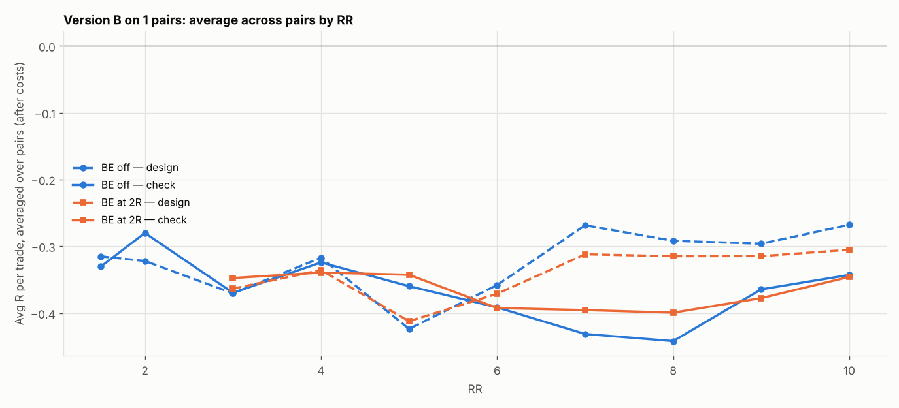

# Version B (SL 1 × box, 05:00 IST) on 1 pairs: RR 1.5–10 × BE

184 setups per pair, 184 in total. $7/lot, swap (+1% markup), 0.2 pip slippage. 2024–2026 split 60/40 into design / check. With this many tries, judge by the check columns and by how many pairs agree.

## Each pair's best design setup, checked

| pair | design pick | design avg R | design t | check avg R | check t | check trades | held up? |
|---|---|---|---|---|---|---|---|
| GBPCAD | SL4x RR4 BE off | 0.112 | 1.049 | -0.141 | -1.175 | 260 | no |

Pairs whose design pick held up in check: **0 of 1**.

## Every setup averaged over all pairs (top 15 by design)

| setup | design | check | pairs positive in check |
|---|---|---|---|
| SL4x RR4 BE off | 0.112 | -0.141 | 0.000 |
| SL3x RR5 BE 3R+5 | 0.087 | -0.100 | 0.000 |
| SL4x RR3 BE off | 0.081 | -0.105 | 0.000 |
| SL3x RR4 BE off | 0.074 | -0.052 | 0.000 |
| SL3x RR5 BE 4R+5 | 0.071 | -0.100 | 0.000 |
| SL4x RR4 BE 3R+5 | 0.071 | -0.110 | 0.000 |
| SL3x RR5 BE off | 0.063 | -0.109 | 0.000 |
| SL3x RR9 BE 3R+5 | 0.060 | -0.254 | 0.000 |
| SL3x RR4 BE 3R+5 | 0.058 | -0.074 | 0.000 |
| SL3x RR8 BE 3R+5 | 0.051 | -0.137 | 0.000 |
| SL4x RR4 BE 2R+5 | 0.051 | -0.092 | 0.000 |
| SL3x RR6 BE off | 0.050 | -0.058 | 0.000 |
| SL3x RR10 BE 3R+5 | 0.048 | -0.312 | 0.000 |
| SL3x RR6 BE 3R+5 | 0.047 | -0.072 | 0.000 |
| SL3x RR6 BE 4R+5 | 0.038 | -0.064 | 0.000 |

## Data

| Pair | days | skipped | design_end | median_box_pips | median_spread_pips |
|---|---|---|---|---|---|
| GBPCAD | 723 | 72 | 2025-08-27 | 9.70 | 2.80 |

Full grid: `grid.csv`.
