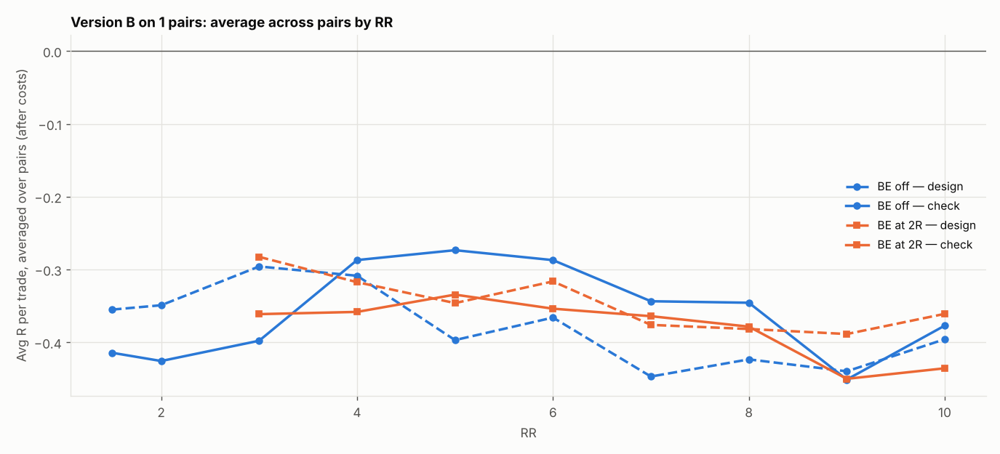

# Version B (SL 1 × box, 05:00 IST) on 1 pairs: RR 1.5–10 × BE

184 setups per pair, 184 in total. $7/lot, swap (+1% markup), 0.2 pip slippage. 2024–2026 split 60/40 into design / check. With this many tries, judge by the check columns and by how many pairs agree.

## Each pair's best design setup, checked

| pair | design pick | design avg R | design t | check avg R | check t | check trades | held up? |
|---|---|---|---|---|---|---|---|
| GBPCHF | SL3x RR9 BE 6R+5 | -0.141 | -0.981 | -0.305 | -1.866 | 261 | no |

Pairs whose design pick held up in check: **0 of 1**.

## Every setup averaged over all pairs (top 15 by design)

| setup | design | check | pairs positive in check |
|---|---|---|---|
| SL3x RR9 BE 6R+5 | -0.141 | -0.305 | 0.000 |
| SL3x RR8 BE 6R+5 | -0.143 | -0.253 | 0.000 |
| SL3x RR3 BE 2R+5 | -0.156 | -0.228 | 0.000 |
| SL3x RR8 BE 5R+5 | -0.157 | -0.225 | 0.000 |
| SL3x RR5 BE off | -0.158 | -0.151 | 0.000 |
| SL3x RR9 BE 5R+5 | -0.160 | -0.276 | 0.000 |
| SL3x RR9 BE 7R+5 | -0.161 | -0.293 | 0.000 |
| SL3x RR8 BE 7R+5 | -0.163 | -0.221 | 0.000 |
| SL3x RR7 BE 6R+5 | -0.165 | -0.296 | 0.000 |
| SL3x RR4 BE 2R+5 | -0.167 | -0.303 | 0.000 |
| SL3x RR6 BE off | -0.170 | -0.160 | 0.000 |
| SL3x RR1.5 BE off | -0.171 | -0.184 | 0.000 |
| SL3x RR9 BE 8R+5 | -0.171 | -0.298 | 0.000 |
| SL3x RR8 BE off | -0.173 | -0.226 | 0.000 |
| SL3x RR10 BE 6R+5 | -0.174 | -0.257 | 0.000 |

## Data

| Pair | days | skipped | design_end | median_box_pips | median_spread_pips |
|---|---|---|---|---|---|
| GBPCHF | 723 | 63 | 2025-08-21 | 6.80 | 1.80 |

Full grid: `grid.csv`.
