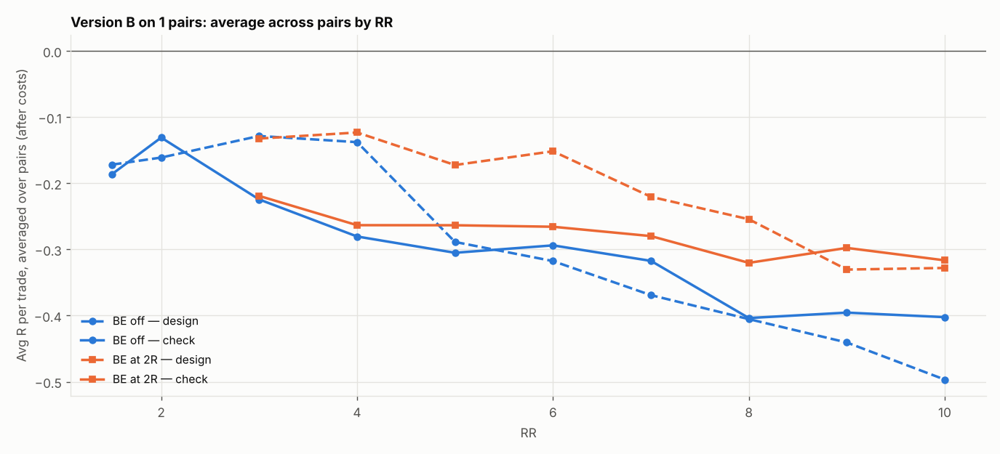

# Version B (SL 1 × box, 05:00 IST) on 1 pairs: RR 1.5–10 × BE

184 setups per pair, 184 in total. $7/lot, swap (+1% markup), 0.2 pip slippage. 2024–2026 split 60/40 into design / check. With this many tries, judge by the check columns and by how many pairs agree.

## Each pair's best design setup, checked

| pair | design pick | design avg R | design t | check avg R | check t | check trades | held up? |
|---|---|---|---|---|---|---|---|
| GBPNZD | SL4x RR10 BE off | 0.250 | 1.478 | -0.614 | -5.101 | 281 | no |

Pairs whose design pick held up in check: **0 of 1**.

## Every setup averaged over all pairs (top 15 by design)

| setup | design | check | pairs positive in check |
|---|---|---|---|
| SL4x RR10 BE off | 0.250 | -0.614 | 0.000 |
| SL4x RR10 BE 8R+5 | 0.230 | -0.619 | 0.000 |
| SL4x RR10 BE 9R+5 | 0.230 | -0.605 | 0.000 |
| SL4x RR10 BE 7R+5 | 0.184 | -0.585 | 0.000 |
| SL4x RR10 BE 6R+5 | 0.172 | -0.569 | 0.000 |
| SL4x RR9 BE 8R+5 | 0.171 | -0.563 | 0.000 |
| SL4x RR9 BE off | 0.171 | -0.553 | 0.000 |
| SL4x RR10 BE 5R+5 | 0.157 | -0.553 | 0.000 |
| SL4x RR9 BE 7R+5 | 0.130 | -0.530 | 0.000 |
| SL4x RR9 BE 6R+5 | 0.120 | -0.513 | 0.000 |
| SL4x RR10 BE 4R+5 | 0.118 | -0.508 | 0.000 |
| SL4x RR9 BE 5R+5 | 0.110 | -0.497 | 0.000 |
| SL4x RR10 BE 3R+5 | 0.087 | -0.524 | 0.000 |
| SL4x RR8 BE off | 0.057 | -0.426 | 0.000 |
| SL4x RR9 BE 4R+5 | 0.055 | -0.452 | 0.000 |

## Data

| Pair | days | skipped | design_end | median_box_pips | median_spread_pips |
|---|---|---|---|---|---|
| GBPNZD | 723 | 18 | 2025-08-26 | 22.05 | 4.90 |

Full grid: `grid.csv`.
