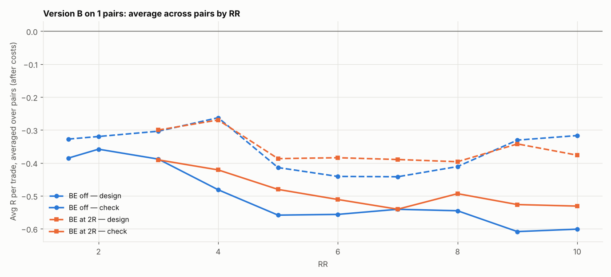

# Version B (SL 1 × box, 05:00 IST) on 1 pairs: RR 1.5–10 × BE

184 setups per pair, 184 in total. $7/lot, swap (+1% markup), 0.2 pip slippage. 2024–2026 split 60/40 into design / check. With this many tries, judge by the check columns and by how many pairs agree.

## Each pair's best design setup, checked

| pair | design pick | design avg R | design t | check avg R | check t | check trades | held up? |
|---|---|---|---|---|---|---|---|
| NZDCAD | SL4x RR1.5 BE off | -0.216 | -3.255 | -0.361 | -4.566 | 213 | no |

Pairs whose design pick held up in check: **0 of 1**.

## Every setup averaged over all pairs (top 15 by design)

| setup | design | check | pairs positive in check |
|---|---|---|---|
| SL4x RR1.5 BE off | -0.216 | -0.361 | 0.000 |
| SL4x RR2 BE off | -0.225 | -0.397 | 0.000 |
| SL2x RR2 BE off | -0.226 | -0.306 | 0.000 |
| SL3x RR1.5 BE off | -0.228 | -0.271 | 0.000 |
| SL3x RR2 BE off | -0.255 | -0.299 | 0.000 |
| SL2x RR1.5 BE off | -0.262 | -0.266 | 0.000 |
| SL1x RR4 BE off | -0.263 | -0.482 | 0.000 |
| SL2x RR4 BE 2R+5 | -0.269 | -0.423 | 0.000 |
| SL1x RR4 BE 2R+5 | -0.270 | -0.421 | 0.000 |
| SL3x RR3 BE off | -0.276 | -0.356 | 0.000 |
| SL4x RR3 BE 2R+5 | -0.279 | -0.446 | 0.000 |
| SL1x RR4 BE 3R+5 | -0.284 | -0.461 | 0.000 |
| SL2x RR3 BE 2R+5 | -0.286 | -0.412 | 0.000 |
| SL4x RR3 BE off | -0.297 | -0.498 | 0.000 |
| SL2x RR5 BE 2R+5 | -0.297 | -0.395 | 0.000 |

## Data

| Pair | days | skipped | design_end | median_box_pips | median_spread_pips |
|---|---|---|---|---|---|
| NZDCAD | 723 | 190 | 2025-07-07 | 9.20 | 2.20 |

Full grid: `grid.csv`.
