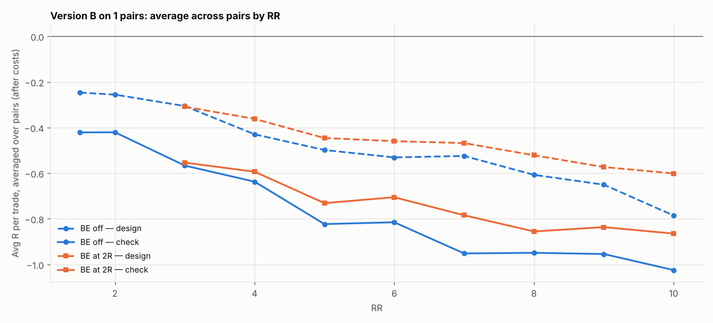

# Version B (SL 1 × box, 05:00 IST) on 1 pairs: RR 1.5–10 × BE

184 setups per pair, 184 in total. $7/lot, swap (+1% markup), 0.2 pip slippage. 2024–2026 split 60/40 into design / check. With this many tries, judge by the check columns and by how many pairs agree.

## Each pair's best design setup, checked

| pair | design pick | design avg R | design t | check avg R | check t | check trades | held up? |
|---|---|---|---|---|---|---|---|
| NZDCHF | SL1x RR1.5 BE off | -0.247 | -3.955 | -0.421 | -5.389 | 246 | no |

Pairs whose design pick held up in check: **0 of 1**.

## Every setup averaged over all pairs (top 15 by design)

| setup | design | check | pairs positive in check |
|---|---|---|---|
| SL1x RR1.5 BE off | -0.247 | -0.421 | 0.000 |
| SL1x RR2 BE off | -0.256 | -0.420 | 0.000 |
| SL2x RR1.5 BE off | -0.259 | -0.423 | 0.000 |
| SL2x RR2 BE off | -0.301 | -0.518 | 0.000 |
| SL4x RR1.5 BE off | -0.304 | -0.521 | 0.000 |
| SL3x RR1.5 BE off | -0.305 | -0.557 | 0.000 |
| SL1x RR3 BE off | -0.306 | -0.566 | 0.000 |
| SL1x RR3 BE 2R+5 | -0.308 | -0.554 | 0.000 |
| SL4x RR2 BE off | -0.328 | -0.664 | 0.000 |
| SL3x RR10 BE 4R+5 | -0.334 | -0.804 | 0.000 |
| SL3x RR10 BE 3R+5 | -0.334 | -0.810 | 0.000 |
| SL3x RR2 BE off | -0.341 | -0.638 | 0.000 |
| SL3x RR10 BE 5R+5 | -0.352 | -0.817 | 0.000 |
| SL1x RR4 BE 2R+5 | -0.362 | -0.593 | 0.000 |
| SL3x RR10 BE 6R+5 | -0.363 | -0.836 | 0.000 |

## Data

| Pair | days | skipped | design_end | median_box_pips | median_spread_pips |
|---|---|---|---|---|---|
| NZDCHF | 723 | 142 | 2025-06-25 | 6.10 | 1.60 |

Full grid: `grid.csv`.
