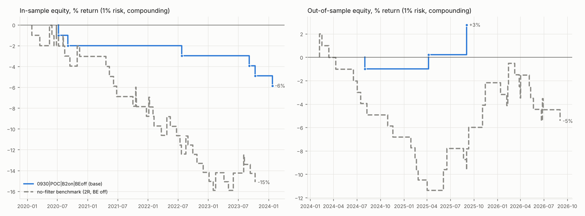
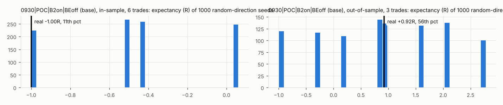

# Nasdaq 100 CFD: overnight volume profile + 15m bias + 1m sweep entries

Data: Dukascopy **USATECH.IDX/USD** (feed symbol `USATECHIDXUSD`), 1-minute **BID and ASK** candles, 2020-01-01 to 2026-10-09 (New York dates). All times America/New_York (zoneinfo, DST handled). Fills use the real bid/ask; signals use mid = (bid + ask) / 2.

**Volume is TICK VOLUME, not real volume**: the profile is weighted by Dukascopy's 1m candle volume (BID side), a tick-activity figure from the broker's own feed. It is not exchange volume and not a raw tick count; only its relative size inside one night matters for POC / value area.

1 unit = $1 per index point, fractional units. Risk 1% of current equity per trade (compounding), $10,000 start. Commission: $0.00 per unit round turn.

**Combos tested: 16** (the ranked sweep). Plus 2 no-filter benchmark runs, 16 next-bar-open robustness runs (not ranked) and 1000 random-direction seeds per reported combo and sample.

Split: tradable days in time order, first 60% in-sample (**1018 days, to 2024-01-25**), last 40% out-of-sample (**678 days, from 2024-01-26**). Ranking uses in-sample expectancy only, minimum 100 in-sample trades.

## Verdict (plain English)

**As specified, this strategy can't be evaluated. The 1m entry almost never fires, and on the trades that do exist it beats neither benchmark.**

* **Too few trades.** Over 1,696 tradable days (2020-01-02 to 2026-10-09) the 16 combos make **2 to 14 trades each**. In-sample the most is **8**, against the 100-trade minimum. Under the agreed rule **no combo qualifies, so nothing was ranked, selected or tested out-of-sample.** Every expectancy in this report is noise: one trade flipping from -1R to +2R moves it by 0.2R or more.
* **Does the 15m filter add anything? No evidence that it does.** In-sample, all 8 fixed-2R combos did worse than the no-filter benchmark with the same break-even setting. For example, BE off: -1.00R on 3-8 trades vs -0.33R on 48. The base setup's in-sample result sits at the **11th percentile** of the random-direction runs, so a coin flip on direction did better 89% of the time. Out-of-sample it has 3 trades (+0.92R, 56th percentile): meaningless. The rule was "useful only if it beats BOTH benchmarks". It beats neither in-sample, and the samples are too small to claim anything either way.
* **The 1m entry pattern shows no edge on its own either.** Without the 15m filter (both directions, swept level near VAH/VAL, 2R) it makes **86 trades: -0.33R in-sample and -0.14R out-of-sample** with BE off, -0.25R / -0.01R with BE on. That's still under 100 trades, and its random-direction percentiles are 36-53, so the direction it picks carries no information.
* **Weakest point: the two 1.5 x ATR(20, 1m) body tests.** The 15m bias isn't the bottleneck: a bias exists on 93-94% of days with B2 on (48-56% with B2 off). The 1m pattern is:
  * Of the base setup's 1,395 sweeps, 872 die for lack of a drive-in. In **771 of those the gap was there but no bearish bar reached 1.5 x ATR**.
  * Another 248 pass the drive-in but get no drive-out within 5 bars. In **138 of those price did close back above the gap, but with too small a body**. The median best drive-out body was 0.84 x ATR.
  * Only 4.4% of 1m bars between 09:30 and 11:00 clear 1.5 x ATR at all. Requiring two such bars within about 15 minutes, plus a gap, plus a fresh sweep, plus the bias, leaves about one trade a year.
  * This isn't caused by my reading of the ATR. Measuring ATR on the 20 bars *before* the tested bar gives 2-17 trades per combo.
* **There's also a logic tension.** A B1 long says price was rejected back into value and should go to POC. The entry then waits for a *new* low to be swept after that, which means price broke down again. The 5 base-setup longs all lost.
* **Execution realism isn't the issue.** Entering at the next bar's open instead of the signal close changes expectancy by 0.00-0.01R. The spread (median 1.4 pts, 1.1 in 2026) is small next to stops of 25-360 pts. No result is flagged as unrealistically good, and every sample is flagged as under 100 trades.

**What to test next** (each as a new, pre-declared sweep with its own in-sample/out-of-sample split; none of these were run here):
1. **Test the 15m idea on its own.** Enter at the close of the bias-confirming 15m bar, stop beyond that 15m sweep's extreme plus the spread, target POC or 2R, with the same exits and limits. That gives on the order of 1,000+ trades, so the core claim (rejection/acceptance at the overnight value area predicts the 09:30-11:00 move) can actually be judged against the same benchmarks.
2. If the 1m trigger matters to you, **loosen it once, before looking**: for example, one big bar instead of two, or a drive-out body of 1.0 x ATR. Treat the no-filter result (-0.14 to -0.33R) as the honest prior for what that pattern is worth.
3. **More history** helps a little but doesn't fix this. Dukascopy USATECH goes back to 2011 and those years are already in `datastore/`. That would add about 2,300 days, which is still only around 30 trades per combo with the current trigger.

## 1. Headline: base setup and top 3, in-sample and out-of-sample, next to the benchmarks

Benchmark 1 = no-filter (1m pattern both directions near VAH/VAL, fixed 2R). Benchmark 2 = random direction at the same timestamps (mean expectancy of the seeds, and the percentile where the real result lands).

| combo | role | sample | trades | win % | avg R | PF | expectancy R | max DD % | max DD R | longest losing streak | net return % | random mean exp R | random pctile | flags |
|---|---|---|---|---|---|---|---|---|---|---|---|---|---|---|
| 0930|POC|B2on|BEoff | base | IS | 6 | 0.00 | -1.00 | 0.00 | -1.00 | 5.85 | 6.00 | 6 | -5.85 | -0.46 | 11.25 | <100 trades |
| 0930|POC|B2on|BEoff | base | OOS | 3 | 66.67 | 0.92 | 3.77 | 0.92 | 1.00 | 1.00 | 1 | 2.76 | 0.89 | 56.05 | <100 trades |
| NOFILTER|2R|BEoff | benchmark 1 | IS | 48 | 22.92 | -0.33 | 0.57 | -0.33 | 15.93 | 17.01 | 6 | -15.13 | -0.29 | 35.90 | <100 trades |
| NOFILTER|2R|BEoff | benchmark 1 | OOS | 38 | 28.95 | -0.14 | 0.81 | -0.14 | 13.13 | 14.00 | 14 | -5.45 | -0.10 | 39.70 | <100 trades |
| NOFILTER|2R|BEon | benchmark 1 | IS | 48 | 14.58 | -0.25 | 0.54 | -0.25 | 12.42 | 13.05 | 6 | -11.59 | -0.26 | 52.50 | <100 trades |
| NOFILTER|2R|BEon | benchmark 1 | OOS | 38 | 23.68 | -0.01 | 0.99 | -0.01 | 9.56 | 10.00 | 10 | -0.52 | -0.01 | 50.60 | <100 trades |

## 2. In-sample ranking of all 16 combos (expectancy in R, >= 100 trades)

| IS rank | combo | trades | win % | avg R | PF | expectancy R | max DD % | max DD R | longest losing streak | net return % | flags | qualifies (>=100 IS trades) |
|---|---|---|---|---|---|---|---|---|---|---|---|---|
| - | 0945|POC|B2off|BEon | 1 | 0.00 | 0.00 | inf | 0.00 | 0.00 | 0.00 | 0 | 0.00 | <100 trades | no |
| - | 0930|POC|B2off|BEon | 4 | 0.00 | -0.25 | 0.00 | -0.25 | 1.00 | 1.00 | 1 | -1.00 | <100 trades | no |
| - | 0930|2R|B2off|BEon | 6 | 0.00 | -0.33 | 0.00 | -0.33 | 1.99 | 2.00 | 2 | -1.99 | <100 trades | no |
| - | 0945|2R|B2off|BEon | 3 | 0.00 | -0.33 | 0.00 | -0.33 | 1.00 | 1.00 | 1 | -1.00 | <100 trades | no |
| - | 0930|POC|B2on|BEon | 6 | 0.00 | -0.50 | 0.00 | -0.50 | 2.97 | 3.00 | 3 | -2.97 | <100 trades | no |
| - | 0930|2R|B2on|BEon | 8 | 0.00 | -0.50 | 0.00 | -0.50 | 3.94 | 4.00 | 4 | -3.94 | <100 trades | no |
| - | 0945|POC|B2on|BEon | 2 | 0.00 | -0.50 | 0.00 | -0.50 | 1.00 | 1.00 | 1 | -1.00 | <100 trades | no |
| - | 0945|2R|B2on|BEon | 4 | 0.00 | -0.50 | 0.00 | -0.50 | 1.99 | 2.00 | 2 | -1.99 | <100 trades | no |
| - | 0930|POC|B2on|BEoff | 6 | 0.00 | -1.00 | 0.00 | -1.00 | 5.85 | 6.00 | 6 | -5.85 | <100 trades | no |
| - | 0930|POC|B2off|BEoff | 4 | 0.00 | -1.00 | 0.00 | -1.00 | 3.94 | 4.00 | 4 | -3.94 | <100 trades | no |
| - | 0930|2R|B2on|BEoff | 8 | 0.00 | -1.00 | 0.00 | -1.00 | 7.73 | 8.00 | 8 | -7.73 | <100 trades | no |
| - | 0930|2R|B2off|BEoff | 6 | 0.00 | -1.00 | 0.00 | -1.00 | 5.85 | 6.00 | 6 | -5.85 | <100 trades | no |
| - | 0945|POC|B2on|BEoff | 2 | 0.00 | -1.00 | 0.00 | -1.00 | 1.99 | 2.00 | 2 | -1.99 | <100 trades | no |
| - | 0945|POC|B2off|BEoff | 1 | 0.00 | -1.00 | 0.00 | -1.00 | 1.00 | 1.00 | 1 | -1.00 | <100 trades | no |
| - | 0945|2R|B2on|BEoff | 4 | 0.00 | -1.00 | 0.00 | -1.00 | 3.94 | 4.00 | 4 | -3.94 | <100 trades | no |
| - | 0945|2R|B2off|BEoff | 3 | 0.00 | -1.00 | 0.00 | -1.00 | 2.97 | 3.00 | 3 | -2.97 | <100 trades | no |

**0 of 16 combos reach 100 in-sample trades** (most: 8), so nothing goes to out-of-sample (agreed rule: only qualifiers are tested). Non-qualifying combos are listed for information, not ranked, and their out-of-sample results are not computed in this report or its files.

## 3. Out-of-sample test of the in-sample top combos (chosen on in-sample only)

No combo qualified, so no combo was selected and none was tested out-of-sample. The base setup's out-of-sample row in section 1 is shown only because it was fixed in advance; it is not a selection.

### Plateau check (combos one setting away, in-sample)

No top combo to check. For information, the base setup's in-sample neighbours:

| change | combo | trades | expectancy | profit_factor |
|---|---|---|---|---|
| start=0945 | 0945|POC|B2on|BEoff | 2 | -1.00 | 0.00 |
| target=2R | 0930|2R|B2on|BEoff | 8 | -1.00 | 0.00 |
| b2=B2off | 0930|POC|B2off|BEoff | 4 | -1.00 | 0.00 |
| be=BEon | 0930|POC|B2on|BEon | 6 | -0.50 | 0.00 |

## 4. Benchmark 1: no-filter vs the strategy's fixed-2R variants

Same 1m pattern, stops, risk and daily limits; both directions allowed whenever the swept level is within 1 x ATR(14, 15m) of VAH or VAL, 09:30-11:00, fixed 2R. Each fixed-2R combo is compared with the no-filter run that has the same break-even setting.

| combo | vs | IS trades | IS exp R | IS NF trades | IS NF exp R | IS beats NF | OOS trades | OOS exp R | OOS NF trades | OOS NF exp R | OOS beats NF |
|---|---|---|---|---|---|---|---|---|---|---|---|
| 0930|2R|B2on|BEoff | NOFILTER|2R|BEoff | 8 | -1.00 | 48 | -0.33 | no | not tested | - | 38 | -0.14 | - |
| 0930|2R|B2on|BEon | NOFILTER|2R|BEon | 8 | -0.50 | 48 | -0.25 | no | not tested | - | 38 | -0.01 | - |
| 0930|2R|B2off|BEoff | NOFILTER|2R|BEoff | 6 | -1.00 | 48 | -0.33 | no | not tested | - | 38 | -0.14 | - |
| 0930|2R|B2off|BEon | NOFILTER|2R|BEon | 6 | -0.33 | 48 | -0.25 | no | not tested | - | 38 | -0.01 | - |
| 0945|2R|B2on|BEoff | NOFILTER|2R|BEoff | 4 | -1.00 | 48 | -0.33 | no | not tested | - | 38 | -0.14 | - |
| 0945|2R|B2on|BEon | NOFILTER|2R|BEon | 4 | -0.50 | 48 | -0.25 | no | not tested | - | 38 | -0.01 | - |
| 0945|2R|B2off|BEoff | NOFILTER|2R|BEoff | 3 | -1.00 | 48 | -0.33 | no | not tested | - | 38 | -0.14 | - |
| 0945|2R|B2off|BEon | NOFILTER|2R|BEon | 3 | -0.33 | 48 | -0.25 | no | not tested | - | 38 | -0.01 | - |

## 5. Benchmark 2: random direction (same trades, timestamps, stop distance, target multiple)

| combo | sample | trades | real exp R | random mean | random p5 | random p50 | random p95 | real exp pctile | real net % | random net % p50 | random net % p95 | real net pctile |
|---|---|---|---|---|---|---|---|---|---|---|---|---|
| 0930|POC|B2on|BEoff | IS | 6 | -1.00 | -0.46 | -1.00 | -0.44 | 0.06 | 11.25 | -5.85 | -2.65 | 0.30 | 11.25 |
| 0930|POC|B2on|BEoff | OOS | 3 | 0.92 | 0.89 | -1.00 | 0.92 | 2.78 | 56.05 | 2.76 | 2.76 | 8.54 | 56.05 |

## 6. Robustness: entry at the next bar's open instead of the signal bar's close (not ranked)

Decision, stop price and target price are fixed at the signal bar's close; the fill moves to the next bar's open (buy at ask, sell at bid). R = P/L / planned 1R, so the delay's cost shows up in R.

| combo | sample | close: trades | close: exp R | close: net % | next open: trades | next open: exp R | next open: net % | exp diff R |
|---|---|---|---|---|---|---|---|---|
| 0930|POC|B2on|BEoff | IS | 6 | -1.00 | -5.85 | 6 | -1.00 | -5.84 | 0.00 |
| 0930|POC|B2on|BEoff | OOS | 3 | 0.92 | 2.76 | 3 | 0.93 | 2.78 | 0.01 |
| 0930|POC|B2on|BEoff | ALL | 9 | -0.36 | -3.25 | 9 | -0.36 | -3.22 | 0.00 |

## 7. Breakdowns (full period)

### 0930|POC|B2on|BEoff

By year:

| year | trades | win_rate | avg_R | total_R |
|---|---|---|---|---|
| 2020 | 2 | 0.00 | -1.00 | -2.00 |
| 2022 | 1 | 0.00 | -1.00 | -1.00 |
| 2023 | 2 | 0.00 | -1.00 | -2.00 |
| 2024 | 2 | 0.00 | -1.00 | -2.00 |
| 2025 | 2 | 100.00 | 1.88 | 3.77 |

By side:

| side | trades | win_rate | avg_R | total_R |
|---|---|---|---|---|
| LONG | 5 | 0.00 | -1.00 | -5.00 |
| SHORT | 4 | 50.00 | 0.44 | 1.77 |

By bias_type:

| bias_type | trades | win_rate | avg_R | total_R |
|---|---|---|---|---|
| B1 | 7 | 28.57 | -0.18 | -1.23 |
| B2 | 2 | 0.00 | -1.00 | -2.00 |

By weekday:

| weekday | trades | win_rate | avg_R | total_R |
|---|---|---|---|---|
| Mon | 2 | 50.00 | 0.11 | 0.23 |
| Wed | 4 | 25.00 | -0.11 | -0.46 |
| Thu | 3 | 0.00 | -1.00 | -3.00 |

By exit_reason:

| exit_reason | trades | win_rate | avg_R | total_R |
|---|---|---|---|---|
| EOD | 1 | 100.00 | 1.23 | 1.23 |
| SL | 7 | 0.00 | -1.00 | -7.00 |
| TP | 1 | 100.00 | 2.54 | 2.54 |

By sample x side:

| sample | side | trades | win_rate | avg_R | total_R |
|---|---|---|---|---|---|
| IS | LONG | 4 | 0.00 | -1.00 | -4.00 |
| IS | SHORT | 2 | 0.00 | -1.00 | -2.00 |
| OOS | LONG | 1 | 0.00 | -1.00 | -1.00 |
| OOS | SHORT | 2 | 100.00 | 1.88 | 3.77 |

By sample x bias_type:

| sample | bias_type | trades | win_rate | avg_R | total_R |
|---|---|---|---|---|---|
| IS | B1 | 4 | 0.00 | -1.00 | -4.00 |
| IS | B2 | 2 | 0.00 | -1.00 | -2.00 |
| OOS | B1 | 3 | 66.67 | 0.92 | 2.77 |

## 8. Counts

### Where the 1m setups end (full period)

Every setup that started (a sweep of the obvious level inside the window) ends in one of: a signal, death for no drive-in at the final sweep extreme, death for no drive-out within 5 bars, or still open at 11:00.

| index | base 0930|POC|B2on|BEoff | no-filter 2R BEoff |
|---|---|---|
| signal | 16 | 179 |
| died_no_drive_in | 872 | 1,539 |
|   drive-in: no gap, has big body | 7 | 92 |
|   drive-in: gap, no big body | 771 | 1,259 |
|   drive-in: neither | 94 | 188 |
| died_no_drive_out | 248 | 718 |
|   drive-out: a big bar, none closed above gap | 1 | 27 |
|   drive-out: closed above gap, body too small | 138 | 386 |
|   drive-out: big bar and reclaim on different bars | 1 | 13 |
|   drive-out: neither | 108 | 292 |
| died_window_end | 259 | 236 |

base 0930|POC|B2on|BEoff, setups that died with drive-in OK: median distance from sweep extreme to gap top = 0.88 x ATR(14, 15m); median best drive-out body in the 5 bars = 0.84 x ATR(20, 1m) (needs 1.5).

no-filter 2R BEoff, setups that died with drive-in OK: median distance from sweep extreme to gap top = 1.21 x ATR(14, 15m); median best drive-out body in the 5 bars = 0.91 x ATR(20, 1m) (needs 1.5).

Interpretation check (not a variant, not ranked): if ATR(20, 1m) for the body tests used the 20 bars BEFORE the tested bar instead of including it, total trades over the full period would be:

| combo | trades, full period |
|---|---|
| 0930|POC|B2on|BEoff | 12 |
| 0930|POC|B2on|BEon | 12 |
| 0930|POC|B2off|BEoff | 8 |
| 0930|POC|B2off|BEon | 8 |
| 0930|2R|B2on|BEoff | 17 |
| 0930|2R|B2on|BEon | 17 |
| 0930|2R|B2off|BEoff | 13 |
| 0930|2R|B2off|BEon | 13 |
| 0945|POC|B2on|BEoff | 6 |
| 0945|POC|B2on|BEon | 6 |
| 0945|POC|B2off|BEoff | 2 |
| 0945|POC|B2off|BEon | 2 |
| 0945|2R|B2on|BEoff | 9 |
| 0945|2R|B2on|BEon | 9 |
| 0945|2R|B2off|BEoff | 5 |
| 0945|2R|B2off|BEon | 5 |
| NOFILTER|2R|BEoff | 115 |
| NOFILTER|2R|BEon | 115 |

Base rate: 4.4% of all 1m bars 09:30-11:00 have a body >= 1.5 x ATR(20, 1m) (either direction).

Weekdays in range: 1,768. Tradable (not skipped): 1,696.

Days skipped or traded, by reason:

| skip | days |
|---|---|
| traded (not skipped) | 1696 |
| nyse_holiday | 66 |
| overnight_lt_6h | 3 |
| gap_gt_30m_0700_0930 | 3 |

Typical session coverage (non-holiday weekdays for the overnight window; tradable days for RTH):

| index | overnight 1m bars (of 930 possible) | % of window | RTH 09:30-16:00 1m bars (of 390) |
|---|---|---|---|
| min | 19.00 | 2.04 | 164.00 |
| p5 | 923.00 | 99.25 | 390.00 |
| p25 | 930.00 | 100.00 | 390.00 |
| median | 930.00 | 100.00 | 390.00 |
| mean | 926.28 | 99.60 | 388.76 |
| p75 | 930.00 | 100.00 | 390.00 |
| max | 930.00 | 100.00 | 390.00 |

Longest pre-market hole 07:00-09:30: median 0 min, p95 0 min, days over 30 min: 6.

Spread (ask - bid at the close of each 1m bar, index points):

| year | median spread 09:30-11:00 | p95 09:30-11:00 | median spread overnight |
|---|---|---|---|
| 2020 | 1.44 | 1.69 | 3.44 |
| 2021 | 1.44 | 1.54 | 3.46 |
| 2022 | 1.44 | 1.54 | 3.45 |
| 2023 | 1.45 | 1.54 | 3.46 |
| 2024 | 1.46 | 1.55 | 3.46 |
| 2025 | 1.40 | 1.54 | 3.41 |
| 2026 | 1.11 | 1.42 | 1.19 |

15m bias outcome per tradable day (+ long, - short):

| index | 0930_B2on | 0930_B2off | 0945_B2on | 0945_B2off |
|---|---|---|---|---|
| B1+ | 364 | 476 | 295 | 397 |
| B1- | 362 | 479 | 322 | 421 |
| B2+ | 469 | 0 | 527 | 0 |
| B2- | 389 | 0 | 455 | 0 |
| conflict | 96 | 111 | 61 | 71 |
| none | 16 | 630 | 36 | 807 |

Setups, signals, skips and deaths per combo (full period; a skipped signal can fail several E6 checks, so reason counts can add up to more than `signals_skipped`):

| variant | setups_started | sweep_extreme_updated | died_no_drive_in | died_no_drive_out_5bars | died_entry_window_end | signals | signals_skipped | skip_reward_lt_1.5R | skip_stop_gt_2xATR15 | skip_poc_wrong_side | skip_no_next_bar | trades | day_done_TP | day_done_2SL | nf_sweep_not_near_va | sweep_both_sides_same_bar |
|---|---|---|---|---|---|---|---|---|---|---|---|---|---|---|---|---|
| 0930|POC|B2on|BEoff | 1395 | 4058 | 872 | 248 | 259 | 16 | 7 | 6 | 2 | 1 | 0 | 9 | 1 | 0 | 0 | 0 |
| 0930|POC|B2on|BEon | 1395 | 4058 | 872 | 248 | 259 | 16 | 7 | 6 | 2 | 1 | 0 | 9 | 1 | 0 | 0 | 0 |
| 0930|POC|B2off|BEoff | 739 | 2233 | 464 | 121 | 140 | 14 | 7 | 6 | 2 | 1 | 0 | 7 | 1 | 0 | 0 | 0 |
| 0930|POC|B2off|BEon | 739 | 2233 | 464 | 121 | 140 | 14 | 7 | 6 | 2 | 1 | 0 | 7 | 1 | 0 | 0 | 0 |
| 0930|2R|B2on|BEoff | 1394 | 4058 | 872 | 248 | 258 | 16 | 2 | 0 | 2 | 1 | 0 | 14 | 2 | 0 | 0 | 0 |
| 0930|2R|B2on|BEon | 1394 | 4058 | 872 | 248 | 258 | 16 | 2 | 0 | 2 | 1 | 0 | 14 | 2 | 0 | 0 | 0 |
| 0930|2R|B2off|BEoff | 738 | 2233 | 464 | 121 | 139 | 14 | 2 | 0 | 2 | 1 | 0 | 12 | 2 | 0 | 0 | 0 |
| 0930|2R|B2off|BEon | 738 | 2233 | 464 | 121 | 139 | 14 | 2 | 0 | 2 | 1 | 0 | 12 | 2 | 0 | 0 | 0 |
| 0945|POC|B2on|BEoff | 913 | 2527 | 507 | 150 | 249 | 7 | 4 | 4 | 1 | 1 | 0 | 3 | 1 | 0 | 0 | 0 |
| 0945|POC|B2on|BEon | 913 | 2527 | 507 | 150 | 249 | 7 | 4 | 4 | 1 | 1 | 0 | 3 | 1 | 0 | 0 | 0 |
| 0945|POC|B2off|BEoff | 413 | 1177 | 233 | 68 | 106 | 6 | 4 | 4 | 1 | 1 | 0 | 2 | 1 | 0 | 0 | 0 |
| 0945|POC|B2off|BEon | 413 | 1177 | 233 | 68 | 106 | 6 | 4 | 4 | 1 | 1 | 0 | 2 | 1 | 0 | 0 | 0 |
| 0945|2R|B2on|BEoff | 913 | 2527 | 507 | 150 | 249 | 7 | 1 | 0 | 1 | 1 | 0 | 6 | 1 | 0 | 0 | 0 |
| 0945|2R|B2on|BEon | 913 | 2527 | 507 | 150 | 249 | 7 | 1 | 0 | 1 | 1 | 0 | 6 | 1 | 0 | 0 | 0 |
| 0945|2R|B2off|BEoff | 413 | 1177 | 233 | 68 | 106 | 6 | 1 | 0 | 1 | 1 | 0 | 5 | 1 | 0 | 0 | 0 |
| 0945|2R|B2off|BEon | 413 | 1177 | 233 | 68 | 106 | 6 | 1 | 0 | 1 | 1 | 0 | 5 | 1 | 0 | 0 | 0 |
| NOFILTER|2R|BEoff | 2672 | 8208 | 1539 | 718 | 236 | 179 | 93 | 0 | 93 | 0 | 0 | 86 | 20 | 0 | 3374 | 5 |
| NOFILTER|2R|BEon | 2687 | 8267 | 1547 | 724 | 237 | 179 | 93 | 0 | 93 | 0 | 0 | 86 | 15 | 0 | 3384 | 5 |

Trades per day:

| combo | tradable days | days with 0 trades | days with 1 | days with 2 | days with 3 | days with 4+ | trades / tradable day | trades / traded day |
|---|---|---|---|---|---|---|---|---|
| 0930|POC|B2on|BEoff | 1696 | 1687 | 9 | 0 | 0 | 0 | 0.01 | 1.00 |
| NOFILTER|2R|BEoff | 1696 | 1611 | 84 | 1 | 0 | 0 | 0.05 | 1.01 |
| NOFILTER|2R|BEon | 1696 | 1611 | 84 | 1 | 0 | 0 | 0.05 | 1.01 |

## 9. Modelling decisions

* Signals (profile, 15m bars, swings, sweeps, gaps, bodies, ATR) use mid bars; this makes long and short exact mirrors. Buys fill at ask, sells at bid; longs exit on bid, shorts on ask.
* Profile bins are [k, k+1) index points; a bar's volume is split equally over every bin from its low's bin to its high's bin. POC = centre of the top bin (ties: lowest bin); VAH/VAL = top/bottom edge of the value area. Value-area step: compare the next two bins above vs below, add ONE bin on the heavier side; on an exact tie add one bin on each side.
* Overnight window = 1m bars opening 18:00 the prior calendar day to 09:29 (Sunday 18:00 for Monday). Skip if < 360 bars, or > 30 consecutive missing minutes between 07:00 and 09:30 (edges included). NYSE full-day holidays (holidays.NYSE) are not traded. Early-close days are traded; the time exit then uses the last bar before 16:00.
* 15m bars are built from 1m bars on the :00/:15/:30/:45 clock and are usable at their end time. B1 window = the sweep bar plus the next 4 eligible 15m bars. If one 15m bar confirms B1 long and B1 short together the day has no bias (counted as conflict). If B1 and B2 confirm on the same bar (same side only) B1 wins.
* Swing low = low strictly below the 5 bars on each side, usable from the 6th bar after it. The 'obvious low' must also be intact (no later bar traded below it), so a level already taken is not swept twice.
* Setups start only from a sweep bar that opens at/after max(09:30, bias active time) (your choice). The drive-in window and swing history can reach back before that. Entry = close of a drive-out bar that closes by 11:00.
* ATR(20, 1m) for the body tests includes the bar being tested (a closed bar, as a chart indicator shows it). ATR(14, 15m) = mean true range of the last 14 closed 15m bars at the signal bar's close.
* If drive-in fails for the current sweep extreme, the setup stays alive: a lower low can restart the clock with a new extreme that is re-tested. Otherwise it dies 5 bars after the extreme. A drive-out bar cannot itself print a new extreme (a new extreme restarts the clock instead).
* Stop = sweep extreme -/+ the spread at the signal bar's close. 1R = |fill - stop|. B1 POC target: TP = POC; reward = (POC - entry) / 1R. Fixed targets: 2R from the fill. E6 skips (reward < 1.5R, stop > 2 x ATR15, B1 with POC on the wrong side, which applies to all B1 trades incl. the 2R variants: your choice).
* Exits per bar: stop first (a bar opening through the stop fills at its open), then TP (limit at TP, also when the bar gaps over it: no positive slippage), then the +1R break-even trigger; the BE stop is live from the next bar. No exit by 16:00: close of the last bar before 16:00. Exit times are the minute bar in which the fill happened (16:00 for the time exit).
* Daily limits: a TP ends the day; two stop-losses in a row end the day; a BE exit neither adds to nor resets the count; no new setup while a trade is open; the next setup can start on the bar after the exit.
* No-filter benchmark: long and short machines, one setup at a time; a sweep counts only if the swept level is within 1 x ATR(14, 15m) of VAH or VAL at the sweep bar's close; a bar sweeping both sides is ignored.
* Random benchmark: each real trade keeps its timestamp, stop distance and target multiple (and BE rule); a fair coin picks the side; the opposite-side outcome is simulated by the engine at the same bar. Daily limits are not re-applied. 1000 seeds.

## Files

* `trade_logs/<combo>.csv`: trade log for the base, the top combos and the benchmarks; `trade_logs/all_variants.csv`: every variant (incl. next-open runs).
* `all_variant_stats.csv`, `counts_by_variant.csv`, `days.csv` (levels, coverage, skip reason, bias per day), `summary.json`, `charts/`.
* Code: `nqvp/` (data, core rules, engine, stats, report), `run_nqvp.py`, tests `tests/test_nqvp.py`.
