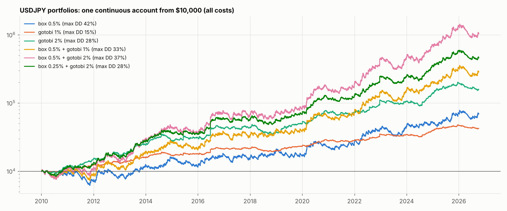

# Prop challenge — USDJPY box breakout + gotobi Tokyo-fix short

Challenges started on every trading day 2010-01 to 2025-10 (P1 +8%, P2 +6%, static 10%, daily 4%, ≥3 days). All costs. Risk mixes fixed before running.

| Mix | trades | pass ≤2 months % | pass ≤3 months % | pass ≤6 months % | fail ≤6 months % | median months to pass | pass ≤12 months % | fail ≤12 months % | fails by daily 4% % | max DD % 2010–26 | per year % |
|---|---|---|---|---|---|---|---|---|---|---|---|
| box 0.5% | 4556.0 | 8.9 | 17.1 | 31.4 | 58.0 | 3.4 | 38.0 | 62.0 | 0.0 | 41.5 | 12.2 |
| gotobi 1% | 1192.0 | 0.0 | 0.6 | 8.3 | 2.1 | 12.2 | 42.7 | 6.3 | 0.0 | 15.0 | 9.1 |
| gotobi 2% | 1192.0 | 4.6 | 13.6 | 41.1 | 16.1 | 5.1 | 64.0 | 26.2 | 0.0 | 28.0 | 18.1 |
| box 0.5% + gotobi 1% | 5748.0 | 13.6 | 24.7 | 43.8 | 49.3 | 3.0 | 48.4 | 51.6 | 0.0 | 32.6 | 22.1 |
| box 0.5% + gotobi 2% | 5748.0 | 20.6 | 32.5 | 45.5 | 50.6 | 2.2 | 47.8 | 52.2 | 1.8 | 37.0 | 31.9 |
| box 0.25% + gotobi 2% | 5748.0 | 12.5 | 26.3 | 51.0 | 29.6 | 3.7 | 63.6 | 34.8 | 0.0 | 27.7 | 25.6 |

