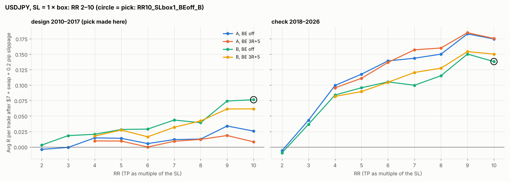

# USDJPY, SL = 1 × box: Versions A and B, RR 2–10, BE off / 3R

Protocol fixed before any result: 32 combos, $7/lot + swap (+1% markup). Pick ONE on 2010–2017 by avg R after 0.2 pip slippage per stop fill; check it on 2018–2026.

**Pick: `RR10_SLbox1_BEoff_B`** — design +0.076R (t +1.06); **check +0.138R** (t +1.91), +0.101R at 0.5 pip slippage, check max drawdown 64.4%, longest losing streak 60.

With 32 combos tried, the design winner is flattered by luck; judge it by the check column.

| Combo (sorted by design score) | trades | avg_R slip 0.2 design | t slip 0.2 design | max_dd_pct design | avg_R slip 0.2 check | t slip 0.2 check | avg_R slip 0.5 | max_dd_pct check | losing_streak | median_hours | avg_swap_nights | rank (design) |
|---|---|---|---|---|---|---|---|---|---|---|---|---|
| RR10_SLbox1_BEoff_B | 2230.000 | 0.076 | 1.056 | 64.999 | 0.138 | 1.907 | 0.101 | 64.354 | 60.000 | 7.758 | 1.338 | 1.000 |
| RR9_SLbox1_BEoff_B | 2230.000 | 0.074 | 1.084 | 57.945 | 0.150 | 2.183 | 0.113 | 58.960 | 60.000 | 7.750 | 1.134 | 2.000 |
| RR10_SLbox1_BE3R+5_B | 2233.000 | 0.062 | 0.961 | 62.340 | 0.150 | 2.279 | 0.113 | 57.322 | 22.000 | 7.717 | 1.028 | 3.000 |
| RR9_SLbox1_BE3R+5_B | 2233.000 | 0.061 | 1.005 | 61.647 | 0.154 | 2.452 | 0.117 | 48.852 | 23.000 | 7.700 | 0.907 | 4.000 |
| RR7_SLbox1_BEoff_B | 2230.000 | 0.044 | 0.730 | 55.965 | 0.100 | 1.679 | 0.063 | 57.116 | 37.000 | 7.633 | 0.819 | 5.000 |
| RR8_SLbox1_BE3R+5_B | 2233.000 | 0.042 | 0.733 | 69.045 | 0.127 | 2.161 | 0.090 | 51.338 | 23.000 | 7.650 | 0.782 | 6.000 |
| RR8_SLbox1_BEoff_B | 2230.000 | 0.039 | 0.615 | 58.349 | 0.115 | 1.798 | 0.078 | 58.532 | 37.000 | 7.717 | 0.978 | 7.000 |
| RR9_SLbox1_BEoff_A | 2488.000 | 0.034 | 0.531 | 68.044 | 0.183 | 2.771 | 0.146 | 54.486 | 35.000 | 7.633 | 1.113 | 8.000 |
| RR7_SLbox1_BE3R+5_B | 2233.000 | 0.032 | 0.591 | 65.084 | 0.121 | 2.180 | 0.084 | 51.177 | 23.000 | 7.567 | 0.659 | 9.000 |
| RR6_SLbox1_BEoff_B | 2230.000 | 0.029 | 0.526 | 69.241 | 0.105 | 1.915 | 0.069 | 56.254 | 34.000 | 7.533 | 0.665 | 10.000 |
| RR5_SLbox1_BEoff_B | 2230.000 | 0.028 | 0.564 | 52.553 | 0.096 | 1.919 | 0.060 | 46.363 | 34.000 | 7.283 | 0.547 | 11.000 |
| RR5_SLbox1_BE3R+5_B | 2231.000 | 0.027 | 0.588 | 62.217 | 0.090 | 1.899 | 0.054 | 44.429 | 23.000 | 7.233 | 0.461 | 12.000 |
| RR10_SLbox1_BEoff_A | 2488.000 | 0.026 | 0.382 | 70.918 | 0.175 | 2.513 | 0.137 | 63.855 | 41.000 | 7.633 | 1.304 | 13.000 |
| RR4_SLbox1_BEoff_B | 2230.000 | 0.020 | 0.466 | 59.428 | 0.084 | 1.905 | 0.049 | 42.897 | 27.000 | 6.917 | 0.381 | 14.000 |
| RR9_SLbox1_BE3R+5_A | 2489.000 | 0.018 | 0.325 | 75.277 | 0.185 | 3.066 | 0.147 | 50.794 | 23.000 | 7.517 | 0.889 | 15.000 |
| RR3_SLbox1_BEoff_B | 2230.000 | 0.018 | 0.483 | 58.721 | 0.037 | 0.979 | 0.003 | 46.908 | 23.000 | 6.383 | 0.225 | 16.000 |
| RR4_SLbox1_BE3R+5_B | 2231.000 | 0.018 | 0.417 | 63.289 | 0.082 | 1.917 | 0.047 | 40.820 | 23.000 | 6.867 | 0.344 | 17.000 |
| RR6_SLbox1_BE3R+5_B | 2232.000 | 0.016 | 0.328 | 62.384 | 0.105 | 2.039 | 0.068 | 46.771 | 23.000 | 7.483 | 0.545 | 18.000 |
| RR4_SLbox1_BEoff_A | 2486.000 | 0.015 | 0.353 | 68.499 | 0.099 | 2.368 | 0.064 | 43.841 | 26.000 | 6.758 | 0.358 | 19.000 |
| RR5_SLbox1_BEoff_A | 2486.000 | 0.014 | 0.297 | 68.583 | 0.118 | 2.473 | 0.082 | 51.834 | 28.000 | 7.100 | 0.522 | 20.000 |
| RR8_SLbox1_BEoff_A | 2488.000 | 0.013 | 0.213 | 68.833 | 0.150 | 2.443 | 0.113 | 50.285 | 41.000 | 7.575 | 0.952 | 21.000 |
| RR8_SLbox1_BE3R+5_A | 2489.000 | 0.012 | 0.228 | 77.622 | 0.160 | 2.830 | 0.122 | 54.625 | 24.000 | 7.500 | 0.760 | 22.000 |
| RR7_SLbox1_BEoff_A | 2488.000 | 0.012 | 0.214 | 68.221 | 0.144 | 2.510 | 0.107 | 50.605 | 41.000 | 7.517 | 0.793 | 23.000 |
| RR4_SLbox1_BE3R+5_A | 2487.000 | 0.010 | 0.242 | 75.078 | 0.096 | 2.349 | 0.060 | 47.440 | 26.000 | 6.717 | 0.322 | 24.000 |
| RR5_SLbox1_BE3R+5_A | 2487.000 | 0.010 | 0.218 | 76.292 | 0.111 | 2.470 | 0.075 | 50.318 | 26.000 | 7.017 | 0.438 | 25.000 |
| RR7_SLbox1_BE3R+5_A | 2489.000 | 0.009 | 0.181 | 77.167 | 0.157 | 2.959 | 0.120 | 55.473 | 25.000 | 7.433 | 0.637 | 26.000 |
| RR10_SLbox1_BE3R+5_A | 2489.000 | 0.008 | 0.139 | 74.579 | 0.175 | 2.785 | 0.138 | 56.568 | 23.000 | 7.550 | 1.002 | 27.000 |
| RR6_SLbox1_BEoff_A | 2487.000 | 0.005 | 0.106 | 71.695 | 0.139 | 2.643 | 0.103 | 60.662 | 32.000 | 7.408 | 0.638 | 28.000 |
| RR2_SLbox1_BEoff_B | 2222.000 | 0.003 | 0.099 | 55.931 | -0.009 | -0.312 | -0.042 | 66.593 | 18.000 | 5.075 | 0.097 | 29.000 |
| RR6_SLbox1_BE3R+5_A | 2488.000 | -0.000 | -0.003 | 75.746 | 0.137 | 2.781 | 0.100 | 54.471 | 24.000 | 7.292 | 0.522 | 30.000 |
| RR3_SLbox1_BEoff_A | 2486.000 | -0.001 | -0.021 | 72.345 | 0.043 | 1.220 | 0.009 | 55.033 | 26.000 | 6.183 | 0.209 | 31.000 |
| RR2_SLbox1_BEoff_A | 2478.000 | -0.004 | -0.135 | 55.801 | -0.006 | -0.209 | -0.039 | 72.909 | 16.000 | 4.933 | 0.089 | 32.000 |

Columns: avg R / t after costs and 0.2 pip slippage; drawdown and streak with costs, no slippage; median hours in trade and swap nights in the check period. Full grid: `grid.csv`.
