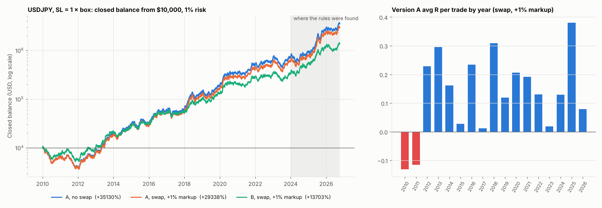

# USDJPY 2010–2026: Versions A and B, SL = 1 × box, with swap

Rules: IST 05:00–05:59 box, SL = that day's box + spread, TP 4R, BE at 3R → entry + 5/30 of the SL distance, 1% risk compounding from $10,000, Dukascopy bid/ask. 4082 tradable days; 292 skipped (no data or a tick-less minute in the box).

Swap: real overnight rates (USD effective Fed Funds, Japan overnight call rate), rollover at 17:00 New York, Wednesday counts 3 days. The markup is the broker's cut on the rate differential and is paid on both sides.

## 2010–2023 (never seen)

| Metric | A, no swap | A, swap, pure carry | A, swap, +1% markup | B, no swap | B, swap, pure carry | B, swap, +1% markup |
|---|---|---|---|---|---|---|
| Trades | 4213 | 4213 | 4213 | 3788 | 3788 | 3788 |
| Win rate % | 27.2 | 27.2 | 27.1 | 27.4 | 27.3 | 27.2 |
| Avg R | +0.122 | +0.123 | +0.117 | +0.117 | +0.119 | +0.112 |
| Profit factor | 1.17 | 1.17 | 1.16 | 1.16 | 1.16 | 1.15 |
| Expectancy (R/trade) | +0.122 | +0.123 | +0.117 | +0.117 | +0.119 | +0.112 |
| Expectancy (% equity/trade) | +0.121 | +0.122 | +0.117 | +0.116 | +0.118 | +0.112 |
| t-stat of mean R (SQN) | +3.91 | +3.95 | +3.77 | +3.58 | +3.62 | +3.44 |
| Max drawdown % | 65.6 | 65.6 | 66.4 | 50.6 | 50.6 | 51.7 |
| Longest losing streak | 35 | 35 | 35 | 33 | 33 | 33 |
| Net return % | +7005.4 | +7428.3 | +5812.9 | +3805.3 | +4018.4 | +3179.1 |
| CAGR % | +35.6 | +36.2 | +33.9 | +29.9 | +30.4 | +28.3 |

## 2024–2026 (where found)

| Metric | A, no swap | A, swap, pure carry | A, swap, +1% markup | B, no swap | B, swap, pure carry | B, swap, +1% markup |
|---|---|---|---|---|---|---|
| Trades | 858 | 858 | 858 | 766 | 766 | 766 |
| Win rate % | 29.4 | 29.3 | 29.3 | 29.5 | 29.4 | 29.4 |
| Avg R | +0.211 | +0.217 | +0.211 | +0.212 | +0.218 | +0.211 |
| Profit factor | 1.30 | 1.31 | 1.30 | 1.30 | 1.31 | 1.30 |
| Expectancy (R/trade) | +0.211 | +0.217 | +0.211 | +0.212 | +0.218 | +0.211 |
| Expectancy (% equity/trade) | +0.207 | +0.213 | +0.207 | +0.208 | +0.214 | +0.208 |
| t-stat of mean R (SQN) | +2.98 | +3.06 | +2.98 | +2.82 | +2.89 | +2.82 |
| Max drawdown % | 34.5 | 34.1 | 34.2 | 27.6 | 28.0 | 28.2 |
| Longest losing streak | 26 | 26 | 26 | 23 | 23 | 23 |
| Net return % | +392.6 | +419.4 | +395.2 | +319.2 | +338.1 | +319.4 |
| CAGR % | +78.1 | +81.6 | +78.4 | +68.0 | +70.7 | +68.0 |

## Full period

| Metric | A, no swap | A, swap, pure carry | A, swap, +1% markup | B, no swap | B, swap, pure carry | B, swap, +1% markup |
|---|---|---|---|---|---|---|
| Trades | 5071 | 5071 | 5071 | 4554 | 4554 | 4554 |
| Win rate % | 27.6 | 27.5 | 27.4 | 27.7 | 27.6 | 27.5 |
| Avg R | +0.137 | +0.139 | +0.133 | +0.133 | +0.135 | +0.129 |
| Profit factor | 1.19 | 1.19 | 1.18 | 1.18 | 1.19 | 1.18 |
| Expectancy (R/trade) | +0.137 | +0.139 | +0.133 | +0.133 | +0.135 | +0.129 |
| Expectancy (% equity/trade) | +0.136 | +0.138 | +0.132 | +0.132 | +0.134 | +0.128 |
| t-stat of mean R (SQN) | +4.80 | +4.87 | +4.67 | +4.44 | +4.50 | +4.31 |
| Max drawdown % | 65.6 | 65.6 | 66.4 | 50.6 | 50.6 | 51.7 |
| Longest losing streak | 35 | 35 | 35 | 33 | 33 | 33 |
| Net return % | +35129.6 | +39245.2 | +29338.3 | +16408.8 | +18067.5 | +13702.9 |
| CAGR % | +41.9 | +42.8 | +40.4 | +35.6 | +36.4 | +34.2 |

## Version A by year

| Year (A, swap, +1% markup) | trades | win_rate | avg_R | total_R | t_stat | swap_R |
|---|---|---|---|---|---|---|
| 2010 | 324.000 | 23.148 | -0.131 | -42.422 | -1.302 | -1.176 |
| 2011 | 321.000 | 21.184 | -0.115 | -36.917 | -1.106 | -2.281 |
| 2012 | 314.000 | 29.618 | 0.229 | 71.855 | 1.939 | -2.139 |
| 2013 | 308.000 | 31.494 | 0.296 | 91.109 | 2.447 | -1.279 |
| 2014 | 288.000 | 26.736 | 0.161 | 46.462 | 1.327 | -1.821 |
| 2015 | 296.000 | 27.365 | 0.027 | 8.018 | 0.242 | -1.205 |
| 2016 | 320.000 | 30.000 | 0.234 | 74.942 | 2.011 | -1.669 |
| 2017 | 316.000 | 25.633 | 0.012 | 3.651 | 0.106 | -0.919 |
| 2018 | 300.000 | 30.333 | 0.309 | 92.672 | 2.488 | -0.941 |
| 2019 | 287.000 | 25.784 | 0.119 | 34.248 | 0.991 | -2.362 |
| 2020 | 279.000 | 28.674 | 0.206 | 57.534 | 1.654 | -2.066 |
| 2021 | 240.000 | 28.333 | 0.192 | 46.081 | 1.439 | -1.329 |
| 2022 | 309.000 | 26.861 | 0.131 | 40.338 | 1.126 | -0.403 |
| 2023 | 311.000 | 24.437 | 0.019 | 5.890 | 0.171 | 1.011 |
| 2024 | 308.000 | 25.974 | 0.129 | 39.686 | 1.106 | 1.760 |
| 2025 | 326.000 | 34.049 | 0.381 | 124.136 | 3.190 | -1.017 |
| 2026 | 224.000 | 26.786 | 0.079 | 17.642 | 0.589 | -0.342 |

## Version A by side

| Side (A, swap, +1% markup) | trades | avg_R | swap_R | avg_nights |
|---|---|---|---|---|
| BUY | 2587.000 | 0.134 | 10.721 | 0.355 |
| SELL | 2484.000 | 0.132 | -28.900 | 0.311 |

## Cost sensitivity

Stop orders (entry, SL, BE) can fill worse than their price; TP is a limit and does not. Commission $7 per lot round turn is converted to pips at each trade's price. The median risk is only 10–27 pips (one box), so a pip of cost is 4–10% of 1R.

| Version A, swap, +1% markup | avg_R all | t all | avg_R 2010-2023 | t 2010-2023 | positive years | years |
|---|---|---|---|---|---|---|
| as tested (Dukascopy spread only) | 0.133 | 4.673 | 0.117 | 3.769 | 15.000 | 17.000 |
| + $7/lot commission | 0.079 | 2.761 | 0.062 | 2.010 | 12.000 | 17.000 |
| + $7 + 0.5 pip slippage per stop fill | 0.016 | 0.547 | -0.004 | -0.139 | 10.000 | 17.000 |
| + $7 + 1.0 pip slippage per stop fill | -0.047 | -1.635 | -0.071 | -2.256 | 5.000 | 17.000 |

Trade logs (with swap): `trade_logs/`.
