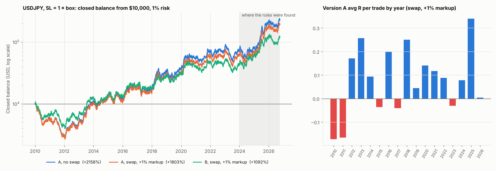

# USDJPY 2010–2026: Versions A and B, SL = 1 × box, with swap, $7/lot commission

Rules: IST 05:00–05:59 box, SL = that day's box + spread, TP 4R, BE at 3R → entry + 5/30 of the SL distance, 1% risk compounding from $10,000, Dukascopy bid/ask. 4082 tradable days; 292 skipped (no data or a tick-less minute in the box).

Swap: real overnight rates (USD effective Fed Funds, Japan overnight call rate), rollover at 17:00 New York, Wednesday counts 3 days. The markup is the broker's cut on the rate differential and is paid on both sides.

## 2010–2023 (never seen)

| Metric | A, no swap | A, swap, pure carry | A, swap, +1% markup | B, no swap | B, swap, pure carry | B, swap, +1% markup |
|---|---|---|---|---|---|---|
| Trades | 4213 | 4213 | 4213 | 3788 | 3788 | 3788 |
| Win rate % | 27.2 | 27.1 | 26.9 | 27.3 | 27.2 | 27.0 |
| Avg R | +0.067 | +0.068 | +0.062 | +0.063 | +0.065 | +0.058 |
| Profit factor | 1.09 | 1.09 | 1.08 | 1.08 | 1.08 | 1.08 |
| Expectancy (R/trade) | +0.067 | +0.068 | +0.062 | +0.063 | +0.065 | +0.058 |
| Expectancy (% equity/trade) | +0.067 | +0.068 | +0.062 | +0.062 | +0.064 | +0.058 |
| t-stat of mean R (SQN) | +2.15 | +2.19 | +2.01 | +1.93 | +1.97 | +1.79 |
| Max drawdown % | 74.5 | 74.5 | 75.1 | 62.6 | 62.6 | 63.3 |
| Longest losing streak | 35 | 35 | 35 | 33 | 33 | 33 |
| Net return % | +618.5 | +659.7 | +503.4 | +405.6 | +434.1 | +324.1 |
| CAGR % | +15.1 | +15.6 | +13.7 | +12.3 | +12.7 | +10.9 |

## 2024–2026 (where found)

| Metric | A, no swap | A, swap, pure carry | A, swap, +1% markup | B, no swap | B, swap, pure carry | B, swap, +1% markup |
|---|---|---|---|---|---|---|
| Trades | 858 | 858 | 858 | 766 | 766 | 766 |
| Win rate % | 29.3 | 29.0 | 28.6 | 29.4 | 29.1 | 28.6 |
| Avg R | +0.158 | +0.164 | +0.158 | +0.159 | +0.165 | +0.158 |
| Profit factor | 1.21 | 1.22 | 1.21 | 1.21 | 1.22 | 1.21 |
| Expectancy (R/trade) | +0.158 | +0.164 | +0.158 | +0.159 | +0.165 | +0.158 |
| Expectancy (% equity/trade) | +0.153 | +0.160 | +0.154 | +0.156 | +0.161 | +0.155 |
| t-stat of mean R (SQN) | +2.22 | +2.30 | +2.23 | +2.12 | +2.19 | +2.11 |
| Max drawdown % | 38.2 | 38.0 | 38.2 | 32.3 | 32.1 | 32.7 |
| Longest losing streak | 26 | 26 | 26 | 23 | 23 | 23 |
| Net return % | +211.5 | +228.9 | +213.5 | +180.9 | +192.3 | +179.6 |
| CAGR % | +50.9 | +53.9 | +51.2 | +45.3 | +47.4 | +45.1 |

## Full period

| Metric | A, no swap | A, swap, pure carry | A, swap, +1% markup | B, no swap | B, swap, pure carry | B, swap, +1% markup |
|---|---|---|---|---|---|---|
| Trades | 5071 | 5071 | 5071 | 4554 | 4554 | 4554 |
| Win rate % | 27.5 | 27.4 | 27.2 | 27.6 | 27.5 | 27.3 |
| Avg R | +0.082 | +0.084 | +0.079 | +0.079 | +0.081 | +0.075 |
| Profit factor | 1.11 | 1.11 | 1.10 | 1.10 | 1.11 | 1.10 |
| Expectancy (R/trade) | +0.082 | +0.084 | +0.079 | +0.079 | +0.081 | +0.075 |
| Expectancy (% equity/trade) | +0.081 | +0.084 | +0.078 | +0.078 | +0.080 | +0.074 |
| t-stat of mean R (SQN) | +2.89 | +2.96 | +2.76 | +2.64 | +2.71 | +2.51 |
| Max drawdown % | 74.5 | 74.5 | 75.1 | 62.6 | 62.6 | 63.3 |
| Longest losing streak | 35 | 35 | 35 | 33 | 33 | 33 |
| Net return % | +2158.2 | +2416.1 | +1803.1 | +1326.5 | +1475.0 | +1092.4 |
| CAGR % | +20.4 | +21.2 | +19.2 | +17.2 | +17.9 | +15.9 |

## Version A by year

| Year (A, swap, +1% markup) | trades | win_rate | avg_R | total_R | t_stat | swap_R |
|---|---|---|---|---|---|---|
| 2010 | 324.000 | 23.148 | -0.173 | -55.990 | -1.721 | -1.175 |
| 2011 | 321.000 | 21.184 | -0.166 | -53.205 | -1.594 | -2.280 |
| 2012 | 314.000 | 29.618 | 0.171 | 53.602 | 1.447 | -2.139 |
| 2013 | 308.000 | 31.494 | 0.257 | 79.190 | 2.128 | -1.279 |
| 2014 | 288.000 | 26.736 | 0.094 | 27.027 | 0.773 | -1.821 |
| 2015 | 296.000 | 27.365 | -0.036 | -10.610 | -0.321 | -1.205 |
| 2016 | 320.000 | 30.000 | 0.199 | 63.584 | 1.706 | -1.670 |
| 2017 | 316.000 | 25.316 | -0.040 | -12.779 | -0.372 | -0.918 |
| 2018 | 300.000 | 30.000 | 0.250 | 75.133 | 2.017 | -0.941 |
| 2019 | 287.000 | 25.436 | 0.044 | 12.553 | 0.364 | -2.362 |
| 2020 | 279.000 | 28.315 | 0.140 | 39.118 | 1.123 | -2.066 |
| 2021 | 240.000 | 27.917 | 0.117 | 28.037 | 0.875 | -1.328 |
| 2022 | 309.000 | 26.861 | 0.088 | 27.182 | 0.758 | -0.403 |
| 2023 | 311.000 | 24.437 | -0.031 | -9.684 | -0.280 | 1.011 |
| 2024 | 308.000 | 25.649 | 0.078 | 23.884 | 0.665 | 1.761 |
| 2025 | 326.000 | 33.436 | 0.340 | 110.819 | 2.848 | -1.017 |
| 2026 | 224.000 | 25.446 | 0.004 | 0.846 | 0.028 | -0.342 |

## Version A by side

| Side (A, swap, +1% markup) | trades | avg_R | swap_R | avg_nights |
|---|---|---|---|---|
| BUY | 2587.000 | 0.079 | 10.724 | 0.355 |
| SELL | 2484.000 | 0.078 | -28.900 | 0.311 |

## Cost sensitivity

Stop orders (entry, SL, BE) can fill worse than their price; TP is a limit and does not. Commission $7 per lot round turn is converted to pips at each trade's price. The median risk is only 10–27 pips (one box), so a pip of cost is 4–10% of 1R.

| Version A, swap, +1% markup | avg_R all | t all | avg_R 2010-2023 | t 2010-2023 | positive years | years |
|---|---|---|---|---|---|---|
| as run ($7 commission) | 0.079 | 2.762 | 0.062 | 2.010 | 12.000 | 17.000 |
| + 0.1 pip slippage per stop fill | 0.066 | 2.316 | 0.049 | 1.578 | 11.000 | 17.000 |
| + 0.2 pip slippage per stop fill | 0.053 | 1.872 | 0.036 | 1.147 | 11.000 | 17.000 |
| + 0.3 pip slippage per stop fill | 0.041 | 1.429 | 0.022 | 0.717 | 10.000 | 17.000 |
| + 0.5 pip slippage per stop fill | 0.016 | 0.547 | -0.004 | -0.139 | 10.000 | 17.000 |
| + 1 pip slippage per stop fill | -0.047 | -1.635 | -0.071 | -2.256 | 5.000 | 17.000 |

Trade logs (with swap): `trade_logs/`.
