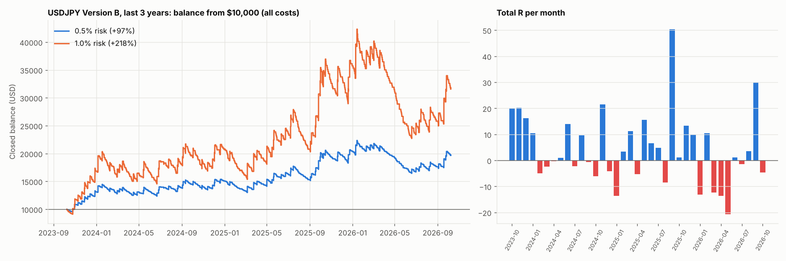

# USDJPY approved strategy — last 3 years (2023-10-09 → 2026-10-07)

Version B, SL = 1 × box, RR 9, BE 3R, 05:00 IST box. $7/lot, swap (+1% markup), 0.2 pip slippage per stop fill.

| Metric | 0.5% risk | 1.0% risk |
|---|---|---|
| Trades | 823 | 823 |
| Win rate % | 24.1 | 24.1 |
| Avg R | +0.195 | +0.195 |
| Profit factor | 1.25 | 1.25 |
| Expectancy (R/trade) | +0.195 | +0.195 |
| Expectancy (% equity/trade) | +0.094 | +0.184 |
| t-stat of mean R (SQN) | +1.82 | +1.82 |
| Max drawdown % | 26.4 | 46.4 |
| Longest losing streak | 24 | 24 |
| Net return % | +97.2 | +217.7 |
| CAGR % | +25.4 | +47.1 |

## By year (0.5% risk)

| Year | trades | win_rate | avg_R | total_R | return_pct |
|---|---|---|---|---|---|
| 2023 | 57.00 | 24.56 | 0.99 | 56.43 | 31.16 |
| 2024 | 274.00 | 22.26 | 0.13 | 35.50 | 14.93 |
| 2025 | 289.00 | 28.37 | 0.31 | 88.90 | 35.23 |
| 2026 | 203.00 | 20.20 | -0.10 | -20.58 | -3.28 |

Positive months: 21 of 37. Best +50.4R (2025-09), worst -20.7R (2026-05).

**By side**

| Side | trades | win_rate_% | avg_R | total_R | profit_factor |
|---|---|---|---|---|---|
| BUY | 437.000 | 27.460 | 0.293 | 128.083 | 1.385 |
| SELL | 386.000 | 20.207 | 0.083 | 32.175 | 1.104 |

**By trade number**

| Trade number | trades | win_rate_% | avg_R | total_R | profit_factor |
|---|---|---|---|---|---|
| 1 | 733.000 | 23.874 | 0.177 | 129.561 | 1.227 |
| 2 | 90.000 | 25.556 | 0.341 | 30.697 | 1.425 |

**By exit reason**

| Exit reason | trades | win_rate_% | avg_R | total_R | profit_factor |
|---|---|---|---|---|---|
| BE | 155.000 | 70.968 | 0.017 | 2.596 | 1.142 |
| OPEN_AT_END | 1.000 | 100.000 | 0.660 | 0.660 | inf |
| SL | 580.000 | 0.000 | -1.076 | -624.198 | 0.000 |
| TP | 87.000 | 100.000 | 8.979 | 781.199 | inf |

**By day of week**

| Day of week | trades | win_rate_% | avg_R | total_R | profit_factor |
|---|---|---|---|---|---|
| Monday | 170.000 | 24.118 | 0.204 | 34.745 | 1.267 |
| Tuesday | 164.000 | 22.561 | -0.010 | -1.644 | 0.988 |
| Wednesday | 159.000 | 25.786 | 0.473 | 75.182 | 1.616 |
| Thursday | 167.000 | 21.557 | -0.089 | -14.931 | 0.889 |
| Friday | 163.000 | 26.380 | 0.410 | 66.905 | 1.544 |
