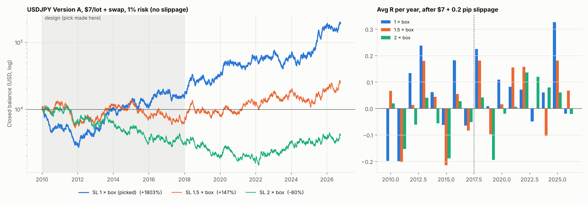

# USDJPY Version A: wider stop-loss test ($7/lot, swap +1% markup)

Protocol fixed before any result: candidates SL = 1, 1.5, 2 × the day's box (+ spread), TP 4R and BE 3R unchanged. Pick ONE on 2010–2017 by avg R after 0.2 pip slippage per stop fill. Check it on 2018–2026.

**Pick (design 2010–2017): SL = 1 × box.**  
**Check 2018–2026:** avg R +0.119 (no slippage), +0.096 (0.2 pip), +0.060 (0.5 pip); t +2.35 at 0.2 pip; max drawdown 47.4%; longest losing streak 26.

| Period · SL | trades | win_rate | median_risk_pips | max_dd_pct | losing_streak | net_return_pct | avg_R slip 0 | t slip 0 | avg_R slip 0.2 | t slip 0.2 | avg_R slip 0.5 | t slip 0.5 | years positive (0.2 slip) |
|---|---|---|---|---|---|---|---|---|---|---|---|---|---|
| design 2010–2017 · 1 × box | 2487 | 26.819 | 15.300 | 75.078 | 35 | 55.010 | 0.037 | 0.915 | 0.010 | 0.242 | -0.031 | -0.759 | 4/8 |
| check 2018–2026 · 1 × box | 2584 | 27.593 | 17.500 | 47.440 | 26 | 1126.471 | 0.119 | 2.937 | 0.096 | 2.349 | 0.060 | 1.473 | 7/9 |
| design 2010–2017 · 1.5 × box | 2281 | 25.734 | 22.600 | 60.778 | 23 | -35.261 | 0.001 | 0.015 | -0.018 | -0.431 | -0.045 | -1.097 | 5/8 |
| check 2018–2026 · 1.5 × box | 2371 | 26.993 | 26.050 | 47.585 | 20 | 282.865 | 0.079 | 1.894 | 0.062 | 1.502 | 0.038 | 0.918 | 6/9 |
| design 2010–2017 · 2 × box | 2159 | 24.687 | 30.000 | 75.478 | 23 | -69.787 | -0.038 | -0.909 | -0.052 | -1.241 | -0.073 | -1.737 | 3/8 |
| check 2018–2026 · 2 × box | 2252 | 25.710 | 34.700 | 61.547 | 29 | 42.083 | 0.039 | 0.942 | 0.027 | 0.650 | 0.009 | 0.213 | 6/9 |

Drawdown, streak and return are with commission and swap but no slippage. Trade logs: `trade_logs/`.
