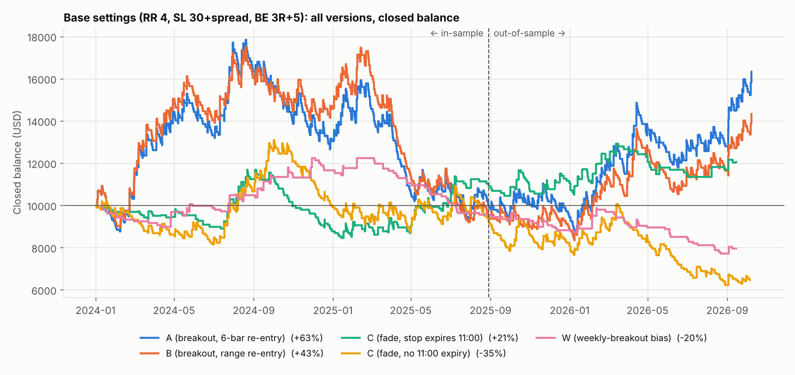

# Version comparison — breakout (A, B), fade (C), weekly bias (W)

Base settings RR 4, SL 30 pips + spread, BE 3R → +5 pips. 707 days 2024-01-02 → 2026-10-07; in-sample to 2025-08-28, out-of-sample from 2025-08-29.

**Version C:** the first break of the 05:00–05:59 IST box is *not* traded. It is followed virtually with the normal SL/TP/BE. A stop order in the opposite direction sits at the virtual trade's SL price. It fills only if the virtual trade is stopped out, and is cancelled if the virtual trade hits TP or BE first. The real trade then follows the usual rules: SL pips + spread from its own entry, RR × that for TP, BE, and the Version A 6-minute re-entry if it is stopped before 11:00, max 2 real trades.

**Version W:** bias from last week's high/low and daily closes (17:00 New York). The latest daily close of the current week above last week's high means buy stop only; below last week's low means sell stop only; inside means no trade. Monday never has a bias. One trade a day, no re-entry.

## Full period

| Metric | A (breakout, 6-bar re-entry) | B (breakout, range re-entry) | C (fade, stop expires 11:00) | C (fade, no 11:00 expiry) | W (weekly-breakout bias) |
|---|---|---|---|---|---|
| Trades | 847 | 770 | 273 | 567 | 147 |
| Win rate % | 26.2 | 25.8 | 27.5 | 24.0 | 22.4 |
| Avg R | +0.079 | +0.068 | +0.086 | -0.059 | -0.139 |
| Profit factor | 1.11 | 1.09 | 1.12 | 0.92 | 0.82 |
| Expectancy (R/trade) | +0.079 | +0.068 | +0.086 | -0.059 | -0.139 |
| Expectancy (% equity/trade) | +0.077 | +0.066 | +0.088 | -0.060 | -0.139 |
| t-stat of mean R (SQN) | +1.16 | +0.95 | +0.71 | -0.74 | -0.93 |
| Max drawdown % | 51.2 | 52.4 | 27.8 | 52.4 | 36.9 |
| Longest losing streak | 22 | 20 | 13 | 19 | 24 |
| Net return % | +63.3 | +43.3 | +20.6 | -35.4 | -20.4 |
| CAGR % | +19.4 | +13.9 | +7.0 | -14.6 | -7.9 |

## In-sample

| Metric | A (breakout, 6-bar re-entry) | B (breakout, range re-entry) | C (fade, stop expires 11:00) | C (fade, no 11:00 expiry) | W (weekly-breakout bias) |
|---|---|---|---|---|---|
| Trades | 514 | 468 | 188 | 351 | 85 |
| Win rate % | 25.1 | 24.6 | 26.1 | 24.2 | 24.7 |
| Avg R | +0.018 | +0.009 | +0.057 | -0.007 | -0.037 |
| Profit factor | 1.02 | 1.01 | 1.08 | 0.99 | 0.95 |
| Expectancy (R/trade) | +0.018 | +0.009 | +0.057 | -0.007 | -0.037 |
| Expectancy (% equity/trade) | +0.016 | +0.006 | +0.059 | -0.008 | -0.038 |
| t-stat of mean R (SQN) | +0.21 | +0.10 | +0.39 | -0.07 | -0.18 |
| Max drawdown % | 47.6 | 47.4 | 27.8 | 33.4 | 22.1 |
| Longest losing streak | 22 | 20 | 13 | 12 | 24 |
| Net return % | -1.1 | -5.5 | +7.9 | -8.7 | -4.6 |
| CAGR % | -0.7 | -3.3 | +4.7 | -5.4 | -2.8 |

## Out-of-sample

| Metric | A (breakout, 6-bar re-entry) | B (breakout, range re-entry) | C (fade, stop expires 11:00) | C (fade, no 11:00 expiry) | W (weekly-breakout bias) |
|---|---|---|---|---|---|
| Trades | 333 | 302 | 85 | 216 | 62 |
| Win rate % | 27.9 | 27.8 | 30.6 | 23.6 | 19.4 |
| Avg R | +0.175 | +0.160 | +0.150 | -0.142 | -0.280 |
| Profit factor | 1.24 | 1.22 | 1.21 | 0.82 | 0.65 |
| Expectancy (R/trade) | +0.175 | +0.160 | +0.150 | -0.142 | -0.280 |
| Expectancy (% equity/trade) | +0.172 | +0.157 | +0.149 | -0.143 | -0.279 |
| t-stat of mean R (SQN) | +1.55 | +1.36 | +0.68 | -1.14 | -1.31 |
| Max drawdown % | 21.1 | 23.0 | 12.2 | 38.0 | 21.8 |
| Longest losing streak | 12 | 10 | 12 | 17 | 13 |
| Net return % | +65.4 | +51.1 | +11.6 | -29.1 | -16.6 |
| CAGR % | +57.6 | +45.3 | +10.4 | -26.7 | -15.1 |

## Order counts

| | A (breakout, 6-bar re-entry) | B (breakout, range re-entry) | C (fade, stop expires 11:00) | C (fade, no 11:00 expiry) | W (weekly-breakout bias) |
|---|---|---|---|---|---|
| Neither side broke by 11:00 | 2 | 2 | 2 | 2 | 65 |
| C: virtual breakout hit TP → reversal cancelled | 0 | 0 | 142 | 142 | 0 |
| C: virtual breakout hit BE stop → reversal cancelled | 0 | 0 | 42 | 42 | 0 |
| C: virtual SL hit at/after 11:00 → reversal stop expired | 0 | 0 | 294 | 0 | 0 |
| C: virtual breakout still open at data end | 0 | 0 | 1 | 1 | 0 |
| C: reversal trades opened | 0 | 0 | 226 | 520 | 0 |
| C: reversal filled on the bar that broke the range | 0 | 0 | 2 | 2 | 0 |
| W: buy-only days | 0 | 0 | 0 | 0 | 156 |
| W: sell-only days | 0 | 0 | 0 | 0 | 56 |
| W: no bias → no trade | 0 | 0 | 0 | 0 | 495 |
| Re-entry skipped: wait reaches 11:00 | 3 | 3 | 0 | 0 | 0 |
| Re-entry skipped: invalid stop | 18 | 120 | 5 | 5 | 0 |
| Re-entry orders expired | 65 | 40 | 12 | 12 | 0 |
| Re-entry orders filled | 142 | 65 | 47 | 47 | 0 |

## Breakdowns — C (fade, stop expires 11:00)

**By range size (pips)**

| Range size (pips) | trades | win_rate_% | avg_R | total_R | profit_factor |
|---|---|---|---|---|---|
| <20 | 60.000 | 31.667 | 0.322 | 19.345 | 1.469 |
| 20-40 | 125.000 | 30.400 | 0.212 | 26.466 | 1.304 |
| 40-60 | 56.000 | 17.857 | -0.406 | -22.721 | 0.520 |
| 60+ | 32.000 | 25.000 | 0.009 | 0.303 | 1.013 |

**By side**

| Side | trades | win_rate_% | avg_R | total_R | profit_factor |
|---|---|---|---|---|---|
| BUY | 126.000 | 26.984 | 0.042 | 5.300 | 1.057 |
| SELL | 147.000 | 27.891 | 0.123 | 18.093 | 1.168 |

**By trade number**

| Trade number | trades | win_rate_% | avg_R | total_R | profit_factor |
|---|---|---|---|---|---|
| 1 | 226.000 | 26.106 | 0.026 | 5.774 | 1.034 |
| 2 | 47.000 | 34.043 | 0.375 | 17.618 | 1.568 |

**By day of week**

| Day of week | trades | win_rate_% | avg_R | total_R | profit_factor |
|---|---|---|---|---|---|
| Monday | 52.000 | 32.692 | 0.316 | 16.443 | 1.454 |
| Tuesday | 43.000 | 34.884 | 0.383 | 16.459 | 1.584 |
| Wednesday | 63.000 | 22.222 | -0.072 | -4.531 | 0.908 |
| Thursday | 50.000 | 28.000 | 0.091 | 4.530 | 1.126 |
| Friday | 65.000 | 23.077 | -0.146 | -9.508 | 0.811 |

**By month**

| Month | trades | win_rate_% | avg_R | total_R | profit_factor |
|---|---|---|---|---|---|
| 2024-01 | 8.000 | 12.500 | -0.375 | -3.000 | 0.571 |
| 2024-03 | 8.000 | 25.000 | -0.230 | -1.842 | 0.693 |
| 2024-04 | 3.000 | 66.667 | -0.232 | -0.696 | 0.304 |
| 2024-05 | 4.000 | 25.000 | 0.250 | 1.000 | 1.333 |
| 2024-06 | 6.000 | 0.000 | -1.000 | -6.000 | 0.000 |
| 2024-07 | 8.000 | 50.000 | 1.500 | 12.000 | 4.000 |
| 2024-08 | 21.000 | 38.095 | 0.539 | 11.310 | 1.870 |
| 2024-09 | 10.000 | 30.000 | 0.115 | 1.153 | 1.165 |
| 2024-10 | 14.000 | 7.143 | -0.918 | -12.848 | 0.012 |
| 2024-11 | 5.000 | 20.000 | -0.769 | -3.846 | 0.038 |
| 2024-12 | 14.000 | 7.143 | -0.643 | -9.000 | 0.308 |
| 2025-01 | 15.000 | 26.667 | 0.333 | 5.000 | 1.455 |
| 2025-02 | 10.000 | 30.000 | -0.270 | -2.698 | 0.615 |
| 2025-03 | 12.000 | 33.333 | 0.346 | 4.153 | 1.519 |
| 2025-04 | 13.000 | 15.385 | -0.527 | -6.846 | 0.378 |
| 2025-05 | 16.000 | 37.500 | 0.875 | 14.000 | 2.400 |
| 2025-06 | 8.000 | 37.500 | 0.875 | 7.000 | 2.400 |
| 2025-07 | 8.000 | 25.000 | 0.250 | 2.000 | 1.333 |
| 2025-08 | 5.000 | 20.000 | -0.033 | -0.163 | 0.961 |
| 2025-09 | 4.000 | 25.000 | 0.181 | 0.725 | 1.221 |
| 2025-10 | 14.000 | 28.571 | -0.121 | -1.690 | 0.831 |
| 2025-11 | 9.000 | 22.222 | 0.111 | 1.000 | 1.143 |
| 2025-12 | 8.000 | 25.000 | 0.091 | 0.731 | 1.101 |
| 2026-01 | 15.000 | 40.000 | 0.232 | 3.477 | 1.386 |
| 2026-02 | 7.000 | 57.143 | 1.308 | 9.159 | 4.053 |
| 2026-03 | 6.000 | 33.333 | 0.667 | 4.000 | 2.000 |
| 2026-04 | 3.000 | 0.000 | -1.000 | -3.000 | 0.000 |
| 2026-05 | 9.000 | 11.111 | -0.444 | -4.000 | 0.500 |
| 2026-06 | 3.000 | 0.000 | -1.000 | -3.000 | 0.000 |
| 2026-07 | 2.000 | 50.000 | -0.422 | -0.845 | 0.155 |
| 2026-08 | 2.000 | 50.000 | 1.500 | 3.000 | 4.000 |
| 2026-09 | 3.000 | 66.667 | 1.053 | 3.158 | 4.158 |

**By exit reason**

| Exit reason | trades | win_rate_% | avg_R | total_R | profit_factor |
|---|---|---|---|---|---|
| BE | 21.000 | 95.238 | 0.087 | 1.830 | 2.436 |
| SL | 197.000 | 0.000 | -1.007 | -198.437 | 0.000 |
| TP | 55.000 | 100.000 | 4.000 | 220.000 | inf |

## Breakdowns — C (fade, no 11:00 expiry)

**By range size (pips)**

| Range size (pips) | trades | win_rate_% | avg_R | total_R | profit_factor |
|---|---|---|---|---|---|
| <20 | 170.000 | 20.588 | -0.230 | -39.076 | 0.714 |
| 20-40 | 250.000 | 28.000 | 0.106 | 26.402 | 1.146 |
| 40-60 | 100.000 | 19.000 | -0.258 | -25.842 | 0.687 |
| 60+ | 47.000 | 25.532 | 0.113 | 5.303 | 1.151 |

**By side**

| Side | trades | win_rate_% | avg_R | total_R | profit_factor |
|---|---|---|---|---|---|
| BUY | 260.000 | 26.154 | 0.037 | 9.747 | 1.050 |
| SELL | 307.000 | 22.150 | -0.140 | -42.961 | 0.822 |

**By trade number**

| Trade number | trades | win_rate_% | avg_R | total_R | profit_factor |
|---|---|---|---|---|---|
| 1 | 520.000 | 23.077 | -0.098 | -50.832 | 0.874 |
| 2 | 47.000 | 34.043 | 0.375 | 17.618 | 1.568 |

**By day of week**

| Day of week | trades | win_rate_% | avg_R | total_R | profit_factor |
|---|---|---|---|---|---|
| Monday | 109.000 | 25.688 | 0.024 | 2.633 | 1.032 |
| Tuesday | 113.000 | 27.434 | 0.070 | 7.922 | 1.097 |
| Wednesday | 115.000 | 21.739 | -0.145 | -16.688 | 0.814 |
| Thursday | 108.000 | 23.148 | -0.093 | -9.999 | 0.880 |
| Friday | 122.000 | 22.131 | -0.140 | -17.082 | 0.826 |

**By month**

| Month | trades | win_rate_% | avg_R | total_R | profit_factor |
|---|---|---|---|---|---|
| 2024-01 | 18.000 | 16.667 | -0.167 | -3.000 | 0.800 |
| 2024-02 | 10.000 | 20.000 | -0.386 | -3.857 | 0.518 |
| 2024-03 | 13.000 | 15.385 | -0.532 | -6.910 | 0.376 |
| 2024-04 | 13.000 | 30.769 | -0.054 | -0.696 | 0.923 |
| 2024-05 | 15.000 | 26.667 | 0.333 | 5.000 | 1.455 |
| 2024-06 | 16.000 | 12.500 | -0.375 | -6.000 | 0.571 |
| 2024-07 | 14.000 | 42.857 | 1.143 | 16.000 | 3.000 |
| 2024-08 | 25.000 | 36.000 | 0.492 | 12.310 | 1.769 |
| 2024-09 | 20.000 | 45.000 | 0.673 | 13.462 | 2.224 |
| 2024-10 | 20.000 | 20.000 | -0.192 | -3.848 | 0.760 |
| 2024-11 | 15.000 | 20.000 | -0.513 | -7.690 | 0.359 |
| 2024-12 | 18.000 | 11.111 | -0.658 | -11.843 | 0.260 |
| 2025-01 | 18.000 | 22.222 | 0.111 | 2.000 | 1.143 |
| 2025-02 | 17.000 | 23.529 | -0.293 | -4.976 | 0.625 |
| 2025-03 | 21.000 | 28.571 | 0.245 | 5.153 | 1.344 |
| 2025-04 | 25.000 | 12.000 | -0.554 | -13.846 | 0.371 |
| 2025-05 | 22.000 | 31.818 | 0.591 | 13.000 | 1.867 |
| 2025-06 | 16.000 | 25.000 | 0.061 | 0.976 | 1.087 |
| 2025-07 | 20.000 | 25.000 | 0.058 | 1.157 | 1.077 |
| 2025-08 | 16.000 | 12.500 | -0.625 | -10.002 | 0.294 |
| 2025-09 | 15.000 | 6.667 | -0.685 | -10.275 | 0.280 |
| 2025-10 | 19.000 | 42.105 | 0.296 | 5.624 | 1.511 |
| 2025-11 | 18.000 | 16.667 | -0.170 | -3.060 | 0.797 |
| 2025-12 | 17.000 | 17.647 | -0.273 | -4.636 | 0.721 |
| 2026-01 | 19.000 | 36.842 | 0.236 | 4.477 | 1.373 |
| 2026-02 | 13.000 | 38.462 | 0.627 | 8.150 | 2.018 |
| 2026-03 | 17.000 | 23.529 | 0.176 | 3.000 | 1.231 |
| 2026-04 | 14.000 | 14.286 | -0.560 | -7.845 | 0.346 |
| 2026-05 | 18.000 | 22.222 | -0.316 | -5.680 | 0.594 |
| 2026-06 | 15.000 | 13.333 | -0.920 | -13.793 | 0.022 |
| 2026-07 | 18.000 | 27.778 | -0.049 | -0.880 | 0.933 |
| 2026-08 | 14.000 | 7.143 | -0.643 | -9.000 | 0.308 |
| 2026-09 | 15.000 | 40.000 | 0.488 | 7.316 | 1.813 |
| 2026-10 | 3.000 | 0.000 | -1.000 | -3.000 | 0.000 |

**By exit reason**

| Exit reason | trades | win_rate_% | avg_R | total_R | profit_factor |
|---|---|---|---|---|---|
| BE | 40.000 | 92.500 | 0.094 | 3.762 | 2.878 |
| SL | 428.000 | 0.000 | -1.012 | -432.975 | 0.000 |
| TP | 99.000 | 100.000 | 4.000 | 396.000 | inf |

## Breakdowns — W (weekly-breakout bias)

**By range size (pips)**

| Range size (pips) | trades | win_rate_% | avg_R | total_R | profit_factor |
|---|---|---|---|---|---|
| <20 | 55.000 | 18.182 | -0.440 | -24.215 | 0.462 |
| 20-40 | 62.000 | 25.806 | 0.166 | 10.276 | 1.223 |
| 40-60 | 22.000 | 22.727 | -0.213 | -4.691 | 0.724 |
| 60+ | 8.000 | 25.000 | -0.231 | -1.846 | 0.692 |

**By side**

| Side | trades | win_rate_% | avg_R | total_R | profit_factor |
|---|---|---|---|---|---|
| BUY | 112.000 | 16.964 | -0.392 | -43.942 | 0.528 |
| SELL | 35.000 | 40.000 | 0.670 | 23.467 | 2.117 |

**By trade number**

| Trade number | trades | win_rate_% | avg_R | total_R | profit_factor |
|---|---|---|---|---|---|
| 1 | 147.000 | 22.449 | -0.139 | -20.476 | 0.820 |

**By day of week**

| Day of week | trades | win_rate_% | avg_R | total_R | profit_factor |
|---|---|---|---|---|---|
| Tuesday | 24.000 | 16.667 | -0.487 | -11.684 | 0.416 |
| Wednesday | 39.000 | 33.333 | 0.075 | 2.937 | 1.113 |
| Thursday | 42.000 | 21.429 | -0.021 | -0.886 | 0.973 |
| Friday | 42.000 | 16.667 | -0.258 | -10.842 | 0.690 |

**By month**

| Month | trades | win_rate_% | avg_R | total_R | profit_factor |
|---|---|---|---|---|---|
| 2024-01 | 4.000 | 0.000 | -1.000 | -4.000 | 0.000 |
| 2024-02 | 4.000 | 0.000 | -1.000 | -4.000 | 0.000 |
| 2024-03 | 2.000 | 50.000 | -0.423 | -0.845 | 0.155 |
| 2024-04 | 4.000 | 50.000 | 1.500 | 6.000 | 4.000 |
| 2024-05 | 7.000 | 28.571 | 0.429 | 3.000 | 1.600 |
| 2024-06 | 2.000 | 50.000 | -0.421 | -0.842 | 0.158 |
| 2024-07 | 5.000 | 60.000 | 1.231 | 6.156 | 4.078 |
| 2024-08 | 6.000 | 33.333 | 0.026 | 0.154 | 1.039 |
| 2024-09 | 8.000 | 50.000 | 1.019 | 8.154 | 3.039 |
| 2024-10 | 5.000 | 20.000 | 0.000 | 0.000 | 1.000 |
| 2024-11 | 2.000 | 100.000 | 4.000 | 8.000 | inf |
| 2024-12 | 5.000 | 0.000 | -1.000 | -5.000 | 0.000 |
| 2025-01 | 4.000 | 25.000 | 0.250 | 1.000 | 1.333 |
| 2025-02 | 1.000 | 100.000 | 4.000 | 4.000 | inf |
| 2025-03 | 5.000 | 0.000 | -1.000 | -5.000 | 0.000 |
| 2025-04 | 5.000 | 0.000 | -1.000 | -5.000 | 0.000 |
| 2025-05 | 5.000 | 0.000 | -1.000 | -5.000 | 0.000 |
| 2025-06 | 4.000 | 0.000 | -1.000 | -4.000 | 0.000 |
| 2025-07 | 5.000 | 0.000 | -1.008 | -5.041 | 0.000 |
| 2025-08 | 2.000 | 50.000 | -0.421 | -0.841 | 0.159 |
| 2025-09 | 2.000 | 0.000 | -1.000 | -2.000 | 0.000 |
| 2025-10 | 6.000 | 16.667 | -0.167 | -1.000 | 0.800 |
| 2025-11 | 7.000 | 14.286 | -0.286 | -2.000 | 0.667 |
| 2025-12 | 4.000 | 25.000 | -0.711 | -2.843 | 0.052 |
| 2026-01 | 4.000 | 25.000 | 0.250 | 1.000 | 1.333 |
| 2026-02 | 6.000 | 50.000 | 1.500 | 9.000 | 4.000 |
| 2026-03 | 8.000 | 12.500 | -0.856 | -6.845 | 0.022 |
| 2026-04 | 6.000 | 16.667 | -0.167 | -1.000 | 0.800 |
| 2026-05 | 1.000 | 0.000 | -1.000 | -1.000 | 0.000 |
| 2026-06 | 4.000 | 0.000 | -1.000 | -4.000 | 0.000 |
| 2026-07 | 6.000 | 16.667 | -0.807 | -4.841 | 0.032 |
| 2026-08 | 5.000 | 0.000 | -1.000 | -5.000 | 0.000 |
| 2026-09 | 3.000 | 66.667 | 1.053 | 3.158 | 4.158 |

**By exit reason**

| Exit reason | trades | win_rate_% | avg_R | total_R | profit_factor |
|---|---|---|---|---|---|
| BE | 10.000 | 100.000 | 0.156 | 1.565 | inf |
| SL | 114.000 | 0.000 | -1.000 | -114.041 | 0.000 |
| TP | 23.000 | 100.000 | 4.000 | 92.000 | inf |
