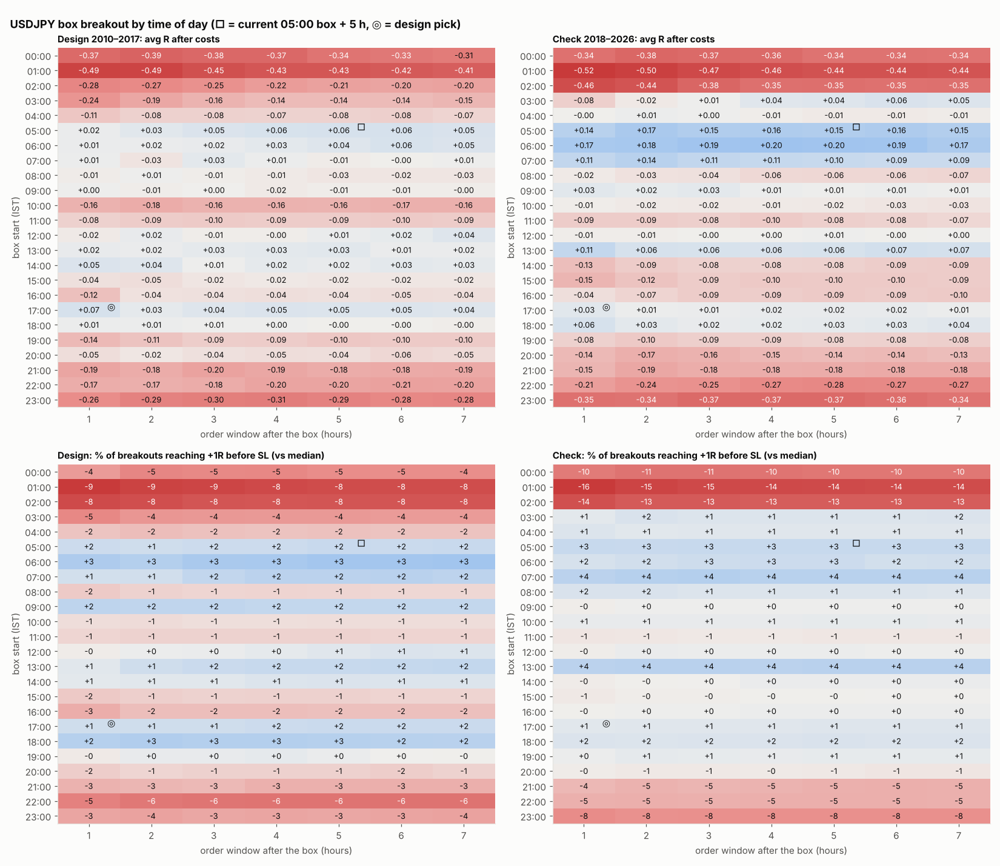

# USDJPY: which time of day does the box breakout work?

1-hour box at every hour 00:00–23:00 IST × order window 1–7 h = 168 windows, Version B (SL 1 × box, RR 9, BE 3R), $7/lot + swap + 0.2 pip slippage. Pick on 2010–2017 by avg R, check on 2018–2026. With 168 tries, a best design t-stat near 3 is expected from luck alone.

**Design pick: 17:00 box + 1 h** — design +0.065R (t +0.99), **check +0.033R** (t +0.54).

| Current window | design avg R | design t | check avg R | check t | check win % | check reach 1R % | check reach 3R % | check trades |
|---|---|---|---|---|---|---|---|---|
| 05:00 box + 5 h | 0.061 | 1.005 | 0.154 | 2.452 | 22.858 | 52.550 | 27.926 | 2323.000 |

| Top 10 by design avg R | design avg R | design t | check avg R | check t | check win % | check reach 1R % | check reach 3R % | check trades |
|---|---|---|---|---|---|---|---|---|
| 17:00 box + 1 h | 0.065 | 0.985 | 0.033 | 0.538 | 20.495 | 50.482 | 27.264 | 2181.000 |
| 05:00 box + 6 h | 0.064 | 1.052 | 0.161 | 2.578 | 22.953 | 52.494 | 27.893 | 2357.000 |
| 05:00 box + 5 h | 0.061 | 1.005 | 0.154 | 2.452 | 22.858 | 52.550 | 27.926 | 2323.000 |
| 05:00 box + 4 h | 0.061 | 0.982 | 0.157 | 2.486 | 22.943 | 52.534 | 27.875 | 2297.000 |
| 06:00 box + 6 h | 0.058 | 0.955 | 0.190 | 3.076 | 21.630 | 51.721 | 28.034 | 2478.000 |
| 05:00 box + 7 h | 0.054 | 0.908 | 0.148 | 2.413 | 22.746 | 52.492 | 27.866 | 2418.000 |
| 05:00 box + 3 h | 0.052 | 0.834 | 0.152 | 2.377 | 22.888 | 52.575 | 27.857 | 2237.000 |
| 06:00 box + 7 h | 0.052 | 0.870 | 0.167 | 2.772 | 21.384 | 51.824 | 28.050 | 2558.000 |
| 17:00 box + 4 h | 0.051 | 0.854 | 0.019 | 0.343 | 20.318 | 50.716 | 27.147 | 2643.000 |
| 14:00 box + 1 h | 0.050 | 0.709 | -0.130 | -2.133 | 18.773 | 49.149 | 24.521 | 1907.000 |

## By box start hour (averaged over the 7 windows)

| Box start (IST), avg over windows | avg_R check | avg_R design | reach_1R check | reach_1R design |
|---|---|---|---|---|
| 00:00 | -0.354 | -0.355 | 39.192 | 44.866 |
| 01:00 | -0.469 | -0.446 | 34.688 | 40.995 |
| 02:00 | -0.383 | -0.231 | 36.526 | 41.638 |
| 03:00 | 0.013 | -0.164 | 50.900 | 45.303 |
| 04:00 | -0.004 | -0.082 | 50.684 | 47.356 |
| 05:00 | 0.154 | 0.049 | 52.511 | 51.039 |
| 06:00 | 0.186 | 0.033 | 51.876 | 52.527 |
| 07:00 | 0.108 | 0.002 | 53.711 | 51.414 |
| 08:00 | -0.048 | -0.014 | 50.950 | 48.185 |
| 09:00 | 0.017 | -0.005 | 49.589 | 51.464 |
| 10:00 | -0.019 | -0.164 | 50.056 | 48.634 |
| 11:00 | -0.084 | -0.091 | 48.804 | 48.157 |
| 12:00 | -0.001 | 0.010 | 49.663 | 49.910 |
| 13:00 | 0.069 | 0.022 | 53.518 | 51.025 |
| 14:00 | -0.092 | 0.028 | 49.664 | 50.210 |
| 15:00 | -0.107 | -0.028 | 49.330 | 48.050 |
| 16:00 | -0.083 | -0.053 | 49.698 | 47.110 |
| 17:00 | 0.017 | 0.046 | 50.689 | 50.994 |
| 18:00 | 0.032 | 0.003 | 51.051 | 51.990 |
| 19:00 | -0.085 | -0.105 | 50.100 | 49.620 |
| 20:00 | -0.147 | -0.046 | 48.866 | 48.038 |
| 21:00 | -0.176 | -0.187 | 44.564 | 46.639 |
| 22:00 | -0.257 | -0.190 | 44.268 | 43.627 |
| 23:00 | -0.356 | -0.288 | 41.710 | 46.003 |

Full grid: `scan.csv`.
