# XAUUSD: supply/demand zones and impulse fade

Period 2010-01-01 to 2026-10-07 23:45 UTC, in-sample to 2020-01-23 (60%), out-of-sample after. Median spread 0.35, median 4H ATR 7.60 (price units). Same rules, engine, costs and benchmarks as the USDJPY/EURUSD studies. Ranking: in-sample expectancy with swap, >= 100 in-sample trades. This is a fresh search on this instrument: any winner is an in-sample pick and needs its own confirmation.

Swap: long gold pays fed funds + 0.5% p.a. markup (gold lease rate taken as 0%); short earns fed funds - 0.5%.

## Verdict

**Short answer: no. Neither supply/demand zones nor fading the impulse has an edge on gold (XAUUSD), 2010–2026. Gold is, if anything, worse than the currency pairs.**

**Zones alone (24 combos; 18 have ≥ 100 in-sample trades).**
- **Overall:** averages −0.12R per trade in-sample and −0.09R out-of-sample. Only 1 of the 18 eligible combos is positive in-sample.
- **That one** (K2_full_B_zone, +0.004R) loses out-of-sample (−0.07R), and the plateau check calls it noise.
- **The other top-5 picks** are negative even in-sample (−0.03R to −0.06R). Two of them turn slightly positive out-of-sample:
  - K1.5_full_B_zone: +0.02R, 234 trades, t-stat 0.2.
  - K1.5_body_B_2R: +0.06R, 124 trades, t-stat 0.5.
  
  Neither can be told apart from zero.
- **The base** (K2_full_A_2R) is −0.14R per trade: −59% over the period, with a 62% drawdown.
- **Versions:** every Version A (limit order) combo is clearly negative, −0.12R to −0.50R. Version B is around −0.03R.
- **Long vs short:** the only positive slices are Version B longs, +0.02R to +0.06R, while shorts lose. That is gold's 4× bull market, not the zones: any rule that leans long earns the drift.
- **Vs random entries in the same zone's life:** Version B zone entries beat them (90th–98th percentile). As on the currency pairs, that comes from waiting out the post-impulse retrace, and it still doesn't make the trade profitable.

**Fade the impulse (18 combos, all eligible).**
- **Every one of the 18 combos loses in-sample.** The best is K1.5_close_2R at −0.05R, and it loses out-of-sample (−0.08R).
- **Overall:** averages −0.17R in-sample, −0.11R out-of-sample and −0.14R over the full period. No combo is positive over the full period.
- **Vs random direction:** the fade sits between the 1st and 94th percentile, mostly around the 55th–75th, so the fade direction carries almost no information on gold.
- **Costs:** trading at random times costs −0.11R per trade with these stops (gold's spread is about $0.35).
- **Snap-back:** after big gold impulses it is weaker than on the currency pairs. Fading at random times in the zone's life makes +0.07R, against +0.12R on USDJPY and EURUSD.

**Other:**
- Swap costs longs about fed funds + 0.5% a year, assuming a 0% gold lease rate. It moves results by ≤ 0.01R per trade.
- Nothing was flagged as unrealistically good.

**Bottom line.** Across USDJPY, EURUSD, five yen crosses and gold, 4H supply/demand zones show no edge, and nor does fading their impulses: with or without the macro filter, under every setting tested, after realistic costs. The one consistent pattern is a partial retrace after big 4H impulses, and it is too small to pay for the spread with stops this tight. I would stop testing variants of this idea on historical data. A different concept, or a different holding horizon (daily rather than 4H, so costs are a smaller share of each trade), would be a better use of the next test.

## Zones alone (24 combos)

| combo | IS_exp | IS_n | OOS_exp | OOS_n | full_exp | full_n | eligible_100 | top5 |
|---|---|---|---|---|---|---|---|---|
| K2_full_B_zone | 0.004 | 194 | -0.073 | 137 | -0.028 | 331 | True | True |
| K1.5_full_B_zone | -0.033 | 316 | 0.021 | 234 | -0.010 | 550 | True | True |
| K2_full_B_2R | -0.035 | 195 | -0.083 | 140 | -0.055 | 335 | True | True |
| K1.5_full_B_2R | -0.048 | 320 | -0.001 | 248 | -0.027 | 568 | True | True |
| K1.5_body_B_2R | -0.058 | 168 | 0.060 | 124 | -0.008 | 292 | True | True |
| K1.5_body_B_zone | -0.065 | 161 | 0.025 | 119 | -0.026 | 280 | True | False |
| K1.5_full_A_2R | -0.094 | 564 | -0.146 | 410 | -0.116 | 974 | True | False |
| K2_full_A_2R | -0.098 | 341 | -0.198 | 250 | -0.140 | 591 | True | False |
| K2_full_A_zone | -0.117 | 328 | -0.257 | 249 | -0.177 | 577 | True | False |
| K1.5_full_A_zone | -0.130 | 534 | -0.191 | 400 | -0.156 | 934 | True | False |
| K3_full_A_2R | -0.180 | 113 | -0.227 | 70 | -0.198 | 183 | True | False |
| K3_full_A_zone | -0.209 | 111 | -0.182 | 69 | -0.199 | 180 | True | False |
| K2_body_A_2R | -0.251 | 336 | -0.327 | 249 | -0.283 | 585 | True | False |
| K1.5_body_A_2R | -0.254 | 592 | -0.164 | 437 | -0.216 | 1029 | True | False |
| K1.5_body_A_zone | -0.291 | 574 | -0.211 | 424 | -0.257 | 998 | True | False |
| K2_body_A_zone | -0.314 | 332 | -0.334 | 243 | -0.322 | 575 | True | False |
| K3_body_A_2R | -0.395 | 109 | -0.491 | 65 | -0.431 | 174 | True | False |
| K3_body_A_zone | -0.478 | 109 | -0.533 | 65 | -0.499 | 174 | True | False |
| K3_body_B_2R | 0.125 | 24 | 0.490 | 14 | 0.259 | 38 | False | False |
| K2_body_B_2R | 0.061 | 93 | 0.024 | 61 | 0.046 | 154 | False | False |
| K3_body_B_zone | 0.043 | 23 | 0.490 | 14 | 0.212 | 37 | False | False |
| K2_body_B_zone | 0.041 | 91 | -0.029 | 60 | 0.013 | 151 | False | False |
| K3_full_B_zone | -0.083 | 62 | 0.104 | 34 | -0.017 | 96 | False | False |
| K3_full_B_2R | -0.084 | 62 | 0.056 | 34 | -0.034 | 96 | False | False |

18 of 24 eligible. Top 5 (in-sample only): K2_full_B_zone, K1.5_full_B_zone, K2_full_B_2R, K1.5_full_B_2R, K1.5_body_B_2R.

### Top 5: in-sample vs out-of-sample

| combo | IS_exp | IS_n | OOS_exp | OOS_n | flag |
|---|---|---|---|---|---|
| K2_full_B_zone | 0.004 | 194 | -0.073 | 137 | OVERFIT: loses out-of-sample |
| K1.5_full_B_zone | -0.033 | 316 | 0.021 | 234 | holds |
| K2_full_B_2R | -0.035 | 195 | -0.083 | 140 | OVERFIT: loses out-of-sample |
| K1.5_full_B_2R | -0.048 | 320 | -0.001 | 248 | OVERFIT: loses out-of-sample |
| K1.5_body_B_2R | -0.058 | 168 | 0.060 | 124 | holds |

### Plateau check

**K2_full_B_zone** (IS 0.004R): neighbour median -0.035R, 1/5 positive -> LIKELY NOISE

| neighbor | changed | neighbor_IS_exp | neighbor_IS_n |
|---|---|---|---|
| K1.5_full_B_zone | K | -0.033 | 316 |
| K3_full_B_zone | K | -0.083 | 62 |
| K2_body_B_zone | zone | 0.041 | 91 |
| K2_full_A_zone | entry | -0.117 | 328 |
| K2_full_B_2R | exit | -0.035 | 195 |

**K1.5_full_B_zone** (IS -0.033R): neighbour median -0.056R, 1/4 positive -> no in-sample edge to check (IS <= 0)

| neighbor | changed | neighbor_IS_exp | neighbor_IS_n |
|---|---|---|---|
| K2_full_B_zone | K | 0.004 | 194 |
| K1.5_body_B_zone | zone | -0.065 | 161 |
| K1.5_full_A_zone | entry | -0.130 | 534 |
| K1.5_full_B_2R | exit | -0.048 | 320 |

**K2_full_B_2R** (IS -0.035R): neighbour median -0.048R, 2/5 positive -> no in-sample edge to check (IS <= 0)

| neighbor | changed | neighbor_IS_exp | neighbor_IS_n |
|---|---|---|---|
| K1.5_full_B_2R | K | -0.048 | 320 |
| K3_full_B_2R | K | -0.084 | 62 |
| K2_body_B_2R | zone | 0.061 | 93 |
| K2_full_A_2R | entry | -0.098 | 341 |
| K2_full_B_zone | exit | 0.004 | 194 |

**K1.5_full_B_2R** (IS -0.048R): neighbour median -0.046R, 0/4 positive -> no in-sample edge to check (IS <= 0)

| neighbor | changed | neighbor_IS_exp | neighbor_IS_n |
|---|---|---|---|
| K2_full_B_2R | K | -0.035 | 195 |
| K1.5_body_B_2R | zone | -0.058 | 168 |
| K1.5_full_A_2R | entry | -0.094 | 564 |
| K1.5_full_B_zone | exit | -0.033 | 316 |

**K1.5_body_B_2R** (IS -0.058R): neighbour median -0.056R, 1/4 positive -> no in-sample edge to check (IS <= 0)

| neighbor | changed | neighbor_IS_exp | neighbor_IS_n |
|---|---|---|---|
| K2_body_B_2R | K | 0.061 | 93 |
| K1.5_full_B_2R | zone | -0.048 | 320 |
| K1.5_body_A_2R | entry | -0.254 | 592 |
| K1.5_body_B_zone | exit | -0.065 | 161 |

### Base and top 5 vs benchmark (random entry inside the same zone's life, 1000 seeds, no swap)

| combo | period | trades | win% | PF | exp R | exp R +swap | maxDD% +swap | lose streak | net % +swap | t +swap | bench p50 | bench p95 | pctl | flags |
|---|---|---|---|---|---|---|---|---|---|---|---|---|---|---|
| K2_full_A_2R | IS | 341 | 30.205 | 0.864 | -0.095 | -0.098 | 35.777 | 10 | -30.617 | -1.309 | -0.173 | -0.050 | 85.300 |  |
| K2_full_A_2R | OOS | 250 | 26.800 | 0.732 | -0.196 | -0.198 | 46.431 | 13 | -40.362 | -2.356 | -0.184 | -0.052 | 43.800 |  |
| K2_full_A_2R | full | 591 | 28.765 | 0.807 | -0.138 | -0.140 | 61.698 | 13 | -58.621 | -2.509 | -0.174 | -0.087 | 75.400 |  |
| K2_full_B_zone | IS | 194 | 32.990 | 1.011 | 0.007 | 0.004 | 26.457 | 13 | -1.356 | 0.035 | -0.127 | 0.029 | 92.200 |  |
| K2_full_B_zone | OOS | 137 | 29.927 | 0.907 | -0.065 | -0.073 | 21.219 | 9 | -10.836 | -0.589 | -0.144 | 0.072 | 73.500 |  |
| K2_full_B_zone | full | 331 | 31.722 | 0.967 | -0.023 | -0.028 | 35.142 | 13 | -12.045 | -0.349 | -0.133 | -0.008 | 92.100 |  |
| K1.5_full_B_zone | IS | 316 | 32.595 | 0.956 | -0.030 | -0.033 | 29.406 | 13 | -12.803 | -0.413 | -0.125 | -0.010 | 91.300 |  |
| K1.5_full_B_zone | OOS | 234 | 31.197 | 1.036 | 0.025 | 0.021 | 26.620 | 12 | 1.188 | 0.176 | -0.083 | 0.084 | 84.700 |  |
| K1.5_full_B_zone | full | 550 | 32.000 | 0.990 | -0.007 | -0.010 | 30.796 | 13 | -11.767 | -0.144 | -0.103 | -0.007 | 95.300 |  |
| K2_full_B_2R | IS | 195 | 32.308 | 0.955 | -0.031 | -0.035 | 20.791 | 10 | -8.397 | -0.350 | -0.169 | -0.016 | 94.100 |  |
| K2_full_B_2R | OOS | 140 | 30.714 | 0.887 | -0.079 | -0.083 | 23.527 | 9 | -12.133 | -0.712 | -0.123 | 0.047 | 68.800 |  |
| K2_full_B_2R | full | 335 | 31.642 | 0.926 | -0.051 | -0.055 | 31.162 | 10 | -19.511 | -0.726 | -0.151 | -0.033 | 92.600 |  |
| K1.5_full_B_2R | IS | 320 | 31.875 | 0.936 | -0.044 | -0.048 | 30.598 | 13 | -16.881 | -0.615 | -0.156 | -0.036 | 94.300 |  |
| K1.5_full_B_2R | OOS | 248 | 33.468 | 1.003 | 0.002 | -0.001 | 22.750 | 9 | -2.632 | -0.009 | -0.118 | 0.014 | 93.100 |  |
| K1.5_full_B_2R | full | 568 | 32.570 | 0.965 | -0.024 | -0.027 | 31.295 | 13 | -19.068 | -0.466 | -0.138 | -0.051 | 98.200 |  |
| K1.5_body_B_2R | IS | 168 | 31.548 | 0.922 | -0.054 | -0.058 | 23.525 | 8 | -10.685 | -0.534 | -0.107 | 0.054 | 71.100 |  |
| K1.5_body_B_2R | OOS | 124 | 35.484 | 1.100 | 0.065 | 0.060 | 13.458 | 10 | 6.353 | 0.464 | -0.082 | 0.107 | 91.200 |  |
| K1.5_body_B_2R | full | 292 | 33.219 | 0.995 | -0.003 | -0.008 | 23.525 | 10 | -5.011 | -0.093 | -0.100 | 0.024 | 90.500 |  |

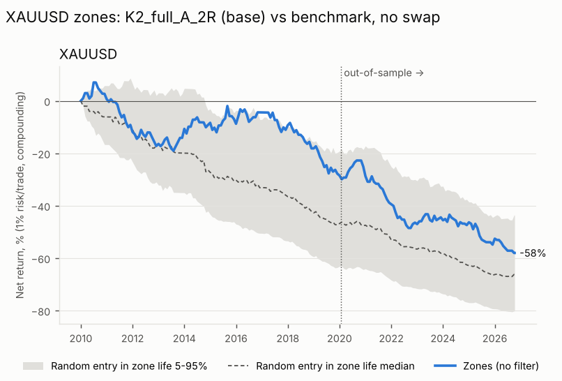

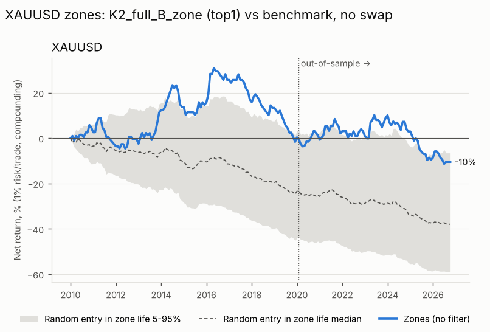

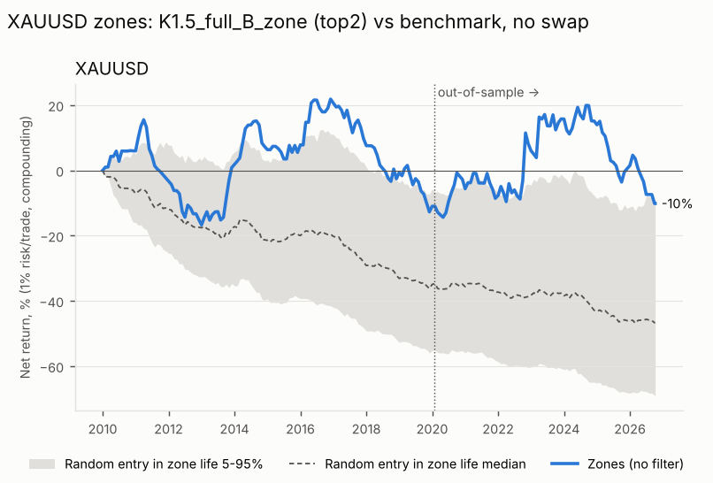

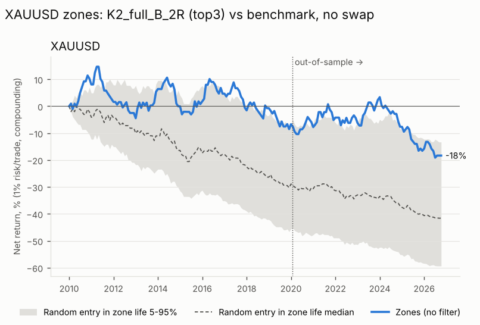

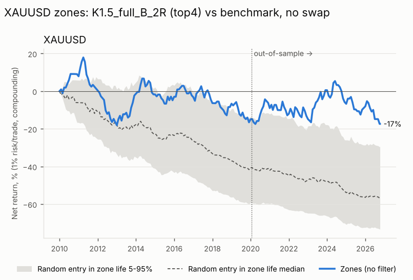

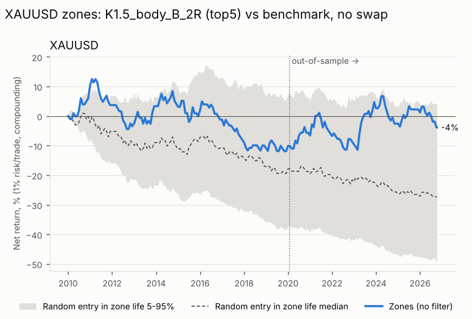

### Controls (base combo, same stop/target geometry, no swap)

| combo | control | mean_exp_R | p5 | p95 | seeds |
|---|---|---|---|---|---|
| K2_full_A_2R | random side, uniform random time | -0.059 | -0.163 | 0.035 | 200.000 |
| K2_full_A_2R | zone side, random time in zone life | -0.180 | -0.271 | -0.082 | 200.000 |
| K2_full_A_2R | opposite side, random time in zone life | 0.071 | -0.007 | 0.162 | 200.000 |
| K2_full_A_2R | zone side, at zone activation | -0.438 | - | - | 1.000 |
| K2_full_A_2R | real zone trades | -0.138 | - | - | 0.000 |

### Breakdowns (with swap)

| combo | by | key | trades | win_rate | expectancy_R | profit_factor | total_R |
|---|---|---|---|---|---|---|---|
| K2_full_A_2R | side | long | 298 | 31.208 | -0.074 | 0.893 | -22.183 |
| K2_full_A_2R | side | short | 293 | 26.280 | -0.207 | 0.718 | -60.596 |
| K2_full_B_zone | side | long | 156 | 34.615 | 0.049 | 1.074 | 7.629 |
| K2_full_B_zone | side | short | 175 | 29.143 | -0.097 | 0.862 | -16.942 |
| K1.5_full_B_zone | side | long | 260 | 34.615 | 0.023 | 1.035 | 5.985 |
| K1.5_full_B_zone | side | short | 290 | 29.655 | -0.040 | 0.943 | -11.480 |
| K2_full_B_2R | side | long | 163 | 34.969 | 0.034 | 1.052 | 5.563 |
| K2_full_B_2R | side | short | 172 | 28.488 | -0.140 | 0.803 | -24.047 |
| K1.5_full_B_2R | side | long | 280 | 34.286 | 0.015 | 1.022 | 4.167 |
| K1.5_full_B_2R | side | short | 288 | 30.903 | -0.069 | 0.900 | -19.760 |
| K1.5_body_B_2R | side | long | 142 | 35.915 | 0.062 | 1.096 | 8.832 |
| K1.5_body_B_2R | side | short | 150 | 30.667 | -0.074 | 0.893 | -11.087 |

| combo | by | key | trades | win_rate | expectancy_R | profit_factor | total_R |
|---|---|---|---|---|---|---|---|
| K2_full_A_2R | sample | IS | 341 | 30.205 | -0.098 | 0.860 | -33.323 |
| K2_full_A_2R | sample | OOS | 250 | 26.800 | -0.198 | 0.730 | -49.456 |
| K2_full_B_zone | sample | IS | 194 | 32.990 | 0.004 | 1.006 | 0.722 |
| K2_full_B_zone | sample | OOS | 137 | 29.927 | -0.073 | 0.896 | -10.035 |
| K1.5_full_B_zone | sample | IS | 316 | 32.595 | -0.033 | 0.951 | -10.506 |
| K1.5_full_B_zone | sample | OOS | 234 | 31.197 | 0.021 | 1.031 | 5.011 |
| K2_full_B_2R | sample | IS | 195 | 32.308 | -0.035 | 0.948 | -6.867 |
| K2_full_B_2R | sample | OOS | 140 | 30.714 | -0.083 | 0.880 | -11.618 |
| K1.5_full_B_2R | sample | IS | 320 | 31.875 | -0.048 | 0.930 | -15.383 |
| K1.5_full_B_2R | sample | OOS | 248 | 33.468 | -0.001 | 0.999 | -0.209 |
| K1.5_body_B_2R | sample | IS | 168 | 31.548 | -0.058 | 0.916 | -9.678 |
| K1.5_body_B_2R | sample | OOS | 124 | 35.484 | 0.060 | 1.093 | 7.423 |

By year, expectancy R (trades):

| year | K1.5_body_B_2R | K1.5_full_B_2R | K1.5_full_B_zone | K2_full_A_2R | K2_full_B_2R | K2_full_B_zone |
|---|---|---|---|---|---|---|
| 2010 | 0.711 (14) | 0.233 (34) | 0.189 (32) | 0.027 (35) | 0.418 (19) | 0.133 (20) |
| 2011 | -0.336 (18) | -0.208 (34) | -0.255 (35) | -0.384 (34) | -0.288 (21) | -0.288 (21) |
| 2012 | -0.288 (21) | -0.573 (35) | -0.421 (35) | -0.158 (32) | -0.335 (18) | 0.069 (19) |
| 2013 | 0.397 (15) | 0.591 (32) | 0.757 (27) | 0.198 (35) | 0.576 (19) | 0.721 (20) |
| 2014 | -0.003 (21) | -0.004 (39) | 0.12 (38) | 0.069 (42) | -0.227 (27) | 0.051 (25) |
| 2015 | -0.058 (19) | -0.045 (25) | 0.056 (27) | -0.005 (33) | 0.101 (19) | 0.101 (19) |
| 2016 | -0.206 (15) | -0.004 (27) | 0.397 (29) | 0.196 (35) | 0.165 (18) | 0.5 (17) |
| 2017 | -0.582 (14) | -0.102 (33) | -0.371 (31) | -0.285 (25) | -0.412 (15) | -0.583 (14) |
| 2018 | -0.123 (17) | 0.004 (30) | -0.245 (31) | -0.329 (31) | 0.057 (17) | -0.123 (17) |
| 2019 | 0.071 (14) | -0.314 (30) | -0.361 (30) | -0.359 (37) | -0.297 (21) | -0.576 (21) |
| 2020 | 0.396 (15) | 0.296 (30) | 0.27 (30) | -0.002 (33) | 0.047 (20) | 0.053 (20) |
| 2021 | -0.121 (17) | -0.159 (32) | -0.129 (31) | -0.402 (40) | 0.102 (19) | 0.102 (19) |
| 2022 | -0.207 (15) | -0.097 (33) | 0.522 (30) | -0.354 (37) | -0.12 (17) | -0.12 (17) |
| 2023 | 0.552 (23) | 0.499 (34) | 0.267 (32) | 0.078 (30) | 0.578 (17) | 0.551 (15) |
| 2024 | -0.136 (21) | -0.091 (53) | -0.016 (47) | -0.03 (44) | -0.341 (32) | -0.195 (32) |
| 2025 | 0.095 (19) | -0.083 (42) | -0.281 (41) | -0.276 (41) | -0.392 (24) | -0.505 (24) |
| 2026 | -0.355 (14) | -0.419 (25) | -0.5 (24) | -0.442 (27) | -0.247 (12) | -0.171 (11) |

### Counts

| combo | zones | impulses | dead_expired_untouched | dead_B_no_trigger_24h | dead_B_closed_through_far_edge | no_confirmation | skipped_position_open | stop_lt_2x_spread | opposite_zone_tp_lt_1R | tp_fallback_2R |
|---|---|---|---|---|---|---|---|---|---|---|
| K1.5_full_A_2R | 1554 | - | 398 | 0 | 0 | - | 177 | 5 | 0 | 0 |
| K1.5_full_A_zone | 1554 | - | 398 | 0 | 0 | - | 216 | 5 | 1 | 701 |
| K1.5_full_B_2R | 1554 | - | 398 | 67 | 440 | - | 81 | 0 | 0 | 0 |
| K1.5_full_B_zone | 1554 | - | 398 | 67 | 440 | - | 49 | 0 | 50 | 365 |
| K1.5_body_A_2R | 1554 | - | 460 | 0 | 0 | - | 32 | 33 | 0 | 0 |
| K1.5_body_A_zone | 1554 | - | 460 | 0 | 0 | - | 64 | 32 | 0 | 694 |
| K1.5_body_B_2R | 1554 | - | 460 | 32 | 740 | - | 30 | 0 | 0 | 0 |
| K1.5_body_B_zone | 1554 | - | 460 | 32 | 740 | - | 17 | 0 | 25 | 182 |
| K2_full_A_2R | 958 | - | 308 | 0 | 0 | - | 54 | 5 | 0 | 0 |
| K2_full_A_zone | 958 | - | 308 | 0 | 0 | - | 68 | 5 | 0 | 476 |
| K2_full_B_2R | 958 | - | 308 | 39 | 252 | - | 24 | 0 | 0 | 0 |
| K2_full_B_zone | 958 | - | 308 | 39 | 252 | - | 11 | 0 | 17 | 238 |
| K2_body_A_2R | 958 | - | 342 | 0 | 0 | - | 12 | 19 | 0 | 0 |
| K2_body_A_zone | 958 | - | 342 | 0 | 0 | - | 22 | 19 | 0 | 459 |
| K2_body_B_2R | 958 | - | 342 | 24 | 433 | - | 5 | 0 | 0 | 0 |
| K2_body_B_zone | 958 | - | 342 | 24 | 433 | - | 4 | 0 | 4 | 108 |
| K3_full_A_2R | 354 | - | 163 | 0 | 0 | - | 7 | 1 | 0 | 0 |
| K3_full_A_zone | 354 | - | 163 | 0 | 0 | - | 10 | 1 | 0 | 167 |
| K3_full_B_2R | 354 | - | 163 | 14 | 78 | - | 3 | 0 | 0 | 0 |
| K3_full_B_zone | 354 | - | 163 | 14 | 78 | - | 2 | 0 | 1 | 84 |
| K3_body_A_2R | 354 | - | 175 | 0 | 0 | - | 2 | 3 | 0 | 0 |
| K3_body_A_zone | 354 | - | 175 | 0 | 0 | - | 2 | 3 | 0 | 162 |
| K3_body_B_2R | 354 | - | 175 | 13 | 127 | - | 1 | 0 | 0 | 0 |
| K3_body_B_zone | 354 | - | 175 | 13 | 127 | - | 1 | 0 | 1 | 30 |

## Fade the impulse (18 combos)

| combo | IS_exp | IS_n | OOS_exp | OOS_n | full_exp | full_n | eligible_100 | top5 |
|---|---|---|---|---|---|---|---|---|
| K1.5_close_2R | -0.047 | 814 | -0.077 | 579 | -0.060 | 1393 | True | True |
| K1.5_confirm_1R | -0.074 | 764 | -0.023 | 532 | -0.053 | 1296 | True | True |
| K1.5_close_1R | -0.090 | 857 | -0.104 | 599 | -0.096 | 1456 | True | True |
| K2_close_2R | -0.103 | 512 | -0.061 | 363 | -0.086 | 875 | True | True |
| K1.5_close_base | -0.115 | 728 | -0.229 | 511 | -0.162 | 1239 | True | True |
| K1.5_confirm_2R | -0.117 | 672 | -0.018 | 375 | -0.082 | 1047 | True | False |
| K2_close_base | -0.139 | 477 | -0.097 | 320 | -0.122 | 797 | True | False |
| K2_confirm_1R | -0.141 | 513 | -0.084 | 345 | -0.118 | 858 | True | False |
| K3_confirm_1R | -0.141 | 205 | -0.089 | 119 | -0.122 | 324 | True | False |
| K2_close_1R | -0.143 | 528 | -0.124 | 372 | -0.135 | 900 | True | False |
| K1.5_confirm_base | -0.148 | 506 | -0.140 | 353 | -0.145 | 859 | True | False |
| K2_confirm_2R | -0.148 | 472 | -0.067 | 269 | -0.119 | 741 | True | False |
| K3_close_1R | -0.209 | 212 | 0.001 | 121 | -0.133 | 333 | True | False |
| K3_close_2R | -0.216 | 204 | -0.099 | 121 | -0.172 | 325 | True | False |
| K3_confirm_2R | -0.218 | 198 | -0.267 | 101 | -0.235 | 299 | True | False |
| K2_confirm_base | -0.240 | 382 | -0.082 | 247 | -0.178 | 629 | True | False |
| K3_close_base | -0.299 | 202 | -0.094 | 114 | -0.225 | 316 | True | False |
| K3_confirm_base | -0.390 | 173 | -0.293 | 101 | -0.354 | 274 | True | False |

18 of 18 eligible. Top 5 (in-sample only): K1.5_close_2R, K1.5_confirm_1R, K1.5_close_1R, K2_close_2R, K1.5_close_base.

### Top 5: in-sample vs out-of-sample

| combo | IS_exp | IS_n | OOS_exp | OOS_n | flag |
|---|---|---|---|---|---|
| K1.5_close_2R | -0.047 | 814 | -0.077 | 579 | OVERFIT: loses out-of-sample |
| K1.5_confirm_1R | -0.074 | 764 | -0.023 | 532 | OVERFIT: loses out-of-sample |
| K1.5_close_1R | -0.090 | 857 | -0.104 | 599 | OVERFIT: loses out-of-sample |
| K2_close_2R | -0.103 | 512 | -0.061 | 363 | OVERFIT: loses out-of-sample |
| K1.5_close_base | -0.115 | 728 | -0.229 | 511 | OVERFIT: loses out-of-sample |

### Plateau check

**K1.5_close_2R** (IS -0.047R): neighbour median -0.109R, 0/4 positive -> no in-sample edge to check (IS <= 0)

| neighbor | changed | neighbor_IS_exp | neighbor_IS_n |
|---|---|---|---|
| K2_close_2R | K | -0.103 | 512 |
| K1.5_confirm_2R | entry | -0.117 | 672 |
| K1.5_close_1R | target | -0.090 | 857 |
| K1.5_close_base | target | -0.115 | 728 |

**K1.5_confirm_1R** (IS -0.074R): neighbour median -0.129R, 0/4 positive -> no in-sample edge to check (IS <= 0)

| neighbor | changed | neighbor_IS_exp | neighbor_IS_n |
|---|---|---|---|
| K2_confirm_1R | K | -0.141 | 513 |
| K1.5_close_1R | entry | -0.090 | 857 |
| K1.5_confirm_2R | target | -0.117 | 672 |
| K1.5_confirm_base | target | -0.148 | 506 |

**K1.5_close_1R** (IS -0.090R): neighbour median -0.094R, 0/4 positive -> no in-sample edge to check (IS <= 0)

| neighbor | changed | neighbor_IS_exp | neighbor_IS_n |
|---|---|---|---|
| K2_close_1R | K | -0.143 | 528 |
| K1.5_confirm_1R | entry | -0.074 | 764 |
| K1.5_close_2R | target | -0.047 | 814 |
| K1.5_close_base | target | -0.115 | 728 |

**K2_close_2R** (IS -0.103R): neighbour median -0.143R, 0/5 positive -> no in-sample edge to check (IS <= 0)

| neighbor | changed | neighbor_IS_exp | neighbor_IS_n |
|---|---|---|---|
| K1.5_close_2R | K | -0.047 | 814 |
| K3_close_2R | K | -0.216 | 204 |
| K2_confirm_2R | entry | -0.148 | 472 |
| K2_close_1R | target | -0.143 | 528 |
| K2_close_base | target | -0.139 | 477 |

**K1.5_close_base** (IS -0.115R): neighbour median -0.114R, 0/4 positive -> no in-sample edge to check (IS <= 0)

| neighbor | changed | neighbor_IS_exp | neighbor_IS_n |
|---|---|---|---|
| K2_close_base | K | -0.139 | 477 |
| K1.5_confirm_base | entry | -0.148 | 506 |
| K1.5_close_1R | target | -0.090 | 857 |
| K1.5_close_2R | target | -0.047 | 814 |

### Base and top 5 vs benchmark (random side at the same moment, 1000 seeds, no swap)

| combo | period | trades | win% | PF | exp R | exp R +swap | maxDD% +swap | lose streak | net % +swap | t +swap | bench p50 | bench p95 | pctl | flags |
|---|---|---|---|---|---|---|---|---|---|---|---|---|---|---|
| K2_close_2R | IS | 512 | 30.078 | 0.860 | -0.098 | -0.103 | 55.052 | 20 | -43.648 | -1.687 | -0.104 | -0.022 | 54.300 |  |
| K2_close_2R | OOS | 363 | 31.680 | 0.915 | -0.059 | -0.061 | 32.178 | 12 | -22.785 | -0.834 | -0.074 | 0.024 | 59.400 |  |
| K2_close_2R | full | 875 | 30.743 | 0.882 | -0.082 | -0.086 | 65.101 | 20 | -56.487 | -1.824 | -0.092 | -0.026 | 59.700 |  |
| K1.5_close_2R | IS | 814 | 32.064 | 0.937 | -0.043 | -0.047 | 57.160 | 18 | -36.987 | -0.947 | -0.103 | -0.038 | 93.700 |  |
| K1.5_close_2R | OOS | 579 | 31.088 | 0.894 | -0.074 | -0.077 | 50.578 | 13 | -39.595 | -1.337 | -0.078 | 0.002 | 54.500 |  |
| K1.5_close_2R | full | 1393 | 31.658 | 0.919 | -0.056 | -0.060 | 73.864 | 18 | -61.937 | -1.584 | -0.092 | -0.041 | 88.600 |  |
| K1.5_confirm_1R | IS | 764 | 46.466 | 0.866 | -0.072 | -0.074 | 52.714 | 8 | -45.273 | -2.044 | -0.076 | -0.015 | 54.900 |  |
| K1.5_confirm_1R | OOS | 532 | 49.060 | 0.956 | -0.022 | -0.023 | 23.589 | 7 | -14.084 | -0.539 | -0.039 | 0.031 | 65.600 |  |
| K1.5_confirm_1R | full | 1296 | 47.531 | 0.902 | -0.051 | -0.053 | 59.518 | 8 | -52.981 | -1.913 | -0.060 | -0.013 | 63.000 |  |
| K1.5_close_1R | IS | 857 | 45.858 | 0.839 | -0.088 | -0.090 | 57.747 | 11 | -55.633 | -2.600 | -0.110 | -0.057 | 74.200 |  |
| K1.5_close_1R | OOS | 599 | 45.242 | 0.817 | -0.101 | -0.104 | 54.098 | 11 | -47.938 | -2.533 | -0.112 | -0.048 | 60.500 |  |
| K1.5_close_1R | full | 1456 | 45.604 | 0.830 | -0.093 | -0.096 | 79.429 | 11 | -76.902 | -3.620 | -0.111 | -0.069 | 75.300 |  |
| K1.5_close_base | IS | 728 | 23.214 | 0.855 | -0.112 | -0.115 | 63.310 | 17 | -61.893 | -1.605 | -0.146 | -0.059 | 73.800 |  |
| K1.5_close_base | OOS | 511 | 21.526 | 0.718 | -0.224 | -0.229 | 73.660 | 21 | -71.298 | -2.925 | -0.068 | 0.039 | 1.400 |  |
| K1.5_close_base | full | 1239 | 22.518 | 0.798 | -0.158 | -0.162 | 89.859 | 21 | -89.062 | -3.056 | -0.116 | -0.049 | 14.800 |  |

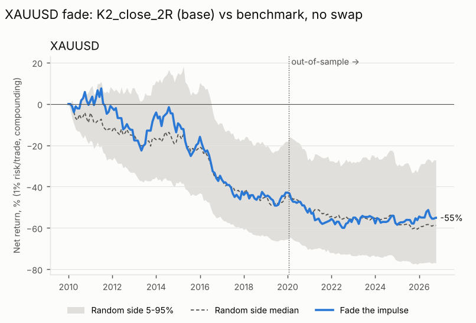

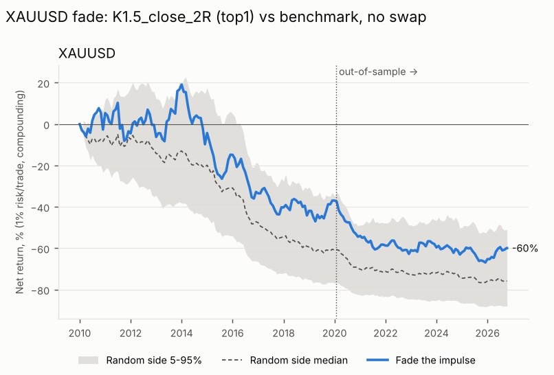

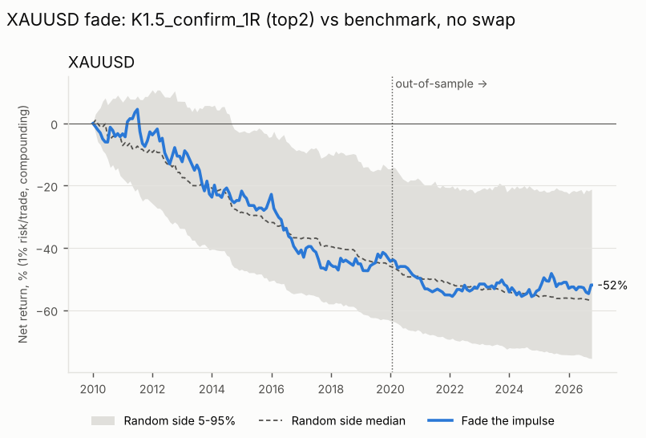

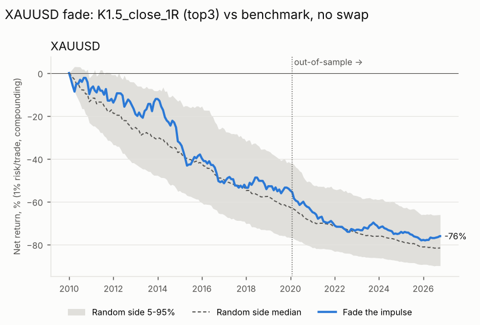

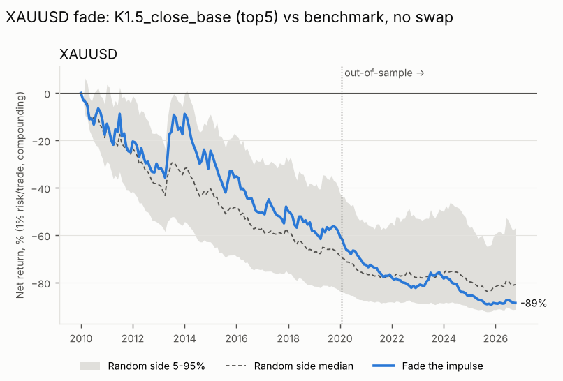

### Controls (base combo, same stop/target geometry, no swap)

| combo | control | mean_exp_R | p5 | p95 | seeds |
|---|---|---|---|---|---|
| K2_close_2R | random side, uniform random time (cost floor) | -0.111 | -0.178 | -0.041 | - |

### Breakdowns (with swap)

| combo | by | key | trades | win_rate | expectancy_R | profit_factor | total_R |
|---|---|---|---|---|---|---|---|
| K2_close_2R | side | long | 427 | 32.084 | -0.056 | 0.919 | -23.908 |
| K2_close_2R | side | short | 448 | 29.464 | -0.114 | 0.839 | -50.915 |
| K1.5_close_2R | side | long | 674 | 33.383 | -0.022 | 0.968 | -14.732 |
| K1.5_close_2R | side | short | 719 | 30.042 | -0.095 | 0.864 | -68.218 |
| K1.5_confirm_1R | side | long | 632 | 49.842 | -0.014 | 0.972 | -8.901 |
| K1.5_confirm_1R | side | short | 664 | 45.331 | -0.090 | 0.834 | -60.046 |
| K1.5_close_1R | side | long | 703 | 45.946 | -0.098 | 0.822 | -69.081 |
| K1.5_close_1R | side | short | 753 | 45.286 | -0.093 | 0.830 | -70.006 |
| K1.5_close_base | side | long | 558 | 25.627 | -0.137 | 0.822 | -76.293 |
| K1.5_close_base | side | short | 681 | 19.971 | -0.182 | 0.772 | -124.010 |

| combo | by | key | trades | win_rate | expectancy_R | profit_factor | total_R |
|---|---|---|---|---|---|---|---|
| K2_close_2R | sample | IS | 512 | 30.078 | -0.103 | 0.854 | -52.519 |
| K2_close_2R | sample | OOS | 363 | 31.680 | -0.061 | 0.911 | -22.304 |
| K1.5_close_2R | sample | IS | 814 | 32.064 | -0.047 | 0.932 | -38.131 |
| K1.5_close_2R | sample | OOS | 579 | 31.088 | -0.077 | 0.889 | -44.819 |
| K1.5_confirm_1R | sample | IS | 764 | 46.466 | -0.074 | 0.863 | -56.449 |
| K1.5_confirm_1R | sample | OOS | 532 | 49.060 | -0.023 | 0.954 | -12.498 |
| K1.5_close_1R | sample | IS | 857 | 45.858 | -0.090 | 0.836 | -76.862 |
| K1.5_close_1R | sample | OOS | 599 | 45.242 | -0.104 | 0.813 | -62.226 |
| K1.5_close_base | sample | IS | 728 | 23.214 | -0.115 | 0.852 | -83.369 |
| K1.5_close_base | sample | OOS | 511 | 21.526 | -0.229 | 0.713 | -116.934 |

By year, expectancy R (trades):

| year | K1.5_close_1R | K1.5_close_2R | K1.5_close_base | K1.5_confirm_1R | K2_close_2R |
|---|---|---|---|---|---|
| 2010 | -0.086 (83) | 0.074 (78) | -0.182 (72) | -0.042 (75) | 0.038 (49) |
| 2011 | -0.08 (89) | -0.114 (81) | -0.112 (70) | -0.002 (76) | -0.062 (51) |
| 2012 | -0.082 (89) | -0.027 (86) | -0.228 (70) | -0.12 (77) | -0.357 (51) |
| 2013 | 0.118 (82) | 0.324 (79) | 0.489 (66) | -0.177 (77) | 0.302 (55) |
| 2014 | -0.284 (92) | -0.238 (89) | -0.21 (83) | 0.023 (76) | -0.11 (57) |
| 2015 | -0.149 (75) | -0.159 (71) | -0.229 (65) | -0.002 (70) | -0.122 (51) |
| 2016 | -0.254 (83) | -0.31 (78) | -0.366 (71) | -0.374 (70) | -0.54 (52) |
| 2017 | -0.049 (86) | -0.122 (85) | 0.036 (73) | -0.116 (79) | -0.287 (42) |
| 2018 | 0.02 (86) | -0.028 (83) | -0.222 (77) | 0.023 (82) | -0.027 (49) |
| 2019 | -0.049 (86) | 0.107 (78) | -0.057 (76) | 0.022 (76) | 0.065 (50) |
| 2020 | -0.352 (71) | -0.437 (71) | -0.55 (65) | -0.148 (67) | -0.317 (45) |
| 2021 | -0.226 (85) | -0.126 (82) | -0.307 (69) | -0.158 (71) | -0.177 (58) |
| 2022 | -0.07 (92) | -0.051 (91) | -0.205 (82) | 0.091 (86) | 0.03 (58) |
| 2023 | 0.022 (95) | 0.035 (86) | 0.206 (78) | -0.051 (89) | -0.111 (54) |
| 2024 | -0.066 (100) | -0.057 (95) | -0.442 (87) | 0.022 (78) | -0.021 (58) |
| 2025 | -0.163 (92) | -0.092 (91) | -0.325 (77) | 0.016 (86) | 0.168 (58) |
| 2026 | 0.113 (70) | 0.216 (69) | 0.044 (58) | 0.039 (61) | -0.028 (37) |

### Counts

| combo | zones | impulses | dead_expired_untouched | dead_B_no_trigger_24h | dead_B_closed_through_far_edge | no_confirmation | skipped_position_open | stop_lt_2x_spread | opposite_zone_tp_lt_1R | tp_fallback_2R |
|---|---|---|---|---|---|---|---|---|---|---|
| K1.5_close_1R | - | 1554 | - | - | - | 0 | 95 | 3 | 0 | 0 |
| K1.5_close_2R | - | 1554 | - | - | - | 0 | 158 | 3 | 0 | 0 |
| K1.5_close_base | - | 1554 | - | - | - | 0 | 88 | 3 | 224 | 0 |
| K1.5_confirm_1R | - | 1554 | - | - | - | 8 | 250 | 0 | 0 | 0 |
| K1.5_confirm_2R | - | 1554 | - | - | - | 8 | 499 | 0 | 0 | 0 |
| K1.5_confirm_base | - | 1554 | - | - | - | 8 | 147 | 0 | 540 | 0 |
| K2_close_1R | - | 958 | - | - | - | 0 | 55 | 3 | 0 | 0 |
| K2_close_2R | - | 958 | - | - | - | 0 | 80 | 3 | 0 | 0 |
| K2_close_base | - | 958 | - | - | - | 0 | 49 | 3 | 109 | 0 |
| K2_confirm_1R | - | 958 | - | - | - | 5 | 95 | 0 | 0 | 0 |
| K2_confirm_2R | - | 958 | - | - | - | 5 | 212 | 0 | 0 | 0 |
| K2_confirm_base | - | 958 | - | - | - | 5 | 63 | 0 | 261 | 0 |
| K3_close_1R | - | 354 | - | - | - | 0 | 19 | 2 | 0 | 0 |
| K3_close_2R | - | 354 | - | - | - | 0 | 27 | 2 | 0 | 0 |
| K3_close_base | - | 354 | - | - | - | 0 | 17 | 2 | 19 | 0 |
| K3_confirm_1R | - | 354 | - | - | - | 2 | 28 | 0 | 0 | 0 |
| K3_confirm_2R | - | 354 | - | - | - | 2 | 53 | 0 | 0 | 0 |
| K3_confirm_base | - | 354 | - | - | - | 2 | 23 | 0 | 55 | 0 |

## Data gaps (15m bars missing in FX market hours; gold also has a daily 1h break, so this overstates gaps)

| expected_15m_bars | missing_15m_bars | gaps_ge_1h |
|---|---|---|
| 414304 | 15655 | 2715 |