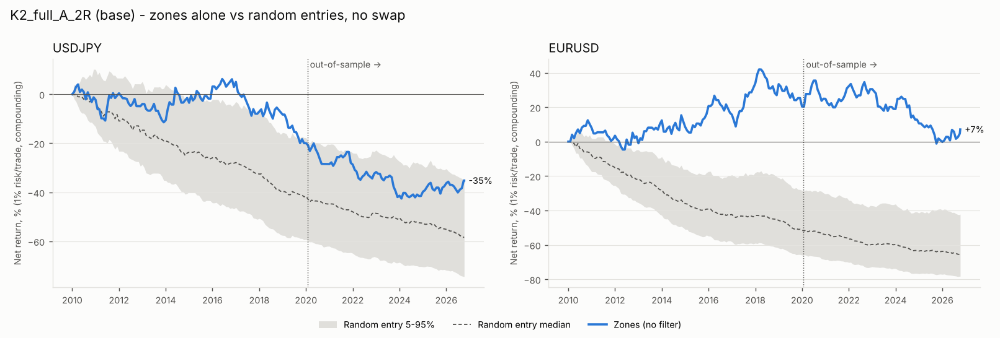
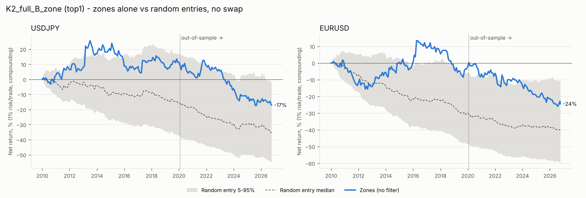
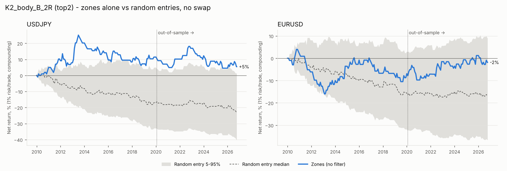
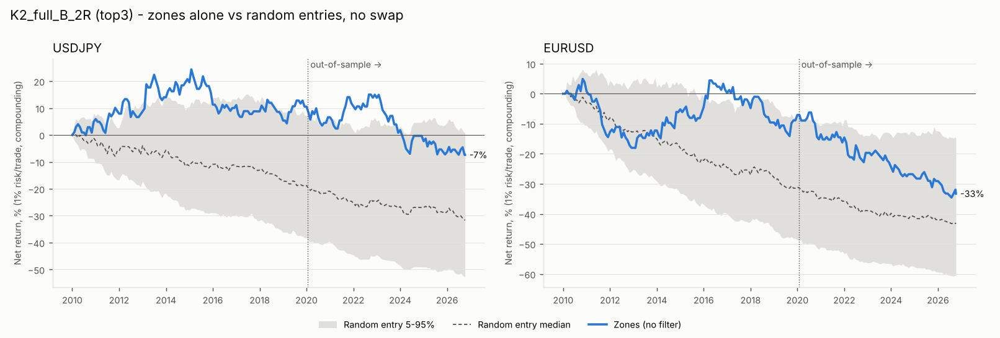
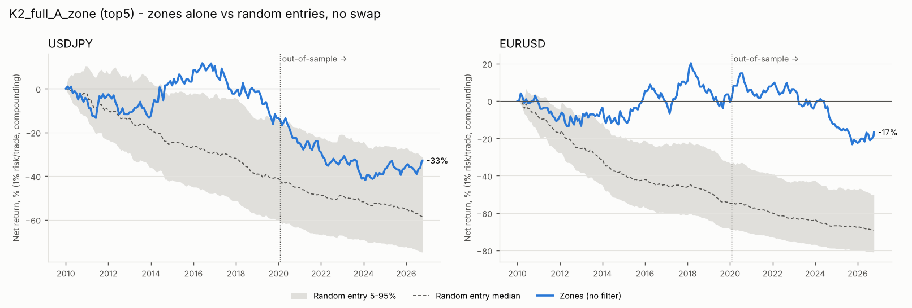

# Supply/demand zones alone: USDJPY and EURUSD

Period 2010-01-01 to 2026-10-07 23:45 UTC, in-sample to 2020-01-23 (60%), out-of-sample after. **Combos tested: 24 per pair.** No day filter: demand and supply zones every day. Same zones, entries, exits, costs, swap and one-position rule as the macro study.

Benchmark: random-entry placebo, same side / stop distance / TP distance, entered at a random 15m close inside the same zone's life (impulse close to 50-bar expiry), 1000 seeds. Only the entry timing differs. Placebo comparisons are without swap.

## Verdict

**Short answer: supply/demand zones on their own have no tradeable edge on USDJPY or EURUSD, 2010–2026.** Waiting for price to come back to the zone is better than entering at a random moment after the impulse. But that only rescues a trade that is losing to begin with, and it leaves you at roughly break-even before costs.

**Sweep, no filter (24 combos per pair, ranked on in-sample only).**
- 15 of 24 combos reach ≥ 100 in-sample trades in each pair.
- Across all 48 combo-pair runs, average expectancy with swap is:
  - in-sample: −0.05R
  - out-of-sample: −0.14R
  - full period: −0.08R
- Only 12.5% of combo-pair runs (6 of 48) are positive over the full period. The typical win rate is 30–34% at 2R; breakeven needs 33.3%.

**Top 5 in-sample** (average of both pairs):
1. K2_full_B_zone: +0.031R
2. K2_body_B_2R: +0.013R
3. K2_full_B_2R: +0.009R
4. K2_full_A_2R (the base): −0.007R
5. K2_full_A_zone: −0.015R

**Out-of-sample:**
- 4 of the 5 lose (−0.07R to −0.21R) and are flagged as overfit.
- K2_body_B_2R is slightly positive (+0.013R). But it has only 55 and 68 out-of-sample trades, it loses on USDJPY (−0.07R) and wins on EURUSD (+0.09R), and the plateau check calls it noise.
- All three positive in-sample combos are flagged as likely noise. Their neighbours are mostly negative: neighbour medians are −0.015R, −0.031R and −0.005R.

**Zones vs random entries (the fair test).** Each random entry has the same side, stop and target as the real trade and is placed at a random 15m close inside the same zone's life. So it knows everything the zone knew, and only the timing differs.
- Zone entries beat most random entries in-sample: the base combo is at the 94th percentile on USDJPY and the 100th on EURUSD.
- They hold up less well out-of-sample: 76th and 89th for the base, and only the 15th percentile for the Version B full-zone combos on EURUSD.

**What the controls show** (base combo, same stop/TP geometry):

| Average R per trade | USDJPY | EURUSD |
|---|---|---|
| Random side, random time (cost floor) | −0.02 | −0.03 |
| Zone direction, entered at the impulse close | −0.46 | −0.30 |
| Zone direction, random time in the zone's life | −0.16 | −0.18 |
| **Real zone trades** | −0.07 | +0.02 |
| Opposite direction, random time in the zone's life | +0.12 | +0.12 |

After a 4H impulse of 2×ATR or more, price tends to come back. The zone wins its comparison because it waits out that pullback, not because the bounce from the zone is reliable. Once price touches the zone, the trade is roughly a coin flip.

**Other cuts:**
- **Version B vs A:** B is less bad (−0.06R vs −0.11R full period, averaged over all combos). The difference is mostly USDJPY; on EURUSD out-of-sample they are level.
- **Zone type:** full-range zones beat body-only zones (−0.07R vs −0.10R). Body zones give tighter stops that get hit more often.
- **K:** the impulse size makes little difference. K=3 has too few trades to rank.
- **Side:** in the base combo, shorts are around 0R and longs around −0.07R.
- **Interventions:** excluding USDJPY trades open within ±3 trading days of an intervention removes up to 14 trades and changes expectancy by ≤ 0.03R.
- **Swap** costs about −0.01R per trade.
- Nothing was flagged as unrealistically good.

**Weakest point:** the edge has to come from the bounce at the zone, and there isn't one. The only robust effect in the data is the snap-back after big impulses, and these zone rules trade that in the wrong direction.

**What to test next**
1. Test the snap-back on its own merits: fade a 4H impulse of 2×ATR or more, with entry, stop and target defined from the impulse itself. It was spotted on the full sample, so it must go through the same in-sample/out-of-sample protocol (its parameters chosen on 2010–2020 only) before believing it.
2. If you want to keep zones, add a confirmation that the pullback has finished (Version B is a weak form of this). Measure it against the same zone-life random-entry benchmark.

## In-sample ranking (no filter, with swap)

| combo | IS_avg_exp | IS_exp_USDJPY | IS_n_USDJPY | IS_exp_EURUSD | IS_n_EURUSD | eligible_100_each | OOS_avg_exp | OOS_exp_USDJPY | OOS_n_USDJPY | OOS_exp_EURUSD | OOS_n_EURUSD |
|---|---|---|---|---|---|---|---|---|---|---|---|
| K2_full_B_zone | 0.031 | 0.051 | 189 | 0.011 | 201 | True | -0.212 | -0.197 | 131 | -0.226 | 123 |
| K2_body_B_2R | 0.013 | 0.092 | 112 | -0.066 | 104 | True | 0.013 | -0.069 | 55 | 0.094 | 68 |
| K2_full_B_2R | 0.009 | 0.045 | 194 | -0.028 | 206 | True | -0.183 | -0.109 | 131 | -0.257 | 128 |
| K2_full_A_2R | -0.007 | -0.072 | 307 | 0.058 | 339 | True | -0.074 | -0.093 | 219 | -0.054 | 203 |
| K2_full_A_zone | -0.015 | -0.044 | 299 | 0.013 | 322 | True | -0.108 | -0.118 | 211 | -0.099 | 200 |
| K1.5_full_B_2R | -0.027 | 0.024 | 346 | -0.078 | 369 | True | -0.157 | -0.162 | 241 | -0.153 | 235 |
| K1.5_full_A_2R | -0.028 | -0.032 | 559 | -0.023 | 590 | True | -0.090 | -0.107 | 378 | -0.073 | 377 |
| K1.5_body_B_2R | -0.031 | 0.004 | 193 | -0.066 | 200 | True | -0.014 | 0.005 | 119 | -0.033 | 120 |
| K1.5_body_B_zone | -0.041 | -0.000 | 183 | -0.081 | 189 | True | -0.060 | -0.182 | 116 | 0.062 | 111 |
| K1.5_full_A_zone | -0.051 | -0.021 | 538 | -0.081 | 563 | True | -0.106 | -0.132 | 363 | -0.081 | 367 |
| K1.5_full_B_zone | -0.055 | 0.053 | 329 | -0.162 | 363 | True | -0.143 | -0.150 | 232 | -0.136 | 221 |
| K1.5_body_A_2R | -0.125 | -0.161 | 601 | -0.089 | 641 | True | -0.113 | -0.129 | 403 | -0.098 | 410 |
| K1.5_body_A_zone | -0.150 | -0.160 | 576 | -0.140 | 622 | True | -0.121 | -0.156 | 388 | -0.086 | 398 |
| K2_body_A_2R | -0.179 | -0.141 | 319 | -0.217 | 337 | True | -0.168 | -0.262 | 213 | -0.074 | 207 |
| K2_body_A_zone | -0.222 | -0.192 | 317 | -0.253 | 329 | True | -0.221 | -0.326 | 211 | -0.115 | 204 |
| K3_full_A_zone | 0.075 | -0.112 | 80 | 0.263 | 86 | False | -0.246 | -0.108 | 65 | -0.383 | 69 |
| K3_full_A_2R | 0.020 | -0.195 | 81 | 0.236 | 86 | False | -0.278 | -0.151 | 66 | -0.405 | 70 |
| K2_body_B_zone | -0.004 | 0.039 | 108 | -0.046 | 98 | False | -0.072 | -0.270 | 54 | 0.126 | 67 |
| K3_full_B_2R | -0.005 | -0.237 | 47 | 0.226 | 54 | False | -0.112 | 0.031 | 38 | -0.256 | 36 |
| K3_full_B_zone | -0.045 | -0.361 | 46 | 0.271 | 54 | False | -0.072 | 0.090 | 38 | -0.233 | 35 |
| K3_body_B_2R | -0.049 | -0.173 | 29 | 0.075 | 31 | False | -0.254 | -0.102 | 17 | -0.406 | 20 |
| K3_body_A_2R | -0.062 | -0.219 | 79 | 0.094 | 82 | False | -0.140 | -0.137 | 62 | -0.142 | 70 |
| K3_body_A_zone | -0.081 | -0.219 | 79 | 0.058 | 82 | False | -0.140 | -0.137 | 62 | -0.142 | 70 |
| K3_body_B_zone | -0.087 | -0.249 | 28 | 0.075 | 31 | False | -0.254 | -0.102 | 17 | -0.406 | 20 |

15 of 24 eligible. Top 5 (in-sample only): K2_full_B_zone, K2_body_B_2R, K2_full_B_2R, K2_full_A_2R, K2_full_A_zone.

### Top 5: in-sample vs out-of-sample

| combo | IS_avg_exp | OOS_avg_exp | OOS_USDJPY | OOS_EURUSD | flag |
|---|---|---|---|---|---|
| K2_full_B_zone | 0.031 | -0.212 | -0.197 | -0.226 | OVERFIT: loses out-of-sample |
| K2_body_B_2R | 0.013 | 0.013 | -0.069 | 0.094 | holds; OOS n<100 in a pair; negative OOS in one pair |
| K2_full_B_2R | 0.009 | -0.183 | -0.109 | -0.257 | OVERFIT: loses out-of-sample |
| K2_full_A_2R | -0.007 | -0.074 | -0.093 | -0.054 | OVERFIT: loses out-of-sample |
| K2_full_A_zone | -0.015 | -0.108 | -0.118 | -0.099 | OVERFIT: loses out-of-sample |

## Plateau check

**K2_full_B_zone** (IS 0.031R): neighbour median -0.015R, 1/5 positive -> LIKELY NOISE

| neighbor | changed | neighbor_IS_avg_exp | neighbor_IS_n_USDJPY | neighbor_IS_n_EURUSD |
|---|---|---|---|---|
| K1.5_full_B_zone | K | -0.055 | 329 | 363 |
| K3_full_B_zone | K | -0.045 | 46 | 54 |
| K2_body_B_zone | zone | -0.004 | 108 | 98 |
| K2_full_A_zone | entry | -0.015 | 299 | 322 |
| K2_full_B_2R | exit | 0.009 | 194 | 206 |

**K2_body_B_2R** (IS 0.013R): neighbour median -0.031R, 1/5 positive -> LIKELY NOISE

| neighbor | changed | neighbor_IS_avg_exp | neighbor_IS_n_USDJPY | neighbor_IS_n_EURUSD |
|---|---|---|---|---|
| K1.5_body_B_2R | K | -0.031 | 193 | 200 |
| K3_body_B_2R | K | -0.049 | 29 | 31 |
| K2_full_B_2R | zone | 0.009 | 194 | 206 |
| K2_body_A_2R | entry | -0.179 | 319 | 337 |
| K2_body_B_zone | exit | -0.004 | 108 | 98 |

**K2_full_B_2R** (IS 0.009R): neighbour median -0.005R, 2/5 positive -> LIKELY NOISE

| neighbor | changed | neighbor_IS_avg_exp | neighbor_IS_n_USDJPY | neighbor_IS_n_EURUSD |
|---|---|---|---|---|
| K1.5_full_B_2R | K | -0.027 | 346 | 369 |
| K3_full_B_2R | K | -0.005 | 47 | 54 |
| K2_body_B_2R | zone | 0.013 | 112 | 104 |
| K2_full_A_2R | entry | -0.007 | 307 | 339 |
| K2_full_B_zone | exit | 0.031 | 189 | 201 |

**K2_full_A_2R** (IS -0.007R): neighbour median -0.015R, 2/5 positive -> no in-sample edge to check (IS <= 0)

| neighbor | changed | neighbor_IS_avg_exp | neighbor_IS_n_USDJPY | neighbor_IS_n_EURUSD |
|---|---|---|---|---|
| K1.5_full_A_2R | K | -0.028 | 559 | 590 |
| K3_full_A_2R | K | 0.020 | 81 | 86 |
| K2_body_A_2R | zone | -0.179 | 319 | 337 |
| K2_full_B_2R | entry | 0.009 | 194 | 206 |
| K2_full_A_zone | exit | -0.015 | 299 | 322 |

**K2_full_A_zone** (IS -0.015R): neighbour median -0.007R, 2/5 positive -> no in-sample edge to check (IS <= 0)

| neighbor | changed | neighbor_IS_avg_exp | neighbor_IS_n_USDJPY | neighbor_IS_n_EURUSD |
|---|---|---|---|---|
| K1.5_full_A_zone | K | -0.051 | 538 | 563 |
| K3_full_A_zone | K | 0.075 | 80 | 86 |
| K2_body_A_zone | zone | -0.222 | 317 | 329 |
| K2_full_B_zone | entry | 0.031 | 189 | 201 |
| K2_full_A_2R | exit | -0.007 | 307 | 339 |

## Base and top 5: zones vs random entries

pctl = share of placebo seeds the real zone trades beat on expectancy (no swap). 95+ would suggest the zone entry carries information.

| combo | pair | period | trades | win% | PF | exp R | exp R +swap | maxDD% +swap | lose streak | net % +swap | placebo p5 | placebo p50 | placebo p95 | pctl | flags |
|---|---|---|---|---|---|---|---|---|---|---|---|---|---|---|---|
| K2_full_A_2R | USDJPY | IS | 307 | 31.270 | 0.904 | -0.066 | -0.072 | 26.655 | 11 | -22.124 | -0.289 | -0.173 | -0.059 | 93.600 |  |
| K2_full_A_2R | USDJPY | OOS | 219 | 30.594 | 0.882 | -0.082 | -0.093 | 28.672 | 15 | -20.174 | -0.274 | -0.138 | -0.000 | 75.700 |  |
| K2_full_A_2R | USDJPY | full | 526 | 30.989 | 0.895 | -0.073 | -0.081 | 47.203 | 15 | -37.835 | -0.250 | -0.157 | -0.072 | 94.800 |  |
| K2_full_A_2R | EURUSD | IS | 339 | 35.693 | 1.100 | 0.065 | 0.058 | 17.460 | 9 | 17.418 | -0.307 | -0.207 | -0.089 | 100.000 |  |
| K2_full_A_2R | EURUSD | OOS | 203 | 32.020 | 0.930 | -0.048 | -0.054 | 27.933 | 12 | -12.183 | -0.303 | -0.155 | 0.002 | 88.500 |  |
| K2_full_A_2R | EURUSD | full | 542 | 34.317 | 1.034 | 0.023 | 0.016 | 32.468 | 12 | 3.114 | -0.273 | -0.187 | -0.091 | 100.000 |  |
| K2_full_B_zone | USDJPY | IS | 189 | 33.862 | 1.088 | 0.058 | 0.051 | 17.332 | 13 | 7.631 | -0.242 | -0.082 | 0.096 | 90.100 |  |
| K2_full_B_zone | USDJPY | OOS | 131 | 25.954 | 0.733 | -0.199 | -0.197 | 26.857 | 10 | -23.769 | -0.363 | -0.184 | -0.022 | 44.600 |  |
| K2_full_B_zone | USDJPY | full | 320 | 30.625 | 0.932 | -0.047 | -0.050 | 34.735 | 13 | -17.952 | -0.239 | -0.126 | 0.003 | 83.700 |  |
| K2_full_B_zone | EURUSD | IS | 201 | 32.836 | 1.019 | 0.013 | 0.011 | 20.981 | 13 | -0.048 | -0.324 | -0.174 | -0.022 | 97.600 |  |
| K2_full_B_zone | EURUSD | OOS | 123 | 25.203 | 0.705 | -0.221 | -0.226 | 26.655 | 9 | -25.160 | -0.286 | -0.101 | 0.100 | 14.500 |  |
| K2_full_B_zone | EURUSD | full | 324 | 29.938 | 0.893 | -0.076 | -0.079 | 35.503 | 13 | -25.195 | -0.267 | -0.148 | -0.022 | 83.100 |  |
| K2_body_B_2R | USDJPY | IS | 112 | 36.607 | 1.155 | 0.098 | 0.092 | 16.318 | 6 | 9.610 | -0.352 | -0.150 | 0.045 | 97.400 |  |
| K2_body_B_2R | USDJPY | OOS | 55 | 30.909 | 0.895 | -0.073 | -0.069 | 12.066 | 8 | -4.211 | -0.403 | -0.127 | 0.134 | 62.700 | n<100 |
| K2_body_B_2R | USDJPY | full | 167 | 34.731 | 1.064 | 0.042 | 0.039 | 17.431 | 8 | 4.995 | -0.299 | -0.147 | 0.018 | 97.800 |  |
| K2_body_B_2R | EURUSD | IS | 104 | 31.731 | 0.903 | -0.068 | -0.066 | 19.246 | 9 | -7.583 | -0.367 | -0.163 | 0.038 | 77.200 |  |
| K2_body_B_2R | EURUSD | OOS | 68 | 36.765 | 1.163 | 0.103 | 0.094 | 6.825 | 7 | 5.834 | -0.256 | 0.012 | 0.279 | 75.600 | n<100 |
| K2_body_B_2R | EURUSD | full | 172 | 33.721 | 0.999 | -0.001 | -0.003 | 19.246 | 9 | -2.192 | -0.256 | -0.097 | 0.061 | 82.400 |  |
| K2_full_B_2R | USDJPY | IS | 194 | 35.052 | 1.079 | 0.052 | 0.045 | 16.703 | 13 | 7.010 | -0.247 | -0.104 | 0.049 | 95.200 |  |
| K2_full_B_2R | USDJPY | OOS | 131 | 29.771 | 0.844 | -0.110 | -0.109 | 19.900 | 10 | -14.376 | -0.296 | -0.113 | 0.053 | 51.200 |  |
| K2_full_B_2R | USDJPY | full | 325 | 32.923 | 0.980 | -0.014 | -0.017 | 25.933 | 13 | -8.373 | -0.221 | -0.107 | 0.013 | 90.900 |  |
| K2_full_B_2R | EURUSD | IS | 206 | 33.010 | 0.963 | -0.025 | -0.028 | 22.096 | 11 | -7.513 | -0.316 | -0.174 | -0.026 | 95.200 |  |
| K2_full_B_2R | EURUSD | OOS | 128 | 25.000 | 0.667 | -0.250 | -0.257 | 30.813 | 10 | -28.793 | -0.320 | -0.133 | 0.056 | 15.100 |  |
| K2_full_B_2R | EURUSD | full | 334 | 29.940 | 0.843 | -0.112 | -0.115 | 38.416 | 11 | -34.143 | -0.272 | -0.159 | -0.038 | 75.700 |  |
| K2_full_A_zone | USDJPY | IS | 299 | 30.435 | 0.943 | -0.040 | -0.044 | 26.633 | 13 | -15.301 | -0.305 | -0.172 | -0.040 | 95.100 |  |
| K2_full_A_zone | USDJPY | OOS | 211 | 27.962 | 0.854 | -0.105 | -0.118 | 33.296 | 15 | -23.767 | -0.303 | -0.149 | 0.019 | 68.500 |  |
| K2_full_A_zone | USDJPY | full | 510 | 29.412 | 0.906 | -0.067 | -0.074 | 48.891 | 15 | -35.431 | -0.261 | -0.162 | -0.061 | 93.900 |  |
| K2_full_A_zone | EURUSD | IS | 322 | 32.298 | 1.026 | 0.018 | 0.013 | 20.888 | 11 | 0.433 | -0.350 | -0.235 | -0.115 | 99.900 |  |
| K2_full_A_zone | EURUSD | OOS | 200 | 30.000 | 0.869 | -0.092 | -0.099 | 33.989 | 15 | -19.562 | -0.338 | -0.192 | -0.036 | 85.300 |  |
| K2_full_A_zone | EURUSD | full | 522 | 31.418 | 0.965 | -0.024 | -0.030 | 36.807 | 15 | -19.214 | -0.306 | -0.216 | -0.122 | 100.000 |  |

## Placebo controls (base combo, no swap, same stop/TP geometry as the real trades)

Random side at random times shows the cost floor; the zone side vs the opposite side inside the zone's life shows what price does after the impulse.

| combo | pair | control | mean_exp_R | p5 | p95 | seeds |
|---|---|---|---|---|---|---|
| K2_full_A_2R | USDJPY | random side, uniform random time | -0.018 | -0.120 | 0.080 | 200 |
| K2_full_A_2R | USDJPY | zone side, random time in zone life | -0.159 | -0.246 | -0.071 | 200 |
| K2_full_A_2R | USDJPY | opposite side, random time in zone life | 0.122 | 0.014 | 0.225 | 200 |
| K2_full_A_2R | USDJPY | zone side, at zone activation | -0.460 | - | - | 1 |
| K2_full_A_2R | USDJPY | real zone trades | -0.073 | - | - | 0 |
| K2_full_A_2R | EURUSD | random side, uniform random time | -0.029 | -0.123 | 0.072 | 200 |
| K2_full_A_2R | EURUSD | zone side, random time in zone life | -0.183 | -0.270 | -0.088 | 200 |
| K2_full_A_2R | EURUSD | opposite side, random time in zone life | 0.121 | 0.025 | 0.222 | 200 |
| K2_full_A_2R | EURUSD | zone side, at zone activation | -0.296 | - | - | 1 |
| K2_full_A_2R | EURUSD | real zone trades | 0.023 | - | - | 0 |

## USDJPY with and without trades open within +/-3 trading days of MoF interventions (with swap)

| combo | period | exp all | exp ex-intervention | n all | n ex-intervention |
|---|---|---|---|---|---|
| K2_body_B_2R | IS | 0.092 | 0.092 | 112.000 | 112.000 |
| K2_body_B_2R | OOS | -0.069 | -0.074 | 55.000 | 52.000 |
| K2_body_B_2R | full | 0.039 | 0.039 | 167.000 | 164.000 |
| K2_full_A_2R | IS | -0.072 | -0.060 | 307.000 | 303.000 |
| K2_full_A_2R | OOS | -0.093 | -0.078 | 219.000 | 209.000 |
| K2_full_A_2R | full | -0.081 | -0.067 | 526.000 | 512.000 |
| K2_full_A_zone | IS | -0.044 | -0.031 | 299.000 | 295.000 |
| K2_full_A_zone | OOS | -0.118 | -0.124 | 211.000 | 200.000 |
| K2_full_A_zone | full | -0.074 | -0.068 | 510.000 | 495.000 |
| K2_full_B_2R | IS | 0.045 | 0.051 | 194.000 | 193.000 |
| K2_full_B_2R | OOS | -0.109 | -0.098 | 131.000 | 126.000 |
| K2_full_B_2R | full | -0.017 | -0.008 | 325.000 | 319.000 |
| K2_full_B_zone | IS | 0.051 | 0.057 | 189.000 | 188.000 |
| K2_full_B_zone | OOS | -0.197 | -0.172 | 131.000 | 124.000 |
| K2_full_B_zone | full | -0.050 | -0.034 | 320.000 | 312.000 |

## Breakdowns (with swap)

### by pair

| combo | key | trades | win_rate | expectancy_R | profit_factor | total_R |
|---|---|---|---|---|---|---|
| K2_full_A_2R | EURUSD | 542 | 34.317 | 0.016 | 1.024 | 8.529 |
| K2_full_A_2R | USDJPY | 526 | 30.989 | -0.081 | 0.884 | -42.482 |
| K2_full_B_zone | EURUSD | 324 | 29.938 | -0.079 | 0.890 | -25.514 |
| K2_full_B_zone | USDJPY | 320 | 30.625 | -0.050 | 0.928 | -16.154 |
| K2_body_B_2R | EURUSD | 172 | 33.721 | -0.003 | 0.996 | -0.458 |
| K2_body_B_2R | USDJPY | 167 | 34.731 | 0.039 | 1.060 | 6.565 |
| K2_full_B_2R | EURUSD | 334 | 29.940 | -0.115 | 0.838 | -38.553 |
| K2_full_B_2R | USDJPY | 325 | 32.923 | -0.017 | 0.975 | -5.528 |
| K2_full_A_zone | EURUSD | 522 | 31.418 | -0.030 | 0.957 | -15.615 |
| K2_full_A_zone | USDJPY | 510 | 29.412 | -0.074 | 0.896 | -37.885 |

### by side

| combo | key | trades | win_rate | expectancy_R | profit_factor | total_R |
|---|---|---|---|---|---|---|
| K2_full_A_2R | long | 495 | 31.313 | -0.070 | 0.899 | -34.762 |
| K2_full_A_2R | short | 573 | 33.857 | 0.001 | 1.002 | 0.808 |
| K2_full_B_zone | long | 282 | 30.142 | -0.071 | 0.899 | -20.116 |
| K2_full_B_zone | short | 362 | 30.387 | -0.060 | 0.916 | -21.552 |
| K2_body_B_2R | long | 157 | 35.032 | 0.054 | 1.084 | 8.520 |
| K2_body_B_2R | short | 182 | 33.516 | -0.013 | 0.981 | -2.412 |
| K2_full_B_2R | long | 293 | 31.058 | -0.075 | 0.892 | -21.968 |
| K2_full_B_2R | short | 366 | 31.694 | -0.060 | 0.913 | -22.114 |
| K2_full_A_zone | long | 477 | 29.979 | -0.067 | 0.906 | -31.755 |
| K2_full_A_zone | short | 555 | 30.811 | -0.039 | 0.944 | -21.745 |

### by sample

| combo | key | trades | win_rate | expectancy_R | profit_factor | total_R |
|---|---|---|---|---|---|---|
| K2_full_A_2R | IS | 646 | 33.591 | -0.004 | 0.994 | -2.483 |
| K2_full_A_2R | OOS | 422 | 31.280 | -0.075 | 0.892 | -31.470 |
| K2_full_B_zone | IS | 390 | 33.333 | 0.031 | 1.045 | 11.949 |
| K2_full_B_zone | OOS | 254 | 25.591 | -0.211 | 0.718 | -53.616 |
| K2_body_B_2R | IS | 216 | 34.259 | 0.016 | 1.024 | 3.504 |
| K2_body_B_2R | OOS | 123 | 34.146 | 0.021 | 1.032 | 2.604 |
| K2_full_B_2R | IS | 400 | 34.000 | 0.008 | 1.011 | 3.034 |
| K2_full_B_2R | OOS | 259 | 27.413 | -0.182 | 0.751 | -47.115 |
| K2_full_A_zone | IS | 621 | 31.401 | -0.014 | 0.980 | -8.813 |
| K2_full_A_zone | OOS | 411 | 28.954 | -0.109 | 0.848 | -44.686 |

### by year (expectancy R, trades)

| year | K2_body_B_2R | K2_full_A_2R | K2_full_A_zone | K2_full_B_2R | K2_full_B_zone |
|---|---|---|---|---|---|
| 2010 | 0.347 (20) | 0.092 (63) | -0.099 (63) | 0.181 (38) | 0.023 (38) |
| 2011 | -0.209 (20) | -0.023 (54) | -0.078 (54) | -0.377 (33) | -0.233 (30) |
| 2012 | -0.362 (28) | -0.119 (71) | -0.213 (67) | -0.105 (50) | -0.016 (48) |
| 2013 | 0.691 (23) | 0.09 (65) | 0.15 (63) | 0.281 (42) | 0.438 (41) |
| 2014 | 0.115 (24) | 0.058 (76) | 0.128 (72) | 0.286 (44) | 0.18 (45) |
| 2015 | -0.081 (26) | 0.268 (66) | 0.342 (64) | -0.146 (42) | -0.211 (41) |
| 2016 | 0.058 (17) | -0.055 (56) | -0.087 (55) | 0.144 (34) | 0.237 (34) |
| 2017 | -0.476 (17) | 0.061 (56) | 0.017 (56) | -0.211 (34) | 0.02 (32) |
| 2018 | -0.128 (17) | -0.024 (67) | -0.056 (62) | -0.209 (41) | -0.344 (39) |
| 2019 | 0.255 (22) | -0.372 (65) | -0.322 (59) | 0.226 (37) | 0.152 (37) |
| 2020 | -0.475 (17) | -0.121 (61) | -0.128 (60) | -0.265 (40) | -0.281 (39) |
| 2021 | 0.34 (20) | 0.126 (61) | -0.016 (59) | 0.053 (48) | 0.111 (48) |
| 2022 | 0.671 (18) | -0.113 (64) | -0.13 (63) | -0.075 (39) | -0.185 (39) |
| 2023 | -0.416 (16) | -0.379 (67) | -0.352 (63) | -0.48 (35) | -0.463 (33) |
| 2024 | -0.051 (16) | -0.068 (57) | -0.12 (54) | -0.235 (32) | -0.442 (31) |
| 2025 | -0.027 (18) | -0.074 (70) | -0.114 (70) | -0.166 (39) | -0.102 (39) |
| 2026 | -0.113 (20) | 0.178 (49) | 0.214 (48) | -0.236 (31) | -0.241 (30) |

### Version A vs B (all 24 combos, paired by K / zone / exit, with swap)

| pair | period | mean_A | mean_B | mean_A_minus_B | A_better |
|---|---|---|---|---|---|
| EURUSD | IS | -0.007 | 0.011 | -0.018 | 6 |
| EURUSD | OOS | -0.146 | -0.152 | 0.006 | 6 |
| USDJPY | IS | -0.131 | -0.059 | -0.071 | 3 |
| USDJPY | OOS | -0.155 | -0.101 | -0.053 | 5 |

### All 24 combos x 2 pairs, expectancy with swap

| combo | pair | exp IS | exp OOS | exp full | n IS | n OOS | n full |
|---|---|---|---|---|---|---|---|
| K1.5_body_A_2R | EURUSD | -0.089 | -0.098 | -0.093 | 641.000 | 410.000 | 1051.000 |
| K1.5_body_A_2R | USDJPY | -0.161 | -0.129 | -0.148 | 601.000 | 403.000 | 1004.000 |
| K1.5_body_A_zone | EURUSD | -0.140 | -0.086 | -0.119 | 622.000 | 398.000 | 1020.000 |
| K1.5_body_A_zone | USDJPY | -0.160 | -0.156 | -0.159 | 576.000 | 388.000 | 964.000 |
| K1.5_body_B_2R | EURUSD | -0.066 | -0.033 | -0.053 | 200.000 | 120.000 | 320.000 |
| K1.5_body_B_2R | USDJPY | 0.004 | 0.005 | 0.005 | 193.000 | 119.000 | 312.000 |
| K1.5_body_B_zone | EURUSD | -0.081 | 0.062 | -0.028 | 189.000 | 111.000 | 300.000 |
| K1.5_body_B_zone | USDJPY | -0.000 | -0.182 | -0.071 | 183.000 | 116.000 | 299.000 |
| K1.5_full_A_2R | EURUSD | -0.023 | -0.073 | -0.043 | 590.000 | 377.000 | 967.000 |
| K1.5_full_A_2R | USDJPY | -0.032 | -0.107 | -0.062 | 559.000 | 378.000 | 937.000 |
| K1.5_full_A_zone | EURUSD | -0.081 | -0.081 | -0.081 | 563.000 | 367.000 | 930.000 |
| K1.5_full_A_zone | USDJPY | -0.021 | -0.132 | -0.066 | 538.000 | 363.000 | 901.000 |
| K1.5_full_B_2R | EURUSD | -0.078 | -0.153 | -0.107 | 369.000 | 235.000 | 604.000 |
| K1.5_full_B_2R | USDJPY | 0.024 | -0.162 | -0.052 | 346.000 | 241.000 | 587.000 |
| K1.5_full_B_zone | EURUSD | -0.162 | -0.136 | -0.152 | 363.000 | 221.000 | 584.000 |
| K1.5_full_B_zone | USDJPY | 0.053 | -0.150 | -0.031 | 329.000 | 232.000 | 561.000 |
| K2_body_A_2R | EURUSD | -0.217 | -0.074 | -0.162 | 337.000 | 207.000 | 544.000 |
| K2_body_A_2R | USDJPY | -0.141 | -0.262 | -0.190 | 319.000 | 213.000 | 532.000 |
| K2_body_A_zone | EURUSD | -0.253 | -0.115 | -0.200 | 329.000 | 204.000 | 533.000 |
| K2_body_A_zone | USDJPY | -0.192 | -0.326 | -0.245 | 317.000 | 211.000 | 528.000 |
| K2_body_B_2R | EURUSD | -0.066 | 0.094 | -0.003 | 104.000 | 68.000 | 172.000 |
| K2_body_B_2R | USDJPY | 0.092 | -0.069 | 0.039 | 112.000 | 55.000 | 167.000 |
| K2_body_B_zone | EURUSD | -0.046 | 0.126 | 0.023 | 98.000 | 67.000 | 165.000 |
| K2_body_B_zone | USDJPY | 0.039 | -0.270 | -0.064 | 108.000 | 54.000 | 162.000 |
| K2_full_A_2R | EURUSD | 0.058 | -0.054 | 0.016 | 339.000 | 203.000 | 542.000 |
| K2_full_A_2R | USDJPY | -0.072 | -0.093 | -0.081 | 307.000 | 219.000 | 526.000 |
| K2_full_A_zone | EURUSD | 0.013 | -0.099 | -0.030 | 322.000 | 200.000 | 522.000 |
| K2_full_A_zone | USDJPY | -0.044 | -0.118 | -0.074 | 299.000 | 211.000 | 510.000 |
| K2_full_B_2R | EURUSD | -0.028 | -0.257 | -0.115 | 206.000 | 128.000 | 334.000 |
| K2_full_B_2R | USDJPY | 0.045 | -0.109 | -0.017 | 194.000 | 131.000 | 325.000 |
| K2_full_B_zone | EURUSD | 0.011 | -0.226 | -0.079 | 201.000 | 123.000 | 324.000 |
| K2_full_B_zone | USDJPY | 0.051 | -0.197 | -0.050 | 189.000 | 131.000 | 320.000 |
| K3_body_A_2R | EURUSD | 0.094 | -0.142 | -0.015 | 82.000 | 70.000 | 152.000 |
| K3_body_A_2R | USDJPY | -0.219 | -0.137 | -0.183 | 79.000 | 62.000 | 141.000 |
| K3_body_A_zone | EURUSD | 0.058 | -0.142 | -0.034 | 82.000 | 70.000 | 152.000 |
| K3_body_A_zone | USDJPY | -0.219 | -0.137 | -0.183 | 79.000 | 62.000 | 141.000 |
| K3_body_B_2R | EURUSD | 0.075 | -0.406 | -0.114 | 31.000 | 20.000 | 51.000 |
| K3_body_B_2R | USDJPY | -0.173 | -0.102 | -0.147 | 29.000 | 17.000 | 46.000 |
| K3_body_B_zone | EURUSD | 0.075 | -0.406 | -0.114 | 31.000 | 20.000 | 51.000 |
| K3_body_B_zone | USDJPY | -0.249 | -0.102 | -0.194 | 28.000 | 17.000 | 45.000 |
| K3_full_A_2R | EURUSD | 0.236 | -0.405 | -0.052 | 86.000 | 70.000 | 156.000 |
| K3_full_A_2R | USDJPY | -0.195 | -0.151 | -0.175 | 81.000 | 66.000 | 147.000 |
| K3_full_A_zone | EURUSD | 0.263 | -0.383 | -0.025 | 86.000 | 69.000 | 155.000 |
| K3_full_A_zone | USDJPY | -0.112 | -0.108 | -0.110 | 80.000 | 65.000 | 145.000 |
| K3_full_B_2R | EURUSD | 0.226 | -0.256 | 0.033 | 54.000 | 36.000 | 90.000 |
| K3_full_B_2R | USDJPY | -0.237 | 0.031 | -0.117 | 47.000 | 38.000 | 85.000 |
| K3_full_B_zone | EURUSD | 0.271 | -0.233 | 0.073 | 54.000 | 35.000 | 89.000 |
| K3_full_B_zone | USDJPY | -0.361 | 0.090 | -0.157 | 46.000 | 38.000 | 84.000 |

## Counts

| combo | pair | zones | dead_expired_untouched | dead_B_no_trigger_24h | dead_B_closed_through_far_edge | skipped_position_open | stop_lt_2x_spread | opposite_zone_tp_lt_1R | tp_fallback_2R |
|---|---|---|---|---|---|---|---|---|---|
| K1.5_full_A_2R | USDJPY | 1483 | 360 | 0 | 0 | 182 | 4 | 0 | 0 |
| K1.5_full_A_2R | EURUSD | 1569 | 403 | 0 | 0 | 192 | 7 | 0 | 0 |
| K1.5_full_A_zone | USDJPY | 1483 | 360 | 0 | 0 | 217 | 4 | 1 | 692 |
| K1.5_full_A_zone | EURUSD | 1569 | 403 | 0 | 0 | 224 | 8 | 4 | 701 |
| K1.5_full_B_2R | USDJPY | 1483 | 360 | 54 | 379 | 103 | 0 | 0 | 0 |
| K1.5_full_B_2R | EURUSD | 1569 | 403 | 59 | 413 | 90 | 0 | 0 | 0 |
| K1.5_full_B_zone | USDJPY | 1483 | 360 | 54 | 379 | 74 | 0 | 55 | 401 |
| K1.5_full_B_zone | EURUSD | 1569 | 403 | 59 | 413 | 48 | 0 | 62 | 401 |
| K1.5_body_A_2R | USDJPY | 1483 | 426 | 0 | 0 | 45 | 8 | 0 | 0 |
| K1.5_body_A_2R | EURUSD | 1569 | 461 | 0 | 0 | 41 | 16 | 0 | 0 |
| K1.5_body_A_zone | USDJPY | 1483 | 426 | 0 | 0 | 85 | 8 | 0 | 665 |
| K1.5_body_A_zone | EURUSD | 1569 | 461 | 0 | 0 | 72 | 16 | 0 | 698 |
| K1.5_body_B_2R | USDJPY | 1483 | 426 | 26 | 679 | 40 | 0 | 0 | 0 |
| K1.5_body_B_2R | EURUSD | 1569 | 461 | 23 | 745 | 20 | 0 | 0 | 0 |
| K1.5_body_B_zone | USDJPY | 1483 | 426 | 26 | 679 | 30 | 0 | 23 | 204 |
| K1.5_body_B_zone | EURUSD | 1569 | 461 | 23 | 745 | 11 | 0 | 29 | 198 |
| K2_full_A_2R | USDJPY | 845 | 262 | 0 | 0 | 55 | 2 | 0 | 0 |
| K2_full_A_2R | EURUSD | 903 | 306 | 0 | 0 | 51 | 4 | 0 | 0 |
| K2_full_A_zone | USDJPY | 845 | 262 | 0 | 0 | 71 | 2 | 0 | 438 |
| K2_full_A_zone | EURUSD | 903 | 306 | 0 | 0 | 70 | 4 | 1 | 433 |
| K2_full_B_2R | USDJPY | 845 | 262 | 25 | 212 | 21 | 0 | 0 | 0 |
| K2_full_B_2R | EURUSD | 903 | 306 | 30 | 213 | 20 | 0 | 0 | 0 |
| K2_full_B_zone | USDJPY | 845 | 262 | 25 | 212 | 14 | 0 | 12 | 254 |
| K2_full_B_zone | EURUSD | 903 | 306 | 30 | 213 | 12 | 0 | 18 | 248 |
| K2_body_A_2R | USDJPY | 845 | 295 | 0 | 0 | 15 | 3 | 0 | 0 |
| K2_body_A_2R | EURUSD | 903 | 339 | 0 | 0 | 15 | 5 | 0 | 0 |
| K2_body_A_zone | USDJPY | 845 | 295 | 0 | 0 | 19 | 3 | 0 | 425 |
| K2_body_A_zone | EURUSD | 903 | 339 | 0 | 0 | 26 | 5 | 0 | 428 |
| K2_body_B_2R | USDJPY | 845 | 295 | 10 | 363 | 10 | 0 | 0 | 0 |
| K2_body_B_2R | EURUSD | 903 | 339 | 12 | 376 | 4 | 0 | 0 | 0 |
| K2_body_B_zone | USDJPY | 845 | 295 | 10 | 363 | 9 | 0 | 6 | 127 |
| K2_body_B_zone | EURUSD | 903 | 339 | 12 | 376 | 3 | 0 | 8 | 127 |
| K3_full_A_2R | USDJPY | 277 | 122 | 0 | 0 | 7 | 1 | 0 | 0 |
| K3_full_A_2R | EURUSD | 312 | 150 | 0 | 0 | 4 | 2 | 0 | 0 |
| K3_full_A_zone | USDJPY | 277 | 122 | 0 | 0 | 9 | 1 | 0 | 135 |
| K3_full_A_zone | EURUSD | 312 | 150 | 0 | 0 | 5 | 2 | 0 | 147 |
| K3_full_B_2R | USDJPY | 277 | 122 | 7 | 61 | 2 | 0 | 0 | 0 |
| K3_full_B_2R | EURUSD | 312 | 150 | 7 | 64 | 1 | 0 | 0 | 0 |
| K3_full_B_zone | USDJPY | 277 | 122 | 7 | 61 | 2 | 0 | 1 | 77 |
| K3_full_B_zone | EURUSD | 312 | 150 | 7 | 64 | 1 | 0 | 1 | 83 |
| K3_body_A_2R | USDJPY | 277 | 132 | 0 | 0 | 3 | 1 | 0 | 0 |
| K3_body_A_2R | EURUSD | 312 | 156 | 0 | 0 | 1 | 3 | 0 | 0 |
| K3_body_A_zone | USDJPY | 277 | 132 | 0 | 0 | 3 | 1 | 0 | 131 |
| K3_body_A_zone | EURUSD | 312 | 156 | 0 | 0 | 1 | 3 | 0 | 145 |
| K3_body_B_2R | USDJPY | 277 | 132 | 1 | 97 | 1 | 0 | 0 | 0 |
| K3_body_B_2R | EURUSD | 312 | 156 | 2 | 103 | 0 | 0 | 0 | 0 |
| K3_body_B_zone | USDJPY | 277 | 132 | 1 | 97 | 1 | 0 | 1 | 43 |
| K3_body_B_zone | EURUSD | 312 | 156 | 2 | 103 | 0 | 0 | 0 | 49 |