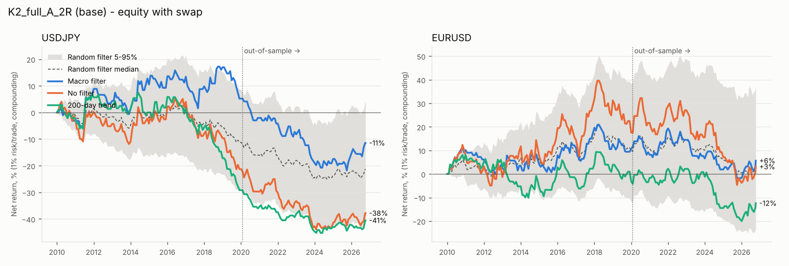
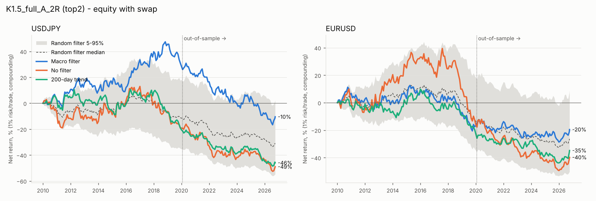
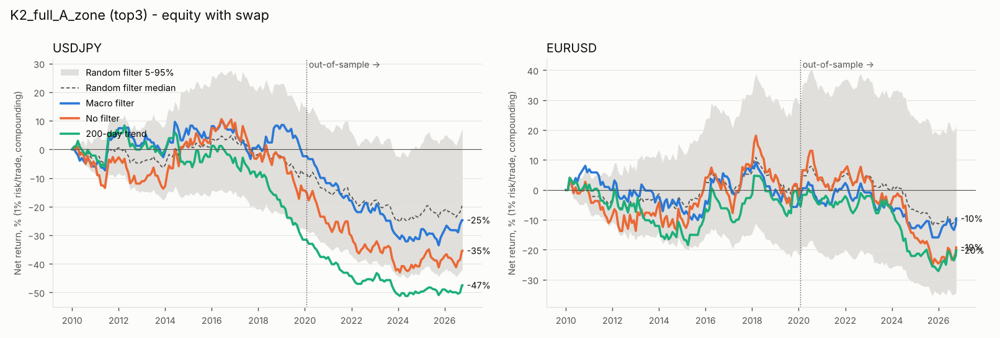
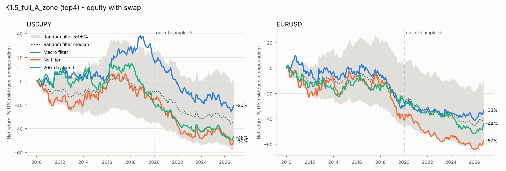
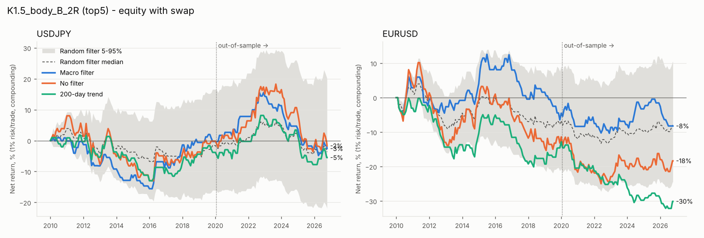

# Zone + macro-bias backtest: USDJPY and EURUSD

Period 2010-01-01 to 2026-10-07 23:45 UTC. In-sample = first 60% (to 2020-01-23), out-of-sample = last 40%. **Combos tested: 24 per pair** (3 K x 2 zone x 2 entry x 2 exit), each run with 3 day filters (macro, none, trend) plus 1000 random-filter seeds for the base and top-5 combos. Swap markup 0.5% p.a.

All R figures include swap unless a table says otherwise. Ranking = in-sample, macro filter, with swap, average expectancy of the two pairs, >= 100 in-sample trades in EACH pair.

## Verdict

**Short answer: no. The macro filter does not add anything you can rely on, on either pair.**

**What was tested.** 24 combos per pair (K 1.5/2/3 × full/body zone × Version A/B × 2R/opposite-zone exit). Each combo was run under the macro filter, no filter and the 200-day trend filter, and the base and top-5 combos also under 1000 random filters. Only 13 of the 24 combos reach ≥ 100 in-sample trades in *each* pair. Every K=3 combo and most body-zone Version B combos fall short, so they could not be ranked.

**In-sample ranking (macro, with swap, average of both pairs).** Only 2 of the top 5 are positive in-sample:
1. K2_full_A_2R (the base): +0.054R
2. K1.5_full_A_2R: +0.023R
3. K2_full_A_zone: 0.000R
4. K1.5_full_A_zone: −0.016R
5. K1.5_body_B_2R: −0.017R

**All 5 lose out-of-sample**, by −0.03R to −0.15R per trade, so they are flagged as overfit. The plateau check flags the two positive combos as likely noise. Their body-zone and Version B neighbours are clearly negative (−0.23R and −0.05R for the base).

**Macro vs the three benchmarks (base combo, with swap).**

| | Macro | No filter | Trend | Random median | Macro percentile vs random |
|---|---|---|---|---|---|
| USDJPY, full period | −0.033R (282 trades) | −0.081R | −0.161R | −0.079R | 76th |
| USDJPY, out-of-sample | −0.146R | −0.093R | −0.142R | −0.090R | 27th |
| EURUSD, full period | +0.028R (299 trades) | +0.016R | −0.031R | +0.022R | 54th |
| EURUSD, out-of-sample | −0.041R | −0.054R | −0.062R | −0.059R | 58th |

On the full period, macro is ahead of all three on paper. But in USDJPY that lead comes entirely from 2016–2019, in-sample, and reverses out-of-sample. In EURUSD it is a coin-flip result.

Across all 24 combos × 2 pairs, macro beats no filter in only 44% of cases in-sample and 29% out-of-sample. Its average expectancy is worse than no filter: −0.075 vs −0.046R in-sample, −0.175 vs −0.139R out-of-sample. It does beat the trend filter about 70% of the time. That is only because the trend filter hurts: these zone entries trade pullbacks, and a 200-day trend side mostly picks the wrong pullbacks.

**Does the signal behave like a signal?** No. With 3 agreeing inputs it does no better than with 2: −0.015R vs +0.007R for the base, and worse in every top combo. A real bias should get stronger when all inputs agree.

**Pairs.** It works on neither pair. USDJPY looks best in-sample and worst out-of-sample. EURUSD is indistinguishable from random.

**Weakest point.** The underlying zone trade has no edge. Unfiltered, the 48 combo-pair runs average −0.08R with a ~30% win rate at 2R, and no day filter can turn that positive.

On top of that, the 3-input vote almost never says "no trade" (about 1% of days), so in practice it just picks long or short. It also cuts trades roughly in half: about 170 in-sample per pair for the base. The standard error of expectancy at that size is about 0.11R, larger than every difference above.

**Minor effects** (none change the conclusion):
- Swap costs about −0.01R per trade.
- Excluding trades within ±3 trading days of MoF intervention days removes at most 12 USDJPY trades.
- The opposite-zone exit falls back to 2R on 78% of trades, because a fresh opposite zone rarely exists in the trade direction. In practice it is mostly the 2R exit.
- Nothing was flagged as unrealistically good.

**What to test next**
1. Test the macro bias on its own, without zones. For example, does the bias side predict the next 5–20 day return of each pair? If it doesn't, no zone overlay will.
2. Test the zone entry against random entries at the same times and with the same stops and targets, to see whether the zones themselves beat chance.
3. Give each input a dead-band, so that small 63-day changes score 0 and "no trade" actually happens. This is a new parameter, so it has to be chosen in-sample only.
4. If 1 or 2 shows anything, add pairs with their own foreign yields (GBPUSD, AUDUSD, USDCAD) to get past roughly 170 trades per pair.

## In-sample ranking (macro filter)

| combo | IS_avg_exp | IS_exp_USDJPY | IS_n_USDJPY | IS_exp_EURUSD | IS_n_EURUSD | eligible_100_each | OOS_avg_exp | OOS_exp_USDJPY | OOS_n_USDJPY | OOS_exp_EURUSD | OOS_n_EURUSD |
|---|---|---|---|---|---|---|---|---|---|---|---|
| K2_full_A_2R | 0.054 | 0.040 | 171 | 0.069 | 189 | True | -0.094 | -0.146 | 111 | -0.041 | 110 |
| K1.5_full_A_2R | 0.023 | 0.086 | 306 | -0.039 | 331 | True | -0.085 | -0.151 | 212 | -0.018 | 198 |
| K2_full_A_zone | 0.000 | -0.004 | 171 | 0.004 | 185 | True | -0.150 | -0.230 | 108 | -0.070 | 109 |
| K1.5_full_A_zone | -0.016 | 0.058 | 304 | -0.089 | 320 | True | -0.097 | -0.166 | 208 | -0.029 | 197 |
| K1.5_body_B_2R | -0.017 | 0.007 | 106 | -0.042 | 107 | True | -0.033 | -0.028 | 62 | -0.039 | 62 |
| K2_full_B_zone | -0.040 | -0.113 | 104 | 0.032 | 112 | True | -0.311 | -0.398 | 64 | -0.225 | 70 |
| K2_full_B_2R | -0.049 | -0.048 | 106 | -0.051 | 114 | True | -0.274 | -0.239 | 67 | -0.309 | 73 |
| K1.5_full_B_2R | -0.051 | -0.082 | 197 | -0.021 | 214 | True | -0.222 | -0.228 | 138 | -0.217 | 125 |
| K1.5_full_B_zone | -0.071 | -0.104 | 184 | -0.039 | 198 | True | -0.211 | -0.217 | 124 | -0.205 | 116 |
| K1.5_body_A_2R | -0.106 | -0.116 | 310 | -0.097 | 336 | True | -0.145 | -0.250 | 210 | -0.041 | 200 |
| K1.5_body_A_zone | -0.165 | -0.192 | 306 | -0.138 | 336 | True | -0.070 | -0.263 | 209 | 0.123 | 199 |
| K2_body_A_2R | -0.227 | -0.136 | 168 | -0.317 | 177 | True | -0.210 | -0.428 | 108 | 0.009 | 110 |
| K2_body_A_zone | -0.303 | -0.243 | 168 | -0.363 | 176 | True | -0.203 | -0.390 | 108 | -0.017 | 110 |
| K3_full_A_zone | 0.117 | -0.169 | 43 | 0.403 | 46 | False | -0.254 | -0.111 | 32 | -0.397 | 41 |
| K3_full_A_2R | 0.061 | -0.169 | 43 | 0.292 | 46 | False | -0.302 | -0.173 | 32 | -0.432 | 42 |
| K3_full_B_zone | -0.006 | -0.485 | 23 | 0.474 | 28 | False | -0.183 | -0.041 | 18 | -0.325 | 22 |
| K1.5_body_B_zone | -0.023 | 0.018 | 99 | -0.064 | 102 | False | -0.082 | -0.159 | 58 | -0.005 | 57 |
| K2_body_B_2R | -0.031 | 0.041 | 57 | -0.104 | 51 | False | 0.046 | 0.025 | 29 | 0.067 | 39 |
| K2_body_B_zone | -0.036 | -0.034 | 57 | -0.038 | 51 | False | -0.058 | -0.222 | 27 | 0.105 | 38 |
| K3_full_B_2R | -0.101 | -0.485 | 23 | 0.282 | 28 | False | -0.184 | -0.010 | 18 | -0.357 | 23 |
| K3_body_A_2R | -0.168 | -0.410 | 39 | 0.074 | 42 | False | -0.365 | -0.535 | 31 | -0.195 | 41 |
| K3_body_A_zone | -0.204 | -0.410 | 39 | 0.003 | 42 | False | -0.365 | -0.535 | 31 | -0.195 | 41 |
| K3_body_B_2R | -0.218 | -0.506 | 12 | 0.069 | 14 | False | -0.177 | 0.110 | 8 | -0.464 | 11 |
| K3_body_B_zone | -0.218 | -0.506 | 12 | 0.069 | 14 | False | -0.177 | 0.110 | 8 | -0.464 | 11 |

13 of 24 combos have >= 100 in-sample trades in both pairs. Top 5 (chosen on in-sample only): K2_full_A_2R, K1.5_full_A_2R, K2_full_A_zone, K1.5_full_A_zone, K1.5_body_B_2R.

OOS columns are shown for the record; nothing was selected with them.

### Top combos: in-sample vs out-of-sample

| combo | IS_avg_exp | OOS_avg_exp | OOS_USDJPY | OOS_EURUSD | flag |
|---|---|---|---|---|---|
| K2_full_A_2R | 0.054 | -0.094 | -0.146 | -0.041 | OVERFIT: loses out-of-sample |
| K1.5_full_A_2R | 0.023 | -0.085 | -0.151 | -0.018 | OVERFIT: loses out-of-sample |
| K2_full_A_zone | 0.000 | -0.150 | -0.230 | -0.070 | OVERFIT: loses out-of-sample |
| K1.5_full_A_zone | -0.016 | -0.097 | -0.166 | -0.029 | OVERFIT: loses out-of-sample |
| K1.5_body_B_2R | -0.017 | -0.033 | -0.028 | -0.039 | OVERFIT: loses out-of-sample; OOS n<100 in a pair |

## Plateau check (neighbours differ by one setting, in-sample avg expectancy)

**K2_full_A_2R** (IS 0.054R): neighbour median 0.000R, 3/5 positive -> LIKELY NOISE

| neighbor | changed | neighbor_IS_avg_exp | neighbor_IS_n_USDJPY | neighbor_IS_n_EURUSD |
|---|---|---|---|---|
| K1.5_full_A_2R | K | 0.023 | 306 | 331 |
| K3_full_A_2R | K | 0.061 | 43 | 46 |
| K2_body_A_2R | zone | -0.227 | 168 | 177 |
| K2_full_B_2R | entry | -0.049 | 106 | 114 |
| K2_full_A_zone | exit | 0.000 | 171 | 185 |

**K1.5_full_A_2R** (IS 0.023R): neighbour median -0.034R, 1/4 positive -> LIKELY NOISE

| neighbor | changed | neighbor_IS_avg_exp | neighbor_IS_n_USDJPY | neighbor_IS_n_EURUSD |
|---|---|---|---|---|
| K2_full_A_2R | K | 0.054 | 171 | 189 |
| K1.5_body_A_2R | zone | -0.106 | 310 | 336 |
| K1.5_full_B_2R | entry | -0.051 | 197 | 214 |
| K1.5_full_A_zone | exit | -0.016 | 304 | 320 |

**K2_full_A_zone** (IS 0.000R): neighbour median -0.016R, 2/5 positive -> LIKELY NOISE

| neighbor | changed | neighbor_IS_avg_exp | neighbor_IS_n_USDJPY | neighbor_IS_n_EURUSD |
|---|---|---|---|---|
| K1.5_full_A_zone | K | -0.016 | 304 | 320 |
| K3_full_A_zone | K | 0.117 | 43 | 46 |
| K2_body_A_zone | zone | -0.303 | 168 | 176 |
| K2_full_B_zone | entry | -0.040 | 104 | 112 |
| K2_full_A_2R | exit | 0.054 | 171 | 189 |

**K1.5_full_A_zone** (IS -0.016R): neighbour median -0.036R, 2/4 positive -> no in-sample edge to check (IS <= 0)

| neighbor | changed | neighbor_IS_avg_exp | neighbor_IS_n_USDJPY | neighbor_IS_n_EURUSD |
|---|---|---|---|---|
| K2_full_A_zone | K | 0.000 | 171 | 185 |
| K1.5_body_A_zone | zone | -0.165 | 306 | 336 |
| K1.5_full_B_zone | entry | -0.071 | 184 | 198 |
| K1.5_full_A_2R | exit | 0.023 | 306 | 331 |

**K1.5_body_B_2R** (IS -0.017R): neighbour median -0.041R, 0/4 positive -> no in-sample edge to check (IS <= 0)

| neighbor | changed | neighbor_IS_avg_exp | neighbor_IS_n_USDJPY | neighbor_IS_n_EURUSD |
|---|---|---|---|---|
| K2_body_B_2R | K | -0.031 | 57 | 51 |
| K1.5_full_B_2R | zone | -0.051 | 197 | 214 |
| K1.5_body_A_2R | entry | -0.106 | 310 | 336 |
| K1.5_body_B_zone | exit | -0.023 | 99 | 102 |

## Base and top-5: macro vs benchmarks

Random = median of the seeds; pctl = percentile of the macro filter's expectancy within the random-seed distribution (100 = better than every seed).

### K2_full_A_2R (base)

**IS**

| pair | swap | filter | trades | win% | avg win R | avg loss R | PF | exp R | maxDD% | lose streak | net % | flags |
|---|---|---|---|---|---|---|---|---|---|---|---|---|
| USDJPY | yes | macro | 171 | 35.09 | 1.98 | -1.01 | 1.06 | 0.04 | 12.30 | 11 | 5.21 |  |
| USDJPY | yes | none | 307 | 31.27 | 1.99 | -1.01 | 0.90 | -0.07 | 26.66 | 11 | -22.12 |  |
| USDJPY | yes | trend | 190 | 27.89 | 1.99 | -1.01 | 0.76 | -0.17 | 34.34 | 20 | -29.26 |  |
| USDJPY | yes | random (median) | 160 | - | - | - | - | -0.07 | - | 0 | -11.84 | p5 -0.214 / p95 0.060; macro pctl 92 |
| USDJPY | no | macro | 171 | 35.09 | 2.00 | -1.01 | 1.07 | 0.05 | 12.27 | 11 | 6.79 |  |
| USDJPY | no | none | 307 | 31.27 | 2.00 | -1.01 | 0.90 | -0.07 | 26.11 | 11 | -20.79 |  |
| USDJPY | no | trend | 190 | 27.89 | 2.00 | -1.00 | 0.77 | -0.17 | 33.63 | 20 | -28.41 |  |
| USDJPY | yes | macro ex-intervention | 169 | 35.50 | 1.98 | -1.01 | 1.08 | 0.05 | 12.30 | 11 | 7.36 |  |
| USDJPY | no | macro ex-intervention | 169 | 35.50 | 2.00 | -1.01 | 1.09 | 0.06 | 12.27 | 11 | 8.96 |  |
| EURUSD | yes | macro | 189 | 35.98 | 1.99 | -1.01 | 1.11 | 0.07 | 12.17 | 7 | 11.68 |  |
| EURUSD | yes | none | 339 | 35.69 | 1.99 | -1.02 | 1.09 | 0.06 | 17.46 | 9 | 17.42 |  |
| EURUSD | yes | trend | 202 | 33.17 | 1.99 | -1.00 | 0.98 | -0.01 | 17.67 | 9 | -4.20 |  |
| EURUSD | yes | random (median) | 174 | - | - | - | - | 0.06 | - | 0 | 9.64 | p5 -0.063 / p95 0.201; macro pctl 52 |
| EURUSD | no | macro | 189 | 35.98 | 2.00 | -1.00 | 1.12 | 0.08 | 11.52 | 7 | 13.25 |  |
| EURUSD | no | none | 339 | 35.69 | 2.00 | -1.01 | 1.10 | 0.06 | 16.90 | 9 | 20.34 |  |
| EURUSD | no | trend | 202 | 33.17 | 2.00 | -1.00 | 0.99 | -0.01 | 17.31 | 9 | -3.26 |  |

**OOS**

| pair | swap | filter | trades | win% | avg win R | avg loss R | PF | exp R | maxDD% | lose streak | net % | flags |
|---|---|---|---|---|---|---|---|---|---|---|---|---|
| USDJPY | yes | macro | 111 | 28.83 | 1.98 | -1.01 | 0.80 | -0.15 | 26.39 | 16 | -15.85 |  |
| USDJPY | yes | none | 219 | 30.59 | 1.99 | -1.01 | 0.87 | -0.09 | 28.67 | 15 | -20.17 |  |
| USDJPY | yes | trend | 115 | 28.70 | 2.00 | -1.00 | 0.80 | -0.14 | 22.62 | 12 | -15.95 |  |
| USDJPY | yes | random (median) | 110 | - | - | - | - | -0.09 | - | 0 | -10.27 | p5 -0.249 / p95 0.067; macro pctl 26 |
| USDJPY | no | macro | 111 | 28.83 | 2.00 | -1.00 | 0.81 | -0.14 | 25.75 | 16 | -14.81 |  |
| USDJPY | no | none | 219 | 30.59 | 2.00 | -1.00 | 0.88 | -0.08 | 28.15 | 15 | -18.20 |  |
| USDJPY | no | trend | 115 | 28.70 | 2.00 | -1.00 | 0.80 | -0.14 | 22.59 | 12 | -15.69 |  |
| USDJPY | yes | macro ex-intervention | 103 | 30.10 | 1.98 | -1.01 | 0.85 | -0.11 | 23.26 | 16 | -11.38 |  |
| USDJPY | no | macro ex-intervention | 103 | 30.10 | 2.00 | -1.00 | 0.86 | -0.10 | 22.68 | 16 | -10.39 |  |
| EURUSD | yes | macro | 110 | 32.73 | 1.95 | -1.01 | 0.94 | -0.04 | 18.47 | 8 | -5.42 |  |
| EURUSD | yes | none | 203 | 32.02 | 1.97 | -1.01 | 0.92 | -0.05 | 27.93 | 12 | -12.18 |  |
| EURUSD | yes | trend | 125 | 32.00 | 1.95 | -1.01 | 0.91 | -0.06 | 22.52 | 10 | -8.54 |  |
| EURUSD | yes | random (median) | 103 | - | - | - | - | -0.06 | - | 0 | -6.92 | p5 -0.212 / p95 0.113; macro pctl 58 |
| EURUSD | no | macro | 110 | 32.73 | 1.95 | -1.00 | 0.95 | -0.03 | 17.78 | 8 | -4.65 |  |
| EURUSD | no | none | 203 | 32.02 | 1.97 | -1.00 | 0.93 | -0.05 | 27.08 | 12 | -11.00 |  |
| EURUSD | no | trend | 125 | 32.00 | 1.96 | -1.00 | 0.92 | -0.05 | 21.85 | 10 | -7.59 |  |

**full**

| pair | swap | filter | trades | win% | avg win R | avg loss R | PF | exp R | maxDD% | lose streak | net % | flags |
|---|---|---|---|---|---|---|---|---|---|---|---|---|
| USDJPY | yes | macro | 282 | 32.62 | 1.98 | -1.01 | 0.95 | -0.03 | 33.99 | 16 | -11.46 |  |
| USDJPY | yes | none | 526 | 30.99 | 1.99 | -1.01 | 0.88 | -0.08 | 47.20 | 15 | -37.83 |  |
| USDJPY | yes | trend | 305 | 28.20 | 1.99 | -1.01 | 0.78 | -0.16 | 49.19 | 20 | -40.54 |  |
| USDJPY | yes | random (median) | 270 | - | - | - | - | -0.08 | - | 0 | -21.35 | p5 -0.191 / p95 0.024; macro pctl 76 |
| USDJPY | no | macro | 282 | 32.62 | 2.00 | -1.00 | 0.96 | -0.02 | 32.97 | 16 | -9.03 |  |
| USDJPY | no | none | 526 | 30.99 | 2.00 | -1.00 | 0.89 | -0.07 | 46.42 | 15 | -35.21 |  |
| USDJPY | no | trend | 305 | 28.20 | 2.00 | -1.00 | 0.78 | -0.16 | 48.62 | 20 | -39.64 |  |
| USDJPY | yes | macro ex-intervention | 272 | 33.46 | 1.98 | -1.01 | 0.99 | -0.01 | 31.18 | 16 | -4.86 |  |
| USDJPY | no | macro ex-intervention | 272 | 33.46 | 2.00 | -1.00 | 1.00 | 0.00 | 30.20 | 16 | -2.37 |  |
| EURUSD | yes | macro | 299 | 34.78 | 1.98 | -1.01 | 1.04 | 0.03 | 19.52 | 8 | 5.63 |  |
| EURUSD | yes | none | 542 | 34.32 | 1.98 | -1.01 | 1.02 | 0.02 | 32.47 | 12 | 3.11 |  |
| EURUSD | yes | trend | 327 | 32.72 | 1.97 | -1.01 | 0.95 | -0.03 | 27.52 | 10 | -12.38 |  |
| EURUSD | yes | random (median) | 277 | - | - | - | - | 0.02 | - | 0 | 3.23 | p5 -0.086 / p95 0.128; macro pctl 54 |
| EURUSD | no | macro | 299 | 34.78 | 1.98 | -1.00 | 1.05 | 0.04 | 18.31 | 8 | 7.98 |  |
| EURUSD | no | none | 542 | 34.32 | 1.99 | -1.01 | 1.03 | 0.02 | 31.11 | 12 | 7.09 |  |
| EURUSD | no | trend | 327 | 32.72 | 1.98 | -1.00 | 0.96 | -0.02 | 26.86 | 10 | -10.61 |  |

### K1.5_full_A_2R (top-5)

**IS**

| pair | swap | filter | trades | win% | avg win R | avg loss R | PF | exp R | maxDD% | lose streak | net % | flags |
|---|---|---|---|---|---|---|---|---|---|---|---|---|
| USDJPY | yes | macro | 306 | 36.60 | 1.98 | -1.01 | 1.13 | 0.09 | 15.45 | 9 | 25.97 |  |
| USDJPY | yes | none | 559 | 32.56 | 1.99 | -1.01 | 0.95 | -0.03 | 30.24 | 14 | -20.85 |  |
| USDJPY | yes | trend | 339 | 31.56 | 1.99 | -1.01 | 0.91 | -0.06 | 29.63 | 13 | -21.41 |  |
| USDJPY | yes | random (median) | 300 | - | - | - | - | -0.04 | - | 0 | -12.64 | p5 -0.142 / p95 0.061; macro pctl 98 |
| USDJPY | no | macro | 306 | 36.60 | 2.00 | -1.00 | 1.15 | 0.10 | 14.20 | 9 | 29.70 |  |
| USDJPY | no | none | 559 | 32.56 | 2.00 | -1.00 | 0.96 | -0.03 | 28.96 | 14 | -17.99 |  |
| USDJPY | no | trend | 339 | 31.56 | 2.00 | -1.00 | 0.92 | -0.06 | 28.53 | 13 | -19.82 |  |
| USDJPY | yes | macro ex-intervention | 303 | 36.96 | 1.98 | -1.01 | 1.15 | 0.10 | 15.45 | 9 | 29.84 |  |
| USDJPY | no | macro ex-intervention | 303 | 36.96 | 2.00 | -1.00 | 1.17 | 0.11 | 14.20 | 9 | 33.67 |  |
| EURUSD | yes | macro | 331 | 32.33 | 1.99 | -1.01 | 0.94 | -0.04 | 30.16 | 14 | -14.94 |  |
| EURUSD | yes | none | 590 | 32.88 | 1.99 | -1.01 | 0.97 | -0.02 | 42.23 | 14 | -17.73 |  |
| EURUSD | yes | trend | 358 | 31.01 | 1.99 | -1.00 | 0.89 | -0.07 | 33.21 | 12 | -25.89 |  |
| EURUSD | yes | random (median) | 316 | - | - | - | - | -0.04 | - | 0 | -14.50 | p5 -0.129 / p95 0.061; macro pctl 50 |
| EURUSD | no | macro | 331 | 32.33 | 2.00 | -1.00 | 0.95 | -0.03 | 29.08 | 14 | -12.93 |  |
| EURUSD | no | none | 590 | 32.88 | 2.00 | -1.00 | 0.97 | -0.02 | 41.34 | 14 | -14.64 |  |
| EURUSD | no | trend | 358 | 31.01 | 2.00 | -1.00 | 0.90 | -0.07 | 33.11 | 12 | -24.99 |  |

**OOS**

| pair | swap | filter | trades | win% | avg win R | avg loss R | PF | exp R | maxDD% | lose streak | net % | flags |
|---|---|---|---|---|---|---|---|---|---|---|---|---|
| USDJPY | yes | macro | 212 | 29.25 | 1.97 | -1.03 | 0.79 | -0.15 | 37.00 | 10 | -28.92 |  |
| USDJPY | yes | none | 378 | 30.42 | 1.99 | -1.02 | 0.85 | -0.11 | 44.58 | 18 | -35.60 |  |
| USDJPY | yes | trend | 218 | 28.44 | 2.00 | -1.02 | 0.78 | -0.16 | 36.46 | 10 | -31.30 |  |
| USDJPY | yes | random (median) | 201 | - | - | - | - | -0.11 | - | 0 | -20.66 | p5 -0.232 / p95 0.012; macro pctl 26 |
| USDJPY | no | macro | 212 | 29.25 | 1.99 | -1.02 | 0.81 | -0.14 | 35.40 | 10 | -27.08 |  |
| USDJPY | no | none | 378 | 30.42 | 1.99 | -1.01 | 0.86 | -0.10 | 42.41 | 18 | -33.09 |  |
| USDJPY | no | trend | 218 | 28.44 | 2.00 | -1.02 | 0.78 | -0.16 | 36.06 | 10 | -30.83 |  |
| USDJPY | yes | macro ex-intervention | 203 | 29.06 | 1.97 | -1.03 | 0.78 | -0.16 | 36.94 | 10 | -28.84 |  |
| USDJPY | no | macro ex-intervention | 203 | 29.06 | 1.99 | -1.02 | 0.80 | -0.15 | 35.34 | 10 | -27.01 |  |
| EURUSD | yes | macro | 198 | 33.33 | 1.97 | -1.01 | 0.97 | -0.02 | 19.46 | 10 | -5.38 |  |
| EURUSD | yes | none | 377 | 31.30 | 1.98 | -1.01 | 0.89 | -0.07 | 43.82 | 12 | -26.78 |  |
| EURUSD | yes | trend | 225 | 32.44 | 1.97 | -1.01 | 0.93 | -0.05 | 28.63 | 10 | -12.00 |  |
| EURUSD | yes | random (median) | 197 | - | - | - | - | -0.07 | - | 0 | -14.76 | p5 -0.193 / p95 0.042; macro pctl 75 |
| EURUSD | no | macro | 198 | 33.33 | 1.97 | -1.01 | 0.98 | -0.01 | 18.38 | 10 | -4.23 |  |
| EURUSD | no | none | 377 | 31.30 | 1.99 | -1.00 | 0.90 | -0.07 | 42.50 | 12 | -24.91 |  |
| EURUSD | no | trend | 225 | 32.44 | 1.98 | -1.01 | 0.94 | -0.04 | 27.21 | 10 | -10.32 |  |

**full**

| pair | swap | filter | trades | win% | avg win R | avg loss R | PF | exp R | maxDD% | lose streak | net % | flags |
|---|---|---|---|---|---|---|---|---|---|---|---|---|
| USDJPY | yes | macro | 518 | 33.59 | 1.98 | -1.02 | 0.98 | -0.01 | 44.05 | 10 | -10.45 |  |
| USDJPY | yes | none | 937 | 31.70 | 1.99 | -1.01 | 0.91 | -0.06 | 58.64 | 18 | -49.03 |  |
| USDJPY | yes | trend | 557 | 30.34 | 1.99 | -1.01 | 0.86 | -0.10 | 54.41 | 13 | -46.01 |  |
| USDJPY | yes | random (median) | 501 | - | - | - | - | -0.06 | - | 0 | -30.91 | p5 -0.150 / p95 0.015; macro pctl 86 |
| USDJPY | no | macro | 518 | 33.59 | 2.00 | -1.01 | 1.00 | -0.00 | 41.77 | 10 | -5.41 |  |
| USDJPY | no | none | 937 | 31.70 | 2.00 | -1.01 | 0.92 | -0.05 | 56.19 | 18 | -45.13 |  |
| USDJPY | no | trend | 557 | 30.34 | 2.00 | -1.01 | 0.86 | -0.10 | 53.40 | 13 | -44.54 |  |
| USDJPY | yes | macro ex-intervention | 506 | 33.79 | 1.98 | -1.02 | 0.99 | -0.01 | 43.99 | 10 | -7.61 |  |
| USDJPY | no | macro ex-intervention | 506 | 33.79 | 2.00 | -1.01 | 1.01 | 0.01 | 41.71 | 10 | -2.43 |  |
| EURUSD | yes | macro | 529 | 32.70 | 1.98 | -1.01 | 0.95 | -0.03 | 37.99 | 14 | -19.51 |  |
| EURUSD | yes | none | 967 | 32.26 | 1.99 | -1.01 | 0.94 | -0.04 | 65.22 | 14 | -39.77 |  |
| EURUSD | yes | trend | 583 | 31.56 | 1.98 | -1.01 | 0.91 | -0.06 | 49.92 | 12 | -34.79 |  |
| EURUSD | yes | random (median) | 514 | - | - | - | - | -0.05 | - | 0 | -26.32 | p5 -0.128 / p95 0.027; macro pctl 66 |
| EURUSD | no | macro | 529 | 32.70 | 1.99 | -1.00 | 0.96 | -0.02 | 36.15 | 14 | -16.61 |  |
| EURUSD | no | none | 967 | 32.26 | 1.99 | -1.00 | 0.95 | -0.04 | 63.85 | 14 | -35.90 |  |
| EURUSD | no | trend | 583 | 31.56 | 1.99 | -1.00 | 0.92 | -0.06 | 48.86 | 12 | -32.73 |  |

### K2_full_A_zone (top-5)

**IS**

| pair | swap | filter | trades | win% | avg win R | avg loss R | PF | exp R | maxDD% | lose streak | net % | flags |
|---|---|---|---|---|---|---|---|---|---|---|---|---|
| USDJPY | yes | macro | 171 | 33.33 | 2.01 | -1.01 | 0.99 | -0.00 | 12.41 | 11 | -2.40 |  |
| USDJPY | yes | none | 299 | 30.43 | 2.16 | -1.01 | 0.94 | -0.04 | 26.63 | 13 | -15.30 |  |
| USDJPY | yes | trend | 190 | 26.84 | 2.04 | -1.01 | 0.74 | -0.19 | 36.92 | 20 | -31.65 |  |
| USDJPY | yes | random (median) | 158 | - | - | - | - | -0.05 | - | 0 | -8.73 | p5 -0.201 / p95 0.099; macro pctl 68 |
| USDJPY | no | macro | 171 | 33.33 | 2.03 | -1.01 | 1.01 | 0.01 | 12.30 | 11 | -0.88 |  |
| USDJPY | no | none | 299 | 30.43 | 2.17 | -1.01 | 0.94 | -0.04 | 26.44 | 13 | -14.31 |  |
| USDJPY | no | trend | 190 | 26.84 | 2.05 | -1.00 | 0.75 | -0.18 | 36.22 | 20 | -30.82 |  |
| USDJPY | yes | macro ex-intervention | 169 | 33.73 | 2.01 | -1.01 | 1.01 | 0.01 | 12.41 | 11 | -0.41 |  |
| USDJPY | no | macro ex-intervention | 169 | 33.73 | 2.03 | -1.01 | 1.03 | 0.02 | 12.30 | 11 | 1.13 |  |
| EURUSD | yes | macro | 185 | 31.89 | 2.17 | -1.01 | 1.01 | 0.00 | 18.28 | 8 | -1.35 |  |
| EURUSD | yes | none | 322 | 32.30 | 2.16 | -1.01 | 1.02 | 0.01 | 20.89 | 11 | 0.43 |  |
| EURUSD | yes | trend | 200 | 30.00 | 2.29 | -1.00 | 0.98 | -0.02 | 21.56 | 9 | -5.46 |  |
| EURUSD | yes | random (median) | 169 | - | - | - | - | 0.02 | - | 0 | 1.03 | p5 -0.128 / p95 0.174; macro pctl 42 |
| EURUSD | no | macro | 185 | 31.89 | 2.18 | -1.00 | 1.02 | 0.01 | 17.91 | 8 | -0.15 |  |
| EURUSD | no | none | 322 | 32.30 | 2.17 | -1.01 | 1.03 | 0.02 | 20.83 | 11 | 1.95 |  |
| EURUSD | no | trend | 200 | 30.00 | 2.30 | -1.00 | 0.98 | -0.01 | 21.08 | 9 | -4.96 |  |

**OOS**

| pair | swap | filter | trades | win% | avg win R | avg loss R | PF | exp R | maxDD% | lose streak | net % | flags |
|---|---|---|---|---|---|---|---|---|---|---|---|---|
| USDJPY | yes | macro | 108 | 24.07 | 2.22 | -1.01 | 0.70 | -0.23 | 32.55 | 16 | -22.89 |  |
| USDJPY | yes | none | 211 | 27.96 | 2.18 | -1.01 | 0.84 | -0.12 | 33.30 | 15 | -23.77 |  |
| USDJPY | yes | trend | 112 | 25.00 | 2.11 | -1.01 | 0.70 | -0.23 | 28.65 | 14 | -23.17 |  |
| USDJPY | yes | random (median) | 109 | - | - | - | - | -0.11 | - | 0 | -12.62 | p5 -0.275 / p95 0.057; macro pctl 11 |
| USDJPY | no | macro | 108 | 24.07 | 2.23 | -1.00 | 0.71 | -0.22 | 32.23 | 16 | -22.25 |  |
| USDJPY | no | none | 211 | 27.96 | 2.20 | -1.00 | 0.85 | -0.11 | 32.75 | 15 | -21.70 |  |
| USDJPY | no | trend | 112 | 25.00 | 2.11 | -1.00 | 0.70 | -0.22 | 28.56 | 14 | -22.91 |  |
| USDJPY | yes | macro ex-intervention | 100 | 25.00 | 2.23 | -1.01 | 0.74 | -0.20 | 29.68 | 16 | -18.80 |  |
| USDJPY | no | macro ex-intervention | 100 | 25.00 | 2.24 | -1.00 | 0.75 | -0.19 | 29.43 | 16 | -18.21 |  |
| EURUSD | yes | macro | 109 | 31.19 | 2.00 | -1.01 | 0.90 | -0.07 | 18.60 | 8 | -8.34 |  |
| EURUSD | yes | none | 200 | 30.00 | 2.02 | -1.01 | 0.86 | -0.10 | 33.99 | 15 | -19.56 |  |
| EURUSD | yes | trend | 125 | 29.60 | 1.97 | -1.01 | 0.82 | -0.13 | 27.38 | 10 | -15.60 |  |
| EURUSD | yes | random (median) | 102 | - | - | - | - | -0.10 | - | 0 | -11.10 | p5 -0.264 / p95 0.064; macro pctl 64 |
| EURUSD | no | macro | 109 | 31.19 | 2.01 | -1.00 | 0.91 | -0.06 | 17.85 | 8 | -7.53 |  |
| EURUSD | no | none | 200 | 30.00 | 2.03 | -1.00 | 0.87 | -0.09 | 33.13 | 15 | -18.39 |  |
| EURUSD | no | trend | 125 | 29.60 | 1.98 | -1.00 | 0.83 | -0.12 | 26.56 | 10 | -14.66 |  |

**full**

| pair | swap | filter | trades | win% | avg win R | avg loss R | PF | exp R | maxDD% | lose streak | net % | flags |
|---|---|---|---|---|---|---|---|---|---|---|---|---|
| USDJPY | yes | macro | 279 | 29.75 | 2.08 | -1.01 | 0.87 | -0.09 | 39.67 | 16 | -24.74 |  |
| USDJPY | yes | none | 510 | 29.41 | 2.17 | -1.01 | 0.90 | -0.07 | 48.89 | 15 | -35.43 |  |
| USDJPY | yes | trend | 302 | 26.16 | 2.07 | -1.01 | 0.73 | -0.20 | 54.99 | 20 | -47.48 |  |
| USDJPY | yes | random (median) | 267 | - | - | - | - | -0.07 | - | 0 | -19.89 | p5 -0.192 / p95 0.039; macro pctl 39 |
| USDJPY | no | macro | 279 | 29.75 | 2.09 | -1.00 | 0.88 | -0.08 | 38.78 | 16 | -22.93 |  |
| USDJPY | no | none | 510 | 29.41 | 2.18 | -1.00 | 0.91 | -0.07 | 48.40 | 15 | -32.91 |  |
| USDJPY | no | trend | 302 | 26.16 | 2.07 | -1.00 | 0.73 | -0.20 | 54.44 | 20 | -46.67 |  |
| USDJPY | yes | macro ex-intervention | 269 | 30.48 | 2.08 | -1.01 | 0.90 | -0.07 | 37.11 | 16 | -19.13 |  |
| USDJPY | no | macro ex-intervention | 269 | 30.48 | 2.09 | -1.00 | 0.91 | -0.06 | 36.25 | 16 | -17.29 |  |
| EURUSD | yes | macro | 294 | 31.63 | 2.11 | -1.01 | 0.97 | -0.02 | 23.05 | 8 | -9.58 |  |
| EURUSD | yes | none | 522 | 31.42 | 2.11 | -1.01 | 0.96 | -0.03 | 36.81 | 15 | -19.21 |  |
| EURUSD | yes | trend | 325 | 29.85 | 2.17 | -1.01 | 0.92 | -0.06 | 31.08 | 10 | -20.20 |  |
| EURUSD | yes | random (median) | 271 | - | - | - | - | -0.02 | - | 0 | -8.96 | p5 -0.142 / p95 0.086; macro pctl 50 |
| EURUSD | no | macro | 294 | 31.63 | 2.12 | -1.00 | 0.98 | -0.02 | 22.06 | 8 | -7.67 |  |
| EURUSD | no | none | 522 | 31.42 | 2.12 | -1.01 | 0.96 | -0.02 | 36.15 | 15 | -16.79 |  |
| EURUSD | no | trend | 325 | 29.85 | 2.18 | -1.00 | 0.92 | -0.05 | 30.76 | 10 | -18.90 |  |

### K1.5_full_A_zone (top-5)

**IS**

| pair | swap | filter | trades | win% | avg win R | avg loss R | PF | exp R | maxDD% | lose streak | net % | flags |
|---|---|---|---|---|---|---|---|---|---|---|---|---|
| USDJPY | yes | macro | 304 | 34.21 | 2.11 | -1.01 | 1.09 | 0.06 | 17.61 | 13 | 15.06 |  |
| USDJPY | yes | none | 538 | 30.48 | 2.23 | -1.01 | 0.97 | -0.02 | 24.73 | 13 | -16.57 |  |
| USDJPY | yes | trend | 339 | 30.09 | 2.16 | -1.01 | 0.92 | -0.06 | 31.30 | 15 | -20.44 |  |
| USDJPY | yes | random (median) | 293 | - | - | - | - | -0.02 | - | 0 | -9.95 | p5 -0.139 / p95 0.088; macro pctl 88 |
| USDJPY | no | macro | 304 | 34.21 | 2.13 | -1.00 | 1.10 | 0.07 | 16.30 | 13 | 18.89 |  |
| USDJPY | no | none | 538 | 30.48 | 2.24 | -1.00 | 0.98 | -0.01 | 23.81 | 13 | -13.44 |  |
| USDJPY | no | trend | 339 | 30.09 | 2.17 | -1.00 | 0.93 | -0.05 | 30.58 | 15 | -18.64 |  |
| USDJPY | yes | macro ex-intervention | 301 | 34.55 | 2.11 | -1.01 | 1.10 | 0.07 | 17.61 | 13 | 18.59 |  |
| USDJPY | no | macro ex-intervention | 301 | 34.55 | 2.13 | -1.00 | 1.12 | 0.08 | 16.30 | 13 | 22.53 |  |
| EURUSD | yes | macro | 320 | 28.44 | 2.23 | -1.01 | 0.88 | -0.09 | 39.25 | 14 | -27.78 |  |
| EURUSD | yes | none | 563 | 29.66 | 2.12 | -1.01 | 0.89 | -0.08 | 42.48 | 14 | -40.39 |  |
| EURUSD | yes | trend | 352 | 28.69 | 2.18 | -1.00 | 0.87 | -0.09 | 32.24 | 12 | -30.21 |  |
| EURUSD | yes | random (median) | 307 | - | - | - | - | -0.09 | - | 0 | -26.28 | p5 -0.195 / p95 0.021; macro pctl 49 |
| EURUSD | no | macro | 320 | 28.44 | 2.23 | -1.00 | 0.89 | -0.08 | 37.92 | 14 | -26.10 |  |
| EURUSD | no | none | 563 | 29.66 | 2.13 | -1.00 | 0.89 | -0.08 | 40.70 | 14 | -38.60 |  |
| EURUSD | no | trend | 352 | 28.69 | 2.18 | -1.00 | 0.88 | -0.09 | 31.39 | 12 | -29.33 |  |

**OOS**

| pair | swap | filter | trades | win% | avg win R | avg loss R | PF | exp R | maxDD% | lose streak | net % | flags |
|---|---|---|---|---|---|---|---|---|---|---|---|---|
| USDJPY | yes | macro | 208 | 25.96 | 2.30 | -1.03 | 0.78 | -0.17 | 38.74 | 13 | -30.87 |  |
| USDJPY | yes | none | 363 | 27.82 | 2.18 | -1.02 | 0.82 | -0.13 | 47.78 | 18 | -40.47 |  |
| USDJPY | yes | trend | 214 | 25.70 | 2.24 | -1.02 | 0.76 | -0.18 | 39.06 | 10 | -34.10 |  |
| USDJPY | yes | random (median) | 198 | - | - | - | - | -0.13 | - | 0 | -24.95 | p5 -0.275 / p95 -0.011; macro pctl 35 |
| USDJPY | no | macro | 208 | 25.96 | 2.32 | -1.02 | 0.80 | -0.15 | 37.09 | 13 | -28.99 |  |
| USDJPY | no | none | 363 | 27.82 | 2.19 | -1.01 | 0.84 | -0.12 | 45.27 | 18 | -37.63 |  |
| USDJPY | no | trend | 214 | 25.70 | 2.24 | -1.02 | 0.76 | -0.18 | 38.54 | 10 | -33.51 |  |
| USDJPY | yes | macro ex-intervention | 199 | 25.63 | 2.31 | -1.03 | 0.77 | -0.17 | 38.67 | 13 | -30.80 |  |
| USDJPY | no | macro ex-intervention | 199 | 25.63 | 2.33 | -1.02 | 0.79 | -0.16 | 37.04 | 13 | -28.93 |  |
| EURUSD | yes | macro | 197 | 31.47 | 2.11 | -1.01 | 0.96 | -0.03 | 22.24 | 10 | -7.64 |  |
| EURUSD | yes | none | 367 | 29.70 | 2.11 | -1.01 | 0.89 | -0.08 | 45.62 | 12 | -28.54 |  |
| EURUSD | yes | trend | 223 | 30.04 | 2.07 | -1.01 | 0.88 | -0.09 | 34.95 | 10 | -19.72 |  |
| EURUSD | yes | random (median) | 194 | - | - | - | - | -0.09 | - | 0 | -18.18 | p5 -0.223 / p95 0.030; macro pctl 79 |
| EURUSD | no | macro | 197 | 31.47 | 2.12 | -1.00 | 0.97 | -0.02 | 21.06 | 10 | -6.36 |  |
| EURUSD | no | none | 367 | 29.70 | 2.12 | -1.00 | 0.90 | -0.07 | 44.14 | 12 | -26.47 |  |
| EURUSD | no | trend | 223 | 30.04 | 2.08 | -1.00 | 0.89 | -0.08 | 33.49 | 10 | -17.98 |  |

**full**

| pair | swap | filter | trades | win% | avg win R | avg loss R | PF | exp R | maxDD% | lose streak | net % | flags |
|---|---|---|---|---|---|---|---|---|---|---|---|---|
| USDJPY | yes | macro | 512 | 30.86 | 2.18 | -1.02 | 0.95 | -0.03 | 46.98 | 14 | -20.46 |  |
| USDJPY | yes | none | 901 | 29.41 | 2.21 | -1.01 | 0.91 | -0.07 | 57.69 | 18 | -50.33 |  |
| USDJPY | yes | trend | 553 | 28.39 | 2.18 | -1.01 | 0.85 | -0.11 | 57.31 | 15 | -47.57 |  |
| USDJPY | yes | random (median) | 491 | - | - | - | - | -0.07 | - | 0 | -33.79 | p5 -0.160 / p95 0.019; macro pctl 76 |
| USDJPY | no | macro | 512 | 30.86 | 2.19 | -1.01 | 0.97 | -0.02 | 44.68 | 14 | -15.58 |  |
| USDJPY | no | none | 901 | 29.41 | 2.22 | -1.01 | 0.92 | -0.06 | 54.83 | 18 | -46.02 |  |
| USDJPY | no | trend | 553 | 28.39 | 2.19 | -1.01 | 0.86 | -0.10 | 56.49 | 15 | -45.91 |  |
| USDJPY | yes | macro ex-intervention | 500 | 31.00 | 2.18 | -1.02 | 0.96 | -0.03 | 46.92 | 14 | -17.94 |  |
| USDJPY | no | macro ex-intervention | 500 | 31.00 | 2.20 | -1.01 | 0.98 | -0.02 | 44.63 | 14 | -12.91 |  |
| EURUSD | yes | macro | 517 | 29.59 | 2.18 | -1.01 | 0.91 | -0.07 | 48.31 | 14 | -33.30 |  |
| EURUSD | yes | none | 930 | 29.68 | 2.12 | -1.01 | 0.89 | -0.08 | 66.27 | 14 | -57.41 |  |
| EURUSD | yes | trend | 575 | 29.22 | 2.13 | -1.01 | 0.87 | -0.09 | 53.69 | 12 | -43.98 |  |
| EURUSD | yes | random (median) | 501 | - | - | - | - | -0.09 | - | 0 | -39.43 | p5 -0.173 / p95 -0.007; macro pctl 68 |
| EURUSD | no | macro | 517 | 29.59 | 2.19 | -1.00 | 0.92 | -0.06 | 46.34 | 14 | -30.80 |  |
| EURUSD | no | none | 930 | 29.68 | 2.12 | -1.00 | 0.89 | -0.07 | 64.32 | 14 | -54.86 |  |
| EURUSD | no | trend | 575 | 29.22 | 2.14 | -1.00 | 0.88 | -0.08 | 52.07 | 12 | -42.04 |  |

### K1.5_body_B_2R (top-5)

**IS**

| pair | swap | filter | trades | win% | avg win R | avg loss R | PF | exp R | maxDD% | lose streak | net % | flags |
|---|---|---|---|---|---|---|---|---|---|---|---|---|
| USDJPY | yes | macro | 106 | 33.96 | 1.99 | -1.01 | 1.01 | 0.01 | 18.01 | 9 | -0.28 |  |
| USDJPY | yes | none | 193 | 33.68 | 1.99 | -1.01 | 1.01 | 0.00 | 19.45 | 10 | -1.16 |  |
| USDJPY | yes | trend | 111 | 32.43 | 1.99 | -1.01 | 0.95 | -0.03 | 14.52 | 9 | -4.78 |  |
| USDJPY | yes | random (median) | 101 | - | - | - | - | -0.01 | - | 0 | -2.33 | p5 -0.171 / p95 0.163; macro pctl 59 |
| USDJPY | no | macro | 106 | 33.96 | 2.00 | -1.00 | 1.03 | 0.02 | 17.75 | 9 | 0.94 |  |
| USDJPY | no | none | 193 | 33.68 | 2.00 | -1.00 | 1.02 | 0.01 | 18.99 | 10 | 0.07 |  |
| USDJPY | no | trend | 111 | 32.43 | 2.00 | -1.00 | 0.96 | -0.03 | 14.33 | 9 | -4.01 |  |
| USDJPY | yes | macro ex-intervention | 106 | 33.96 | 1.99 | -1.01 | 1.01 | 0.01 | 18.01 | 9 | -0.28 |  |
| USDJPY | no | macro ex-intervention | 106 | 33.96 | 2.00 | -1.00 | 1.03 | 0.02 | 17.75 | 9 | 0.94 |  |
| EURUSD | yes | macro | 107 | 32.71 | 2.00 | -1.03 | 0.94 | -0.04 | 16.92 | 12 | -5.43 |  |
| EURUSD | yes | none | 200 | 31.50 | 2.00 | -1.02 | 0.91 | -0.07 | 23.14 | 7 | -14.05 |  |
| EURUSD | yes | trend | 123 | 29.27 | 2.01 | -1.00 | 0.83 | -0.12 | 20.09 | 18 | -14.59 |  |
| EURUSD | yes | random (median) | 103 | - | - | - | - | -0.07 | - | 0 | -8.03 | p5 -0.226 / p95 0.080; macro pctl 64 |
| EURUSD | no | macro | 107 | 32.71 | 2.00 | -1.03 | 0.94 | -0.04 | 16.75 | 12 | -5.07 |  |
| EURUSD | no | none | 200 | 31.50 | 2.00 | -1.02 | 0.91 | -0.07 | 22.61 | 7 | -14.00 |  |
| EURUSD | no | trend | 123 | 29.27 | 2.00 | -1.00 | 0.83 | -0.12 | 19.70 | 18 | -14.91 |  |

**OOS**

| pair | swap | filter | trades | win% | avg win R | avg loss R | PF | exp R | maxDD% | lose streak | net % | flags |
|---|---|---|---|---|---|---|---|---|---|---|---|---|
| USDJPY | yes | macro | 62 | 32.26 | 2.01 | -1.00 | 0.96 | -0.03 | 19.29 | 8 | -2.31 | n<100 |
| USDJPY | yes | none | 119 | 33.61 | 1.99 | -1.00 | 1.01 | 0.01 | 18.71 | 10 | -0.53 |  |
| USDJPY | yes | trend | 61 | 32.79 | 2.00 | -0.98 | 1.00 | -0.00 | 14.70 | 9 | -0.74 | n<100 |
| USDJPY | yes | random (median) | 61 | - | - | - | - | -0.01 | - | 0 | -1.48 | p5 -0.235 / p95 0.214; macro pctl 46 |
| USDJPY | no | macro | 62 | 32.26 | 2.00 | -1.00 | 0.95 | -0.03 | 19.17 | 8 | -2.57 | n<100 |
| USDJPY | no | none | 119 | 33.61 | 2.00 | -1.00 | 1.01 | 0.01 | 18.53 | 10 | -0.23 |  |
| USDJPY | no | trend | 61 | 32.79 | 2.00 | -1.00 | 0.98 | -0.02 | 15.01 | 9 | -1.59 | n<100 |
| USDJPY | yes | macro ex-intervention | 60 | 33.33 | 2.01 | -1.00 | 1.01 | 0.00 | 18.48 | 7 | -0.34 | n<100 |
| USDJPY | no | macro ex-intervention | 60 | 33.33 | 2.00 | -1.00 | 1.00 | 0.00 | 18.36 | 7 | -0.59 | n<100 |
| EURUSD | yes | macro | 62 | 32.26 | 1.98 | -1.00 | 0.94 | -0.04 | 8.97 | 9 | -2.96 | n<100 |
| EURUSD | yes | none | 120 | 32.50 | 1.99 | -1.01 | 0.95 | -0.03 | 16.12 | 12 | -4.99 |  |
| EURUSD | yes | trend | 70 | 24.29 | 1.99 | -1.00 | 0.63 | -0.28 | 22.90 | 12 | -18.16 | n<100 |
| EURUSD | yes | random (median) | 60 | - | - | - | - | 0.01 | - | 0 | 0.12 | p5 -0.198 / p95 0.233; macro pctl 36 |
| EURUSD | no | macro | 62 | 32.26 | 2.00 | -1.00 | 0.95 | -0.03 | 8.84 | 9 | -2.57 | n<100 |
| EURUSD | no | none | 120 | 32.50 | 2.00 | -1.00 | 0.96 | -0.03 | 15.91 | 12 | -4.09 |  |
| EURUSD | no | trend | 70 | 24.29 | 2.00 | -1.00 | 0.64 | -0.27 | 22.54 | 12 | -17.80 | n<100 |

**full**

| pair | swap | filter | trades | win% | avg win R | avg loss R | PF | exp R | maxDD% | lose streak | net % | flags |
|---|---|---|---|---|---|---|---|---|---|---|---|---|
| USDJPY | yes | macro | 168 | 33.33 | 1.99 | -1.01 | 0.99 | -0.01 | 19.29 | 9 | -2.59 |  |
| USDJPY | yes | none | 312 | 33.65 | 1.99 | -1.00 | 1.01 | 0.00 | 19.45 | 10 | -1.69 |  |
| USDJPY | yes | trend | 172 | 32.56 | 1.99 | -1.00 | 0.97 | -0.02 | 14.70 | 9 | -5.49 |  |
| USDJPY | yes | random (median) | 163 | - | - | - | - | -0.01 | - | 0 | -3.67 | p5 -0.145 / p95 0.122; macro pctl 54 |
| USDJPY | no | macro | 168 | 33.33 | 2.00 | -1.00 | 1.00 | 0.00 | 19.17 | 9 | -1.66 |  |
| USDJPY | no | none | 312 | 33.65 | 2.00 | -1.00 | 1.01 | 0.01 | 18.99 | 10 | -0.16 |  |
| USDJPY | no | trend | 172 | 32.56 | 2.00 | -1.00 | 0.97 | -0.02 | 15.01 | 9 | -5.53 |  |
| USDJPY | yes | macro ex-intervention | 166 | 33.73 | 1.99 | -1.01 | 1.01 | 0.01 | 18.48 | 9 | -0.62 |  |
| USDJPY | no | macro ex-intervention | 166 | 33.73 | 2.00 | -1.00 | 1.02 | 0.01 | 18.36 | 9 | 0.34 |  |
| EURUSD | yes | macro | 169 | 32.54 | 1.99 | -1.02 | 0.94 | -0.04 | 20.47 | 12 | -8.23 |  |
| EURUSD | yes | none | 320 | 31.88 | 2.00 | -1.01 | 0.92 | -0.05 | 31.91 | 12 | -18.34 |  |
| EURUSD | yes | trend | 193 | 27.46 | 2.00 | -1.00 | 0.76 | -0.18 | 32.83 | 18 | -30.10 |  |
| EURUSD | yes | random (median) | 163 | - | - | - | - | -0.04 | - | 0 | -8.03 | p5 -0.164 / p95 0.071; macro pctl 50 |
| EURUSD | no | macro | 169 | 32.54 | 2.00 | -1.02 | 0.95 | -0.04 | 20.27 | 12 | -7.51 |  |
| EURUSD | no | none | 320 | 31.88 | 2.00 | -1.01 | 0.93 | -0.05 | 31.71 | 12 | -17.52 |  |
| EURUSD | no | trend | 193 | 27.46 | 2.00 | -1.00 | 0.76 | -0.18 | 32.77 | 18 | -30.06 |  |

## Random-filter distribution (with swap)

| combo | pair | period | seeds | rand p5 | rand p50 | rand p95 | macro exp R | macro pctl |
|---|---|---|---|---|---|---|---|---|
| K2_full_A_2R | USDJPY | IS | 1000 | -0.214 | -0.069 | 0.060 | 0.040 | 92.000 |
| K2_full_A_2R | USDJPY | OOS | 1000 | -0.249 | -0.090 | 0.067 | -0.146 | 26.500 |
| K2_full_A_2R | USDJPY | full | 1000 | -0.191 | -0.079 | 0.024 | -0.033 | 76.500 |
| K2_full_A_2R | EURUSD | IS | 1000 | -0.063 | 0.064 | 0.201 | 0.069 | 52.500 |
| K2_full_A_2R | EURUSD | OOS | 1000 | -0.212 | -0.059 | 0.113 | -0.041 | 57.700 |
| K2_full_A_2R | EURUSD | full | 1000 | -0.086 | 0.022 | 0.128 | 0.028 | 53.900 |
| K1.5_full_A_2R | USDJPY | IS | 1000 | -0.142 | -0.035 | 0.061 | 0.086 | 97.800 |
| K1.5_full_A_2R | USDJPY | OOS | 1000 | -0.232 | -0.107 | 0.012 | -0.151 | 25.700 |
| K1.5_full_A_2R | USDJPY | full | 1000 | -0.150 | -0.064 | 0.015 | -0.011 | 86.100 |
| K1.5_full_A_2R | EURUSD | IS | 1000 | -0.129 | -0.039 | 0.061 | -0.039 | 50.200 |
| K1.5_full_A_2R | EURUSD | OOS | 1000 | -0.193 | -0.072 | 0.042 | -0.018 | 75.400 |
| K1.5_full_A_2R | EURUSD | full | 1000 | -0.128 | -0.050 | 0.027 | -0.031 | 66.400 |
| K2_full_A_zone | USDJPY | IS | 1000 | -0.201 | -0.046 | 0.099 | -0.004 | 68.200 |
| K2_full_A_zone | USDJPY | OOS | 1000 | -0.275 | -0.113 | 0.057 | -0.230 | 11.000 |
| K2_full_A_zone | USDJPY | full | 1000 | -0.192 | -0.072 | 0.039 | -0.092 | 39.100 |
| K2_full_A_zone | EURUSD | IS | 1000 | -0.128 | 0.019 | 0.174 | 0.004 | 41.700 |
| K2_full_A_zone | EURUSD | OOS | 1000 | -0.264 | -0.104 | 0.064 | -0.070 | 63.500 |
| K2_full_A_zone | EURUSD | full | 1000 | -0.142 | -0.023 | 0.086 | -0.023 | 50.000 |
| K1.5_full_A_zone | USDJPY | IS | 1000 | -0.139 | -0.023 | 0.088 | 0.058 | 87.600 |
| K1.5_full_A_zone | USDJPY | OOS | 1000 | -0.275 | -0.134 | -0.011 | -0.166 | 34.900 |
| K1.5_full_A_zone | USDJPY | full | 1000 | -0.160 | -0.072 | 0.019 | -0.033 | 76.000 |
| K1.5_full_A_zone | EURUSD | IS | 1000 | -0.195 | -0.088 | 0.021 | -0.089 | 49.100 |
| K1.5_full_A_zone | EURUSD | OOS | 1000 | -0.223 | -0.093 | 0.030 | -0.029 | 79.400 |
| K1.5_full_A_zone | EURUSD | full | 1000 | -0.173 | -0.089 | -0.007 | -0.066 | 68.000 |
| K1.5_body_B_2R | USDJPY | IS | 1000 | -0.171 | -0.014 | 0.163 | 0.007 | 58.700 |
| K1.5_body_B_2R | USDJPY | OOS | 1000 | -0.235 | -0.014 | 0.214 | -0.028 | 46.200 |
| K1.5_body_B_2R | USDJPY | full | 1000 | -0.145 | -0.013 | 0.122 | -0.006 | 53.700 |
| K1.5_body_B_2R | EURUSD | IS | 1000 | -0.226 | -0.072 | 0.080 | -0.042 | 64.100 |
| K1.5_body_B_2R | EURUSD | OOS | 1000 | -0.198 | 0.012 | 0.233 | -0.039 | 36.300 |
| K1.5_body_B_2R | EURUSD | full | 1000 | -0.164 | -0.041 | 0.071 | -0.041 | 50.500 |

## Breakdowns (with swap)

### by pair

| combo | filter | key | trades | win_rate | expectancy_R | profit_factor | total_R |
|---|---|---|---|---|---|---|---|
| K2_full_A_2R | macro | EURUSD | 299 | 34.783 | 0.028 | 1.043 | 8.504 |
| K2_full_A_2R | macro | USDJPY | 282 | 32.624 | -0.033 | 0.951 | -9.408 |
| K2_full_A_2R | none | EURUSD | 542 | 34.317 | 0.016 | 1.024 | 8.529 |
| K2_full_A_2R | none | USDJPY | 526 | 30.989 | -0.081 | 0.884 | -42.482 |
| K2_full_A_2R | trend | EURUSD | 327 | 32.722 | -0.031 | 0.955 | -10.027 |
| K2_full_A_2R | trend | USDJPY | 305 | 28.197 | -0.161 | 0.777 | -49.177 |
| K1.5_full_A_2R | macro | EURUSD | 529 | 32.703 | -0.031 | 0.954 | -16.494 |
| K1.5_full_A_2R | macro | USDJPY | 518 | 33.591 | -0.011 | 0.983 | -5.826 |
| K1.5_full_A_2R | none | EURUSD | 967 | 32.265 | -0.043 | 0.938 | -41.227 |
| K1.5_full_A_2R | none | USDJPY | 937 | 31.697 | -0.062 | 0.910 | -58.232 |
| K1.5_full_A_2R | trend | EURUSD | 583 | 31.561 | -0.064 | 0.908 | -37.125 |
| K1.5_full_A_2R | trend | USDJPY | 557 | 30.341 | -0.101 | 0.857 | -56.266 |
| K2_full_A_zone | macro | EURUSD | 294 | 31.633 | -0.023 | 0.966 | -6.809 |
| K2_full_A_zone | macro | USDJPY | 279 | 29.749 | -0.092 | 0.871 | -25.564 |
| K2_full_A_zone | none | EURUSD | 522 | 31.418 | -0.030 | 0.957 | -15.615 |
| K2_full_A_zone | none | USDJPY | 510 | 29.412 | -0.074 | 0.896 | -37.885 |
| K2_full_A_zone | trend | EURUSD | 325 | 29.846 | -0.058 | 0.918 | -18.830 |
| K2_full_A_zone | trend | USDJPY | 302 | 26.159 | -0.204 | 0.727 | -61.483 |
| K1.5_full_A_zone | macro | EURUSD | 517 | 29.594 | -0.066 | 0.907 | -34.325 |
| K1.5_full_A_zone | macro | USDJPY | 512 | 30.859 | -0.033 | 0.953 | -16.922 |
| K1.5_full_A_zone | none | EURUSD | 930 | 29.677 | -0.081 | 0.886 | -75.384 |
| K1.5_full_A_zone | none | USDJPY | 901 | 29.412 | -0.066 | 0.908 | -59.355 |
| K1.5_full_A_zone | trend | EURUSD | 575 | 29.217 | -0.090 | 0.874 | -51.637 |
| K1.5_full_A_zone | trend | USDJPY | 553 | 28.391 | -0.106 | 0.855 | -58.403 |
| K1.5_body_B_2R | macro | EURUSD | 169 | 32.544 | -0.041 | 0.941 | -6.886 |
| K1.5_body_B_2R | macro | USDJPY | 168 | 33.333 | -0.006 | 0.992 | -0.948 |
| K1.5_body_B_2R | none | EURUSD | 320 | 31.875 | -0.053 | 0.923 | -17.096 |
| K1.5_body_B_2R | none | USDJPY | 312 | 33.654 | 0.005 | 1.007 | 1.405 |
| K1.5_body_B_2R | trend | EURUSD | 193 | 27.461 | -0.176 | 0.757 | -34.057 |
| K1.5_body_B_2R | trend | USDJPY | 172 | 32.558 | -0.023 | 0.966 | -3.957 |

### by side

| combo | filter | key | trades | win_rate | expectancy_R | profit_factor | total_R |
|---|---|---|---|---|---|---|---|
| K2_full_A_2R | macro | long | 259 | 32.046 | -0.051 | 0.927 | -13.092 |
| K2_full_A_2R | macro | short | 322 | 35.093 | 0.038 | 1.058 | 12.188 |
| K2_full_A_2R | none | long | 495 | 31.313 | -0.070 | 0.899 | -34.762 |
| K2_full_A_2R | none | short | 573 | 33.857 | 0.001 | 1.002 | 0.808 |
| K2_full_A_2R | trend | long | 306 | 30.065 | -0.108 | 0.847 | -32.907 |
| K2_full_A_2R | trend | short | 326 | 30.982 | -0.081 | 0.884 | -26.297 |
| K1.5_full_A_2R | macro | long | 476 | 30.252 | -0.105 | 0.851 | -50.030 |
| K1.5_full_A_2R | macro | short | 571 | 35.552 | 0.049 | 1.074 | 27.710 |
| K1.5_full_A_2R | none | long | 907 | 30.209 | -0.102 | 0.854 | -92.943 |
| K1.5_full_A_2R | none | short | 997 | 33.601 | -0.007 | 0.990 | -6.517 |
| K1.5_full_A_2R | trend | long | 566 | 30.389 | -0.097 | 0.862 | -54.878 |
| K1.5_full_A_2R | trend | short | 574 | 31.533 | -0.067 | 0.903 | -38.513 |
| K2_full_A_zone | macro | long | 256 | 28.906 | -0.118 | 0.837 | -30.099 |
| K2_full_A_zone | macro | short | 317 | 32.177 | -0.007 | 0.990 | -2.274 |
| K2_full_A_zone | none | long | 477 | 29.979 | -0.067 | 0.906 | -31.755 |
| K2_full_A_zone | none | short | 555 | 30.811 | -0.039 | 0.944 | -21.745 |
| K2_full_A_zone | trend | long | 304 | 28.618 | -0.122 | 0.831 | -37.025 |
| K2_full_A_zone | trend | short | 323 | 27.554 | -0.134 | 0.816 | -43.289 |
| K1.5_full_A_zone | macro | long | 471 | 27.601 | -0.139 | 0.811 | -65.330 |
| K1.5_full_A_zone | macro | short | 558 | 32.437 | 0.025 | 1.037 | 14.083 |
| K1.5_full_A_zone | none | long | 872 | 28.211 | -0.110 | 0.849 | -95.547 |
| K1.5_full_A_zone | none | short | 959 | 30.761 | -0.041 | 0.942 | -39.191 |
| K1.5_full_A_zone | trend | long | 560 | 28.214 | -0.114 | 0.843 | -63.735 |
| K1.5_full_A_zone | trend | short | 568 | 29.401 | -0.082 | 0.886 | -46.305 |
| K1.5_body_B_2R | macro | long | 148 | 33.784 | 0.018 | 1.027 | 2.624 |
| K1.5_body_B_2R | macro | short | 189 | 32.275 | -0.055 | 0.921 | -10.459 |
| K1.5_body_B_2R | none | long | 290 | 31.034 | -0.067 | 0.902 | -19.559 |
| K1.5_body_B_2R | none | short | 342 | 34.211 | 0.011 | 1.017 | 3.868 |
| K1.5_body_B_2R | trend | long | 174 | 29.310 | -0.113 | 0.839 | -19.676 |
| K1.5_body_B_2R | trend | short | 191 | 30.366 | -0.096 | 0.863 | -18.338 |

### by macro_score

| combo | filter | key | trades | win_rate | expectancy_R | profit_factor | total_R |
|---|---|---|---|---|---|---|---|
| K2_full_A_2R | macro | 2 | 352 | 34.091 | 0.007 | 1.010 | 2.437 |
| K2_full_A_2R | macro | 3 | 229 | 33.188 | -0.015 | 0.978 | -3.340 |
| K2_full_A_2R | none | 0 | 10 | 30.000 | -0.104 | 0.851 | -1.044 |
| K2_full_A_2R | none | 2 | 659 | 33.991 | 0.005 | 1.008 | 3.598 |
| K2_full_A_2R | none | 3 | 399 | 30.576 | -0.091 | 0.869 | -36.508 |
| K2_full_A_2R | trend | 0 | 4 | 25.000 | -0.255 | 0.662 | -1.022 |
| K2_full_A_2R | trend | 2 | 396 | 31.061 | -0.079 | 0.886 | -31.412 |
| K2_full_A_2R | trend | 3 | 232 | 29.741 | -0.115 | 0.837 | -26.770 |
| K1.5_full_A_2R | macro | 2 | 623 | 33.387 | -0.017 | 0.974 | -10.797 |
| K1.5_full_A_2R | macro | 3 | 424 | 32.783 | -0.027 | 0.960 | -11.523 |
| K1.5_full_A_2R | none | 0 | 15 | 20.000 | -0.411 | 0.491 | -6.158 |
| K1.5_full_A_2R | none | 2 | 1154 | 33.102 | -0.022 | 0.968 | -25.460 |
| K1.5_full_A_2R | none | 3 | 735 | 30.476 | -0.092 | 0.868 | -67.842 |
| K1.5_full_A_2R | trend | 0 | 6 | 33.333 | -0.018 | 0.973 | -0.108 |
| K1.5_full_A_2R | trend | 2 | 697 | 30.416 | -0.100 | 0.857 | -69.989 |
| K1.5_full_A_2R | trend | 3 | 437 | 31.808 | -0.053 | 0.922 | -23.293 |
| K2_full_A_zone | macro | 2 | 346 | 32.659 | 0.015 | 1.022 | 5.200 |
| K2_full_A_zone | macro | 3 | 227 | 27.753 | -0.166 | 0.773 | -37.573 |
| K2_full_A_zone | none | 0 | 10 | 10.000 | -0.715 | 0.217 | -7.150 |
| K2_full_A_zone | none | 2 | 633 | 32.859 | 0.035 | 1.051 | 22.054 |
| K2_full_A_zone | none | 3 | 389 | 26.992 | -0.176 | 0.760 | -68.404 |
| K2_full_A_zone | trend | 0 | 4 | 0.000 | -1.032 | 0.000 | -4.128 |
| K2_full_A_zone | trend | 2 | 393 | 29.517 | -0.081 | 0.886 | -31.797 |
| K2_full_A_zone | trend | 3 | 230 | 26.087 | -0.193 | 0.741 | -44.388 |
| K1.5_full_A_zone | macro | 2 | 608 | 31.086 | -0.021 | 0.970 | -12.632 |
| K1.5_full_A_zone | macro | 3 | 421 | 28.979 | -0.092 | 0.872 | -38.615 |
| K1.5_full_A_zone | none | 0 | 14 | 14.286 | -0.568 | 0.348 | -7.951 |
| K1.5_full_A_zone | none | 2 | 1101 | 30.972 | -0.026 | 0.964 | -28.122 |
| K1.5_full_A_zone | none | 3 | 716 | 27.654 | -0.138 | 0.810 | -98.666 |
| K1.5_full_A_zone | trend | 0 | 6 | 16.667 | -0.536 | 0.376 | -3.213 |
| K1.5_full_A_zone | trend | 2 | 691 | 28.944 | -0.097 | 0.865 | -66.910 |
| K1.5_full_A_zone | trend | 3 | 431 | 28.770 | -0.093 | 0.871 | -39.917 |
| K1.5_body_B_2R | macro | 2 | 209 | 33.493 | -0.009 | 0.986 | -1.948 |
| K1.5_body_B_2R | macro | 3 | 128 | 32.031 | -0.046 | 0.933 | -5.886 |
| K1.5_body_B_2R | none | 0 | 8 | 50.000 | 0.489 | 1.962 | 3.914 |
| K1.5_body_B_2R | none | 2 | 390 | 32.308 | -0.040 | 0.941 | -15.682 |
| K1.5_body_B_2R | none | 3 | 234 | 32.906 | -0.017 | 0.975 | -3.923 |
| K1.5_body_B_2R | trend | 0 | 3 | 33.333 | -0.029 | 0.958 | -0.087 |
| K1.5_body_B_2R | trend | 2 | 222 | 29.730 | -0.108 | 0.846 | -23.950 |
| K1.5_body_B_2R | trend | 3 | 140 | 30.000 | -0.100 | 0.857 | -13.977 |

### by sample

| combo | filter | key | trades | win_rate | expectancy_R | profit_factor | total_R |
|---|---|---|---|---|---|---|---|
| K2_full_A_2R | macro | IS | 360 | 35.556 | 0.055 | 1.084 | 19.826 |
| K2_full_A_2R | macro | OOS | 221 | 30.769 | -0.094 | 0.866 | -20.729 |
| K2_full_A_2R | none | IS | 646 | 33.591 | -0.004 | 0.994 | -2.483 |
| K2_full_A_2R | none | OOS | 422 | 31.280 | -0.075 | 0.892 | -31.470 |
| K2_full_A_2R | trend | IS | 392 | 30.612 | -0.090 | 0.872 | -35.173 |
| K2_full_A_2R | trend | OOS | 240 | 30.417 | -0.100 | 0.857 | -24.031 |
| K1.5_full_A_2R | macro | IS | 637 | 34.380 | 0.021 | 1.032 | 13.343 |
| K1.5_full_A_2R | macro | OOS | 410 | 31.220 | -0.087 | 0.876 | -35.663 |
| K1.5_full_A_2R | none | IS | 1149 | 32.724 | -0.027 | 0.960 | -31.560 |
| K1.5_full_A_2R | none | OOS | 755 | 30.861 | -0.090 | 0.872 | -67.900 |
| K1.5_full_A_2R | trend | IS | 697 | 31.277 | -0.068 | 0.902 | -47.351 |
| K1.5_full_A_2R | trend | OOS | 443 | 30.474 | -0.104 | 0.853 | -46.039 |
| K2_full_A_zone | macro | IS | 356 | 32.584 | 0.000 | 1.001 | 0.138 |
| K2_full_A_zone | macro | OOS | 217 | 27.650 | -0.150 | 0.795 | -32.511 |
| K2_full_A_zone | none | IS | 621 | 31.401 | -0.014 | 0.980 | -8.813 |
| K2_full_A_zone | none | OOS | 411 | 28.954 | -0.109 | 0.848 | -44.686 |
| K2_full_A_zone | trend | IS | 390 | 28.462 | -0.101 | 0.860 | -39.250 |
| K2_full_A_zone | trend | OOS | 237 | 27.426 | -0.173 | 0.763 | -41.064 |
| K1.5_full_A_zone | macro | IS | 624 | 31.250 | -0.018 | 0.975 | -11.020 |
| K1.5_full_A_zone | macro | OOS | 405 | 28.642 | -0.099 | 0.864 | -40.228 |
| K1.5_full_A_zone | none | IS | 1101 | 30.064 | -0.052 | 0.926 | -57.214 |
| K1.5_full_A_zone | none | OOS | 730 | 28.767 | -0.106 | 0.853 | -77.524 |
| K1.5_full_A_zone | trend | IS | 691 | 29.378 | -0.074 | 0.896 | -51.084 |
| K1.5_full_A_zone | trend | OOS | 437 | 27.918 | -0.135 | 0.816 | -58.956 |
| K1.5_body_B_2R | macro | IS | 213 | 33.333 | -0.017 | 0.974 | -3.707 |
| K1.5_body_B_2R | macro | OOS | 124 | 32.258 | -0.033 | 0.951 | -4.128 |
| K1.5_body_B_2R | none | IS | 393 | 32.570 | -0.032 | 0.954 | -12.397 |
| K1.5_body_B_2R | none | OOS | 239 | 33.054 | -0.014 | 0.979 | -3.294 |
| K1.5_body_B_2R | trend | IS | 234 | 30.769 | -0.079 | 0.887 | -18.423 |
| K1.5_body_B_2R | trend | OOS | 131 | 28.244 | -0.150 | 0.790 | -19.591 |

### by year

Macro filter, expectancy R (trades), both pairs pooled:

| year | K1.5_body_B_2R | K1.5_full_A_2R | K1.5_full_A_zone | K2_full_A_2R | K2_full_A_zone |
|---|---|---|---|---|---|
| 2010 | 0.123 (24) | 0.158 (62) | 0.073 (60) | 0.196 (35) | 0.024 (35) |
| 2011 | -0.183 (23) | 0.078 (55) | -0.001 (55) | 0.253 (33) | 0.213 (33) |
| 2012 | -0.364 (28) | 0.036 (72) | 0.009 (70) | -0.194 (37) | -0.162 (35) |
| 2013 | 0.102 (19) | -0.016 (63) | -0.006 (62) | -0.049 (37) | -0.101 (36) |
| 2014 | 0.167 (23) | 0.105 (62) | -0.052 (60) | 0.236 (41) | 0.025 (41) |
| 2015 | -0.048 (22) | 0.027 (64) | 0.065 (64) | 0.179 (38) | 0.179 (38) |
| 2016 | 0.421 (21) | 0.242 (53) | 0.384 (53) | 0.109 (27) | 0.276 (27) |
| 2017 | -0.127 (17) | 0.097 (68) | 0.009 (68) | 0.135 (34) | -0.04 (34) |
| 2018 | 0.167 (18) | -0.107 (67) | -0.128 (63) | 0.019 (38) | -0.019 (37) |
| 2019 | -0.337 (17) | -0.352 (65) | -0.465 (65) | -0.322 (38) | -0.377 (38) |
| 2020 | -0.121 (17) | -0.137 (59) | -0.237 (57) | -0.274 (33) | -0.316 (33) |
| 2021 | 0.5 (14) | 0.05 (57) | -0.092 (56) | 0.258 (31) | -0.0 (30) |
| 2022 | 0.257 (19) | -0.223 (65) | -0.244 (64) | -0.214 (38) | -0.187 (38) |
| 2023 | -0.128 (21) | -0.228 (61) | -0.104 (59) | -0.638 (32) | -0.618 (30) |
| 2024 | -0.066 (16) | 0.17 (61) | 0.127 (60) | -0.048 (28) | -0.082 (27) |
| 2025 | -0.269 (20) | -0.325 (69) | -0.261 (69) | -0.023 (36) | -0.101 (36) |
| 2026 | -0.32 (18) | 0.232 (44) | 0.257 (44) | 0.483 (25) | 0.483 (25) |

macro_score = how many of the 3 inputs agreed with the bias on the entry day (2 or 3); 0 for no-filter/trend trades taken on macro no-trade days.

### Version A vs B (macro filter, in-sample and out-of-sample, avg of both pairs)

| entry | period | trades | mean_exp |
|---|---|---|---|
| A | IS | 4294 | -0.078 |
| A | OOS | 2798 | -0.195 |
| B | IS | 2013 | -0.072 |
| B | OOS | 1268 | -0.156 |

Paired by the other three settings (K, zone, exit), A minus B expectancy, macro filter:

| pair | period | count | mean | 50% | min | max |
|---|---|---|---|---|---|---|
| EURUSD | IS | 12.000 | -0.064 | -0.053 | -0.324 | 0.119 |
| EURUSD | OOS | 12.000 | 0.095 | 0.141 | -0.123 | 0.269 |
| USDJPY | IS | 12.000 | 0.052 | 0.096 | -0.209 | 0.316 |
| USDJPY | OOS | 12.000 | -0.173 | -0.133 | -0.644 | 0.167 |

## Counts: zones, dead zones, skips, overlaps

| combo | pair | filter | zones | dead_expired_untouched | dead_B_no_trigger_24h | dead_B_closed_through_far_edge | filtered_by_bias | skipped_position_open | stop_lt_2x_spread | opposite_zone_tp_lt_1R | tp_fallback_2R |
|---|---|---|---|---|---|---|---|---|---|---|---|
| K1.5_full_A_2R | USDJPY | macro | 1483 | 360 | 0 | 0 | 552 | 51 | 2 | 0 | 0 |
| K1.5_full_A_2R | USDJPY | none | 1483 | 360 | 0 | 0 | 0 | 182 | 4 | 0 | 0 |
| K1.5_full_A_2R | USDJPY | trend | 1483 | 360 | 0 | 0 | 513 | 51 | 2 | 0 | 0 |
| K1.5_full_A_2R | EURUSD | macro | 1569 | 403 | 0 | 0 | 575 | 58 | 4 | 0 | 0 |
| K1.5_full_A_2R | EURUSD | none | 1569 | 403 | 0 | 0 | 0 | 192 | 7 | 0 | 0 |
| K1.5_full_A_2R | EURUSD | trend | 1569 | 403 | 0 | 0 | 512 | 64 | 7 | 0 | 0 |
| K1.5_full_A_zone | USDJPY | macro | 1483 | 360 | 0 | 0 | 552 | 57 | 2 | 0 | 400 |
| K1.5_full_A_zone | USDJPY | none | 1483 | 360 | 0 | 0 | 0 | 217 | 4 | 1 | 692 |
| K1.5_full_A_zone | USDJPY | trend | 1483 | 360 | 0 | 0 | 513 | 55 | 2 | 0 | 443 |
| K1.5_full_A_zone | EURUSD | macro | 1569 | 403 | 0 | 0 | 575 | 68 | 4 | 2 | 402 |
| K1.5_full_A_zone | EURUSD | none | 1569 | 403 | 0 | 0 | 0 | 224 | 8 | 4 | 701 |
| K1.5_full_A_zone | EURUSD | trend | 1569 | 403 | 0 | 0 | 512 | 70 | 7 | 2 | 448 |
| K1.5_body_B_2R | USDJPY | macro | 1483 | 426 | 26 | 679 | 171 | 13 | 0 | 0 | 0 |
| K1.5_body_B_2R | USDJPY | none | 1483 | 426 | 26 | 679 | 0 | 40 | 0 | 0 | 0 |
| K1.5_body_B_2R | USDJPY | trend | 1483 | 426 | 26 | 679 | 164 | 16 | 0 | 0 | 0 |
| K1.5_body_B_2R | EURUSD | macro | 1569 | 461 | 23 | 745 | 167 | 4 | 0 | 0 | 0 |
| K1.5_body_B_2R | EURUSD | none | 1569 | 461 | 23 | 745 | 0 | 20 | 0 | 0 | 0 |
| K1.5_body_B_2R | EURUSD | trend | 1569 | 461 | 23 | 745 | 141 | 6 | 0 | 0 | 0 |
| K2_full_A_2R | USDJPY | macro | 845 | 262 | 0 | 0 | 283 | 17 | 1 | 0 | 0 |
| K2_full_A_2R | USDJPY | none | 845 | 262 | 0 | 0 | 0 | 55 | 2 | 0 | 0 |
| K2_full_A_2R | USDJPY | trend | 845 | 262 | 0 | 0 | 263 | 14 | 1 | 0 | 0 |
| K2_full_A_2R | EURUSD | macro | 903 | 306 | 0 | 0 | 281 | 15 | 2 | 0 | 0 |
| K2_full_A_2R | EURUSD | none | 903 | 306 | 0 | 0 | 0 | 51 | 4 | 0 | 0 |
| K2_full_A_2R | EURUSD | trend | 903 | 306 | 0 | 0 | 251 | 16 | 3 | 0 | 0 |
| K2_full_A_zone | USDJPY | macro | 845 | 262 | 0 | 0 | 283 | 20 | 1 | 0 | 243 |
| K2_full_A_zone | USDJPY | none | 845 | 262 | 0 | 0 | 0 | 71 | 2 | 0 | 438 |
| K2_full_A_zone | USDJPY | trend | 845 | 262 | 0 | 0 | 263 | 17 | 1 | 0 | 272 |
| K2_full_A_zone | EURUSD | macro | 903 | 306 | 0 | 0 | 281 | 19 | 2 | 1 | 248 |
| K2_full_A_zone | EURUSD | none | 903 | 306 | 0 | 0 | 0 | 70 | 4 | 1 | 433 |
| K2_full_A_zone | EURUSD | trend | 903 | 306 | 0 | 0 | 251 | 18 | 3 | 0 | 272 |

All 24 combos (macro filter), totals over both pairs:

| combo | zones | dead_expired_untouched | dead_B_no_trigger_24h | dead_B_closed_through_far_edge | filtered_by_bias | skipped_position_open | stop_lt_2x_spread | opposite_zone_tp_lt_1R | tp_fallback_2R |
|---|---|---|---|---|---|---|---|---|---|
| K1.5_body_A_2R | 3052 | 887 | 0 | 0 | 1059 | 39 | 11 | 0 | 0 |
| K1.5_body_A_zone | 3052 | 887 | 0 | 0 | 1059 | 45 | 11 | 0 | 751 |
| K1.5_body_B_2R | 3052 | 887 | 49 | 1424 | 338 | 17 | 0 | 0 | 0 |
| K1.5_body_B_zone | 3052 | 887 | 49 | 1424 | 338 | 14 | 0 | 24 | 222 |
| K1.5_full_A_2R | 3052 | 763 | 0 | 0 | 1127 | 109 | 6 | 0 | 0 |
| K1.5_full_A_zone | 3052 | 763 | 0 | 0 | 1127 | 125 | 6 | 2 | 802 |
| K1.5_full_B_2R | 3052 | 763 | 113 | 792 | 663 | 47 | 0 | 0 | 0 |
| K1.5_full_B_zone | 3052 | 763 | 113 | 792 | 663 | 41 | 0 | 58 | 454 |
| K2_body_A_2R | 1748 | 634 | 0 | 0 | 533 | 14 | 4 | 0 | 0 |
| K2_body_A_zone | 1748 | 634 | 0 | 0 | 533 | 15 | 4 | 0 | 464 |
| K2_body_B_2R | 1748 | 634 | 22 | 739 | 173 | 4 | 0 | 0 | 0 |
| K2_body_B_zone | 1748 | 634 | 22 | 739 | 173 | 4 | 0 | 3 | 137 |
| K2_full_A_2R | 1748 | 568 | 0 | 0 | 564 | 32 | 3 | 0 | 0 |
| K2_full_A_zone | 1748 | 568 | 0 | 0 | 564 | 39 | 3 | 1 | 491 |
| K2_full_B_2R | 1748 | 568 | 55 | 425 | 332 | 8 | 0 | 0 | 0 |
| K2_full_B_zone | 1748 | 568 | 55 | 425 | 332 | 9 | 0 | 9 | 271 |
| K3_body_A_2R | 589 | 288 | 0 | 0 | 144 | 1 | 3 | 0 | 0 |
| K3_body_A_zone | 589 | 288 | 0 | 0 | 144 | 1 | 3 | 0 | 146 |
| K3_body_B_2R | 589 | 288 | 3 | 200 | 53 | 0 | 0 | 0 | 0 |
| K3_body_B_zone | 589 | 288 | 3 | 200 | 53 | 0 | 0 | 0 | 42 |
| K3_full_A_2R | 589 | 272 | 0 | 0 | 149 | 2 | 3 | 0 | 0 |
| K3_full_A_zone | 589 | 272 | 0 | 0 | 149 | 3 | 3 | 0 | 154 |
| K3_full_B_2R | 589 | 272 | 14 | 125 | 86 | 0 | 0 | 0 | 0 |
| K3_full_B_zone | 589 | 272 | 14 | 125 | 86 | 0 | 0 | 1 | 84 |

Zone formation (same for every entry/exit, per pair and K): bases found, runs of 4+ small candles ignored, ambiguous (both directions on one candle), no impulse.

| combo | pair | bases | long_runs_ignored | ambiguous | no_impulse | zones |
|---|---|---|---|---|---|---|
| K1.5_full_A_2R | USDJPY | 5306 | 1290 | 3 | 3820 | 1483 |
| K1.5_full_A_2R | EURUSD | 5422 | 1234 | 10 | 3843 | 1569 |
| K1.5_body_A_2R | USDJPY | 5306 | 1290 | 3 | 3820 | 1483 |
| K1.5_body_A_2R | EURUSD | 5422 | 1234 | 10 | 3843 | 1569 |
| K2_full_A_2R | USDJPY | 5306 | 1290 | 0 | 4461 | 845 |
| K2_full_A_2R | EURUSD | 5422 | 1234 | 5 | 4514 | 903 |
| K2_body_A_2R | USDJPY | 5306 | 1290 | 0 | 4461 | 845 |
| K2_body_A_2R | EURUSD | 5422 | 1234 | 5 | 4514 | 903 |
| K3_full_A_2R | USDJPY | 5306 | 1290 | 0 | 5029 | 277 |
| K3_full_A_2R | EURUSD | 5422 | 1234 | 2 | 5108 | 312 |
| K3_body_A_2R | USDJPY | 5306 | 1290 | 0 | 5029 | 277 |
| K3_body_A_2R | EURUSD | 5422 | 1234 | 2 | 5108 | 312 |

### Data gaps (15m bars missing inside market hours Sun 22:00 - Fri 21:00 UTC)

| pair | expected_15m_bars | missing_15m_bars | gaps_ge_1h |
|---|---|---|---|
| USDJPY | 414304 | 109 | 13 |
| EURUSD | 414304 | 107 | 13 |

### Yen intervention days used (MoF data, 2010+)

2010-09-15, 2011-03-18, 2011-08-04, 2011-10-31, 2011-11-01, 2011-11-02, 2011-11-03, 2011-11-04, 2022-09-22, 2022-10-21, 2022-10-24, 2024-04-29, 2024-05-01, 2024-07-11, 2024-07-12, 2026-04-30, 2026-05-04, 2026-05-06
